# LLM 架构与优化方法

本部分覆盖大语言模型的基础架构，以及让训练和推理高效化的关键优化技术。内容按课程顺序组织：先介绍Transformer 本身，然后讨论如何高效训练、如何低成本适配、如何压缩、如何扩展规模，以及如何加速推理。

## 1.1 LLM 工作原理：直觉概览

在深入架构细节之前，让我们先建立大语言模型如何将文本转换为文本的直觉。整个过程遵循一条简单的流水线：文本→Token →表征→Token →文本。


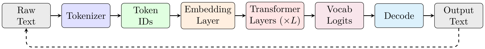

**Figure 1.1: LLM 流水线：文本被分词为子词单元，转换为整数ID，嵌入为稠密向量，经Transformer 层处理，投影到词表logits，最后解码回文本。虚线回路展示自回归生成——每个输出Token 被追加到输入中作为下一次前向传播的输入。**

四个关键阶段

1. 分词（Tokenization）：使用学习得到的词表将原始文本切分为子词片段（既非字符也非完整单词）。“unhappiness”可能被切为[“un”, “happiness”] 或[“unhapp”, “iness”]。

2. 嵌入（Embedding）：每个Token ID 索引到一张学习得到的嵌入表中，产生Rd（通常d = 4096）中的稠密向量。这些向量捕捉语义含义——相似的词获得相似的向量。

3. 上下文处理：Transformer栈并行处理所有嵌入，通过自注意力让每个位置“读取” 所有其他位置。经过L 层之后，每个位置的隐藏状态编码了丰富的上下文信息。

4. 预测：最终的隐藏状态被投影为整个词表上的概率分布，由解码策略选择下一个Token。

## 1.2 分词（Tokenization）

分词（Tokenization）是将原始文本转换为语言模型所操作的离散符号的关键第一步。分词器的选择直接影响模型质量、多语种能力和计算效率。


**Table 1.1: 不同分词粒度的权衡。**

| 粒度 |  |  |
| --- | --- | --- |
| 词表大小 | 序列长度 | 问题 |
| 字符 |  |  |
| ∼256 | 极长 | 注意力开销O(n2)；难以学习长程语义 |
| 词 |  |  |
| ∼500K+ | 短 | 无法处理稀有/新词；嵌入表巨大 |
| 子词 |  |  |
| 32K–128K | 适中 | 最佳权衡：短序列、开放词表 |

### 1.2.1 为什么不用字符或词？

### 1.2.2 字节对编码（Byte-Pair Encoding，BPE）

字节对编码（Byte-Pair Encoding，BPE）[24] 是GPT、Llama、Mistral 以及大多数现代LLM 采用的主流分词算法。

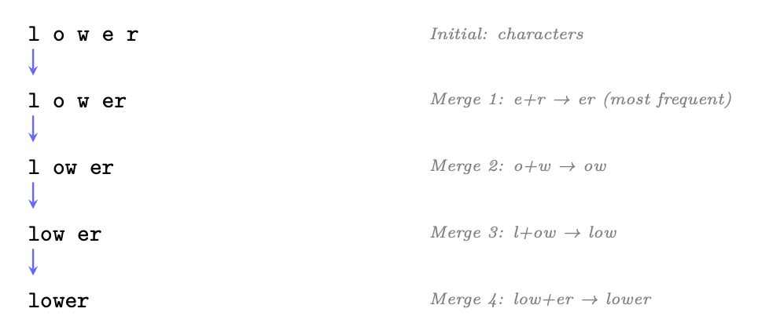

**Figure 1.2: BPE 分词示例：从字符开始，算法迭代地合并出现频率最高的相邻对，直到该词成为单个Token 或词表预算耗尽。**

### 1.2.3 其他分词方法

**Table 1.2: 子词分词算法对比。**

| 方法 | 使用者 | 核心思想 |
| --- | --- | --- |
| BPE | GPT-4 [23], Llama-3 [25], Mis- tral [26] | 自底向上合并频繁对；确定性 |
| WordPiece | BERT [27], DistilBERT [28] | 类似BPE，但最大化训练数据似然 |
| Unigram LM | SentencePiece | 自顶向下：从大词表开始，按似然 影响剪枝 |
| 字节级BPE（Byte-level BPE） | GPT-2 [29]+ | 在原始字节上做BPE（不可能出现 未知Token）；256 个基础词 |

### 1.2.4 分词最佳实践

1. 词表大小很重要：32K是最低限度；128K 能提供更好的多语种覆盖和代码处理能力。Llama-3使用128K Token。

2. 特殊Token：始终包含<bos>、<eos>、<pad>、<unk>。对于指令微调模型，需添加角色标记（<|user|>、<|assistant|>）。

3. 繁殖度（Fertility）：度量各语种的每词Token 数。高繁殖度（每词产生很多Token）表示对该语种的覆盖较差。

4. 切勿跨边界分词：空格、标点和数字应一致处理。大多数现代分词器会在前面添加空格标记（如“the”）以区分词首Token 与词中续接Token。

5. 数字：对算术任务考虑数字级分词。“2024”切为[“2”,“0”,“2”,“4”] 可以支持逐位推理。

6. 代码：确保高效地分词空白（缩进）。Llama-3将连续空格分词为单个Token。

### 1.2.5 分词实战：HuggingFace 示例

transformers 库为所有分词器提供了统一接口。以下演示了使用现代LLM 分词器进行编码和解码：

```
from transformers import AutoTokenizer
# 加载Llama -3 分词器（128K 词表，字节级BPE ）
tokenizer = AutoTokenizer.from_pretrained("meta-llama/Meta-Llama -3-8B")
text = "Reinforcement learning optimizes long-term rewards."
# 编码：文本-> Token ID
token_ids = tokenizer.encode(text)
print(token_ids)
# [128000, 29934, 262, 11008, 4815, 6900, 1317, 9860, 21845, 13]
# 将单个Token 解码以查看子词切分
tokens = tokenizer.convert_ids_to_tokens(token_ids)
print(tokens)
# ['<|begin_of_text|>', 'Re', 'inforce', 'ment', ' learning',
# ' optimizes', ' long', '-term', ' rewards', '.']
# 解码回文本（双向往返）
reconstructed = tokenizer.decode(token_ids , skip_special_tokens=True)
assert reconstructed == text # 完美重建
# 带注意力掩码的分词（用于带padding 的批量输入）
batch = tokenizer(
["Short text.", "A much longer input sentence for comparison."],
padding=True, return_tensors="pt"
```

```
)
print(batch.keys()) # dict_keys(['input_ids', 'attention_mask '])
```

Listing 1.1: 使用HuggingFace Transformers 进行分词的编码/解码。

### 1.2.6 特殊Token 与结构化提示

特殊Token 是保留的词表条目，承载结构性含义而非语言内容。它们对控制模型行为至关重要。

**Table 1.3: 各类LLM 中常见的特殊Token。**

| Token | 别名 用途 标记序列开始 |
| --- | --- |
| <bos> / <|begin_of_text|> | BOS |
| <eos> / <|end_of_text|> | EOS 标记序列结束；停止生成 标记对话中用户轮次的开始 |
| <|user|> | — |
| <|assistant|> | — 标记对话中助手轮次的开始 将批次填充到统一长度；在注意力中被掩盖 |
| <pad> | PAD |
| <unk> | UNK 词表外占位符（在BPE 中很少出现） |
| [SEP] | SEP 分隔片段（BERT 风格） |
| [CLS] | CLS 分类Token（BERT） |
| [MASK] | MASK 用于掩码语言模型（MLM）预训练的掩码Token |

指令微调模型的角色标记。现代对话模型使用特殊Token 来界定对话结构。它们并非被训练来承载语义含义——而是结构分隔符，模型学习去解析它们：

```
# Llama -3 对话模板
messages = [
{"role": "system", "content": "You are a helpful assistant."},
{"role": "user", "content": "Explain PPO in one sentence."},
]
# apply_chat_template 处理所有特殊Token 的插入
prompt = tokenizer.apply_chat_template(messages , tokenize=False)
print(prompt)
# <|begin_of_text|><|start_header_id|>system <|end_header_id|>
#
# You are a helpful assistant.<|eot_id|><|start_header_id|>user <|end_header_id|>
#
# Explain PPO in one sentence.<|eot_id|><|start_header_id|>assistant <|end_header_id|>
#
#
```

Listing 1.2: 带特殊Token 的对话模板（Llama-3 格式）。

#### 特殊Token 最佳实践

- 切勿拆分特殊Token：它们必须是原子单位——确保分词器将其视为单个单元，而非字符序列。

- 对特殊Token 屏蔽损失：在SFT 期间，不要对结构性Token（角色标记、分隔符）计算损失。模型不应“学习” 预测格式本身。

- 用模板表达结构：通过特殊Token 而非自然语言指令编码任务语义。例如，<|tool_call| > 比“Now I will call a tool:” 更可靠。

- 工具/函数调用：定义专用Token，如<|function|>、<|result|>，以在推理与动作之间建立无歧义的边界。

- RL 中的一致处理：在PPO/GRPO 期间，确保参考模型与策略模型使用相同的分词和特殊Token 处理——不一致会破坏KL 计算。


## 1.3 Transformer 架构

Transformer [6] 是所有现代LLM 的基础。理解其组件对于把握本指南中的每种优化和训练方法都至关重要。

### 1.3.1 整体结构

仅解码器（decoder-only）的Transformer 依次通过嵌入层、重复的注意力+FFN 块以及最终对词表logits 的投影来处理Token。图1.3 展示了完整架构。

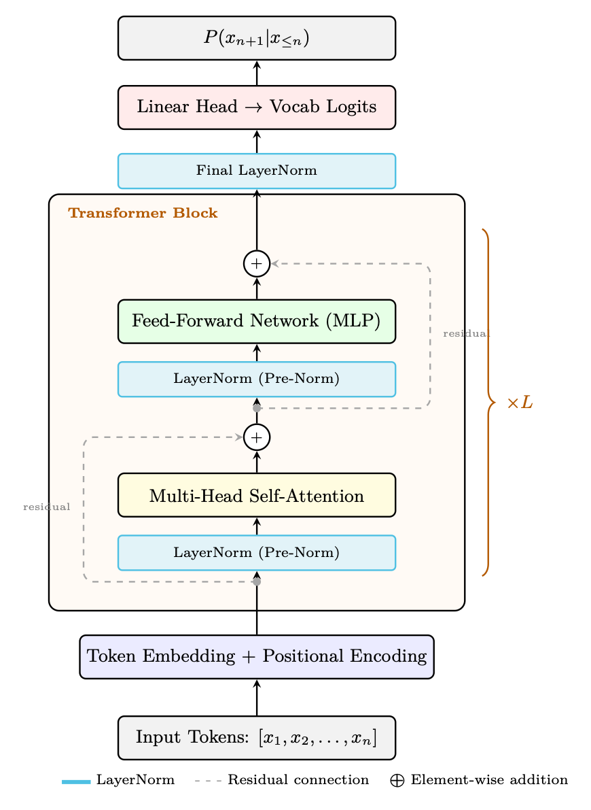

**Figure 1.3: 仅解码器Transformer 块（GPT 风格，Pre-Norm 变体）。每个子层（注意力、FFN）之前先经过LayerNorm，之后接残差相加：x + SubLayer(LN(x))。这种Pre-Norm 顺序（被Llama、GPT-3、Mistral采用）在无需warmup 的情况下稳定训练，不同于原始的Post-Norm（在相加之后应用LayerNorm）。L 个相同的块被堆叠，之后是一个最终的LayerNorm 和到词表logits 的线性投影。**

### 1.3.2 原始的编码器-解码器Transformer

Transformer 最初被提出[6] 时是一种用于序列到序列任务（机器翻译、摘要）的编码器-解码器架构。尽管现代LLM 主要使用仅解码器变体（GPT 风格），理解完整架构仍然至关重要，因为交叉注意力和带掩码的自注意力——两者都起源于此——仍是基础构建模块。

编码器（Encoder）。编码器双向地处理整个输入序列——每个Token 关注所有其他Token（无因果掩码）。这产生了丰富的上下文表征Henc ∈Rn×d，其中每个位置都编码了关于整个输入的信息：

- 输入：Token嵌入+ 正弦位置编码

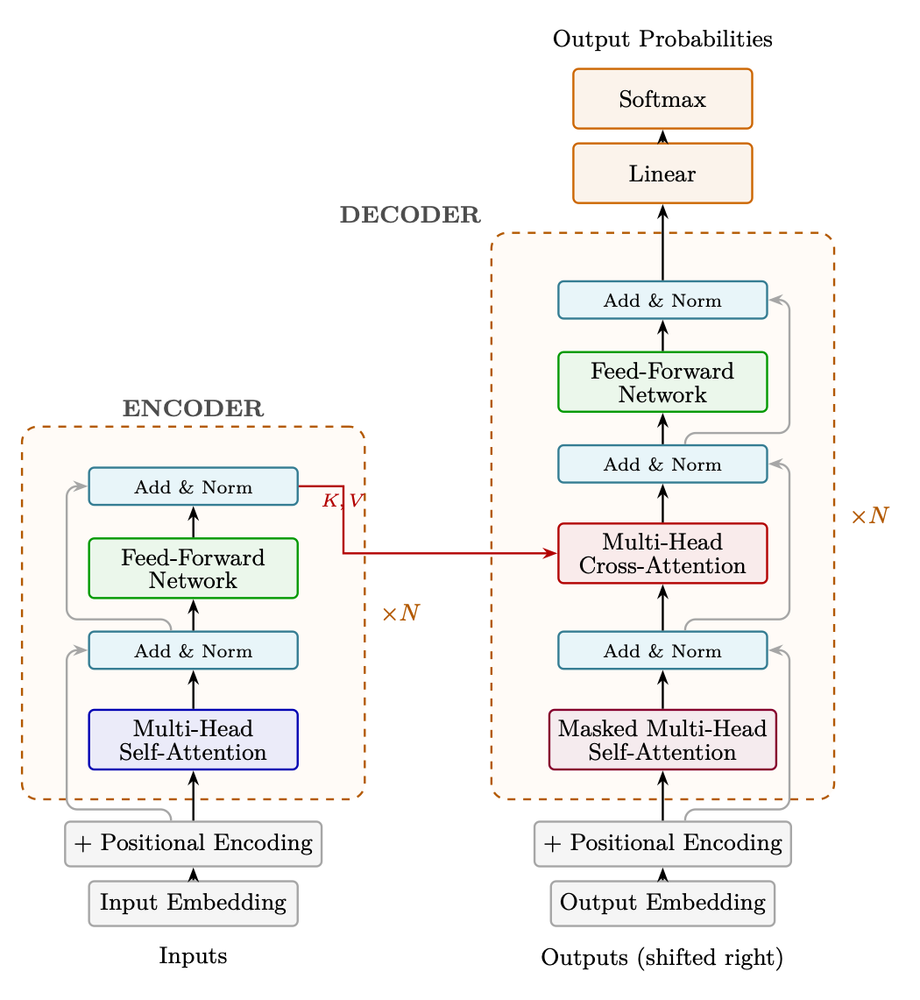

**Figure 1.4: 原始Transformer 架构（Vaswani 等，2017）。编码器（左）通过双向自注意力处理整个输入。解码器（右）使用带掩码的自注意力以及对编码器表征的交叉注意力来自回归生成Token。虚线框表示重复的层块（×N）；灰线表示绕过每个子层的残差连接。注意：原始工作使用Post-Norm（LayerNorm 在残差相加之后应用：LN(x + SubLayer(x))），不同于现代LLM 使用Pre-Norm。**

- 每一层：多头自注意力→Add & Norm →FFN →Add & Norm

- 无因果掩码：位置i 关注所有位置1, . . . , n

- 输出：整个输入序列的上下文表征

解码器——带掩码的多头自注意力。解码器一次生成一个输出Token（自回归地）。为了防止模型

!

QKT MaskedAttn(Q, K, V ) = softmax √dk + M V (1.1)

其中掩码M 为：( if i ≥j (can attend) Mij = −∞ if i < j (future token — blocked)


解码器——交叉注意力。在带掩码的自注意力之后，每个解码器层应用交叉注意力（cross-

!

QdecKT CrossAttn(Qdec, Kenc, Venc) = softmax √dk enc Venc (1.2)

- Query 来自解码器之前的子层（带掩码自注意力的输出）

- Key 和Value 来自编码器的最终输出Henc

- 不应用掩码——每个解码器位置可以关注每个编码器位置

- 这使得解码器在每个生成步骤可以动态聚焦于输入的不同部分（例如，在英语→西班牙语翻译中，生成“gato” 时关注“cat”）

完整的解码器层。每个解码器层包含三个子层（编码器只有两个）：

1. 带掩码的多头自注意力+残差+ LayerNorm

2. 多头交叉注意力（对编码器输出）+ 残差+ LayerNorm

3. 前馈网络（Feed-Forward Network）+残差+ LayerNorm

从编码器-解码器到仅解码器。现代LLM（GPT、Llama、Qwen）只使用解码器，完全移除了编码器和交叉注意力层。关键洞察：对于生成式语言建模，单个因果（掩码）自注意力栈就足够了——模型在单次传递中学会编码上下文并生成后续内容。这简化了架构、训练和推理，并且更有效地扩展规模。编码器-解码器模型（T5、BART）对于具有明确输入/输出结构的任务（翻译、摘要）仍然有意义，而交叉注意力在多模态模型中再次出现，其中视觉编码器为语言解码器提供Key/Value。

### 1.3.3 仅解码器vs 编码器-解码器

现代LLM 几乎只使用仅解码器架构，但理解与编码器-解码器设计的权衡有助于阐明原因。

架构示例使用场景

仅解码器GPT-4 [23], Llama [25], Mistral [26],自回归生成；在对话/推理领域占主导Qwen [30]编码器-解码器T5 [31], BART [32], Flan-T5 [33] Seq2seq（翻译、摘要）；现在较少使用仅编码器BERT [27], RoBERTa [34]分类/嵌入；不用于生成


### 1.3.4 嵌入：从离散Token 到连续空间

在任何注意力或计算发生之前，Transformer 必须将离散的Token ID 转换为神经网络可处理的连续向量。这就是嵌入层（embedding layer）的作用。

什么是嵌入？嵌入是一个离散符号的学习得到的稠密向量表示。我们不再把单词“king” 表示为大小为|V| = 128,000 的独热向量（大部分为零），而是表示为Rd（例如d = 4096）中一个紧凑的向量，捕捉其含义。

关键洞察：相似的概念得到相近的向量。在一个训练良好的嵌入空间中：

- “king” 和“queen” 接近（都是王室）

- “king” 和“bicycle” 距离很远（无关）

- 向量运算捕捉关系：⃗ king − man + ⃗ woman ≈ ⃗ queen ⃗

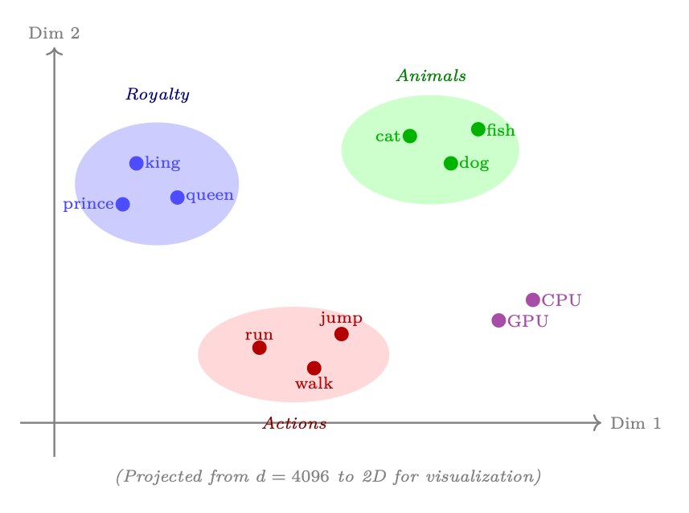

**Figure 1.5: 嵌入空间可视化（二维投影）：语义相似的词聚集在一起。嵌入表在预训练期间学习这些位置，纯粹从文本中的共现模式中捕捉含义。**

嵌入表。在实践中，嵌入层就是一个矩阵E ∈R|V|×d，其中第i 行存储Token i 的嵌入向量：

embed(xt) = E[xt] ∈Rd (1.3)

对于一个Token ID 序列[x1, x2, . . . , xn]，嵌入只是一个简单的表查询（索引操作）：

#### H0 = [E[x1]; E[x2]; . . . ; E[xn]] ∈Rn×d

#### Transformer 中的嵌入表

- 尺寸：|V| × d。对于Llama-3：128,256 × 4,096 = 525M 参数（占8B 模型的6.5%）。

- 初始化：随机（Xavier/正态分布），然后通过反向传播学习。

- 权重共享（Weight tying）：许多模型共享嵌入矩阵与输出投影头：Whead = ET 。这节省

参数并创建对称的编码-解码结构。

- 输入：Token ID（整数）→输出：Rd 中的稠密向量。

- 梯度流：在训练期间，只有当前批次中Token 对应的行接收梯度更新（稀疏更新）。


各向异性（anisotropy）问题。当使用预训练嵌入（例如来自BERT 或GPT-2）用于下游任务（如检索RAG 或推荐系统冷启动）时，会出现一个关键问题：学习到的表征高度各向异性（anisotropic）

- —它们占据嵌入空间中一个狭窄的锥形区域，而非均匀分布在所有方向上[36]。

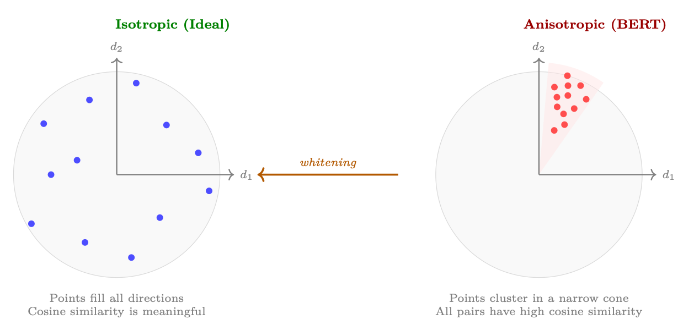

**Figure 1.6: 嵌入空间中的各向同性（isotropy）与各向异性（anisotropy）。左：各向同性的嵌入均匀分布，使余弦相似度成为可靠的语义相关性度量。右：各向异性的嵌入（如BERT 中观察到的）聚集在狭窄的锥形内，导致所有对的余弦相似度都很高，无论语义内容如何。白化（whitening）变换空间以恢复各向同性。**

这为何对应用很重要：

- RAG / 检索：如果所有嵌入无论内容如何余弦相似度都> 0.7，检索排名几乎成为随机——系统无法区分相关与不相关的段落。

- 推荐系统：使用预训练LLM 嵌入来表示物品/用户，只有在几何结构保留了有意义的相似性结构时才有效。

- 聚类：各向异性的嵌入使聚类塌缩，无法发现自然分组。

解决方案：白化（whitening）。一个简单有效的解决方法是白化（whitening）[37]——一种使嵌入分布变得各向同性（零均值、单位协方差）的线性变换：

(1.4)

其中µ 是平均嵌入，UDUT 是协方差矩阵Σ = 1 P i(hi −µ)(hi −µ)T 的特征分解。

N白化的实践

- 作用：旋转并缩放嵌入空间，使所有方向具有相等的方差（单位协方差）。

- 效果：余弦相似度变得有意义——语义相似的对得分高，不相似的对得分低。

- 额外好处：可以同时通过仅保留前k 个特征向量来降维（类似PCA），使检索更快。

- 成本：需要在一个代表性语料上计算协方差矩阵（一次性，O(N · d2)）。变换本身在推理时只是简单的矩阵乘法。

- 替代方法：对比微调（SimCSE）、基于flow 的归一化，或使用促进各向同性的正则项进行训练。

### 1.3.5 自注意力机制

自注意力是核心操作，它允许每个Token 关注序列中的每一个其他Token，基于相关性计算加权组合。

给定输入序列X ∈Rn×d，我们计算：

Q = XWQ, K = XWK, V = XWV (WQ, WK, WV ∈Rd×dk)

!

QKT Attention(Q, K, V ) = softmax √dk + M V

其中M 是因果掩码（用于自回归模型）：若i ≥j 则Mij = 0，否则为−∞。

直觉：每个Token“关注” 所有先前的Token，基于query-key 相似度计算其value 的加权平均。

计算复杂度。朴素的注意力计算在序列长度上具有平方代价：

- 时间：O(n2 · d)——计算QKT 需要n2 个点积，每个维度为dk。

- 内存：O(n2)——必须物化完整的注意力矩阵才能应用Softmax。

对于一个d = 4096 的128K Token 上下文，仅注意力矩阵就是128K × 128K = 164 亿个元素（FP32 下为64 GB）。这种平方扩展是长上下文LLM 的根本瓶颈。

**Table 1.4: 注意力代价的扩展：为何朴素实现对长序列不可行。**

| 序列长度 | 注意力操作数 | 矩阵大小 实际影响 |
| --- | --- | --- |
| 2K | 4M | 16 MB 快速；可放入SRAM |
| 8K | 64M | 256 MB 用FlashAttention 可应对 |
| 32K | 1B | 4 GB 需要内存高效内核 |
| 128K | 16B | 64 GB 超出单块GPU 的HBM |
| 1M | 1T | 4 TB 不使用次平方方法则不可行 |

驯服注意力代价的方法。有几类方案可以应对这种平方瓶颈：

1. 具备IO 感知的精确注意力（FlashAttention [7]）：不降低计算复杂度，但通过将注意力计算分块到能放入SRAM 的瓦片中，消除了在HBM 中物化n × n 矩阵的需要。关键的是，FlashAttention 与下面的稀疏模式正交——它是一种执行引擎，而非注意力模式。生产系统通常将FlashAttention 与滑动窗口或块稀疏掩码结合使用，同时获得IO 效率和FLOPs 减少。

我们在第1.6 节详细介绍该算法。

2. 滑动窗口/ 局部注意力：每个Token 只关注最近的w 个Token（例如w = 4096）。代价变为O(n · w)——在n 上是线性的。被Mistral [26]（窗口= 4096）和Longformer [38] 采用。以全局上下文换效率；之所以有效，是因为实践中大部分注意力是局部的。在现代技术栈中，滑动窗口掩码在FlashAttention 内核内部执行。

3. 稀疏注意力模式：将局部窗口与周期性的全局Token 结合（例如，每隔512 个Token 关注全部）。BigBird [39] 和LongT5 [40] 使用此方法。以O(n√n) 代价保留一些长程连通性。同样，

FlashAttention 作为非零注意力块的底层内核。

4. 线性注意力/ 状态空间模型：利用结合律将softmax(QKT )V 替换为ϕ(Q)(ϕ(K)T V )，或重

构为递归形式（Mamba [41]、RWKV [42]）。理论上总代价为O(n · d2)。与上面方法2–3 不同，这些是架构上的替换，改变了模型的表达能力——无Softmax 的注意力本质上表达力更弱，经验上这些模型在需要精确长程检索或复杂推理的任务上仍然落后于Transformer。

5. KV 缓存压缩：在推理时，压缩或驱逐旧的KV 对以限制内存。技术包括：H2O [43]（重击者预言机——只保留高注意力的Key）、StreamingLLM [44]（保留初始“注意力陷阱（Attention Sink）”Token + 最近窗口），以及量化KV 缓存[45]。

一个常见误解是FlashAttention 是稀疏注意力的替代。事实并非如此——它是注意力内核的IO优化，可以与任何注意力掩码自由组合。现代生产系统（如Mistral、DeepSeek）使用FlashAttention作为滑动窗口或块稀疏掩码底层的执行引擎。这同时为你带来FLOPs 的减少（来自稀疏性）和最优的内存访问模式（来自瓦片化）。RingAttention [46] 将其进一步扩展到多设备场景，沿序列维度将瓦片化的计算分布到多块GPU 上。

线性注意力和状态空间模型（Mamba、RWKV）是一种真正不同的架构选择——它们为了O(n)计算而牺牲完整的成对交互。虽然理论上优雅，它们在知识密集或长程推理任务上仍未达到Transformer 的质量，前沿实验室继续使用精确注意力（结合FlashAttention + 稀疏性）作为骨干。

### 1.3.6 多头注意力

多头注意力不是计算单一的注意力函数，而是并行运行多个注意力操作，每个都学习聚焦于输入的不同方面（句法、语义、位置等）。

不使用一个d 维Key/Value 的注意力函数，而是使用H 个维度为dk = d/H 的并行头：

MultiHead(X) = Concat(head1, . . . , headH)WO

每个头可以学习不同的注意力模式（例如，一个头处理句法，另一个处理语义，再一个处理位置邻近性）。

分组查询注意力（Grouped Query Attention，GQA）：Llama-3 [25] 使用比Q 头更少的K、V 头（例如，8 个KV 头被32 个Q 头共享）。这将KV 缓存大小减小4×，质量损失极小。

### 1.3.7 位置编码

Transformer 在构造上是置换等变的——没有位置信息，模型无法区分“the cat sat on the mat” 和“mat the on sat cat the”。位置编码注入序列顺序信号，使注意力能够推理Token 的距离和方向。

**Table 1.5: 现代LLM 中的位置编码方法。**

| 方法 | 使用者 | 核心思想 |
| --- | --- | --- |
| 正弦（Sinusoidal） | 原始Transformer | 不同频率的固定sin / cos。无需学习。 |
| 学习的绝对位置 | GPT-2 [29], BERT [27] | 每个位置的学习嵌入。受限于训练长度。 |
| RoPE | Llama [25], Qwen [30], Mistral [26] | 将Q、K 向量按位置相关的角度旋转。通 过NTK 感知缩放进行外推。 |
| ALiBi | BLOOM [47], MPT [48] | 不使用位置嵌入；在注意力分数上添加线 性偏置−m|i −j|。简单，外推性好。 |

正弦（固定）位置编码。原始Transformer [6] 中提出，该方法在几何间隔的频率上使用固定的正弦函数： pos   pos  PE(pos, 2i) = sin , PE(pos, 2i+1) = cos 100002i/d 100002i/d

其中pos 是Token 位置，i 是维度索引，d 是模型维度。

动机：每个频率以不同尺度编码位置（类比二进制计数）。作者假设模型可以学会关注相对位置，因为PE(pos + k) 可以表示为PE(pos) 的线性函数。

优点：零学习参数；确定性；理论上支持任意长度。

缺点：实践中外推超出训练长度时表现不佳；模型必须间接地从绝对信号中学习解码相对位置；已大体被取代。

学习的绝对位置嵌入。被GPT-2 [29] 和BERT [27] 采用：一个可学习的嵌入矩阵Epos ∈RLmax×d被加到Token 嵌入上：h(pos) = TokenEmbed(xpos) + Epos[pos]

动机：让模型自己学习对任务最优的位置表示，而不是强加一个固定结构。

优点：最大的灵活性；实现简单；对短序列通常优于正弦编码。

缺点：硬编码的最大长度Lmax；无法泛化到其之外；Lmax 末尾附近的嵌入训练不足；增加Lmax × d 个参数。

旋转位置编码（Rotary Position Embedding，RoPE）。RoPE [49] 通过在2D 子空间中旋转Query 和Key 向量来编码位置：

 x(1)     −x(2)    m cos mθ1 m sin mθ1

RoPE(xm, m) =         x(d−1) x(2) m m ...         ⊙        cos mθd/2 cos mθ1 ...        +         −x(d) x(1) m ... m         ⊙        sin mθd/2 sin mθ1 ...       

x(d) cos mθd/2 x(d−1) sin mθd/2 m m

其中θi = 10000−2i/d，m 是位置索引。关键性质是：旋转后的Query 与Key 之间的点积只依赖于相对位置：⟨RoPE(qm, m), RoPE(kn, n)⟩= f(qm, kn, m −n)

动机：在无需显式偏置项的情况下实现相对位置编码，同时保持与线性注意力和KV 缓存的兼容性。

优点：天然相对；无额外参数；与高效推理兼容；可以通过NTK 感知缩放[50] 或YaRN（调整θ 基数或插值频率）扩展到更长的上下文。

缺点：每次注意力操作的计算略多（旋转+ 交错）；外推需要显式的缩放策略；在2D 子空间中的旋转施加了一种结构，对所有任务未必最优。

将训练在L 长度上的RoPE 模型扩展到上下文长度L′ > L：

- 位置插值（Position interpolation）：将位置按L/L′ 缩放，使所有位置落在[0, L] 内。简

单但压缩了分辨率。

- NTK 感知缩放：增大θ 基数（例如10000 →10000 · (L′/L)d/(d−2)），有效地拉伸高频成分，同时保留低频成分。

- YaRN [50]：将NTK 缩放与注意力温度校正t = 0.1 ln(s) + 1 结合，以补偿更长距离上熵的增加。

ALiBi（带线性偏置的注意力，Attention with Linear Biases）。ALiBi [51] 采取了根本不同的方法：完全不使用位置嵌入。取而代之，从注意力分数中减去一个静态的线性惩罚：!

QKT |i −j|  Attention(Q, K, V ) = softmax √dk −m ·V i,j

其中m 是头特定的斜率（几何设置：对总共H 个头中的第h 个头取mh = 2−8h/H）。偏置−m|i−j|创建了一个软局部注意力窗口，其宽度因头而异。

动机：位置应使注意力偏向邻近Token（近因先验），同时不干扰嵌入空间。通过纯粹在注意力分数空间中操作，ALiBi 避免了用位置信号污染Token 表征。

优点：出色的长度外推（在1k 上训练，在8k+ 仍可用）；零参数；实现极简；头特定的斜率提供多尺度局部性。

缺点：对需要精确长程位置推理的任务（如“第5 个词是什么？”）表达力较弱；线性衰减是一种强归纳偏置，可能不适合所有领域；由于RoPE 在短上下文上表现更好，最近的模型中已大体被RoPE 取代。

**Table 1.6: 位置编码对比：实际权衡。**

| 正弦（Sinusoidal） |  |  |
| --- | --- | --- |
| 学习绝对位置 | RoPE | ALiBi |
| 额外参数 |  |  |
| 无 |  |  |
| Lmax × d | 无 | 无 |
| 位置类型 |  |  |
| 绝对 |  |  |
| 绝对 | 相对 | 相对（隐式） |
| 长度外推 |  |  |
| 差 |  |  |
| 无 | 好（带缩放） | 优秀 |
| 计算开销 |  |  |
| 可忽略 |  |  |
| 可忽略 | 小 | 可忽略 |
| 主导时期 |  |  |
| 2017–19 |  |  |
| 2018–20 | 2022–至今 | 2022–23 |

扩展到极长上下文（100K–1M+ Token）。现代前沿模型（Claude [52] 拥有200K–1M 上下文、Gemini 1.5 [53] 达到1M+、GPT-4 [23] 128K）需要在远超训练长度时仍然忠实的位置编码。当今的主流解决方案：

1. 带频率缩放的RoPE：将RoPE 扩展到训练长度之外的标准方法。无需重新训练，对基础频率θ 进行重新缩放：Ltarget 2i/d θ′ i = θi ·Ltrain

变体包括：

- 线性缩放（位置插值）[54]：简单地将位置索引除以因子s。便宜但在高扩展比时降低质量。

- NTK 感知缩放[50]：缩放基础频率θ = 10000 →10000 · sd/(d−2)。保留高频（局部）信息的同时扩展低频（全局）范围。

- YaRN [50]（Yet another RoPE extensioN）：将NTK 缩放与注意力温度校正以及在一个小型长上下文语料上的微调结合。Llama-3 用它将8K 训练扩展到128K 部署。

- 动态NTK（Dynamic NTK）[50]：在推理时根据实际序列长度即时调整缩放因子。无需固定扩展比——模型随上下文增长而适应。

2. 在长数据上继续预训练：即使使用RoPE 缩放，模型也能从在长文档上的短期继续预训练阶段（1–5B Token）中受益。这教会模型真正地使用远距离上下文，而不仅是在位置上容忍它。

Llama-3.1 使用渐进式计划：8K →64K →128K。

3. Ring Attention / 分块并行[46]：对于超出单GPU 内存的序列（1M+ Token），Ring Attention 以环形拓扑将序列分布在GPU 之间。每块GPU 持有一个块并在环上传递KV 块，计算局部注意力瓦片。这使内存能够随GPU 数量线性扩展，同时保留精确注意力。

4. 混合架构：一些系统将大多数层的局部滑动窗口（例如4K）与选定层（如每4 层一次）的全注意力结合。这为大部分计算提供O(n · w) 代价，同时维持全局信息流。

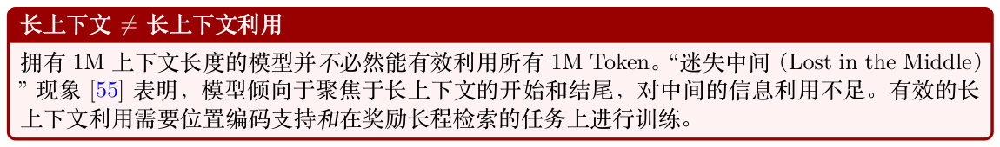

### 1.3.8 前馈网络（MLP）

每个Transformer 块包含一个独立应用于每个位置的MLP：

FFN(x) = W2 · σ(W1x + b1) + b2

其中W1 ∈Rd×4d，W2 ∈R4d×d。现代LLM 使用：

- SwiGLU 激活：FFN(x) = W2(Swish(W1x) ⊙W3x)——被Llama [25]、Mistral [26] 采用。需要3 个权重矩阵，但带来更好的性能。

- 隐藏维度通常为8/3 × d（取整到256 的倍数以适配Tensor Core 效率）。


### 1.3.9 层归一化（Layer Normalization）

层归一化通过在特征维度上对激活进行归一化来稳定训练。它相对于注意力/FFN 子层的位置显著影响训练动态。

LayerNorm 如何工作。给定一个隐藏状态向量x ∈Rd（单个Token 的表征），LayerNorm [57]计算：

LayerNorm(x) = γ ⊙ √ σ2 + ϵ + β (1.5)

其中：

Pd

- µ = 1 i=1 xi（在d 个特征维度上的均值）d

- σ2 = 1 Pd i=1(xi −µ)2（在特征上的方差）d

- γ, β ∈Rd 是学习的缩放和平移参数（按维度）

- ϵ ≈10−5 防止除以零

与BatchNorm 的关键区别：LayerNorm 在单个样本的特征维度上归一化，而非跨批次。这使其独立于批次大小，并在训练和推理时表现一致。

RMSNorm——现代简化版。均方根归一化（Root Mean Square Normalization，RMSNorm）[58]去掉了均值中心化步骤，仅按均方根归一化：

v u x u t1 X d RMSNorm(x) = γ ⊙ RMS(x), RMS(x) = x2 (1.6) d i i=1

没有β（平移）参数，也没有均值减法——只有缩放。这每个Token 节省一次归约操作，在GPU 上快约5–10%，同时保持等同的模型质量。所有现代LLM（Llama、Mistral、Qwen）都使用RMSNorm。

#### Pre-LN vs Post-LN

- Post-LN（原始Transformer）：h + LayerNorm(Attn(h))。需要仔细的warmup；训练可能不稳定。

- Pre-LN（GPT-2+，所有现代LLM）：h + Attn(LayerNorm(h))。稳定训练；允许更高的学习率。

- RMSNorm（Llama [25], Mistral [26]）：不带均值中心化的简化LayerNorm：RMSNorm(x) = x/RMS(x) · γ。稍快，同等质量。

为什么归一化对深度网络很重要

没有归一化，激活倾向于在层之间指数增长或收缩（爆炸/消失激活）。一个无LayerNorm 的128层Transformer 在第一层和最后一层之间，量级会变化1030×。归一化将每层输出约束在可预测的范围内，使梯度流动稳定，并允许优化器在整个网络中使用一致的学习率。

### 1.3.10 模型规模参考

下表总结了广泛使用的开放权重模型（截至2025 年的最新版本）的关键架构参数，为理解规模和设计选择提供了快速参考。

**Table 1.7: 流行开放权重LLM 的架构参数（2024–2025 代）。**

| 模型 | 参数 | 层数 | d | 头数 | KV 头数 上下文 |
| --- | --- | --- | --- | --- | --- |
| Llama-3.1 8B [25] | 8B |  |  |  | 128K |
| Llama-3.1 405B [25] | 405B |  |  |  | 128K |
| Llama-4 Maverick [59] | 400B (17B 活跃) |  |  |  | 1M |
| Mistral Large 2 [60] | 123B |  |  |  | 128K |
| Qwen-2.5 72B [30] | 72B |  |  |  | 128K |
| DeepSeek-V3 [61] | 671B (37B 活跃) |  |  |  | MLA 128K |
| 注：标注“活跃” 参数的模型使用混合专家（Mixture-of-Experts，MoE）架构——总参数表示模 |  |  |  |  |  |
| 型容量，而活跃参数反映每个Token 的计算代价。DeepSeek-V3 使用多头潜注意力（Multi-head |  |  |  |  |  |
| Latent Attention，MLA）而非标准GQA，将KV 压缩到低秩潜空间中。 |  |  |  |  |  |

### 1.3.11 注意力病态

虽然注意力机制功能强大，但它表现出实践者必须理解的系统性失败模式——特别是在扩展到长上下文或解释模型行为时。

现象。Xiao 等[62] 发现Transformer 模型对序列中的第一个Token 分配了不成比例的高注意力分数——无论其语义内容如何。即使第一个Token 是无意义的<BOS> 标记，所有层中的注意力头都持续地关注它，有时占总注意力质量的20–50%。

Softmax 注意力必须产生有效的概率分布（P为什么会发生。j αj = 1）。当没有Key 对Query 特别相关时，模型需要一个“倾倒” 位置来安放未使用的注意力质量。在训练期间，第一个Token 成为这个默认陷阱，因为它总是存在且在位置上可预测。它作为一个无操作的注意力目标——模型已经学会将不相关的注意力路由到那里，而不是不可预测地分配它。

√ exp(q⊤k0/ d) ≫1 αsink = P √ (even when k0 is semantically irrelevant) j exp(q⊤kj/ d) n

后果。

- 流式推理失败：使用滑动窗口KV 缓存时，驱逐第一个Token 会导致困惑度灾难性地飙升

- —模型失去了它的注意力陷阱。

- 误导性的可解释性：朴素的注意力可视化暗示第一个Token“重要”，而实际上它只是一种数学伪影。

- 上下文窗口浪费：陷阱Token 占用一个KV 缓存槽位，却不携带有用信息。

解决方案。

- StreamingLLM [62]：始终在KV 缓存中保留前k 个Token（“注意力陷阱”）以及最近的滑动窗口。在有界内存下实现无限长度生成。

- 设计上的陷阱Token：一些模型（如Mistral）在训练期间预置专门的陷阱Token，明确用于吸收残余注意力。

- Softmax 替代：用ReLU 注意力或Sigmoid 门控替换Softmax，使零注意力可以表示而无需倾倒目标。

现象。随着序列长度n 增长，每个Query 必须将其注意力预算分配到更多Key 上。每个Token的平均注意力权重以O(1/n) 下降，使得模型越来越难以集中在少数真正相关的位置上——这个问题被称为注意力稀释（attention dilution）或注意力扩散（attention diffusion）[55]。

“迷失中间（Lost in the Middle）” 效应。Liu 等[55] 表明LLM 表现出U 形检索曲线：放在长上下文开始或结尾的信息被可靠地检索，但中间的信息常常被忽略。这是注意力稀释叠加RoPE/ ALiBi 位置偏差的直接后果：

为什么会发生。

- Softmax 饱和：在Key 很多时，Softmax 温度有效降低，使分布更加均匀（熵化）。

- 位置衰减：RoPE的相对位置编码引入了一种随距离的自然衰减，抑制了对距离开始和结尾都较远的中间位置的注意力。

- 训练分布：在较短序列上训练的模型形成了偏向近期上下文的注意力模式。

缓解策略。

- 显式检索：将相关上下文放在提示的开始或结尾；使用RAG 来避免依赖中间位置。

- 长上下文训练：在关键信息位置多样化的长文档上训练[63]。

- 层次化注意力：如Mamba [64] 或RWKV 等完全避免O(n2) 注意力瓶颈的架构。

- 地标Token（Landmark tokens）：在上下文中插入可检索的标记，作为注意力的“路标”。

- 温度缩放：一些实现将注意力logits 按log n 缩放，以抵消长序列中的稀释。

其他注意力现象

**Table 1.8: 在大型Transformer 中观察到的其他注意力模式。**

| 模式 | 描述 | 影响 |
| --- | --- | --- |
| 注意力头专门化 | 不同头学习不同角色：句法头、共 指头、位置头[65] | 并非所有头都同等重要；很多可 以被剪枝 |
| 归纳头（Induction heads） | 实现[A][B]...[A] →[B] 复制的 头[66] | 对上下文学习至关重要；在2 层 及以上的模型中涌现 |
| 注意力塌缩（Attention collapse） | 在深度网络中，注意力分布可能 收敛（所有头关注相同位置） | 损害表达力；通过注意力多样性 损失来解决 |
| 检索头（Retrieval heads） | 特定头专门从上下文中检索事实 信息[67] | 解释了为何剪枝某些头会导致幻 觉激增 |

### 1.3.12 为可解释性而进行注意力可视化

注意力权重为模型推理提供了一扇窗户——但必须谨慎解读。

注意力可视化方法√原始注意力图。最简单的方法：为每个头和每层将n × n 注意力矩阵A = softmax(QK⊤/ d) 绘制为热图。BertViz [68] 等工具可以渲染交互式的多头可视化。

注意力展开（Attention rollout）。单层的原始注意力是有误导性的，因为信息通过残差连接流经所有层。Abnar 和Zuidema [69] 提出了注意力展开（attention rollout）：将各层的注意力矩阵相乘以近似从输入到输出的总信息流：

R(l) = A(l) · R(l−1), R(0) = I

其中A(l) 是第l 层的注意力矩阵（跨头平均），经过调整以包含残差连接：A(l) = 0.5 · A(l) raw + 0.5 · I。

梯度加权的注意力。将注意力权重与梯度信息结合以识别哪些被关注的Token 实际影响输出[70]：

∂y Relevance(i) = αi ·∂hi

这回应了“高注意力̸= 高影响” 的批评（一个Token 可以收到高注意力，但通过近零权重路径处理）。


可解释性问题。Transformer MLP和残差流中的单个神经元通常是多义的（polysemantic）——单个神经元对多个不相关的概念激活（例如“蓝色AND 学术引文AND 单词‘the”’）。这使得直接的神经元级解释变得不可靠。

稀疏自编码器（Sparse Autoencoder，SAE）。Cunningham 等[72] 和Bricken 等[73] 证明，在模型激活上训练稀疏自编码器（Sparse Autoencoder，SAE）可以将多义表征分解为单义特征（monosemantic features）——每个对应单一概念的可解释方向：

h = Wdec · ReLU(Wenc · x + benc) + bdec

其中Wenc ∈Rm×d，m ≫d（超完备基），ReLU + 稀疏惩罚确保每个输入只有少数特征被激活。

#### SAE 可解释性的关键发现：

- 特征是单义的：每个编码一个人类可解释的概念（“Python代码”、“提及金门大桥”、“第一人称叙述”）[73]。

- 特征是可操控的：将某个特征的激活钳制为高/低直接控制模型行为（例如，强制“金门大桥”特征开启会使模型在每个回复中都提到它）[74]。

- 特征可组合：复杂行为从简单特征的组合中涌现。

- SAE 可扩展：Templeton 等[74] 在Claude 3 Sonnet 上训练了多达34M 个特征的SAE，找到了与安全相关的概念（欺骗、谄媚、危险请求）的可解释特征。

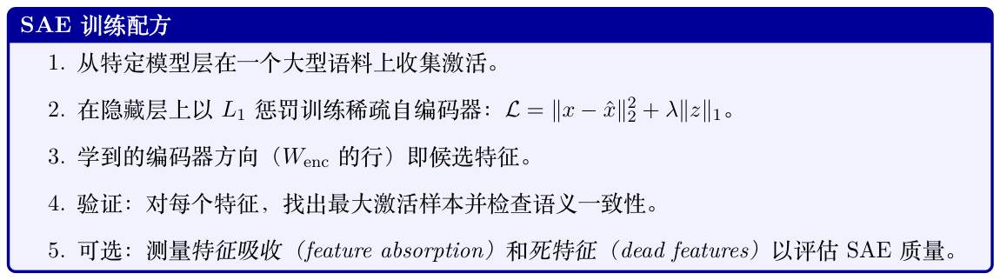

虽然SAE 将激活分解为可解释的向量，其特征仍需人工检查最大激活样本才能理解。Anthropic 的自然语言自编码器（Natural Language Autoencoders，NLAE）[75] 采取了根本不同的方法：用自然语言描述替代稀疏瓶颈，使可解释性自动化。

NLAE 如何工作。

1. 编码器：一个语言模型读取隐藏激活（或输入文本）并产生关于活跃概念的自然语言描述：例如，“文本讨论法国菜并使用正式的学术语调。”

2. 解码器：第二个语言模型读取自然语言描述并重建原始激活（或预测下一个Token）。

3. 训练：编码器和解码器端到端地训练以最小化重建损失，瓶颈是一个可变长度的自然语言字符串而非稀疏向量。

相对SAE 的优势。

- 自解释：特征字面上就是自然语言——无需人工标注。

- 可组合：可以表达SAE 特征无法作为单一方向表示的复杂关系概念（“对事实声明的讽刺回应”）。

- 层次化：描述可以在同一表征中同时捕捉细粒度（词级）和粗粒度（文档级）属性。

- 可审计：瓶颈描述是人类可读的，能够直接检查模型“认为” 存在的信息。

局限性。NLAE引入了一个“语言模型在回路中” 的设计，使其计算昂贵，并且可能与任何模型生成的解释一样面临忠实性担忧。它们也不能轻易表示亚符号特征（几何模式、精确数值），而SAE能将这些自然地作为激活幅度处理。

可解释性层级栈

将可解释性工具视为一个层级：

1. 注意力图：“模型在看什么？”（最便宜，最不忠实）

2. 探测分类器：“这一层编码了什么信息？”

3. 稀疏自编码器：“哪些单义特征是活跃的？”（可扩展，需要人工标注）

4. 自然语言自编码器：“模型认为发生了什么？”（自解释，昂贵）

5. 因果追踪/ 修补（Causal tracing / patching）：“哪些组件实际导致了这个输出？”（最忠实，最昂贵）

每个层级都在解释的成本、可扩展性和忠实性之间权衡。

## 1.4 预测头：Transformer 的输出

Transformer 主干网络为每个位置产生上下文隐藏状态ht ∈Rd。我们如何处理这些隐藏状态——即预测头（Prediction Head）——定义了任务本身。同一个Transformer 主干网络只需更换预测头，就能服务于完全不同的目的。

### 1.4.1 语言建模头（预训练阶段）

标准的语言建模头（Language Modeling Head, LM Head）将最终隐藏状态投影到词表logits，并以下一个token 的交叉熵损失进行训练：

P(xt+1|x≤t) = softmax(Whead · ht + b) (1.7)

其中Whead ∈R|V|×d（通常与embedding 矩阵权重共享：Whead = ET ）。

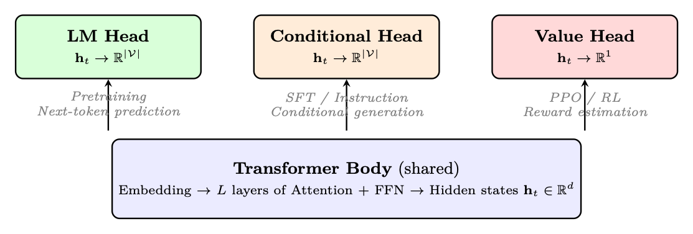

**Figure 1.7: 同一个Transformer 主干网络通过更换预测头即可支持不同任务。本文使用的全部三种预测头在最终投影层之下具有完全相同的架构。**


### 1.4.2 条件生成头（SFT / 指令跟随）

对于监督微调（Supervised Fine-Tuning, SFT），其架构与LM 头完全相同——都是将隐藏状态线性投影到词表logits。区别仅在于在哪些token 上计算损失：

LSFT = −1 X |y| log P(yt|xprompt, y<t) (1.8) |y| t=1

#### 条件生成头– 与LM 头的关键区别

- 损失掩码：只在回复的token 上计算损失，不计算prompt/指令部分。Prompt 仅提供上下文，不提供梯度信号。

- 条件化：模型学会在特定指令格式（system prompt、用户查询、工具调用）的条件下生成回复。

- 格式token：特殊token（<|user|>、<|assistant|>）引导模型产生结构化输出。

- 使用阶段：在精心策划的指令-回复对上进行SFT；也在强化学习的策略生成阶段使用（即产出动作/回复的策略头）。

LM 头和SFT 头在架构上完全相同（同一个Whead）。唯一的区别是SFT 阶段会掩码掉prompt token 的损失。这个细微的改动就把一个通用文本预测器转变为一个指令跟随助手。预测头学会根据上下文条件「激活」不同的生成模式。

### 1.4.3 价值头（用于RL 的回归头）

在强化学习（PPO、GRPO）中，我们需要估计某个状态有多好——这需要一个标量输出，而不是

V (st) = wT value · ht + b ∈R (1.9)

其中wvalue ∈Rd，b ∈R。

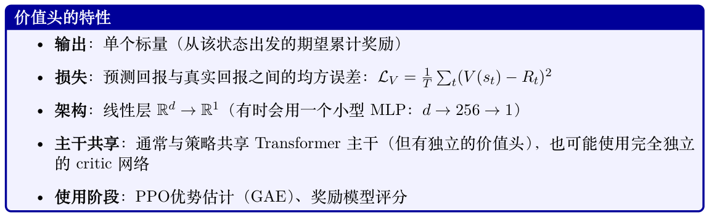

### 1.4.4 预测头选择总览

**Table 1.9: 本文使用的各类预测头及其训练场景。**

| 预测头 | 输出 | 损失 | 阶段 | 用途 |
| --- | --- | --- | --- | --- |
| LM Head | R|V| R|V| | 交叉熵（所有token）预训练 交叉熵（仅回复部 |  | 从原始文本学习语 言 学习跟随指令 |
| Conditional Head |  | 分） | SFT |  |
| Value Head | R1 | MSE | RL (PPO) | 估计状态价值以计 算优势 |
| Reward Head | R1 | 成对排序 | 奖励模型训练 | 给回复质量打分 |

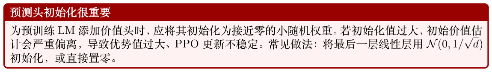

### 1.4.5 HuggingFace 实现

```
from transformers import (
AutoModelForCausalLM , # LM 头（预训练+ SFT ）
AutoModelForSequenceClassification , # 奖励头
AutoTokenizer ,
)
from trl import AutoModelForCausalLMWithValueHead # 价值头（PPO ）
import torch
model_name = "meta-llama/Llama -3.1-8B-Instruct"
tokenizer = AutoTokenizer.from_pretrained(model_name)
# === 1. LM 头（预训练/ SFT ）===
# 默认的CausalLM 模型—— 将隐藏状态投影到词表logits
lm_model = AutoModelForCausalLM.from_pretrained(
model_name ,
torch_dtype=torch.bfloat16 ,
device_map="auto",
)
# lm_model.lm_head: Linear(hidden_size -> vocab_size)
# 输出：形状为(batch, seq_len , vocab_size) 的logits
inputs = tokenizer("The capital of France is", return_tensors="pt")
outputs = lm_model(**inputs)
next_token_logits = outputs.logits[:, -1, :] # (batch, vocab_size)
probs = torch.softmax(next_token_logits , dim=-1)
# === 2. 条件生成头（SFT ）===
# 架构上与LM 头完全相同—— 区别在于损失掩码
# SFT 时只在回复token 上计算损失：
```

```
messages = [
{"role": "user", "content": "What is 2+2?"},
{"role": "assistant", "content": "4"},
]
formatted = tokenizer.apply_chat_template(messages , return_tensors="pt")
labels = formatted.clone()
# 掩码掉prompt token （设为-100 ，交叉熵会忽略它们）
prompt_len = len(tokenizer.apply_chat_template(messages[:1]))
labels[:, :prompt_len] = -100
loss = lm_model(input_ids=formatted , labels=labels).loss
# === 3. 价值头（PPO Critic ）===
# 在LM 主干之上加一个Linear(hidden_size -> 1)
value_model = AutoModelForCausalLMWithValueHead.from_pretrained(
model_name ,
torch_dtype=torch.bfloat16 ,
device_map="auto",
)
# value_model.v_head: Linear(hidden_size -> 1)
# 同时返回LM logits 和每个token 的价值估计
inputs = tokenizer("Explain quantum computing", return_tensors="pt")
lm_logits , loss, values = value_model(
**inputs, return_dict=False
)
# values 形状：(batch, seq_len , 1) —— 每个token 一个标量估计
# === 4. 奖励头（奖励模型）===
# 分类头：在最后一个token 上接Linear(hidden_size -> 1)
reward_model = AutoModelForSequenceClassification.from_pretrained(
model_name ,
num_labels=1, # 单标量输出
torch_dtype=torch.bfloat16 ,
device_map="auto",
)
# 通过池化最后一个token 的隐藏状态对整个序列打分
inputs = tokenizer("Good response here", return_tensors="pt")
reward_score = reward_model(**inputs).logits # 形状：(batch, 1)
```

Listing 1.3: 使用HuggingFace 加载与使用不同的预测头。

大多数现代LLM 会将LM 头的权重与输入embedding 矩阵共享（tie）：lm_head.weight = model.embed_tokens.weight。这意味着LM 头并非独立学习的一层——它直接复用了embed- ding 表。好处包括：参数更少（节省|V|×d）、泛化更好，并且embedding 空间的几何结构直接决定了token 概率。你可以在HuggingFace 中验证这一点：对大多数模型而言，model.lm_head.weight is model.model.embed_tokens.weight 会返回True。

## 1.5 LLM 训练的优化理论

训练一个大语言模型意味着寻找一组参数θ（数十亿个权重），使损失函数L(θ) ——通常是下一个token 的负对数似然——最小化。这是一个在极高维空间中的优化问题，用来在该空间中导航的算法直接决定了训练是成功、发散还是停滞。

### 1.5.1 梯度下降：基础

什么是梯度？梯度∇θL 是一个指向损失函数最陡上升方向的向量。每个分量∂L ∂θi 告诉我们：如果对参数θi 略微增加一点，损失会变化多少。为了降低损失，我们沿相反方向移动：

θt+1 = θt −η∇θL(θt) (1.10)

其中η > 0 是学习率（Learning Rate）——也就是步长。这就是梯度下降（Gradient Descent）[76]。

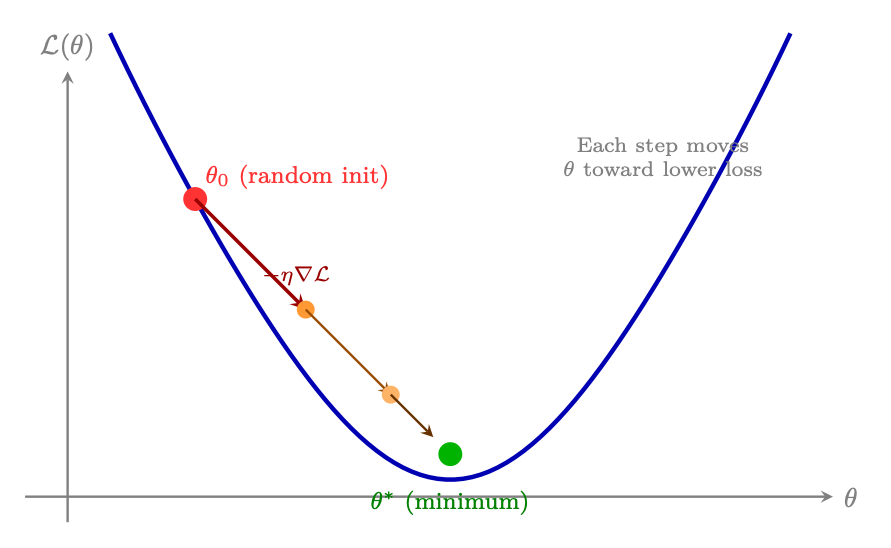

**Figure 1.8: 梯度下降：从随机初始化θ0 开始，每一步都将参数沿降低损失的方向移动，步长由学习率η 控制。该过程会向某个（局部）最小值收敛。**

为何全梯度下降不可行。计算精确梯度需要在整个训练集上评估损失（对LLM 而言是万亿级token），计算开销极其高昂——单步梯度更新就需要遍历全部数据。

随机梯度下降（Stochastic Gradient Descent，SGD）。解决办法是：用一个小的随机数据子

∇θL(θ) ≈1 X B ∇θℓ(θ; xi) B i=1

其中B 是批大小（对LLM 通常是1K–4M 个token）。小批量梯度是真实梯度的含噪但无偏的估计。

#### 为何小批量SGD 有效

- 计算效率：每步开销是O(B) 而非O(Ntotal)。当B = 4096 而总token 为15T 时，每步开销约便宜40 亿倍。

- 噪声即正则化：随机噪声有助于逃离尖锐的局部极小值，找到泛化性更好的平坦区域。

- GPU 利用率：小批量足够大，能充分占满GPU 并行度（矩阵乘法变为计算受限而非显存受限）。

√

- 收敛性：理论上以O(1/ T) 的速率收敛到局部极小值（比精确GD 的O(1/T) 慢，但每步开销便宜数百万倍）。

从SGD 到自适应方法。带动量的SGD 对视觉模型（CNN）效果不错，但LLM 训练需要自适应优化器（Adaptive Optimizer）——即为每个参数维护各自学习率的算法。

### 1.5.2 为何朴素SGD 在LLM 上失效

随机梯度下降按下式更新权重：θt+1 = θt −η∇θL(θt)

#### SGD 在LLM 上的问题

- 各层梯度尺度不同：Transformer早期层的梯度远小于后期层（梯度消失）。单一学习率η 对一些参数过大，对另一些参数又过小。

- 稀疏梯度：embedding层只对当前批次出现的token 有梯度，大部分行的梯度为零。带动量的SGD 会在零梯度行上浪费动量。

- 鞍点：高维损失曲面存在大量鞍点。SGD可能停滞，而自适应方法能更快逃脱。

- 对学习率敏感：SGD需要仔细调参；η 变化2 倍就可能导致发散。

### 1.5.3 Adam — 自适应矩估计（Adaptive Moment Estimation）

Adam [78] 为每个参数维护梯度一阶矩（均值）与二阶矩（非中心化方差）的估计。

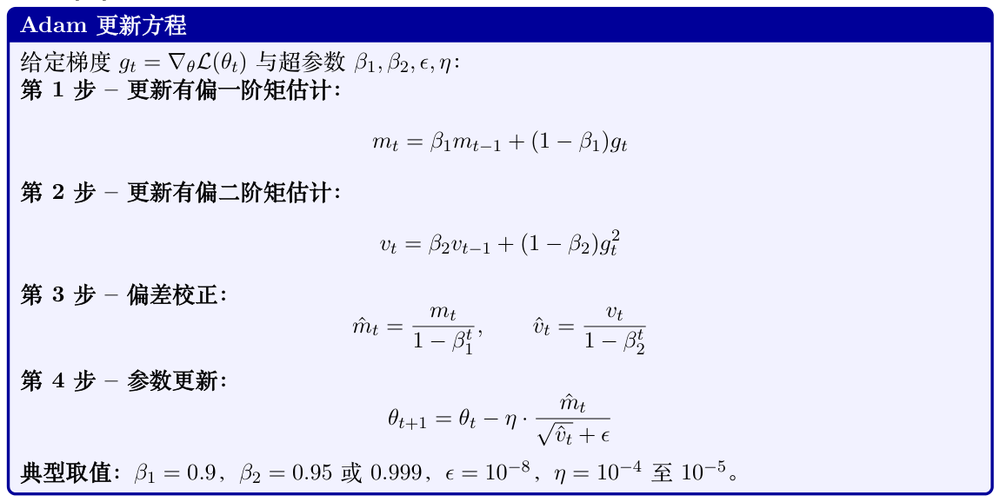

每一项的作用

- mt（动量）：梯度的指数移动平均，可平滑噪声梯度估计。β1 = 0.9 意味着当前梯度贡献10%，历史贡献90%。

- vt（自适应学习率）：梯度平方的EMA。梯度持续较大的参数获得较小的有效学习率（η/√vt）；

梯度较小的参数获得较大的有效学习率。这是应对各层梯度尺度差异的关键。

- ˆmt, ˆvt（偏差校正）：在t = 1 时，m1 = (1 −β1)g1 远小于真实均值。除以(1 −βt 1) 可以校正这种初始化偏差。如果不做校正，早期更新步长会过小。

- ϵ（数值稳定性）：防止除零；同时也作为有效学习率的下限。

### 1.5.4 AdamW — 解耦权重衰减（Decoupled Weight Decay, AdamW）

AdamW [79] 修正了权重衰减与自适应优化器交互时一个细微但重要的问题。

在L2 正则化下，损失变为L + λ 2∥θ∥2，因此梯度为gt + λθt。在Adam 中，这部分正则化梯度会被自适应因子1/√ˆvt 缩放：

θt+1 = θt −η · ˆmt + λθt √ˆvt + ϵ

vt 较大（梯度方差大）的参数受到的正则化反而更弱。这并不是我们想要的——权重衰减本应是均匀的。

AdamW（Loshchilov & Hutter, 2017）将权重衰减直接作用于参数本身，置于自适应缩放之外：

ˆmt θt+1 = θt −η ·√ˆvt + ϵ −ηλθt

权重衰减项ηλθt 不再被√ˆvt 缩放。这样无论参数的梯度历史如何，所有参数都能获得均匀的正

则化。

典型取值：LLM 训练时λ = 0.1。

Adam 与AdamW 的差别虽细微但很重要。使用Adam + L2 时，梯度方差小的参数（如bias、LayerNorm 参数）受到更强的权重衰减，梯度方差大的参数（如attention 权重）受到的衰减更弱。AdamW 才能提供我们想要的均匀正则化。大多数框架默认使用AdamW；务必确认你的优化器类。

### 1.5.5 学习率— 最重要的超参数

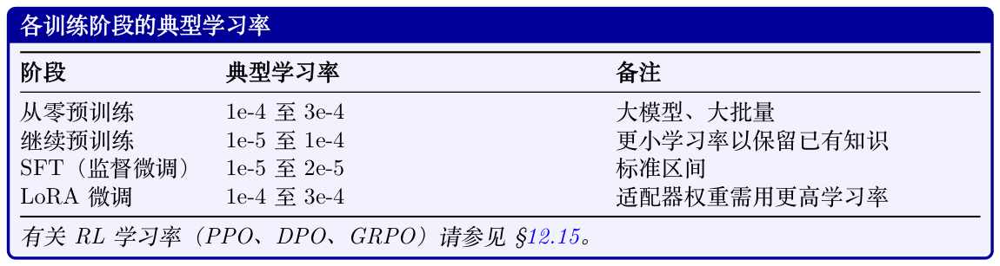

### 1.5.6 学习率预热（Warmup）

为何需要预热

训练开始时，vt（二阶矩估计）被初始化为零。偏差校正后：ˆvt = vt/(1−βt 2)。在t = 1、β2 = 0.999时：ˆv1 = v1/(1 −0.999) = 1000v1。这意味着有效学习率是η/√1000v1，远小于预期。

另一方面，如果第一步的梯度异常大（在初始化时常见），二阶矩估计会被这个离群值主导，导致早期更新极不稳定。预热（Warmup）通过从极小的学习率开始、逐步增大来缓解这一问题，让vt 有时间积累一个可靠的估计。

- 线性预热：ηt = ηmax × t/Twarmup

- 典型预热时长：预训练为总步数的1–5%；微调为3–10%（更短的训练任务通常需要按比例更长的预热）

- SFT 场景：通常预热50–200 步

### 1.5.7 学习率调度策略

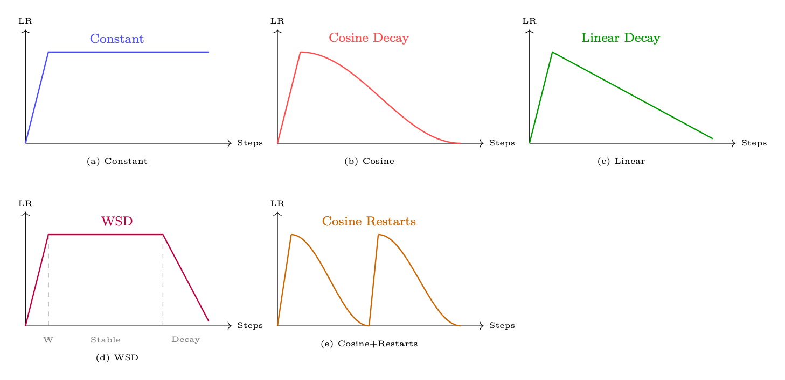

**Figure 1.9: 常见学习率调度。所有调度都包含一个线性预热阶段。WSD（Warmup-Stable-Decay）正成为预训练的事实标准。**

(a) 恒定调度（Constant）。最简单的调度。适合短期微调，以避免学习率过度衰减。风险在于：缺乏退火意味着模型可能无法收敛到最尖锐的最小值。

(b) 余弦衰减（Cosine Decay）。

!!

ηt = ηmin + 1 t −Twarmup 2(ηmax −ηmin) 1 + cos π T −Twarmup

预训练与SFT 的标准选择。平滑衰减避免了学习率的突变。ηmin 通常取ηmax/10。

(c) 线性衰减（Linear Decay）。比余弦更简单，经验效果相近。当你希望任意步的学习率都可预测时优先选用。

(d) WSD — 预热-稳定-衰减（Warmup-Stable-Decay, WSD）。大规模预训练的新标准[25, 80]。包含三个阶段：

1. 预热：线性升至ηmax（占总步数的1–5%）

2. 稳定：在训练的大部分时间保持恒定的ηmax

3. 衰减：以快速余弦或线性方式衰减到ηmin（最后10–20% 的步数）

核心优势在于：稳定阶段允许在任意时刻打checkpoint 并继续训练；而衰减阶段可在任一训练任务结束时再施加。

(e) 带重启的余弦调度— 带重启的随机梯度下降（Stochastic Gradient Descent with Warm Restarts, SGDR）。周期性重启会将学习率重置为ηmax，有助于逃离局部极小值。在LLM 中并不常用，更适合较小的模型。

### 1.5.8 梯度裁剪（Gradient Clipping）

### 梯度裁剪（Gradient Clipping）

当梯度的全局范数超过某阈值时，梯度裁剪会对其重新缩放：

  τ gt ←gt · min 1, ∥gt∥2

其中τ 是max_grad_norm（通常取1.0）。

梯度裁剪与降低学习率都能限制参数更新的幅度。区别在于：裁剪保留梯度的方向（只是缩放幅度），而较小的学习率会对所有更新一视同仁地缩放。裁剪更适合处理偶发的大梯度，同时不会拖慢正常训练步的速度。

下面的代码片段展示了本节中各概念——带解耦权重衰减的AdamW（§1.6.6）、带线性预热的余弦学习率调度（§1.6.7）和梯度裁剪（§1.6.8）——如何借助HuggingFace transformers 库在实践中结合起来。

```
from transformers import TrainingArguments , Trainer
from transformers import get_cosine_schedule_with_warmup
import torch
# --- 方案1：使用TrainingArguments （推荐）---
training_args = TrainingArguments(
output_dir="./checkpoints",
# AdamW 优化器（解耦权重衰减，§1.6.6 ）
optim="adamw_torch",
learning_rate=2e-5, # 预热后的峰值学习率
adam_beta1=0.9, # 一阶矩衰减
adam_beta2=0.999, # 二阶矩衰减
adam_epsilon=1e-8, # 数值稳定项
weight_decay=0.01, # 解耦L2 惩罚
# 学习率调度（§1.6.7 ）
lr_scheduler_type="cosine", # 余弦衰减至0
warmup_ratio=0.1, # 10% 步数用于线性预热
```

```
# 梯度裁剪（§1.6.8 ）
max_grad_norm=1.0, # 按全局L2 范数裁剪
# 混合精度（§1.6.9 ）
bf16=True, # 在Ampere+ GPU 上使用BFloat16
# 训练时长
num_train_epochs=3,
per_device_train_batch_size=8,
gradient_accumulation_steps=4, # 有效批量= 8*4 = 32
)
trainer = Trainer(
model=model,
args=training_args ,
train_dataset=dataset ,
)
trainer.train()
# --- 方案2：手动控制（适用于自定义训练循环）---
from torch.optim import AdamW
# 权重衰减分组（不对bias / norm 做正则化）
no_decay = ["bias", "LayerNorm.weight", "layernorm.weight"]
param_groups = [
{
"params": [p for n, p in model.named_parameters()
if not any(nd in n for nd in no_decay)],
"weight_decay": 0.01,
},
{
"params": [p for n, p in model.named_parameters()
if any(nd in n for nd in no_decay)],
"weight_decay": 0.0,
},
]
optimizer = AdamW(param_groups , lr=2e-5, betas=(0.9, 0.999))
# 带线性预热的余弦调度
total_steps = len(train_dataloader) * num_epochs
warmup_steps = int(0.1 * total_steps)
scheduler = get_cosine_schedule_with_warmup(
optimizer ,
num_warmup_steps=warmup_steps ,
num_training_steps=total_steps ,
)
# 带梯度裁剪的训练循环
for batch in train_dataloader:
outputs = model(**batch)
loss = outputs.loss
loss.backward()
# 在optimizer.step() 之前裁剪梯度
torch.nn.utils.clip_grad_norm_(model.parameters(), max_norm=1.0)
optimizer.step()
scheduler.step()
optimizer.zero_grad()
```

Listing 1.4: 将AdamW、余弦调度与梯度裁剪整合在一起的完整优化器配置。

实践要点

- 权重衰减排除：bias项和LayerNorm 权重不应被正则化——它们参数很少，对其加正则反而损害性能[79]。

- 预热比例：通常为总步数的5–10%；预热不足配合高学习率会使早期训练不稳定。

- 梯度累积：在显存受限时模拟更大批量；裁剪作用于累积后的梯度。

- BF16 vs. FP16：在Ampere+ GPU 上优先bf16=True（更宽的动态范围可免去损失缩放）；老硬件回退到fp16=True。

### 1.5.9 混合精度训练（Mixed Precision Training）

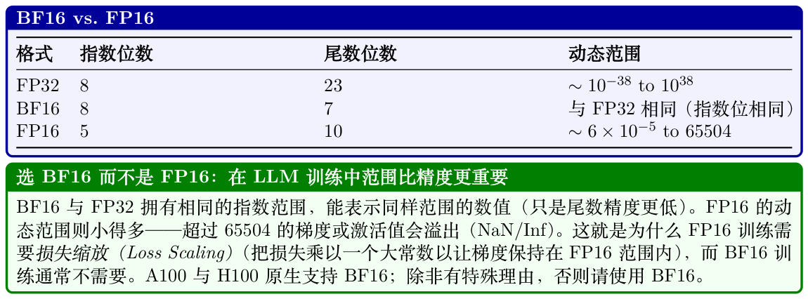

损失缩放（Loss Scaling，仅FP16）。

1. 将损失乘以缩放因子S（例如S = 215）

2. 用FP16 计算梯度（梯度被S 缩放）

3. 在optimizer 步骤前将梯度除以S

4. 检查溢出（NaN/Inf）；若发现则跳过该步并减小S

5. 若连续N 步未溢出，则增大S

FP32 主权重（FP32 Master Weights）。在混合精度训练中，权重以FP32 形式保存（主副本），仅在前向/反向传播时转换为BF16/FP16。优化器步骤则在FP32 下完成。这一点很重要，原因是：

- 很小的梯度更新（∆θ ≪θ）在BF16 精度下会丢失（7 位尾数≈0.8% 的相对精度）

- FP32 主权重可确保许多小更新在多步中的累积保持准确

- 显存代价：权重存储翻倍（FP32 + BF16副本）

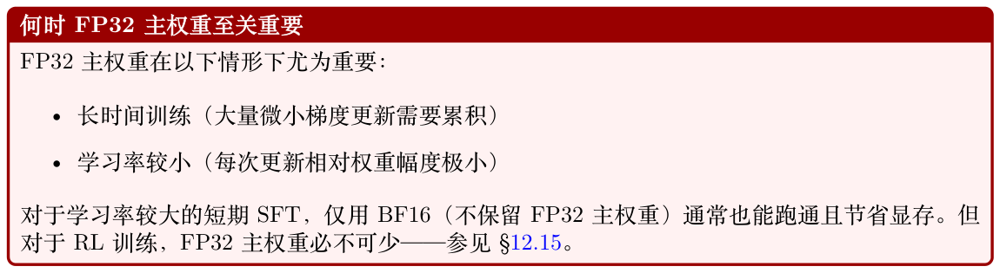

#### 混合精度实战：HuggingFace

```
# === HuggingFace TrainingArguments （最简方式）===
from transformers import TrainingArguments
# Ampere+ GPU 上的BF16 （A100 、H100 、RTX 30xx/40xx ）
args_bf16 = TrainingArguments(
output_dir="./out",
bf16=True, # BF16 前向/反向；FP32 主权重
bf16_full_eval=True, # 评估时也使用BF16
# 无需loss scaling —— BF16 的范围已与FP32 等价
)
# 老GPU 上的FP16 （V100 、T4、RTX 20xx）
args_fp16 = TrainingArguments(
output_dir="./out",
fp16=True, # FP16 前向/反向
fp16_full_eval=False, # 评估仍用FP32 以保证精度
# 损失缩放由PyTorch GradScaler 自动完成
)
# === 手写PyTorch AMP （用于自定义训练循环）===
import torch
# 初始化（PyTorch 2.x API ）
use_fp16 = not torch.cuda.is_bf16_supported()
scaler = torch.amp.GradScaler("cuda", enabled=use_fp16) # 仅FP16 需要
optimizer = torch.optim.AdamW(model.parameters(), lr=2e-5)
dtype = torch.float16 if use_fp16 else torch.bfloat16
for batch in train_dataloader:
optimizer.zero_grad()
# autocast ：以降精度执行前向
with torch.autocast("cuda", dtype=dtype):
outputs = model(**batch)
loss = outputs.loss
if use_fp16:
# FP16 路径：缩放损失以防梯度下溢
scaler.scale(loss).backward()
scaler.unscale_(optimizer) # 裁剪前先反缩放
torch.nn.utils.clip_grad_norm_(model.parameters(), 1.0)
scaler.step(optimizer) # 溢出时会跳过step
scaler.update() # 调整缩放因子
else:
# BF16 路径：无需缩放
loss.backward()
torch.nn.utils.clip_grad_norm_(model.parameters(), 1.0)
optimizer.step()
scheduler.step()
```

Listing 1.5: 使用HuggingFace 与手写PyTorch AMP 实现混合精度训练。

#### 代码层面BF16 与FP16 的关键差异

- BF16：只需用autocast(dtype=torch.bfloat16) 包裹即可，无需scaler。代码更简单，数值更稳定。

- FP16：需要GradScaler 以防止梯度下溢。scaler 会动态调节乘子；若检测到溢出（NaN）就会跳过该optimizer step 并降低缩放因子。

- 梯度裁剪+ FP16：必须在clip_grad_norm_ 之前调用scaler.unscale_(optimizer)，否则你裁剪的是被缩放后的梯度（阈值错误）。

- 显存节省：激活显存减半（激活值以16-bit 存储）；权重显存取决于是否保留FP32 主副本。

### 1.5.10 各训练阶段的优化器配置实践

```
优化器超参数参考表
阶段优化器学习率权重衰减预热调度
预训练AdamW 3e-4 0.1 2000 步WSD或Co-
sine
SFT AdamW 2e-5 0.01 100 步Cosine
LoRA SFT AdamW 2e-4 0.01 100 步Cosine
以上均使用：β1=0.9、β2=0.95、ϵ=10−8、max_grad_norm=1.0、BF16。RL 相关设置参见§12.15。
诊断训练不稳定
# 监控以下指标以诊断优化器问题：
# 1. 梯度范数——大多数时候应< max_grad_norm
# 2. 损失缩放因子（FP16 ）——应稳定，不应持续减小
# 3. 参数更新范数——应远小于参数自身的范数
import torch
def log_optimizer_stats(model, optimizer , step):
# 梯度范数（裁剪前）
total_norm = 0.0
for p in model.parameters():
if p.grad is not None:
total_norm += p.grad.data.norm(2).item() ** 2
total_norm = total_norm ** 0.5
# Adam 二阶矩统计（自适应学习率的代理指标）
v_norms = []
for group in optimizer.param_groups:
for p in group['params']:
state = optimizer.state[p]
if 'exp_avg_sq' in state:
v_norms.append(state['exp_avg_sq'].mean().item())
print(f"Step {step}: grad_norm={total_norm:.3f}, "
f"mean_v={sum(v_norms)/len(v_norms):.6f}")
# 红色警报：
# grad_norm 反复>> 1.0 ——降低学习率或加长预热
# grad_norm == 0.0 ——梯度消失或loss 写错
# loss_scale 持续下降—— FP16 溢出，改用BF16
# v 非常小—— Adam 还没预热完，加长预热
学习率是最重要的超参数
实践中，把学习率调对比任何其他超参数都重要。LLM 微调的经验法则：
• 从上表中的取值开始
• 若损失发散（初始下降后又上升）：学习率过高
• 若损失下降极慢且过早进入平台期：学习率过低
• 若损失不稳定（震荡）：学习率过高或预热过短
第二重要的超参数是批大小（通过线性缩放规则影响梯度噪声和有效学习率）。其他都是次要的。
```

## 1.6 FlashAttention——算法与硬件感知

FlashAttention [7, 81] 是自Transformer 本身以来深度学习领域最具影响力的算法创新之一。它不改变Attention 的数学结果——计算出的输出与原始Attention 完全相同——但它重构了内存访问模式，让GPU 上容量有限的高速SRAM 承担所有重活，从而将高带宽内存（HBM）占用从O(n2)降至O(n)，并在典型工作负载上带来2–4× 的端到端实际墙钟时间加速。

### 1.6.1 标准Attention 的内存问题

标准的缩放点积Attention 为：

!

QKT Attention(Q, K, V ) = softmax √dk V

对于序列长度n 和头维度d：

- Q, K, V ∈Rn×d：O(nd) 内存

- S = QKT ∈Rn×n：O(n2) 内存——瓶颈所在

- P = softmax(S) ∈Rn×n：又一个O(n2)

- O = PV ∈Rn×d：O(nd)

在n = 8192、d = 128、BF16 条件下：仅Attention 矩阵本身就达到81922 × 2 ≈134 MB 每头。

若有32 个头，单单一层的Attention 分数就要占用4.3 GB。

为什么O(n2) 是灾难性的

Attention 矩阵必须写入HBM（对长序列而言它放不进SRAM），随后再读出来做Softmax，然后再读一次用于PV 乘法。每一次HBM 往返都很慢。当n = 32768（32K 上下文）时，Attention矩阵达327682 × 2 ≈2 GB 每头——完全无法存储。

### 1.6.2 FlashAttention 的核心洞察——分块（Tiling）与在线Softmax（Online Softmax）

核心洞察是：我们从不需要把完整的n × n 矩阵一次性放入内存。如果使用在线Softmax 技巧，就可以按块逐步计算输出O。

在线Softmax（Online Softmax）。回想一下，为了数值稳定性，Softmax 需要一个全局最大值：

exi−m softmax(xi) = P j exj−m , m = max xj j

诀窍在于：我们可以在处理新块时更新运行中的最大值和归一化因子，而无需在任何时刻物化整行。

给定运行状态(mold, ℓold, Oold) 和一个新的分数块snew：

1. mnew = max(mold, max(snew))

2. ℓnew = emold−mnew · ℓold + P j esnew,j−mnew

3. Onew = ℓnew (emold−mnew · ℓold · Oold + esnew−mnew · Vnew)

这在数学上等价于一次性对所有块计算Softmax。

### 1.6.3 FlashAttention 算法

设定：SRAM 大小M。块大小Br = ⌈M/(4d)⌉，Bc = min(⌈M/(4d)⌉, d)。

1. 将Q 划分为Tr = ⌈n/Br⌉块Q1, . . . , QTr

2. 将K, V 划分为Tc = ⌈n/Bc⌉块K1, . . . , KTc

3. 初始化输出O ∈Rn×d、运行最大值m ∈Rn、运行求和ℓ∈Rn（均在HBM 中）

4. 对j = 1, . . . , Tc 进行外循环：

(a) 将Kj, Vj 从HBM 加载到SRAM

(b) 对i = 1, . . . , Tr 进行内循环：

i. 将Qi, Oi, mi, ℓi 从HBM 加载到SRAM √ ii. 计算Sij = QiKT j / d（保留在SRAM 中）

iii. 应用在线Softmax 更新得到新的mi, ℓi, Oi

iv. 将Oi, mi, ℓi 写回HBM

5. 返回O

关键：Sij（Attention块）在SRAM 中计算并丢弃。它从不写入HBM。

#### FlashAttention 复杂度

内存（HBM）O(n2) O(n) HBM 读写量O(n2d) O(n2d/M) FLOPs O(n2d) O(n2d)（相同）加速比1× 2–4×

在前向传播中，总FLOPs 仍为O(n2d)——与标准Attention 完全相同。FlashAttention 的加速完全来自于削减缓慢的HBM 流量，而不是减少运算。（反向传播由于重计算实际上执行了更多FLOPs，但墙钟时间仍然更短，因为节省下来的内存带宽占主导。）

### 1.6.4 FlashAttention 2——更好的并行性

FlashAttention 2 [81] 做出了三项关键改进：

1. 减少非矩阵乘法FLOPs：原版FA 在内循环中存在不必要的重缩放操作。FA2 重构循环以最小化这些操作。在A100 上，Tensor Core 矩阵乘法比标量运算快约16×，因此即便内循环中只有少量非矩阵乘法工作，也会成为延迟瓶颈。

2. 序列维度上更好的并行性：FA1仅在batch 和head 上并行。FA2 还在query 序列维度上并行，使长序列、小批量场景下的GPU 利用率显著提升。

3. 因果掩码优化：对于自回归（因果）Attention，大约一半的块是完全被掩码的。FA2 完全跳过这些块，相对于双向Attention 带来约2× 的加速。

### 1.6.5 FlashAttention 3——Hopper 架构

FlashAttention 3 [82] 专为H100 设计，并利用了三项Hopper 特有的特性：

- TMA（Tensor Memory Accelerator，张量内存加速器）：H100 有一个专用硬件单元用于在HBM 和SRAM 之间进行异步批量数据搬移。FA3 利用TMA 让数据加载与计算重叠，从而隐藏内存延迟。

- Warp 专用化（Warp-specialization）：FA3 给不同的warp 分配不同角色（生产者warp通过TMA 加载数据；消费者warp 计算MMA）。这是一种软件流水线技术，使内存系统和Tensor Core 同时保持繁忙。

- FP8 支持：H100 以BF16 两倍的吞吐量支持FP8（E4M3/E5M2）Tensor Core 运算。FA3支持FP8 Attention，并通过逐块量化来保持精度。

FA3 在FP16 Attention 上可达H100 理论峰值的75%，相比之下FA2 约为35%。

### 1.6.6 FlashAttention 4——Blackwell 架构

FlashAttention 4 [83] 面向NVIDIA 的Blackwell GPU（B200/GB200），这类GPU 将Tensor Core吞吐量提高到2.25 PFLOP/s（BF16），但非矩阵乘法单元（指数运算、共享内存带宽）的扩展速度较慢。这种非对称的硬件扩展意味着瓶颈发生了转移：在Blackwell 上，Attention 的限制因素不再是矩阵乘法，而是Softmax 指数运算以及围绕它们的共享内存流量。

FA4 通过四项关键技术来应对这一问题：

- 完全异步的MMA 流水线：Blackwell 的MMA 指令是完全异步的（不像Hopper 的wgmma仍会阻塞等待完成）。FA4 重新设计了流水线，在更大的分块尺寸上让MMA、TMA 加载和Softmax 重缩放相互重叠，使所有硬件单元保持饱和。

- 软件模拟指数运算：FA4不调用硬件的ex2 单元（吞吐量瓶颈），而是用多项式近似在快得多的Tensor Core 上模拟ex。这相当于用额外的矩阵乘法指令换取消除指数单元的停顿。

- 条件式Softmax 重缩放：标准FlashAttention 每个分块都会重缩放运行max。FA4 在新分块的最大值不超过当前运行最大值时（实际中很常见）跳过重缩放，从而节省寄存器搬移和同步屏障。

- Tensor Memory + 2-CTA MMA 模式（反向传播）：反向传播使用Blackwell 的张量内存（Tensor Memory）（一种比共享内存更大的、每SM 私有的暂存区）以及2-CTA 协作模式，在两个线程块簇之间融合dQ 累加，使共享内存往返次数减半。

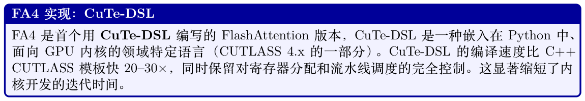

结果。在B200 上，BF16、head 维度128（因果，序列长度8K）：

- 1613 TFLOP/s——达到Blackwell 峰值利用率的71%

- 比cuDNN 9.13（NVIDIA 的专有融合内核）快1.3×

- 在同一硬件上比Triton 快2.7×

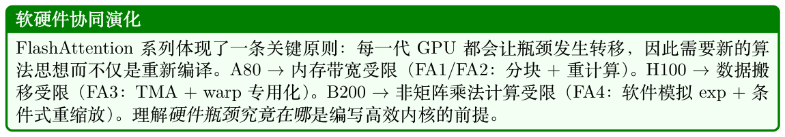

## 1.7 预训练：最佳实践

预训练是LLM 开发中代价最高的阶段——消耗数百万GPU 小时，需要对数据、算力和超参数进行精心编排。本节提炼Llama-3 [25]、Chinchilla [84] 和GPT-4 [23] 的关键经验。

### 1.7.1 训练目标

所有现代仅解码器LLM 都使用因果语言建模（Causal Language Modeling，CLM）：

LCLM = −1 X T log Pθ(xt | x<t) T t=1

这个简单的目标——在足够的数据和规模下——无需显式监督就能产生涌现能力（上下文学习、推理、指令遵循）[21]。

### 1.7.2 数据流水线

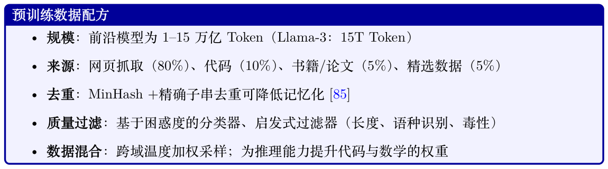

### 1.7.3 扩展律

Hoffmann等[84] 表明，算力最优的训练需要平衡模型大小N 和数据大小D：Nopt ∝C0.50，Dopt ∝C0.50。70B 模型的算力最优点约在1.4T Token。实际中，模型通常被过训练（Token 数超过Chinchilla 最优值），因为推理成本随模型大小而非训练Token 数扩展——较小的过训练模型部署成本更低。

### 1.7.4 关键超参数

**Table 1.10: 已发表模型的预训练超参数。**

| 设置 | Llama-3 405B | Llama-3 8B | Qwen-2.5 72B | Mistral 7B |
| --- | --- | --- | --- | --- |
| Token 数 | 15T | 15T | 18T | 8T |
| 批大小（Token） | 16M | 4M | 4M | 4M |
| 峰值学习率 | 8e-5 | 3e-4 | 3e-4 | 3e-4 |
| 调度策略 | WSD | WSD | Cosine | Cosine |
| 权重衰减 | 0.1 | 0.1 | 0.1 | 0.1 |
| 上下文长度 |  |  | 4096→32K |  |

### 1.7.5 常见失败模式

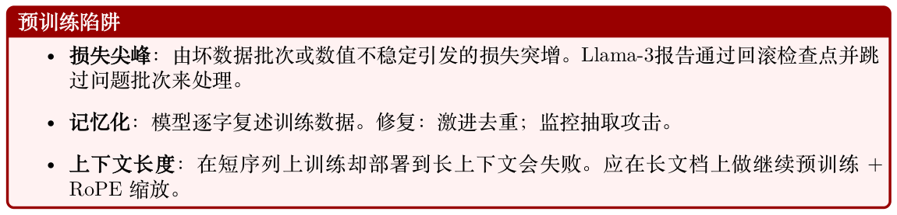

## 1.8 监督微调（Supervised Fine-Tuning，SFT）

SFT 通过在精选的「提示——回复」对上训练，将预训练语言模型转化为指令遵循助手。它是从原始语言建模到RLHF 的桥梁。

### 1.8.1 SFT 目标

LSFT = −1 X |y| log Pθ(yt | xprompt, y<t) |y| t=1

提示Token 提供上下文但不接收梯度（标签设为−100）。

### 1.8.2 数据质量：LIMA 原则

Zhou 等[86] 证明，1,000 个精心策划的样例可以匹敌在50K+ 嘈杂样例上训练的模型。关键要求：

- 多样性：涵盖问答、摘要、代码、数学、创意写作、多轮对话

- 正确性：每条回复必须事实准确且格式良好

- 长度平衡：混合短（单句）和长（多段落）回复

- 去污染：移除与评估基准的重叠

### 1.8.3 训练配置

```
from trl import SFTTrainer , SFTConfig
sft_config = SFTConfig(
output_dir="./sft_output",
max_seq_length=4096,
packing=True, # 将多个短样例打包进完整序列
learning_rate=2e-5,
lr_scheduler_type="cosine",
warmup_ratio=0.1,
weight_decay=0.01,
max_grad_norm=1.0,
num_train_epochs=3,
per_device_train_batch_size=4,
gradient_accumulation_steps=8,
bf16=True,
gradient_checkpointing=True,
)
trainer = SFTTrainer(model=model, args=sft_config ,
train_dataset=dataset , processing_class=tokenizer)
trainer.train()
```

### 1.8.4 高效训练方案

标准的HuggingFace 训练存在显著的性能浪费。多个库为SFT 工作负载提供了即插即用的效率提升：

Liger Kernel [87]。LinkedIn 开源的一组Triton 融合内核，在训练时替换标准的PyTorch 算子。关键融合包括：

- 融合交叉熵：将最后的线性投影、Softmax和损失计算合并为单个内核——避免物化完整的(batch × seq × vocab) logit 张量。

- 融合RMSNorm / SwiGLU / RoPE：消除常见LLM 构建块的中间内存分配。

- 分块操作：将大张量按块处理，从而限制峰值内存。

效果：仅需一行集成代码（apply_liger_kernel_to_llama()）即可获得20% 的吞吐量提升和最高60% 的内存降低。兼容FSDP、DeepSpeed 和LoRA。

Unsloth [88]。一个专注于微调的库，将自定义CUDA/Triton 内核与激进的内存优化相结合：

- 对LoRA 层进行手工反向传播（避免autograd 开销）。

- 带融合反量化的4-bit QLoRA——在单张48 GB GPU 上训练70B 模型。

- 针对每种架构（Llama、Mistral、Qwen、Gemma）的智能RoPE 与Attention 内核融合。

效果：比原版HuggingFace + PEFT 快2–5×，显存占用降低60–70%。对单GPU 与消费级硬件工作流尤为重要。

torchtune [89]。Meta 的原生PyTorch 微调库（2025 年开发逐步收尾），其设计围绕可组合性而非单体抽象：

- 纯PyTorch——没有trainer 类；配方（recipe）是可读的单文件脚本。

- 与torch.compile、FSDP2 以及激活检查点的原生集成。

- 对QLoRA、全量微调与知识蒸馏的一等支持。

- 内置量化感知训练（QAT），用于训练后压缩。

效果：速度与自定义方案相当，但具备完整的可调试性，无框架锁定。

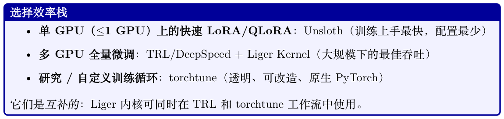

### 1.8.5 最佳实践

**Table 1.11: SFT 训练指南。**

| 实践 | 细节 |
| --- | --- |
| 打包（Packing） | 将多个短样例拼接为一个序列（用EOS 分隔）。避免填充浪费。 |
| NEFTune [90] | 在Embedding 上添加均匀噪声（α = 5）。零代价提升MT-Bench 5–15%。 |
| 对话模板 | 始终使用模型原生模板。模板不匹配会降低质量。 |
| Epoch 数 | 大数据集2–3 个；小型（<10K）精选集最多5 个。过训练会导致格式记忆化。 |

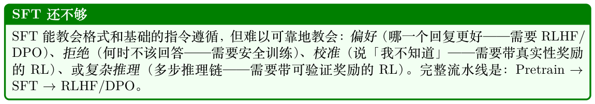

## 1.9 LoRA 与参数高效微调

对70B 模型进行全量微调需要存储70B 可训练参数及其优化器状态（560+ GB 内存）。低秩适配（Low-Rank Adaptation，LoRA）[91] 提供了一种仅用<1% 参数即可微调、并达到相当质量的方法。

### 1.9.1 LoRA 的核心洞察

不更新完整的权重矩阵W ∈Rd×d，而是学习一个低秩扰动：

W ′ = W + α r · BA, B ∈Rd×r, A ∈Rr×d

- W 被冻结（无梯度，无优化器状态）

- 只训练B 和A：2 × d × r 参数而非d2

- 在秩r = 16、d = 4096 时：LoRA 每层新增2 × 4096 × 16 = 131K 参数，而完整矩阵为

## 16.8 M

- α/r 缩放因子控制更新的幅度

低秩为何有效

Aghajanyan 等[92] 表明，微调发生在一个非常低维的子空间——微调任务的「内在维度（intrinsic dimensionality）」远小于模型的参数量。一个175B 模型的微调任务内在维度可能<10,000。LoRA直接利用了这一点：秩r 把每个权重矩阵的更新约束在r 维子空间内。

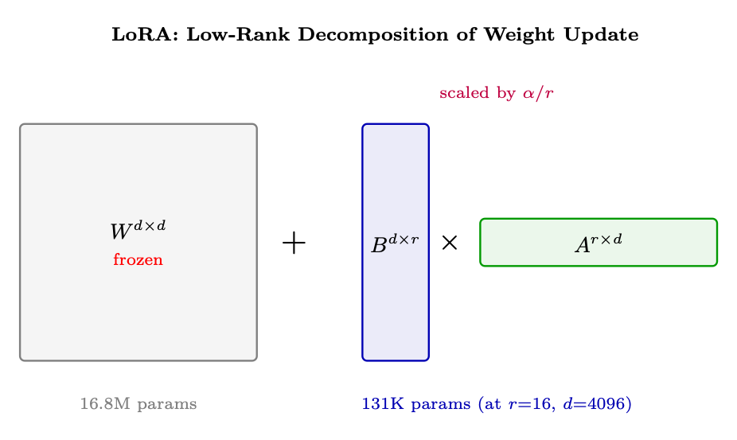

**Figure 1.10: LoRA 将权重更新∆W 分解为两个小矩阵B × A。原始权重W 保持冻结；只有B 和A 接收梯度。推理时，乘积BA 可以零开销地合并到W 中。**

为什么α/r 缩放很重要

如果不做缩放，将秩r 翻倍大约会让∆W = BA 的幅度翻倍（B 中更多列参与求和）。这意味着改变秩也会改变模型被扰动的幅度——你每次调整r 都得重新调学习率。

α/r 因子对更新幅度进行归一化，使其无论秩为多少都大致保持恒定：

W ′ = W + α r · BA

- 固定α，扫描r：有效更新幅度无论秩为何都保持在∼α 附近。可以尝试r ∈{8, 16, 32, 64}而无需重新调学习率。

- 常见做法：设α = r（即α/r = 1）或α = 2r（即α/r = 2）。这是缩放因子为小整数的便捷默认。

- 为什么不直接调LR？可以，但α/r 提供了一个与秩无关的旋钮。团队可以在不同秩的实验间共享LR 配方。

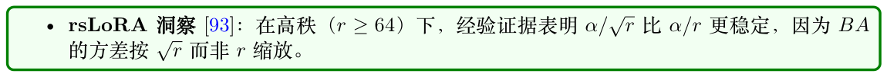

### 1.9.2 LoRA 超参数

正确选择LoRA 超参数至关重要——错误的秩或alpha 要么欠拟合（约束过强），要么浪费内存（表达力过剩）。

**Table 1.12: LoRA 超参数指南。**

| 超参数 | 典型值 | 建议 |
| --- | --- | --- |
| r（秩） | 8, 16, 32, 64 16, 32（通常= r 或2r） | 更高= 更大容量但更多内存。从16 开始。 通过α/r 缩放控制更新幅度。 |
| lora_alpha |  | 所有Attention 投影。添加gate_proj, |
| target_modules | q_proj, k_proj, v_proj, o_proj | up_proj, down_proj 以实现完整覆盖。 正则化。小数据集通常用0.05。 |
| lora_dropout | 0.0–0.1 | 训练偏置项新增参数极少但很少有帮助。 |
| bias | "none" |  |
| 学习率 | 1e-4 到3e-4 | 高于全量微调（只更新适配器）。 |

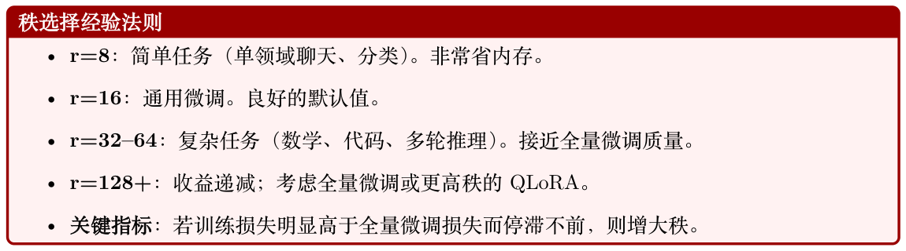

### 1.9.3 LoRA 变体

**Table 1.13: LoRA 变体及其创新。**

| 方法 | 关键创新 | 适用场景 |
| --- | --- | --- |
| QLoRA [94] | 4-bit 量化基座+ BF16 的LoRA。NF4 数 据类型+ 双重量化。 | 在单张48GB GPU 上微调70B。 |
| DoRA [95] | 将W 分解为幅度与方向；LoRA 只更新方 向。 | 推理任务的泛化更好。 |
| LoRA+ [96] | 为A/B 使用不同的LR。 | 免费的2% 提升；无额外成本。 |
| AdaLoRA [97] | 跨层动态秩预算（基于SVD 的重要性）。 用α/√r 而非α/r 缩放。在高秩下稳定。 | 算力预算非常紧张时。 |
| rsLoRA [93] |  | 使用r ≥64 时。 |
| VeRA [98] | 共享冻结的随机A, B；只训练对角缩放。 | 极致的参数效率。 |
| LoRA-FA | 初始化后冻结A；只训练B。将LoRA 内存 减半。 | 内存受限场景。 |

关键扩展详解

DoRA——权重分解低秩适配（Weight-Decomposed Low-Rank Adaptation，DoRA）。

DoRA [95] 观察到，全量微调倾向于改变权重向量的方向多于幅度。标准LoRA 把二者混在一起。

DoRA 将每个权重列分解为幅度m = ∥W∥col 和方向ˆV = W/∥W∥col，然后只对方向应用LoRA：

W ′ = m ⊙ˆV ′, ˆV ′ = W + BA ∥W + BA∥col

幅度m 是单独的可学习向量（每列一个标量）。它在推理与指令遵循基准上始终比LoRA 高1–3%，且无额外推理成本（部署时合并）。

LoRA+——非对称学习率。Hayou 等[96] 表明，LoRA 中的矩阵A 和B 拥有不同的最优学习率。由于B 初始化为零，它与从N(0, σ2) 初始化的A 处于截然不同的状态。设置ηB ≈16 × ηA 可提升收敛速度并将最终质量提高约2%——一个仅需一行配置改动的免费收益：

```
# PEFT 中的LoRA+：为每个矩阵设置不同的学习率
optimizer_grouped_parameters = [
{"params": [p for n, p in model.named_parameters() if "lora_B" in n],
"lr": 2e-4 * 16}, # B 矩阵：更高的学习率
{"params": [p for n, p in model.named_parameters() if "lora_A" in n],
"lr": 2e-4}, # A 矩阵：基础学习率
]
```

VeRA——基于向量的随机矩阵适配（Vector-based Random Matrix Adaptation，VeRA）。

VeRA [98] 把参数效率推向极致：它不学习A 和B，而是将它们冻结为所有层之间共享的随机矩阵，仅训练两个对角缩放向量db ∈Rr 和da ∈Rd：

∆W = B · diag(db) · A · diag(da)

这相比LoRA 将可训练参数减少约10×（每层只有r + d 个参数），同时达到LoRA 90–95% 的质量。最适合需要数百个任务专用适配器、且存储极小化的场景。

```
QLoRA 内存节省
70B 模型全量微调：140 GB（权重）+ 280 GB（优化器）+ 140 GB（梯度）= 560 GB（7×
A100-80GB）。
70B QLoRA（r=16，所有线性层）：
• NF4 格式的基座模型：70B × 0.5 = 35 GB
• BF16 格式的LoRA 适配器：∼160 MB
• 优化器状态（仅适配器）：∼320 MB
• 激活值（梯度检查点）：∼8 GB
• 总计：∼44 GB——可装入单张48GB GPU！
# 使用PEFT 的QLoRA 配置
from peft import LoraConfig , get_peft_model , prepare_model_for_kbit_training
from transformers import BitsAndBytesConfig
import torch
# 4-bit 量化配置
bnb_config = BitsAndBytesConfig(
load_in_4bit=True,
bnb_4bit_quant_type="nf4", # NormalFloat4 - 对权重最优
bnb_4bit_compute_dtype=torch.bfloat16 , # 计算使用BF16
bnb_4bit_use_double_quant=True, # 对量化常数再次量化
)
# LoRA 配置
lora_config = LoraConfig(
r=16,
lora_alpha=32, # alpha/r = 2 倍缩放
target_modules=["q_proj", "k_proj", "v_proj", "o_proj",
"gate_proj", "up_proj", "down_proj"],
lora_dropout=0.05,
bias="none",
task_type="CAUSAL_LM",
)
model = prepare_model_for_kbit_training(model) # 为QLoRA 做准备
model = get_peft_model(model, lora_config) # 添加LoRA 适配器
```

```
model.print_trainable_parameters()
# 输出：trainable params: 83,886,080 || all params: 70,553,706,496 || 0.12%
```

### 1.9.4 其他PEFT 方法

LoRA 主导了现代实践，但并非唯一的参数高效方法。为完整起见，列出主要的替代方案：

**Table 1.14: 参数高效微调（Parameter-Efficient Fine-Tuning，PEFT）方法家族。LoRA 是LLM 微调的事**

| 实标准；其余方法列在此处用于历史背景和小众使用场景。 |  |  |  |
| --- | --- | --- | --- |
| 方法 | 机制 | 优点/ 缺点 | 现状 |
| LoRA [91]（及变体） | 在现有权重上添加低秩矩 阵 | 推理时可合并（零开销）； 支持完善；适用于所有架 构 | 标准 |
| Adapters [99] | 在层之间插入小型瓶颈 MLP | 模块化；可堆叠；增加推 理延迟（额外的串行层） | 很少使用 |
| 前缀微调[100] | 在每层K/V 前拼接可学 习的「虚拟Token」 | 不修改权重；对生成任务 有效；占用上下文长度 | 小众 |
| 提示微调[101] | 在输入前拼接可学习的软 提示Embedding 用学到的向量对K、V 和 | 参数极少（<0.01%）；复 杂任务上弱于LoRA 参数比LoRA 更少；可合 | 小众 已弃用 |
| IA3 [102] | FFN 激活进行重缩放 只训练偏置项 | 并；容量有限 参数接近于零；在简单任 | 历史方法 |
| BitFit [103] |  | 务上意外有效；表达力有 限 |  |
| 为什么LoRA 胜出 |  |  |  |
| LoRA 成为标准是因为它独特地兼具：(1) 零推理开销——适配器可合并入基座权重，不像 |  |  |  |
| Adapters 或前缀微调会增加延迟或消耗上下文；(2) 可组合性——多个LoRA 适配器可在服务时 |  |  |  |
| 切换，用于多租户部署；(3) 生态支持——HuggingFace PEFT、TRL、vLLM 以及所有主流框架 |  |  |  |
| 都对LoRA 有一等支持；(4) 大规模验证——Meta、Google 以及HuggingFace 上大多数开源微 |  |  |  |
| 调都在生产中使用。除非你有LoRA 无法满足的特定约束，否则它应当是你的默认选择。 |  |  |  |

## 1.10 专家混合模型（Mixture of Experts，MoE）

专家混合模型[104, 105] 通过对每个Token 只激活参数的一个子集，从而在不按比例增加计算成本的情况下扩展模型容量。

### 1.10.1 架构

在一个MoE Transformer 中，每个块中的FFN 层被替换为N 个并行的“专家”FFN，再加上一个

X N MoE(x) = gi(x) · Ei(x), g(x) = TopK(softmax(Wrx)) i=1

- Ei 是专家网络（标准的FFN 层）

- gi(x) 是来自路由器的门控权重（只有top-K 个非零）

- 通常每个Token 在N = 8–64 个专家中激活K = 2 个

- 总参数量随N 增长；激活参数量按FFN 大小的K/N 比例增长

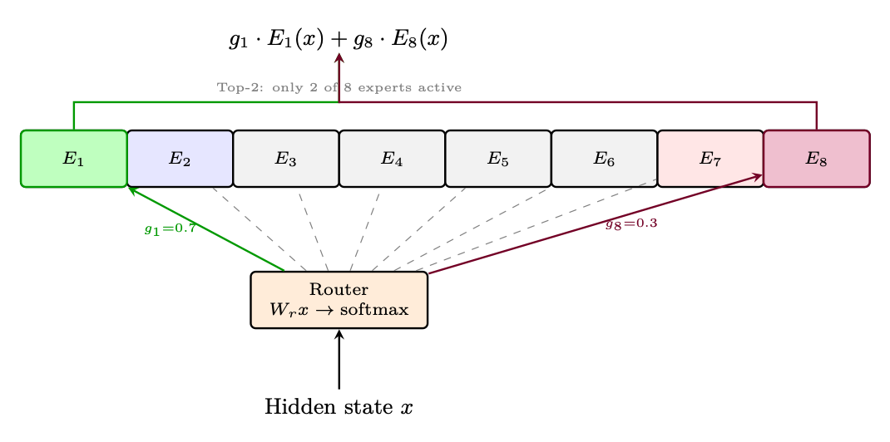

**Figure 1.11: 具有8 个专家和Top-2 路由的MoE 层。每个Token 只计算门控值最高的两个专家；其余专家被完全跳过。**

### 1.10.2 负载均衡

负载均衡问题

在没有约束的情况下，路由器可能会把大多数Token 都发送到相同的1–2 个专家上（“专家坍缩（expert collapse）”）。这既浪费了容量，又造成了跨GPU 的计算不均衡（每个专家通常位于不同的GPU 上）。

解决方案：添加一个辅助的负载均衡损失：

X N Lbal = α · N fi · pi i=1

其中fi 表示路由到专家i 的Token 比例，pi 表示专家i 的平均路由概率。这鼓励了对专家的均匀利用。

### 1.10.3 噪声Top-K 门控（Noisy Top-K Gating）：让离散路由变得可训练

MoE 的核心挑战在于top-k 选择是不可微的——你无法通过一个硬性的“挑选前2 名”操作反向传播。该领域发展出了两个关键技巧来解决这个问题：

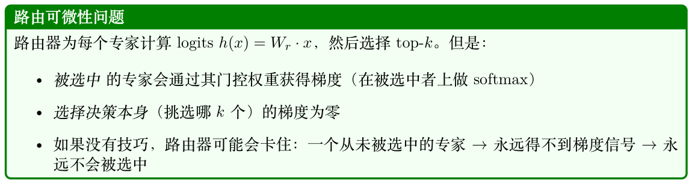

方法1：噪声Top-K 门控（Noisy Top-K Gating）[104]。在进行top-k 选择之前，向路由器的logits 添加可学习的高斯噪声：

h(x) = Wg · x (clean logits)

H(x) = h(x) + ϵ · Softplus(Wnoise · x), ϵ ∼N(0, 1) (noisy logits) ( vi if vi is in the top k TopK(v, k)i = (1.11) −∞ otherwise TopK(H(x), k)  g(x) = softmax (sparse gates)

- Wnoise 是学习得到的噪声幅度——模型会学习每个专家需要多少探索量

- 在训练过程中，噪声偶尔会将“弱势”专家提升到top-k 中，使其获得梯度信号

- 在推理时去除噪声：使用干净的logits h(x) 进行确定性路由

- Softplus 确保噪声尺度始终为正

方法2：Gumbel-Softmax 技巧（Gumbel-Softmax Trick，用于可微的离散采样）。来自变分推断文献的另一种方法[106]。Gumbel-Max 技巧（Gumbel-Max trick）提供了从类别分布中精确采样的方式：

z = arg max [log πi + Gi] , Gi ∼Gumbel(0, 1) (1.12) i

其中Gumbel 噪声由Gi = −log(−log(Ui)), Ui ∼Uniform(0, 1) 生成。

对于top-k 路由：取(log πi + Gi) 的top-k，等价于从由π 定义的类别分布中无放回地抽取k 个样本。

由于arg max 是不可微的，Gumbel-Softmax 松弛将其替换为一个由温度控制的softmax：

exp ((log πi + Gi)/τ) ˆgi = P (1.13) j exp ((log πj + Gj)/τ)

- τ →0：趋近于硬one-hot（精确但不可微）

- τ →∞：趋近于均匀分布（可微但无信息量）

- 实践中，在训练过程中将τ 从1.0 退火到0.1–0.5

- 直通估计器（Straight-through estimator）：前向传播中使用硬top-k，反向传播中使用Gumbel-Softmax 梯度——两全其美实际中使用的是哪种方法？

- Sparsely-Gated MoE [104]、Mixtral [105]、DeepSeek-V2 [107]：使用带高斯噪声的噪声Top-K。简单、有效，在大规模上得到了充分验证。

- Switch Transformer [108]：简化为不带噪声的Top-1（仅依赖负载均衡损失）。

- 研究型/ 小规模MoE：一些工作使用Gumbel-Softmax 实现完全可微的路由，尤其是当学习路由本身就是研究目标时。

- 关键见解：两种方法都通过噪声注入解决了同一个问题（让离散选择可训练）。高斯噪声更简单；Gumbel噪声在类别采样上有更强的理论保证。

### 1.10.4 值得关注的MoE 模型

模型总参数量激活参数量专家创新点

Switch Transformer [108] 1.6T 100B 128, Top-1首个大规模MoE；简化的路由Mixtral 8x7B [105] 47B 13B 8, Top-2开放权重；质量媲美Llama-2 70B DeepSeek-V2 [107] 236B 21B 160, Top-6带共享+路由专家的DeepSeekMoE Qwen-MoE [30] 14.3B 2.7B 60, Top-4为提升效率而设计的细粒度专家DBRX [109] 132B 36B 16, Top-4每块4 个专家的细粒度结构

## 1.11 LLM 训练中的多样性

多样性——在训练数据、模型输出和优化轨迹上的多样性——对于防止模式坍缩并确保鲁棒的通用LLM 至关重要。本节介绍适用于所有LLM 训练阶段的关键多样性机制。

### 1.11.1 采样多样性

用于多样化生成的采样策略

- 温度τ：P(xi) ∝exp(logiti/τ)。更高的τ = 更均匀的分布= 更多样化。典型值：RLHF 生成中使用τ = 0.7–1.0。

- Top-k：只从概率最高的k 个Token 中采样。防止退化的低概率Token。

- Top-p（核采样，Nucleus Sampling）：从累计概率≥p 的最小Token 集合中采样。自适应：模型不确定时更多样。

- Min-p：仅保留满足P ≥pmin × Pmax 的Token。比top-k 更具原理性。

- 频率/出现惩罚（Frequency/presence penalty）：对已在回复中出现过的Token 进行惩罚。鼓励词汇多样性。

### 1.11.2 训练数据多样性

- 提示多样性：覆盖不同的领域、难度等级和格式。Goldilocks原则：提示的成功率应在20–80%之间。

- 去重：移除近似重复的训练样本（MinHash、n-gram重叠）。重复样本会导致对特定模式的过拟合。

- 数据混合：使用温度加权采样或课程策略，在任务/领域之间进行平衡。

### 1.11.3 促进多样性的方法

方法它如何促进多样性

温度缩放（Temperature scaling）更高的τ 会让分布变得更平坦；更多Token 变得合理。

Top-p / Min-p自适应阈值允许模型在不确定时进行更广的采样。

频率惩罚（Frequency penalty）惩罚重复出现的Token，强制在一次回复内产生词汇多样性。

数据去重从训练数据中移除近似重复样本，防止对特定模式的过拟合。

多领域混合跨领域的温度加权采样确保了广泛的覆盖。

口头化采样（Verbalized sampling）提示模型显式地用语言表达出对回复的概率分布[110]。见§7.5。

## 1.12 文本生成：解码方法

一个训练好的语言模型在每一步都会输出一个在词表上的概率分布：P(xt|x<t)。解码策略决定了我们如何从该分布中选择下一个Token。这个选择深刻地影响输出质量、多样性和连贯性。

### 1.12.1 贪心解码（Greedy Decoding）

最简单的策略：总是选择概率最高的Token。

xt = arg max v∈V P(v|x<t)

直觉：就像在句子中总是选取最显而易见的下一个词。”The capital of France is...” →”Paris”（概率0.92）。

优点：确定性、快速、无超参数。

缺点：产生重复、泛泛的文本。当一个早期的低概率Token 会带来全局更优输出时会被错过。没有多样性。

### 1.12.2 束搜索（Beam Search）

并行维护B 个（束宽）部分假设，每一步用top-k 个Token 扩展每个假设，并保留得分最高的B个完整序列：

X t score(y1:t) = log P(yi|y<i) i=1

X |y| scorenorm(y) = log P(yi|y<i), α ∈[0.6, 1.0] |y|α i=1

直觉：就像同时在迷宫中探索多条路径，并在每个岔路口只保留B 条最有希望的路径。

优点：能找到比贪心解码似然更高的序列；适合翻译和摘要等存在单一“正确”输出的任务。

缺点：对开放式生成仍倾向于产生泛泛、重复的文本；计算量增加B 倍；所有束往往收敛到相似的输出。

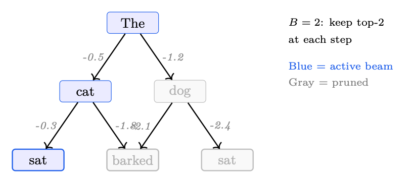

**Figure 1.12: 束宽为B = 2 的束搜索。在每一步，只有得分最高的2 个部分序列会被保留（蓝色）。得分较低的候选会被剪枝（灰色）。**

### 1.12.3 多样化束搜索（Diverse Beam Search）

标准束搜索会产生近似重复的束。多样化束搜索（Diverse Beam Search）[111] 将束划分为G 个组，

X scoreg(yt) = log P(yt|y<t) −λ ∆(yt, Yg′) g′<g

其中∆衡量与较早组已选Token 的重叠（例如Hamming 多样性），λ 控制多样性强度。

直觉：就像强迫一个头脑风暴小组生成不同的想法——每个子组若重复了较早子组所说的内容就会被惩罚。

优点：产生真正不同的候选序列；对重排序流水线很有用。

缺点：多样性惩罚可能降低单个束的质量；超参数更多（G、λ）。

### 1.12.4 Top-k 采样

仅从概率最高的k 个Token 中采样，并重新分配概率质量：   P P(v|x<t) if v ∈Top-k P ′(v|x<t) = v′∈Top-k P(v′|x<t)   otherwise

直觉：在”The cat sat on the...” 之后，只考虑前k 个合理的延续（”mat”、”floor”、”couch”⋯⋯），忽略那些极不可能的（”quantum”、”archipelago”）。

优点：去除尾部噪声；实现简单。

缺点：固定的k 对尖峰分布而言过于严格（浪费概率质量），对平坦分布而言又过于宽松（让垃圾Token 进入）。

### 1.12.5 Top-p 采样（核采样，Nucleus Sampling）

从累计概率超过p 的最小Token 集合中采样：( ) X Top-p = min S ⊆V : P(v|x<t) ≥p v∈S

其中Token 按概率降序排序，并逐个加入直到达到阈值p。

直觉：自适应地调整候选池大小。如果模型很自信（”Paris” 概率95%），核就很小。如果不确定（”The movie was...”），核会扩展以包含许多合理的形容词。

优点：能适应分布形状；广泛使用的默认设置（p = 0.9–0.95）。

缺点：在核的尾部仍会包含一些低质量Token；阈值是一个单一的全局超参数。

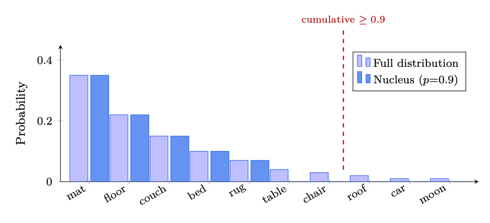

**Figure 1.13: Top-p（核）采样：Token 按概率排序并依次加入，直到累计质量达到p = 0.9。核（深蓝）会根据分布形状自适应其大小——这里5 个Token 就足够了。**

考虑预测下一个词：

- 在”2 + 2 =”之后：分布是尖峰的——top-1 Token（”4”）占据99% 的质量。Top-k=50 会浪费地考虑49 个错误答案。Top-p=0.9 则正确地只选取”4”。

- 在”I enjoy eating”之后：分布是平坦的——许多食物都合理。Top-k=5 太过严格。Top-p=0.9可能会包含50 多个Token，与实际的不确定性相匹配。

Top-p 自适应；top-k 不会。实践中，两者常被结合使用：从top-p 与top-k 的交集中采样。

### 1.12.6 Min-p 采样

一种较新的替代方法，它设置一个相对概率下限[112]：  Min-p = v ∈V : P(v|x<t) ≥pmin · max P(v′|x<t) v′

只有概率至少为最高Token 概率pmin 倍的Token 才会被保留。

直觉：“只考虑那些其可能性至少为最优Token 10% 的Token。”如果最高Token 的概率为0.8，那么只有概率高于0.08 的Token 能留下。如果最高Token 的概率为0.05（非常不确定），概率高于

## 0.005 的Token 都能留下——自然地扩大了候选池。

优点：会随模型置信度自然伸缩；在尖峰分布上比top-p 产生更少的退化样本；只有一个直观的参数。

缺点：较新、经受的实战检验较少；尚未在所有推理框架中成为标准。

### 1.12.7 温度缩放

在应用任何采样策略之前，将logits 除以温度T：

exp(zv/T) PT (v|x<t) = P v′ exp(zv′/T)

- T < 1：使分布更尖锐→更确定、更聚焦的输出。

- T = 1：未修改的模型分布。

- T > 1：使分布更平坦→更随机、更有创造性的输出。

- T →0：退化为贪心解码。T →∞：退化为均匀采样。

常见设置：事实性任务T = 0.7，创意写作T = 1.0–1.2，代码/数学T = 0.0（贪心）。

### 1.12.8 对比解码（Contrastive Decoding）

对比解码（Contrastive Decoding）[113] 利用一个强模型（专家）与一个弱模型（业余者）之间的差异，来放大专家独有的知识：

xt = arg v∈V(x<t) [log Pexpert(v|x<t) −log Pamateur(v|x<t)] max

其中V(x<t) = {v : Pexpert(v|x<t) ≥α · maxv′ Pexpert(v′|x<t)} 是一个自适应的合理性约束。

直觉：业余模型捕捉到的是泛泛的、显而易见的模式（常用词、重复）。减去其对数概率就去除了这种“泛泛信号”，留下专家独有的知识和推理。就像从录音中去除背景噪声以听见信号一样。

优点：减少重复和泛泛的措辞；在不额外训练的情况下提升事实性和连贯性；可与任意一对模型搭配使用。

缺点：需要运行两个模型（计算量加倍）；对业余模型的选择敏感；合理性阈值α 需要调优。

### 1.12.9 重复惩罚

与采样策略正交，重复惩罚（repetition penalties）阻止模型重复Token。给定Token v 的原始logit zv（即LM 头在softmax 之前输出的未归一化得分），惩罚后的logit 为：

( zv/θ if v ∈generated tokens and zv > 0 z′ v = zv · θ if v ∈generated tokens and zv < 0

其中θ > 1 是惩罚因子（通常为1.1–1.3）。在两种情况下，其效果都是把logit 推向零——从而降低先前生成Token 的概率。频率惩罚和出现惩罚是OpenAI API 使用的更简单的加性变体：

z′ v = zv −α · count(v) −β · 1[v ∈generated]

其中α 是频率惩罚（与v 出现次数成正比），β 是出现惩罚（对任何先前出现给予恒定惩罚）。

### 1.12.10 实际对比

**Table 1.15: LLM 文本生成中各解码方法的对比。**

| 同一个模型、同一个提示——解码策略决定了输出的风格。 |  |  |  |  |
| --- | --- | --- | --- | --- |
| 方法 | 是否确定性 是 | 多样性 无 | 质量 中等 | 最佳适用 代码、事实问答 |
| Greedy |  |  |  |  |
| Beam Search（B=4–8） | 是 是 | 低 中等 | 高（较窄） 高 | 翻译、摘要 用于重排序的候 |
| Diverse Beam Search |  |  |  | 选生成 |
| Top-k（k=50） | 否 | 中等 | 中等 | 通用生成 |
| Top-p（p=0.9） | 否 | 自适应 | 高 | 开放式任务的默 认选择 |
| Min-p（pmin=0.1） | 否 | 自适应 | 高 | top-p 的稳健替代 |
| Contrastive | 是 | 低 | 非常高 | 事实性、连贯的长 文本 |
| 实际中的解码：“Once upon a time” |  |  |  |  |
| 给定提示”Once upon a time,”： |  |  |  |  |
| • Greedy: ”there was a young girl who lived in a small village...”（泛泛的童话） |  |  |  |  |
| • Top-p=0.9, T=1.0: ”the rivers ran backwards and the fish learned to fly...”（有创意、出 |  |  |  |  |
| 人意料） |  |  |  |  |
| • Top-p=0.9, T=0.3: ”there was a kingdom ruled by a wise and just king...”（连贯、常规） |  |  |  |  |
| • Contrastive: ”in the amber-lit corridors of a collapsing star, two minds argued about the |  |  |  |  |
| nature of time...”（独特，避免了陈词滥调） |  |  |  |  |

### 1.12.11 受限解码（Constrained Decoding，结构化生成Structured Generation）

上述所有方法都在每一步从完整的词表中采样。受限解码（Constrained Decoding）限制允许的Token 集合，从而保证输出符合某种形式语法——通常是JSON 模式、正则表达式或上下文无关文法（Context-Free Grammar，CFG）。

核心机制。在每个解码步t，会根据当前解析器状态计算一个Token 掩码（token mask）Mt ⊆V。

只有Mt 中的Token 保留其原始logits；在softmax 之前，所有其它Token 都被设为−∞：

( P(v|x<t)/Z if v ∈Mt P ′(v|x<t) = otherwise

其中Z = P v∈Mt P(v|x<t) 用于重新归一化。由于掩码每一步都会变化（它取决于到目前为止已经生成的内容），约束是逐步强制实施的——模型在任何位置都不可能生成一个非法前缀。

从模式到掩码。编译流水线为：

JSON Schema −−−−→Regex compile −−−−→FSM (DFA) compile −−−→Token Mask per State index

有限状态机（FSM）的状态对应正则表达式中的位置。对每个状态，所有能使字符串保持在该语言内的词表Token 都被预计算成索引（对每个模式只需一次性的开销）。在运行时，查询掩码只是一次O(1) 的表访问——对每个解码步带来的延迟可忽略不计。

关键库。

- Outlines [114]：将JSON 模式和正则表达式编译为交织的、由FSM 引导的生成。支持任何提供logits 接口的模型。

- lm-format-enforcer1：类似的FSM 方法，重点放在与服务框架（vLLM、TGI）的集成上。

- Guidance2（Microsoft）：将受限生成与控制流（循环、条件）交织在一起，可实现超越扁平模式的复杂结构化输出。

- XGrammar [115]：基于下推自动机的引擎，支持完整的上下文无关文法（不仅限于正则语言），被MLC-LLM 和vLLM 用于语法模式的解码。

权衡。受限解码保证了语法有效性——不会出现事后解析失败，也无需重试。然而：

- 语义质量：如果模型对“正确”答案的概率质量位于语法之外，强制结构可能会降低内容质量。

在实践中，对于设计良好的模式和训练良好的模型，这种情况很少出现。

- 编译开销：必须为每个模式构建FSM 索引。对于复杂模式可能需要1–5 秒，但这一开销会在所有使用该模式的请求间摊销。

- 语法覆盖：正则/FSM可处理JSON、YAML、SQL 片段以及大多数结构化格式。完整的CFG（通过XGrammar 或LALR 解析器）可覆盖Python 或XML 等语言。

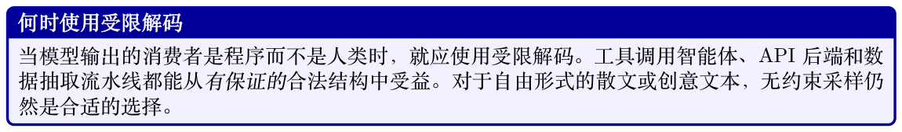

```
1https://github.com/noamgat/lm-format-enforcer
2https://github.com/guidance-ai/guidance
```

## 1.13 Prompt 工程

Prompt 工程是一门设计LLM 输入的学科，目标是在不修改模型权重的情况下可靠地激发预期行为。微调修改的是模型本身，而Prompt 工程则通过精心的框架、示例与结构来挖掘模型已有的能力。它是改善LLM 输出最快、最便宜、也最易获得的杠杆，即使在使用微调模型时也依然不可或缺。

### 1.13.1 上下文学习（In-Context Learning，ICL）

上下文学习[21] 是大语言模型一项令人瞩目的能力：在推理时仅凭Prompt 中提供的示例就能学习任务，完全无需梯度更新。模型从输入-输出对的模式中隐式推断任务，并泛化到新的输入上。

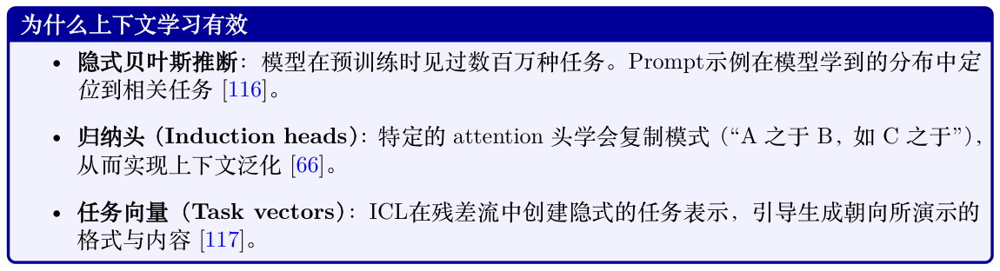

扩展行为。ICL 主要在参数量约1B 以上的模型中涌现，并随模型规模呈对数线性提升[21]。较小的模型可以记住示例，但难以在同一上下文窗口内泛化到新的输入。

### 1.13.2 零样本提示（Zero-Shot Prompting）

零样本提示不提供任何示例，只有任务描述或指令。模型必须完全依靠预训练知识与指令微调来生成正确的格式与内容。

```
零样本分类
Classify the following movie review as POSITIVE or NEGATIVE.
Review: "The cinematography was breathtaking but the plot
felt rushed and predictable."
Sentiment:
```

零样本何时奏效：

- 模型在预训练/SFT阶段大量见过的任务（翻译、摘要、情感分析）

- 指令明确、输出格式无歧义

- 指令微调模型（如ChatGPT、Claude、Llama-3-Instruct）在零样本任务上显著优于基座模型[9]

零样本何时失效：全新格式、领域特定的标注方案，或模型无法仅凭指令推断出确切需求的模糊任务。

### 1.13.3 少样本提示（Few-Shot Prompting）

少样本提示[21] 在实际查询之前提供k 个输入-输出示例（即“shots”）。它是上下文学习最常见的形式，也仍然是最有效的提示策略之一。

```
少样本命名实体识别
Extract named entities from the text. Format: [ENTITY](TYPE)
Text: "Apple released the iPhone 15 in Cupertino."
Entities: [Apple](ORG), [iPhone 15](PRODUCT), [Cupertino](LOC)
Text: "Elon Musk announced Tesla's new factory in Berlin."
Entities: [Elon Musk](PER), [Tesla](ORG), [Berlin](LOC)
Text: "OpenAI partnered with Microsoft to deploy GPT-4."
Entities:
```

少样本示例的关键设计原则：

1. 多样性：覆盖预期输入的范围（不同长度、边界情况、类别）。

2. 顺序：将较难或更具代表性的示例放在最后（近因偏差，recency bias）[118]。

3. 标签平衡：分类任务中要包含所有类别的示例，以避免多数类偏差。

4. 格式一致性：每个示例都必须遵循完全相同的结构。模型会模仿这种模式。

5. 相关性：选用与目标查询语义相近的示例可获得最佳效果[119]。

需要多少个示例？性能通常会从0 个示例提升到4–8 个示例，然后趋于平稳。超过约20 个示例后收益微乎其微，反而有占满上下文窗口的风险。Min 等人[120] 表明，示例的格式与标签空间比标签正确性更重要——即使随机标签也有帮助（不过正确标签帮助更大）。

### 1.13.4 指令跟随类Prompt

指令微调模型对清晰、结构化的指令响应最好。关键洞察是：把Prompt 当作规范说明，而不是建议。

```
高效指令型Prompt 的解剖
1. 角色/人格：定义模型是谁（“你是一名资深数据科学家⋯⋯”）
2. 任务：要做什么，表述清晰无歧义
3. 上下文：模型需要的背景信息
4. 约束：长度限制、语气、需要避免的内容、输出格式
5. 示例（可选）：展示期望的输出格式
6. 输入：实际待处理的数据
带约束的指令型Prompt
Role: You are a medical literature reviewer.
Task: Summarize the following research abstract for a
general audience.
Constraints:
- Maximum 3 sentences
- No jargon (explain any technical terms)
- Include the key finding and its clinical implication
- Do NOT speculate beyond what the abstract states
Abstract: [...]
```

System Prompt 与User Prompt 的对比。现代聊天API 将系统Prompt（持久指令、角色定义）与用户消息（每轮输入）分离。多数模型对system prompt 赋予更高的attention 优先级，是放置角色定义、约束和输出格式说明的天然位置[23]。

### 1.13.5 结构化输出Prompt（JSON/XML）

对于程序化用途，最关键的提示技术是强制结构化输出——尤其是JSON。

```
JSON 输出Prompt
Extract the following information from the customer email.
Respond ONLY with valid JSON, no other text.
Schema:
{
"intent": "refund|complaint|question|praise",
"urgency": "low|medium|high",
"product_mentioned": "string or null",
"summary": "one sentence summary"
}
Email: [...]
```

获得可靠结构化输出的技巧：

- Schema 优先：在输入之前展示精确的JSON schema，模型会将其当作模板。

- 约束解码（Constrained decoding）：使用基于语法的采样（如Outlines [114]、Guidance）在token 级别保证JSON 语法合法。

- XML 标签：对于嵌套或多段输出，XML 标签（如<thinking>...</thinking>）提供无歧义的分隔符，模型能可靠地遵循。

- Pydantic/TypeScript 类型：提供类型定义有助于模型理解字段约束（OpenAI 的function calling 内部就使用JSON Schema）。

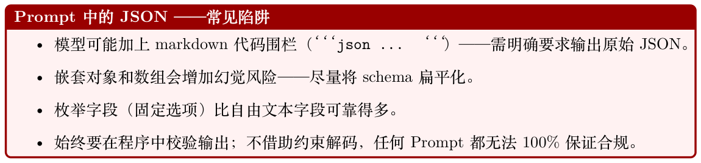

JSON Prompting：结构化输入本身。一种独立但互补的技术是JSON prompting——将Prompt本身格式化为JSON 而非自然语言。这利用了模型在结构化数据（API、配置、代码）上的大量预训练，从而提升指令遵循度、降低歧义，并使多字段请求能被确定性地解析。

```
结合System Prompt 的JSON Prompting
=== SYSTEM ===
You are a senior code reviewer. Analyze code for bugs,
security issues, and style violations. Always respond
in the JSON schema provided.
=== USER (JSON prompt) ===
{
"task": "code_review",
"language": "python",
"severity_filter": "high",
```

```
"code": "def login(user, pw):\n query = ...",
"output_schema": {
"issues": [{
"line": "int",
"severity": "critical|high|medium|low",
"category": "security|bug|style|performance",
"description": "string",
"fix": "string"
}],
"overall_risk": "critical|high|medium|low"
}
}
为何JSON prompting 有效：
• 无歧义的字段边界：不会混淆一条指令何处结束、下一条何处开始。
• 带类型的约束：像"severity_filter": "high" 这样的字段比“只显示高严重度问题” 更
清晰。
• Schema 即契约：在输入中加入output_schema 复刻了模型在预训练中大量见过的API
设计模式。
• System prompt 依然不可或缺：System 消息提供角色、语气与行为约束，这些内容并不
适合放进JSON 负载里。
```

### 1.13.6 思维链（Chain-of-Thought，CoT）Prompting

思维链Prompting [121] 要求模型在给出最终答案之前先生成中间推理步骤。这一简单技术在需要多步推理的任务上（算术、逻辑、常识推断与代码生成）能带来显著的性能提升。

#### CoT 为何奏效：

- 将计算序列化：Transformer深度固定，但生成长度可变。CoT 将并行（困难）问题转化为串行（容易）的步骤，相当于增加了模型的计算预算。

- 降低累积误差：每一步都是更简单的子问题，单步错误率更低。

- 暴露中间状态：让推理过程可审计、可调试。

```
思维链的变体
方法说明
零样本CoT（Zero-Shot CoT）[122]在任意Prompt 末尾追加“Let’s think step by step”
少样本CoT（Few-shot CoT）[121]提供带显式推理链的示例
自一致性（Self-Consistency）[123]采样N 条CoT 路径；对最终答案做多数投票
思维树（Tree of Thoughts）[124]探索多条推理分支并支持回溯
Plan-and-Solve [125]先规划步骤，再逐步执行
ReAct [126]交替进行Reasoning 与Acting（工具调用）
零样本思维链
Q: A store has 45 apples. They sell 3/5 of them in the
morning and 1/3 of the remaining in the afternoon.
How many apples are left?
Let's think step by step.
A: Morning sales: 45 * 3/5 = 27 apples sold.
Remaining after morning: 45 - 27 = 18.
Afternoon sales: 18 * 1/3 = 6 apples sold.
```


自一致性（Self-Consistency）。Wang 等人[123] 表明，采样多条思维链推理路径并对最终答案做多数投票，能显著优于单路径CoT。直觉是：正确的推理路径往往收敛于同一答案，而错误通常各有不同。这是用算力（生成N 个样本）换取准确率——在延迟不如正确性重要时非常实用。

CoT 何时反而有害。CoT 并非普遍有益。对于简单任务（单步分类、检索、格式化），CoT 会增加不必要的token、提高延迟，甚至会因过度思考引入错误。应有选择地在确实需要多步推理的任务中使用CoT。

### 1.13.7 进阶Prompting 技术

检索增强生成（Retrieval-Augmented Generation，RAG）。RAG [127] 不再只依赖模型的参数化记忆，而是检索相关文档并将其纳入Prompt：

```
Context (retrieved): [document chunks]
Question: [user query]
Answer based ONLY on the provided context.
```

这将模型的回答锚定在可验证的来源上，在知识密集型任务中能显著减少幻觉。

Prompt 链式调用与分解。复杂任务受益于被拆解成由多个简单Prompt 组成的流水线，每一步的输出作为下一步的输入：

1. 从文档中提取关键事实

2. 在提取出的事实上进行推理

3. 格式化最终答案

每一步都可以使用不同的Prompt 模板、模型或温度设置。相较单一的大Prompt，这种方式更可控，也便于有针对性地调试。

宪法AI（Constitutional AI）/ 自我批评（Self-Critique）。Bai 等人[128] 引入了一类Prompt：让模型根据一组原则批评并修订自己的输出：

```
[Generate initial response]
Critique: Does this response violate any of the following
principles? [list principles]
Revision: Rewrite the response addressing the critique.
```

元提示（Meta-Prompting）与Prompt 优化。与手工编写Prompt 不同，近期工作开始自动化Prompt 设计：

- APE [129]：使用LLM 自动生成并打分候选Prompt。

- DSPy [130]：将声明式的任务描述编译为优化过的Prompt 流水线，并带有学习到的少样本示例。

- OPRO [131]：将Prompt 优化视为优化问题，使用LLM 作为优化器。

专注推理查询（Attentive Reasoning Queries，ARQ）。ARQ [132] 解决了标准Prompting 的一个根本弱点：随着上下文变长，模型越来越容易“丢失” Prompt 中段的关键信息（即lost-in-the- middle 效应）。ARQ 通过将复杂查询分解为若干聚焦的子查询来缓解这一问题，每个子查询都旨在将模型的attention 引向上下文的特定部分：

1. 查询分解：将用户问题拆解为原子级的子问题，每个聚焦一个狭窄方面。

2. 专注检索：对每个子查询，仅检索或高亮与之相关的上下文片段——迫使模型聚焦于它。

3. 聚合：将子答案合并为连贯的最终回答。

这在长文档问答、对大规模检索集合的多跳推理以及上下文窗口中包含大量工具输出的智能体任务中尤为有效。ARQ可被视为一种结构化的思维链，它显式地管理模型看哪里，而不仅仅是怎么推理。

### 1.13.8 最佳实践：打造高效Prompt

基于文献中的实证发现与从业者经验，以下原则能够稳定地提升Prompt 质量：

#### Prompt 工程检查清单

1. 具体且无歧义：把“总结一下” 替换为“用2–3 个要点总结，每条不超过20 字，聚焦可操作的发现”。

2. 展示而非陈述：一个好示例胜过100 字的说明。拿不准时就加一个少样本示例。

3. 显式定义输出格式：指定JSON schema、要点列表、表格格式或精确分隔符。绝不把格式留给模型自行解读。

4. 为输入数据使用分隔符：用明确的分隔符（"""、<input>...</input>、---）包裹用户输入，将指令与数据分开。

5. 指定角色：“你是一名[领域专家]，[具体行为]” 可以激发相关知识与语气。

6. 指明不要做什么：负向约束（“不要解释你的推理”、“绝不输出超过5 项”）通常比正向约束更有效。

7. 为推理任务加入思维链：对数学、逻辑或多跳问题，追加“Think step by step” 或提供解题示例。

8. 合理控制温度：事实/确定性任务用T ≈0；创造性/多样化输出用T ≈0.7–1.0。

9. 基于实证迭代：把Prompt 当作代码——做版本管理、A/B 测试，并在代表性评测集上度量性能。

10. 利用近因偏差：将最关键的指令和示例放在Prompt 的末尾（最接近生成位置）。

**Table 1.16: 常见的Prompting 失效模式与解决方案。**

| Prompt 工程的心智模型 |  |  |
| --- | --- | --- |
| 把Prompt 工程想象成用自然语言编程。模型是一个强大但字面化的解释器——它会严格按照你 |  |  |
| 的要求执行，并按其训练分布中最可能的方式去理解。软件工程的常见原则同样适用： |  |  |
| • DRY（Don’t Repeat Yourself）：除非是为对抗长上下文中的attention 衰减 |  |  |
| • 关注点分离：角色、约束、示例与输入分置于不同的Prompt 段落 |  |  |
| • 测试驱动开发：先定义期望输出，再编写Prompt |  |  |
| • 版本控制：跟踪Prompt 的迭代及其评测分数 |  |  |
| • 模块化：构建可复用的Prompt 模板；将可变部分参数化 |  |  |
| 当经过系统迭代后Prompt 仍无法达到所需质量，这就是切换到微调（SFT）或强化学习（RLHF/ |  |  |
| DPO）的信号。 |  |  |
| 失效模式 | 症状 | 解决方案 |
| 指令遗忘 | 模型在长Prompt 中忽略约束 | 把约束放到末尾；重复关键规则；使用 system prompt |
| 格式漂移 | 输出开头正确，但在长生成中逐渐崩坏 | 使用约束解码；拆分为多段较短的链式 Prompt |
| 谄媚（Sycophancy） | 模型附和Prompt 中错误的前提 | 加上“若前提不正确请质疑”；使用系统 级指令 |
| 细节幻觉 | 模型编造上下文中不存在的事实 | 加上“若未知请说不知道”；使用带溯源 的RAG |
| 过度拒答 | 模型因安全训练而拒绝无害请求 | 改写以澄清正当意图；显式说明请求合理 性的上下文 |

## 1.14 模型压缩方法

模型压缩在保持质量的同时降低模型规模和推理成本。三种主要方法：量化（Quantization，降低数值精度）、剪枝（Pruning，移除参数）和蒸馏（Distillation，训练较小模型模仿更大模型）。

### 1.14.1 量化（Quantization）

量化通过将权重（以及可选的激活值）表示为更低精度的格式来缩小模型规模、降低推理成本。其核心权衡在于压缩率与质量下降之间。

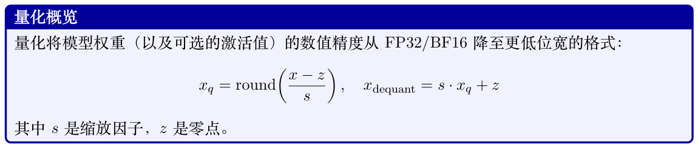

**Table 1.17: 面向LLM 的量化方法。**

| 何时进行量化 |  |  |
| --- | --- | --- |
| • 推理服务：始终量化。W4A16（4-bit权重，BF16 激活）是甜点——节省2× 内存，对70B |  |  |
| 以上模型质量损失<1%。 |  |  |
| • 训练：H100上的FP8 在质量损失极小的情况下提供2× 吞吐。BF16 仍是较小模型的默认 |  |  |
| 选项。 |  |  |
| • 边缘部署：在消费级硬件上做本地推理时使用GGUF Q4_K_M。 |  |  |
| • RLHF：将冻结模型（参考模型、奖励模型）量化为INT8/FP8。策略模型保持BF16 以 |  |  |
| 确保训练精度。 |  |  |
| 方法 | 位宽 类型 | 核心思想 |
| GPTQ [133] | 4-bit PTQ，仅权重 | 基于optimal brain surgeon 进 行逐层量化，最小化∥WX − ˆWX∥2。 |
| AWQ [134] | 4-bit PTQ，仅权重 | 保护显著权重（与大激活相对应）。 1% 的权重承担99% 的重要性。 |
| GGUF [135] | 2–8 bit PTQ，仅权重 | 面向 CPU 优化的格式 （llama.cpp） 。按 block 量 化，支持多种类型。 |
| FP8 (E4M3) | 8-bit 训练+ 推理 | H100 原生支持。相比BF16 提供 2× 吞吐。 |
| SmoothQuant [136] | W8A8 PTQ，权重+ 激活 | 在量化前将激活离群值平滑迁移 到权重。使INT8 GEMM 可行。 使用模拟量化进行训练。质量最 |
| QAT [137] | 4-bit QAT | 高但成本昂贵。 |
| AQLM [138] | 2-bit PTQ，加性码字 | 通过学习到的加性量化码本实现 极端压缩。 |

### 1.14.2 剪枝（Pruning）

为何要剪枝？现代LLM 包含数十亿参数，而实证研究一致表明其中相当大一部分权重对模型输出贡献甚微。剪枝正是利用这种过参数化：通过移除冗余权重，可以降低内存占用（使其能部署于较小的GPU 或边缘设备）、推理延迟（每次前向传递的乘加操作更少），以及服务成本（每美元的吞吐更高）。与对所有权重统一降低精度的量化不同，剪枝有选择地消除权重——与量化结合时能带来乘性的节省（例如50% 稀疏、4-bit 的模型相比密集BF16 基线节省4× 内存）。挑战在于既要实现高稀疏度又不损害生成质量，这推动了无需重新训练的一次性（one-shot）原则性方法的发展。

剪枝方法

- 非结构化剪枝：将低于阈值的单个权重置零。可实现高稀疏度（50–90%）。需要稀疏GEMM内核（A100/H100 上的2:4）。

- 结构化剪枝：移除整个attention 头、层或FFN 神经元。无需专门内核即可直接降低FLOPS。

- SparseGPT [139]：使用近似逆Hessian 进行一次性剪枝。在175B 模型上以极小的质量损失实现50% 非结构化稀疏。

- Wanda [140]：按|w| × ∥x∥（权重幅值乘以输入激活范数）剪枝。无需校准数据，效果可与SparseGPT 竞争。

A100/H100 Tensor Core 原生支持2:4 稀疏：每4 个元素中至多2 个非零。在硬件加速支持的操作上恰好带来2× 加速。其约束是：必须恰好在这一特定模式下达到50% 稀疏，相比任意稀疏度灵活性较低。

### 1.14.3 知识蒸馏（Knowledge Distillation）

知识蒸馏[141] 将一个大型教师模型已学到的行为迁移到一个更小、更便宜的学生模型中。核心思想是：教师在token 上的输出分布所携带的信号远比单纯的硬标签丰富——揭示了类间相似性、置信度校准与不确定性，学生可以加以利用。

温度缩放（Temperature Scaling）的Softmax。为了揭示教师logits 中的“暗知识”（dark knowledge），我们用温度T > 1 对分布进行软化：

p(T) = P exp(zi/T) i j exp(zj/T)

温度较高时概率质量在更多token 上分布开来，使接近正确的备选项变得可见。训练时学生使用相同温度；推理时学生使用T = 1。

通用蒸馏损失。

Ldistill = α T 2 · KL P (T) teacher ∥P (T)  + (1 −α) · LCE(y, P (1) student) student T 2 因子补偿了软化分布造成的梯度幅度下降。典型取值：T ∈[2, 20]，α ∈[0.5, 0.9]（教师质量越高，

KL 的权重越大）。

**Table 1.18: 面向LLM 的知识蒸馏范式。**

| 范式 | 机制 | 优点 | 缺点 |
| --- | --- | --- | --- |
| 离线/ 白盒（Offline / White-box） | 预先计算教师log- its；学生在完整分 布上训练 | 完整分布信号；教 师代价一次性付出 | 数据陈旧；存储开 销大 |
| 在线/ 协同训练（Online / Co-training） | 教师在线生成；学 生看到新鲜logits | 适应学生弱点 | 算力2×；基础设 施复杂 |
| 黑盒（API） | 仅有教师的文本输 出（无logits） | 适用于专有模型 | 失去暗知识；近似 于SFT |
| 自蒸馏（Self-distillation） | 模型蒸馏到自身的 较小版本 | 不需要单独的教师 | 教师= 学生家族； 存在上限 |

离线（白盒）蒸馏。为每个训练token 记录教师完整的logit 向量（或为节省存储而记录top-k logits）。学生最小化与这些存储分布的KL 散度。在教师访问不受限时，这是最数据高效的范式。

动机：将教师推理与学生训练解耦——在高端硬件上跑一次教师，之后廉价地训练多个学生。

优点：确定性、可复现；教师代价被摊销；完整分布信号。

缺点：需要为每个token 存储|V | 维向量（可通过top-k 剪枝缓解）；教师无法针对学生的失误进行调整。

在线（协同训练）蒸馏。教师与学生联合运行：教师为学生当前的训练批次生成logits。

动机：让教师聚焦于学生当前难以处理的输入（类似课程学习）。

优点：数据新鲜；可使用学生生成的输入进行on-policy 蒸馏。

缺点：GPU 代价翻倍；同步复杂度高；更难扩展。

黑盒（API）蒸馏。当仅有文本输出可用时（例如从专有API 蒸馏），学生通过对教师生成结果做SFT 进行训练，并可选地辅以思维链轨迹。

动机：现实约束——大多数前沿模型不暴露logits。

优点：流程简单；适用于任何带API 的模型。

缺点：没有软标签信号；容易放大幻觉；本质上等同于监督微调。

自蒸馏。模型从同一架构家族中的较大版本（例如Llama-3 70B →8B）或训练过程中的自身checkpoint 蒸馏。

动机：避免训练单独的教师；在不同规模上利用模型自身的能力。

优点：架构兼容；无外部依赖。

缺点：教师天花板等于模型天花板；无法引入真正新的知识。


LLM 蒸馏的实践考量。

- 序列级vs. token 级：token 级KL 是标准做法；序列级蒸馏（在完整序列上最小化KL）能更好地捕捉长程一致性，但更难优化。

- 逐层提示：匹配中间表示（attention图、隐藏状态）能提供额外的学习信号——尤其在学生架构不同的情况下有用。

- 数据选择：蒸馏数据质量很重要；精挑多样化的困难样本比随机采样能产出更好的学生。

- 学生容量：学生参数低于教师约10% 时收益递减；在极端压缩下可能需要架构变更（例如MoE →dense）。

- 与量化结合：蒸馏+ 4-bit 量化（例如QLoRA 蒸馏模型）能在20× 压缩下达到接近教师的质量。

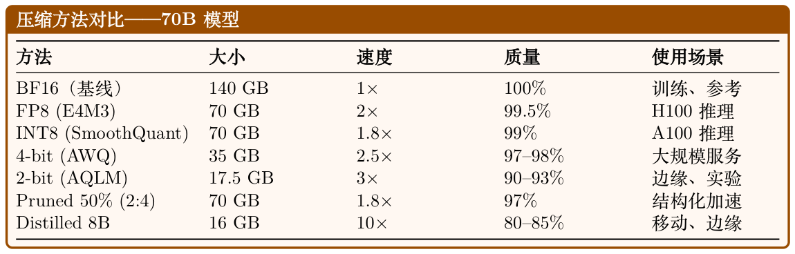

## 1.15 投机解码（Speculative Decoding）方法

投机解码[142] 通过同时预测多个token，然后在目标模型的一次前向传递中对其进行验证，来加速自回归生成。它产生与标准解码完全相同的输出分布（无质量损失），同时实现2–3× 加速。

### 1.15.1 核心原理

投机解码框架

1. 一个快速的草稿（draft）机制提议k 个候选token：ˆx1, . . . , ˆxk

2. 大的目标模型对所有k 个token 进行一次（批量）前向传递

3. 验证：从左到右依次接受token，只要Ptarget(ˆxi) ≥ri · Pdraft(ˆxi)（其中ri ∼U[0, 1]）

4. 在位置j 首次被拒绝时：从调整后的分布重新采样xj，并丢弃ˆxj+1, . . . , ˆxk

关键性质：这一接受/拒绝方案保证最终分布与Ptarget 完全一致。

加速比：若接受率为α，每步期望token 数= 1−αk+1 1−α 。在α = 0.8、k = 5 时：每步期望3.4 个

token，相较标准解码的1 个。

### 1.15.2 方法对比

### 1.15.3 Medusa 多头推测解码

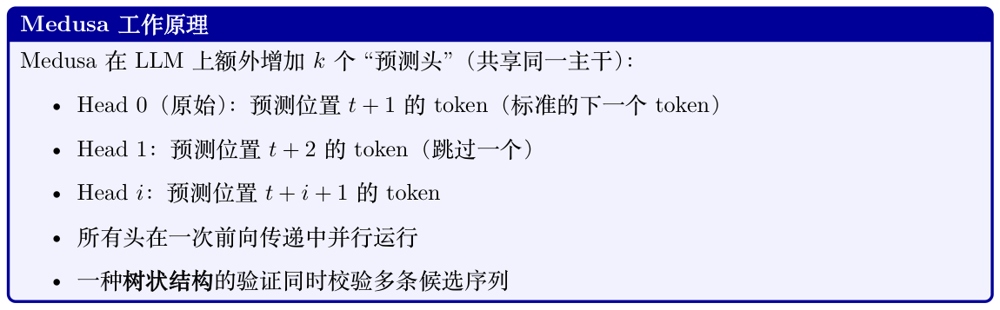

**Table 1.19: 现代推理引擎支持的投机解码方法。**

| 方法 | 草稿来源 | 加速比 核心思想 |
| --- | --- | --- |
| 标准方案[142] | 小模型（1–7B） 并行LM 头 | 独立的草稿模型生成候选。简单但需要同时加载2 个 2–3× 模型。 在目标模型上增加k 个额外的预测头。每个分别预测 |
| Medusa [143] |  | 2–3× +1, +2, . . . , +k 位置的token。 |
| Eagle [144] | 特征层级 | 2.5–3.5× 轻量解码器根据目标模型的隐藏状态生成草稿token。 接受率高于Medusa。 |
| Eagle-2 [144] | 上下文感知 | 3–4× 基于置信度扩展的动态草稿树。当前最先进的接受率。 |
| N-gram Lookup | N-gram 缓存 | 1.5–2× 将Prompt 的n-gram 与已生成文本进行匹配。零成本； 对重复输出极佳。 |
| Lookahead [145] | Jacobi 迭代 | 2–2.5× 并行Jacobi 解码配合n-gram 验证。无需草稿模型；使 用目标模型自身。 |
| 多token 预测[146] | 修改架构 | 2–3× 训练模型原生地在每步预测多个token（Meta 在Llama 中的方案）。 |


### 1.15.4 Eagle：特征级草稿

Medusa 的各个头在不同位置独立预测——它们无法以自己先前的预测为条件（t+2 位置的token不知道t + 1 预测了什么）。Eagle 通过一个作用在目标模型隐藏状态上的轻量自回归解码器修正了这一点：

1. 从目标模型最后一层提取隐藏状态

2. 输入一个小型（1层）解码器，以先前隐藏状态为条件自回归地生成草稿token

3. 这捕捉到了Medusa 所缺失的token 间依赖

结果：Eagle 实现85–95% 的接受率，而Medusa 为60–80%。

### 1.15.5 N-gram 投机解码

最简单的投机解码——无需额外模型或训练：

1. 维护一份来自Prompt 与已生成文本的n-gram 缓存

2. 每一步检查当前上下文的最后n −1 个token 是否匹配缓存中的任一n-gram

3. 若匹配：将其后继作为草稿token 提议

4. 像往常一样在目标模型上进行验证

最佳场景：代码生成（重复模式）、结构化输出（JSON/XML），以及带有重复元素的Prompt。

成本：基本为零。

### 1.15.6 与vLLM 的集成

```
from vllm import LLM, SamplingParams
# 标准投机解码（独立的草稿模型）
llm = LLM(
model="meta-llama/Llama -3-70B",
tensor_parallel_size=4,
speculative_config={
"model": "meta-llama/Llama -3-8B",
"num_speculative_tokens": 5,
},
)
# N-gram 投机（零成本，无需草稿模型）
llm = LLM(
model="meta-llama/Llama -3-70B",
speculative_config={
"method": "ngram",
"num_speculative_tokens": 5,
"prompt_lookup_max": 4, # 从Prompt 中匹配最长4-gram
},
)
# EAGLE 风格（特征级草稿，高接受率）
llm = LLM(
model="meta-llama/Meta-Llama -3-8B-Instruct",
tensor_parallel_size=4,
speculative_config={
"model": "yuhuili/EAGLE-LLaMA3 -Instruct -8B",
"num_speculative_tokens": 2,
"method": "eagle",
"draft_tensor_parallel_size": 1,
},
)
# MLP 推测器（IBM 风格，轻量预测头）
llm = LLM(
model="meta-llama/Meta-Llama -3.1-70B-Instruct",
tensor_parallel_size=4,
speculative_config={
"model": "ibm-ai-platform/llama3 -70b-accelerator",
"draft_tensor_parallel_size": 1,
},
)
何时不该使用投机解码
• 高批量：当batch ≥64 时，生成本身已经计算密集。投机解码引入的开销（草稿生成+ 验
证）得不偿失。
• 分布差异过大：若草稿模型与目标模型差异过大，接受率会跌至50% 以下，反而比标准解
码更慢。
• 短输出：对少于20 个token 的输出，投机解码的启动开销超过收益。
• 经验法则：投机解码对延迟敏感的单流生成（聊天机器人、交互式代码补全）帮助最大。
```

## 1.16 幻觉检测

LLM会生成流畅但可能事实错误的文本——这种现象称为幻觉（hallucination）[147]。本节介绍在模型层面（不依赖外部检索或多智能体校验）的基本检测方法。

### 1.16.1 幻觉的类型

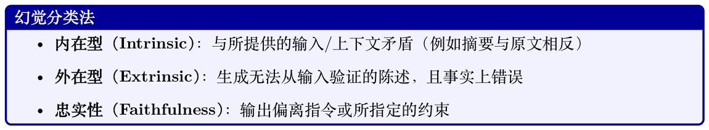

### 1.16.2 检测方法（模型层级）

**Table 1.20: 在模型层面运作的基础幻觉检测方法。**

| 方法 | 机制 | 信号 |
| --- | --- | --- |
| Token 级熵 | 生成时的高熵表示不确定[148] | H(P(xt)) > τ P |
| 序列对数概率 | 输出的平均对数概率较低提示存在虚构 | t log P(xt) T |
| 一致性采样 | 生成N 个回复；一致性低= 可能幻觉[149] | 矛盾率 |
| 语义熵（Semantic Entropy） | 对语义（而非字符串）聚类；语义熵高= 不确定[150] | 聚类多样性 |
| DoLA | 对比后层与前层的logits；放大事实知识[151] | 层间差异 |

语义熵（Semantic Entropy）。Kuhn 等人[150] 观察到token 级熵并不可靠（同义改写包含不同token 但意义相同）。他们改为生成多个回复，按语义等价（通过NLI）聚类，并在语义聚类上计算熵：X SE = − P(c) log P(c) c∈clusters

高SE 意味着模型产生语义不同的答案——这是强烈的幻觉信号。

SelfCheckGPT。Manakul 等人[149] 通过检查自一致性来检测幻觉：生成多个回复并验证主回复中的陈述是否被其他回复支持。若模型“自相矛盾”，则该陈述很可能是幻觉。无需外部知识。

按层对比解码（Decoding by Contrasting Layers，DoLA）。Chuang 等人[151] 观察到事实知识在Transformer 较深的层中浮现，而较早的层保留更多通用/不确定的表示。DoLA 在每个解码步上对比较深（“成熟”）层与较早（“未成熟”）层的logits 分布：

log Plate(xt) −log Pearly(xt)  DoLA(xt) = softmax

通过放大深层中事实知识所编码的信号，DoLA 在推理时降低幻觉，无需重新训练——只需对对比层进行一次额外的前向传递。它与基于采样的方法互补，可以与之结合使用。


## 1.17 LLM 安全与负责任AI

安全并非事后补救——它是LLM 训练流水线不可或缺的一部分。本节涵盖LLM 安全的关键维度以及用于强制负责任行为的机制。

**Table 1.21: LLM 安全威胁类别。**

| 类别 | 描述与示例 |
| --- | --- |
| 有害内容 | 生成有毒、暴力或非法的指令（生物武器、CSAM） |
| 偏见与歧视 | 延续刻板印象；在不同人口群体间的不公正对待[152] |
| 隐私侵犯 | 泄露训练数据中的PII；记忆攻击[153] |
| 越狱（Jailbreaking） | 绕过安全护栏的对抗性Prompt [154] |
| 虚假信息 | 生成令人信服但虚假的陈述（规模化的幻觉） |
| 双重用途 | 合法能力（编程、化学）被武器化用于伤害 |

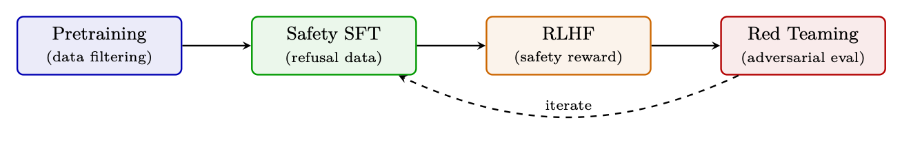

**Figure 1.14: 安全贯穿每个阶段：预训练中的数据过滤、SFT 中的拒答示例、RLHF 中专门的安全奖励模型，以及迭代式红队测试。**

### 1.17.1 威胁分类

### 1.17.2 安全训练流水线

### 1.17.3 关键安全机制

安全技术

- 数据过滤：从预训练语料中剔除有毒、有偏见以及含PII 的文本

- 安全SFT：在恰当拒答的示例上训练（“我无法帮你做这件事，因为⋯⋯”）

- 宪法AI（Constitutional AI）[128]：基于原则进行自我批评（Self-Critique）；模型依照一部规则宪法修订自身输出

- 安全奖励模型：基于安全标注配对训练独立的RM；在RLHF 中通过加权和与helpfulness RM 结合

- 护栏（Guardrails）：在服务时拦截有害请求/回复的输入/输出分类器

- 红队测试（Red teaming）[155]：系统性的对抗评估，在部署前发现失效模式

### 1.17.4 有用性与安全性的权衡

在有用性与安全性之间平衡

对安全的过度优化会带来过度拒答问题：模型拒绝无害的请求（例如在教育语境中拒绝讨论历史暴力）。目标是一个帕累托最优策略，在安全约束之内最大化有用性：

max E[Rhelpful] subject to E[Rsafety] ≥τ θ

在实践中，这通过加权奖励实现：R = αRhelpful + (1 −α)Rsafety，并仔细调整α（通常0.6–0.8）。

Meta 的Llama-3 报告称使用独立的安全与有用性奖励模型，并采用基于margin 的加权[25]。

### 1.17.5 评测

- 安全基准：ToxiGen、RealToxicityPrompts、BBQ（偏见）、CrowS-Pairs

- 越狱鲁棒性：GCG攻击[154]、多轮越狱、编码型Prompt

- 过度拒答率：度量无害Prompt 上的假阳性拒答（目标<5%）

- 红队评估：由领域专家（生物安全、网络安全）执行的人类对抗性测试


