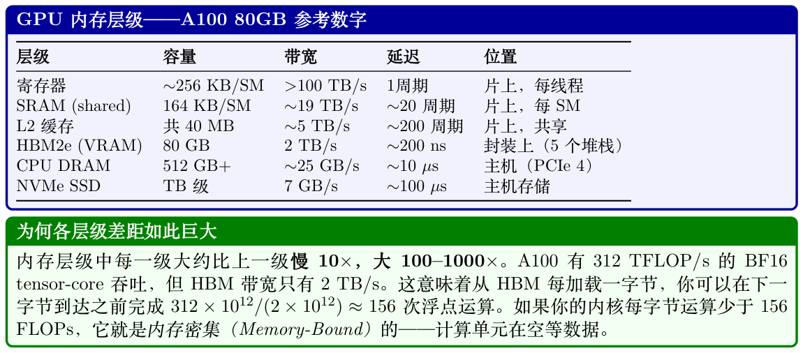
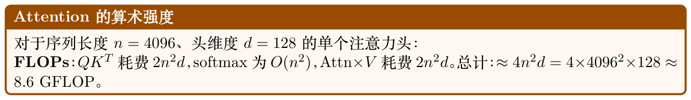
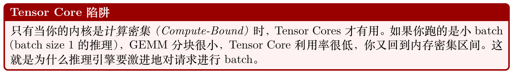
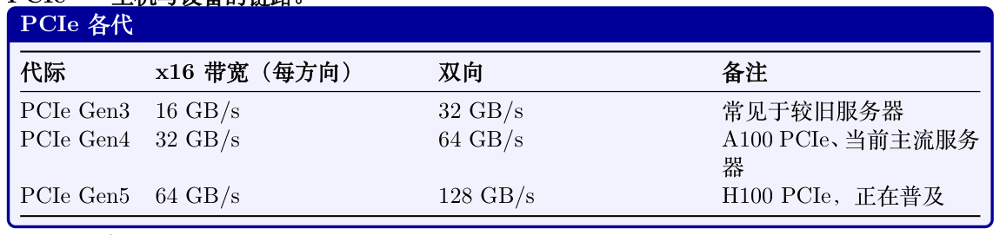
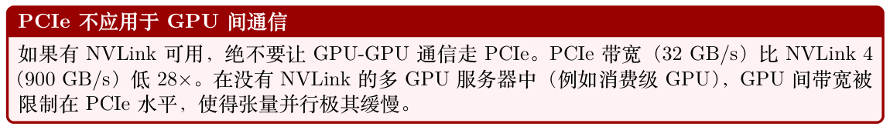
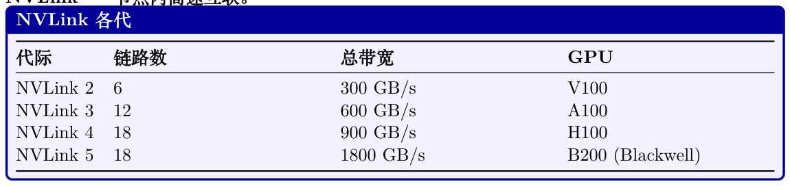
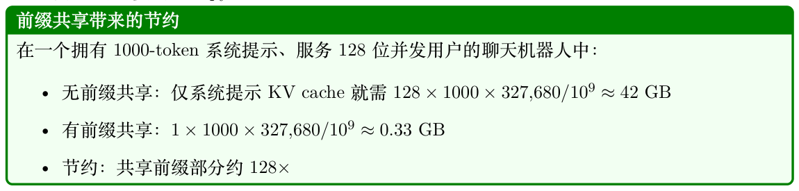

# 面向 LLM 的系统基础

## 2.1 GPU 架构——从硅片到LLM 训练

现代大型语言模型几乎完全依赖GPU（图形处理器，Graphics Processing Unit）进行训练和服务。

理解GPU 架构对于在并行策略、内存管理、内核优化和基础设施规模等方面做出明智决策至关重要。本节针对LLM 工作负载，系统地介绍GPU 硬件相关知识。

### 2.1.1 为什么深度学习要用GPU？

GPU 和CPU 代表了根本不同的硬件设计哲学。理解这种差异能解释为何LLM 训练在GPU 上能快100–1000 倍。

#### CPU 与GPU——基本设计哲学

- CPU 针对延迟进行优化——它们以尽可能快的速度执行少量线程，配备大型缓存、分支预测器和乱序执行单元。现代CPU 拥有8–96 个核心。

- GPU 针对吞吐量进行优化——它们并行执行数千个线程，每个线程只做简单工作。现代GPU 拥有数千个“核心”（执行单元），它们被组织成流式多处理器（Streaming Multiprocessor，SM）。

深度学习工作负载以矩阵乘法（在O(n2) 数据上执行O(n3) 操作）为主，这是天然并行的。70B模型的单次transformer 前向传播每个token 需要约140 TFLOP 计算量——非常适合GPU 的吞吐能力。

### 2.1.2 NVIDIA GPU 微架构代际演进

NVIDIA 已经发布了一系列GPU 架构，每一代都为深度学习带来关键创新：

**Table 2.1: 面向深度学习的NVIDIA GPU 微架构时间线。**

| 架构 | 年份 | 旗舰 | 深度学习关键创新 |
| --- | --- | --- | --- |
| Pascal |  | P100 | 首款HBM GPU；FP16 支持； NVLink 1 |
| Volta |  | V100 | Tensor Cores（第一代）；混 合精度训练 INT8 推理；RT cores（非ML |
| Turing |  | T4 | 用途） BF16 Tensor Cores；TF32；第 |
| Ampere |  | A100 | 3 代NVLink；MIG Cores；TMA； |
| Hopper |  | H100 | FP8 Tensor Transformer Engine；NVLink 第2 代Transformer Engine； |
| Blackwell |  | B200 | NVLink 5（1.8 TB/s）；FP4 |

### 2.1.3 LLM 训练与推理常用GPU

**Table 2.2: 与LLM 工作负载相关的GPU 规格。所有带宽数字均为双向。**

| GPU | 架构 | HBM BF16 TF HBM 带宽 NVLink | LLM 角色 |
| --- | --- | --- | --- |
| V100-32GB | Volta | 32 GB 125 TF* 900 GB/s 300 GB/s | 旧型号；小模型微调 |
| A100-40GB | Ampere | 40 GB 312 TF 1.5 TB/s 600 GB/s | 经济型训练/推理 |
| A100-80GB | Ampere | 80 GB 312 TF 2.0 TB/s 600 GB/s | 标准RLHF（70B 模型用8–64 卡） |
| H100 SXM | Hopper | 80 GB 990 TF 3.35 TB/s 900 GB/s | 训练快3× |
| H200 SXM | Hopper | 141 GB 990 TF 4.8 TB/s 900 GB/s | 用更少GPU 装下70B 策略+ 参考 模型 新一代；比H100 快2× |
| B200 SXM | Blackwell | 192 GB 2250 TF 8.0 TB/s 1800 GB/s |  |
| AMD 和Google 替代方案： |  |  |  |
| MI300X | CDNA3 | 192 GB 1300 TF 5.3 TB/s N/A | 显存最大；ROCm |
| TPU v5e | Google | 16 GB 197 TF 1.6 TB/s ICI 1.6 TB/s | 仅云端；JAX/XLA |
| 如何选择GPU？ |  |  |  |
| • 训练70B+ 模型：带NVLink 的H100/B200 节点（张量并行需要快速互联）。每个实例至 |  |  |  |
| 少8×H100。 |  |  |  |
| • 推理（延迟敏感）：H100/H200适合高带宽场景；MI300X 适合内存密集（Memory-Bound） |  |  |  |
| 场景（巨大的键值缓存（KV Cache））。 |  |  |  |
| • 微调7B–13B 模型：A100-80GB 性价比高。用LoRA 单卡即可。 |  |  |  |
| • 预算紧张：A100-40GB，甚至用A10（24GB）在7B 模型上跑LoRA。 |  |  |  |

### 2.1.4 GPU 内部架构——流式多处理器（SM）

GPU 由一组流式多处理器（Streaming Multiprocessor，SM）阵列组成，每个SM 都是独立的处理器，拥有自己的寄存器文件、共享内存和执行单元。理解SM 是理解GPU 性能的关键。

**Figure 2.1: 左：A100 单个流式多处理器（SM）的内部结构——64 个FP32 CUDA cores、4 个Tensor Cores、4 个warp 调度器、256 KB 寄存器文件以及192 KB 共享内存/L1 缓存。右：完整A100 芯片包含108 个SM，共享40 MB L2 缓存和80 GB HBM2e。左侧边栏的带宽标注显示了从寄存器到HBM 的急剧下降。**


- Tensor Cores：专用的矩阵乘加（matrix-multiply-accumulate，MMA）单元。每个单元每周期执行一次4×4×4 融合乘加运算。A100 每个SM 有4 个，在支持的精度下提供相对CUDA cores 16× 的吞吐量。

- 寄存器文件：最快的存储（延迟1 周期）。所有活动线程共享。溢出到L1 会显著降速。

- 共享内存/ L1：由程序员显式管理的片上SRAM。这是FlashAttention 性能的关键（数据块完全装入共享内存）。

- Warp 调度器：每个SM 有4 个warp 调度器（A100）。一个warp = 32 个步调一致执行的线程（SIMT 模型）。调度器通过在warp 之间切换来隐藏内存延迟。

GPU 采用单指令多线程（Single Instruction, Multiple Threads，SIMT）执行模型。在一个warp（32 个线程）内，所有线程执行相同指令但作用于不同数据。当线程出现分支（例如if/else）时，两条路径都会被串行执行——称为warp 分支（warp divergence）。这就是为什么GPU 内核必须最小化分支的原因。

对于LLM 工作负载，主要运算（GEMM、attention、softmax）在线程间具有统一的控制流，非常适合SIMT 执行。

### 2.1.5 各代际GPU 芯片的扩展

NVIDIA GPU 架构的演进显示出在计算密度、片上内存和深度学习专用单元方面持续扩展：

**Table 2.3: 各代NVIDIA 架构在SM 层面的扩展。**

| 架构 | SM 数 TCs/SM SRAM/SM L2 | 关键变化 |
| --- | --- | --- |
| Volta (V100) | 128 KB 6 MB | 引入Tensor Cores |
| Ampere (A100) | 192 KB 40 MB | BF16/TF32；更大的L2 |
| Hopper (H100) | 256 KB 50 MB | TMA；FP8；Thread Block Clusters |
| Blackwell (B200) | 256 KB 128 MB | 2× 裸片；FP4；TMEM；NVLink 5 |

### 2.1.6 GPU 内存层级与带宽

现代GPU 训练和推理性能几乎完全取决于你如何管理数据在内存层级之间的搬运。理解内存层级不是可选项——它是后续章节讨论每一种优化技术的基础。



寄存器。每个CUDA 线程都有自己的私有寄存器文件。寄存器是芯片上最快的存储——读写在一个时钟周期内完成且无需仲裁。A100 每个SM 有65,536 个32 位寄存器。寄存器溢出到本地内存（L1/L2）是主要的性能隐患。

SRAM——共享内存/ L1。A100 上每个SM 拥有192 KB 的L1/共享内存池（H100 为256 KB），其中最多164 KB 可配置为共享内存。共享内存由程序员（或较新版本CUDA 中由编译器）显式管理。例如，FlashAttention 的整个设计都基于一个洞察：注意力分块计算可以装入SRAM。

L2 缓存。A100 上的40 MB L2 由所有108 个SM 共享。它充当SRAM 与HBM 之间的中转区。

对于具有良好空间局部性的工作负载（例如在一个batch 内被反复访问的权重矩阵），L2 命中率可以大幅降低实际HBM 流量。

HBM——高带宽显存。高带宽显存（High Bandwidth Memory，HBM）是直接安装在GPU 封装上的堆叠DRAM，通过宽带中介层连接。A100 SXM 拥有80 GB HBM2e，带宽2 TB/s；H100 SXM5 拥有80 GB HBM3，带宽3.35 TB/s。它是模型权重、KV cache、激活和优化器状态的主要工作内存。

通过PCIe 访问CPU DRAM。GPU HBM 与CPU DRAM 之间的数据传输需经过PCIe 总线。PCIe Gen4 ×16 每方向提供约32 GB/s（双向64 GB/s）；Gen5 翻倍。这相对于HBM（每方向）是约60× 的带宽下降。CPU 卸载（ZeRO-Infinity、DeepSpeed）利用这条链路，但必须谨慎使用以免成为瓶颈。

NVMe。NVMe SSD（例如Samsung 990 Pro）顺序读取可达约7 GB/s。ZeRO-Infinity 可以将优化器状态卸载到NVMe，但只有在计算与I/O 比率非常高（大batch 尺寸、训练步骤较慢）时才可行。

### 2.1.7 算术强度与Roofline 模型

FLOPs I = (FLOPs / Byte)从HBM 访问的字节数

当I < Iridge 时内核是内存密集（Memory-Bound）的，当I > Iridge 时则是计算密集（Compute-

Iridge = 峰值FLOP/s = 312 × 1012 = 156 FLOP/Byte (A100 BF16)峰值带宽2 × 1012

**Figure 2.2: A100 BF16 的Roofline 模型（Roofline Model）。Attention 深陷于内存密集区间；大型GEMM（FFN 层）则是计算密集的。**



内存流量（标准实现，非Flash 版）：

- 读取Q, K：2 × n × d × 2 = 2 MB

- 写入注意力分数S = QKT ：n2 × 2 = 33.5 MB

- 为softmax 读取S：n2 × 2 = 33.5 MB

- 写入softmax 输出P：n2 × 2 = 33.5 MB

- 为最终矩阵乘读取P 和V ：n2 × 2 + n × d × 2 = 34.5 MB

- 写入输出O：n × d × 2 = 1 MB

总内存：≈138 MB（由对n2 注意力矩阵的4 次遍历主导）。

算术强度：I = 8.6 × 109 138 × 106 ≈62 FLOP/Byte

这是A100 脊点的62/156 = 40%——明确属于内存密集。GPU 有60% 的时间在等内存空转。

FlashAttention 解决方案：通过永远不物化n × n 矩阵（在SRAM 中对Q, K, V 分块），FlashAttention 把HBM 流量降至仅读取Q, K, V 并写入O：4 × n × d × 2 = 4 MB。每个加载的字节被复用于O(n) 次计算（每个query 都要attend 所有key），因此：

4 · n · d · 2 = n 4n2d 2 = 4096 I = = 2048 FLOP/Byte

这比脊点（156）高出13×——深度计算密集。GPU 跑满峰值312 TFLOPS，只需要312T/2048 ≈ 152 GB/s 带宽（HBM 容量的7.6%）。内存不再是瓶颈。

### 2.1.8 Attention 是内存密集的；FFN 是计算密集的

一个transformer 块有两个主要组件，它们的算术强度截然不同：

- Attention：作用于n × d 张量。QKT 乘积是O(n2d) FLOPs，但注意力分数需要O(n2)

内存。在长序列下，内存流量占主导地位——attention 是内存密集（Memory-Bound）的。

- FFN（MLP）：两个大型线性层，权重矩阵形状为[dmodel, 4dmodel]。这些是高算术强度的大型GEMM——FFN 是计算密集（Compute-Bound）的。

这就是为什么FlashAttention（内存优化）对attention 有效但对FFN 无效，而量化（缩小权重体积）对FFN 的帮助比对attention 更大。

### 2.1.9 Tensor Cores

什么是Tensor Cores？

张量核心（Tensor Core）是Volta 架构（2017）引入的专用矩阵乘加（MMA）单元。每个Tensor Core 在单个时钟周期内执行一次4 × 4 × 4 矩阵乘法：

D = A × B + C (4 × 4 matrices)

A100 在108 个SM 中共有432 个Tensor Cores（每个SM 4 个，每个子分区1 个）。在BF16精度下提供312 TFLOP/s 吞吐——约是FP32 CUDA cores 吞吐的16×。

- 支持的精度：FP64、TF32、BF16、FP16、INT8、FP8（H100+）。

- 累加：内部始终使用FP32，即使输入为BF16。这能防止点积过程中的灾难性抵消。

- 要求：当矩阵维度是8（BF16）或16（FP8）的倍数时，Tensor Cores 效率最高。为此进行填充通常是值得的。

- WGMMA（H100）：Hopper 引入了warpgroup 级别的MMA 指令，作用于更大的分块（64×256×16），并可与TMA（Tensor Memory Accelerator）数据搬运形成流水线。



### 2.1.10 通信架构——NVLink、InfiniBand 与PCIe

分布式LLM 训练和推理需要在GPU、节点和存储之间搬运海量数据。通信结构往往是大规模训练的瓶颈。

PCIe——主机与设备的链路。



- CPU ↔GPU 数据传输（模型加载、CPU 卸载）

- 当NVLink 不可用时的跨节点GPU 通信（罕见，且非常慢）

- NVMe 存储访问（经由CPU）



NVLink——节点内高速互联。



NVLink 是同一节点内GPU 之间的点对点互联。每条链路都是双向的。H100 SXM5 拥有18 条NVLink 4 链路，每条提供50 GB/s 双向带宽，总计900 GB/s。

NVSwitch。在DGX H100 系统中，所有8 块GPU 都通过NVSwitch 互联——这是一种提供全二分带宽（full bisection bandwidth）的专用交换芯片。这意味着任意GPU 都能以完整NVLink 速度同时与任何其他GPU 通信，而不仅仅是环上邻居。

在环形拓扑（8 GPU）中，AllReduce 需要数据绕环传输。每条链路必须承载总数据的2(N−1)，N因此算法带宽为Blink × 2(N−1)（N = 8 时约为0.57 × Blink）。借助NVSwitch 的全二分带宽，N

AllReduce 可以使用基于树的算法同时使用所有链路，达到接近峰值的带宽。在DGX H100 实际测试中：ring 达到约700 GB/s 总线带宽，NVSwitch 达到约900 GB/s。

InfiniBand——节点间通信。对于节点（服务器）之间的通信，InfiniBand 提供高带宽、低延迟的网络，并支持直接GPU 内存访问。

#### InfiniBand NDR

- NDR 400Gb/s = 每端口50 GB/s（单向）

- HDR 200Gb/s = 每端口25 GB/s（上一代）

- RDMA：远程直接内存访问（Remote Direct Memory Access）——GPU 可读写远端GPU内存而无需远端CPU 参与

- GPUDirect RDMA：数据直接经由HBM →NIC →网络→NIC →HBM，完全绕过CPU 和系统DRAM

- 延迟：小消息约1–2 µs（对比TCP/IP 的约100 µs）

胖树拓扑（Fat-Tree Topology）。大型GPU 集群使用胖树（Fat-Tree Topology）网络拓扑。使用k 端口交换机的3 层胖树可支持k3/4 个节点并保持全二分带宽。对于k = 64 端口的400Gb/s NDR 交换机：643/4 = 65,536 个节点。

轨道优化拓扑（Rail-Optimized Topology）。实践中，集群使用轨道优化拓扑（Rail-Optimized Topology），节点中的每块GPU 连接到不同的机架顶端（top-of-rack）交换机。这样可以保证AllReduce 操作（涉及所有GPU）同时使用所有网络链路，从而最大化带宽。

分布式LLM 训练中的通信模式。分布式训练依赖集体通信原语。原语的选择决定了带宽需求和扩展行为。

通信原语

原语使用场景通信量

AllReduce梯度同步（DDP、FSDP）2(N −1)/N× 参数大小AllGather收集分片权重（FSDP）(N −1)/N× 参数大小ReduceScatter分散梯度（FSDP）(N −1)/N× 参数大小AllGather张量并行激活激活大小Point-to-Point流水线并行（send/recv）micro-batch 激活Broadcast权重同步（新worker）完整模型大小

设定：70B 参数模型，BF16 梯度，8 节点× 8 GPU = 64 GPU。数据并行度= 64。

梯度大小：70 × 109 × 2 字节= 140 GB。

每块GPU 的AllReduce 量（环形）：2 × (64 −1)/64 × 140 ≈275 GB。

可用节点间带宽：8 GPU/节点× 50 GB/s/GPU = 400 GB/s（采用轨道优化拓扑，8 块网卡全部启用）。

AllReduce 耗时：每步275/400 ≈0.69 秒。

含义：对于一个1 秒的计算步骤，通信增加0.69 秒（占总步骤时间41%）。这就是为什么梯度压缩、混合精度、以及把通信与计算重叠的FSDP 至关重要。

网络拓扑示意图。下图展示了典型的双节点GPU 集群拓扑，同时显示节点内（NVLink）和节点间（InfiniBand）通信路径。

**Figure 2.3: 两节点8-GPU 拓扑。节点内：通过NVSwitch 的NVLink 4（总计900 GB/s）。节点间：通过机架顶端交换机的InfiniBand NDR 400Gb/s。每个节点配有8 块IB 网卡（每块GPU 一块），用于轨道优化AllReduce。**

根据带宽选择并行策略

- 张量并行（TP）：每层都需要all-reduce——仅在节点内通过NVLink 使用。TP=8 是H100 DGX 节点的标准。

- 流水线并行（PP）：阶段之间的点对点通信——可以跨节点，但会引入流水线气泡开销。当模型大到单靠TP 装不下时使用。

- 数据并行（DP）：梯度的AllReduce——可以通过IB 跨节点。在快速IB 下扩展性良好。

- FSDP/ZeRO：AllGather + ReduceScatter——类似于DP 但会分片优化器状态。对于大模型优于DP。

## 2.2 vLLM——分页注意力与高吞吐推理

vLLM [156] 引入了分页注意力（PagedAttention），它借鉴操作系统用于管理RAM 的分页抽象，并将其应用于GPU 的键值缓存（KV Cache）。在LLM 推理过程中，KV cache——存储了所有先前token 的key 和value 张量——是最大的内存消耗者。高效管理KV cache 是高吞吐推理的核心挑战。

### 2.2.1 KV cache 碎片化问题

对于具有L 层、H 个头、头维度d、序列长度为n 个token 的模型：

KV cache 大小= 2 × L × H × d × n × 每元素字节数

对于Llama-3 70B（BF16）：L = 80、H = 8（GQA）、d = 128：

= 2 × 80 × 8 × 128 × n × 2 = 327,680 × n bytes

当n = 4096 token 时：每条序列约1.3 GB。

内部碎片与外部碎片

传统推理系统会为每条序列的KV cache 预先分配一块连续内存，大小为可能的最大序列长度。

这会造成两类浪费：内部碎片：一条只生成500 token 的序列仍然占据为4096 token 预留的块。未使用的3596 个token 槽位被浪费。

外部碎片：许多序列完成后，剩余空闲内存由许多小的不连续空隙组成。即使总空闲内存足够，新的长序列也无法被分配，因为没有任何一块连续区域足够大。

实际中，朴素分配下的GPU 显存利用率通常只有20–40%。

### 2.2.2 分页注意力——为KV cache 引入虚拟内存

分页注意力（PagedAttention，Kwon 等，2023）借鉴了操作系统的分页抽象。它不再为每条序列分配一块连续内存，而是把KV cache 切分成固定大小的页（page）（即块），并通过一个间接表——类似CPU 页表——将每条序列的逻辑token 位置翻译为分散的物理GPU 内存地址。

#### PagedAttention 核心概念

- 块大小：通常每块16 个token（可调）。每个块存储16 × 2 × L × H × d 个元素。

- 块表（Block table）：每条序列一份的映射，把逻辑块索引映射到GPU 内存池中的物理块索引。

- 物理块池：预先分配好的固定大小块池。分配为O(1)——只需从空闲列表弹出。

- 注意力内核：做了修改，在注意力计算时使用块表从不连续的物理位置gather KV 块。

块表示例

假设块大小= 4 个token，我们有两条序列：

- 序列A（7 个token）：逻辑块[0,1] →物理块[3, 7]

- 序列B（5 个token）：逻辑块[0,1] →物理块[1, 5]

物理块3 持有序列A 的token 0–3。物理块7 持有序列A 的token 4–6（部分填充）。序列A 的注意力内核按顺序从物理块3 和7 读取，并以块表作为间接层。

### 2.2.3 PagedAttention 的收益

近零浪费。内部碎片至多为每条序列一个部分填充块（最后一个块）。当块大小为16 时，最差浪费为每条序列15 个token——可忽略不计。外部碎片被消除，因为块是固定大小、可互换的。

动态分配。块在序列增长时按需分配。无需预先知道最终序列长度。这对生成任务至关重要，因为输出长度未知。

前缀共享（写时复制）。多条共享同一前缀（例如同一系统提示）的序列可以共享相同的物理块来表示该前缀。块表只需让多条序列指向相同的物理块。当某条序列需要写入共享块（与前缀分叉）时，会触发写时复制（Copy-on-Write）。



通过swap 抢占。当GPU 显存耗尽时，vLLM 可以通过把某条序列的KV 块换出到CPU DRAM（或者直接丢弃，之后重新计算）来抢占该序列。这之所以可行，是因为块是自包含且非连续的——若是连续分配则需要复制整个缓冲区。

### 2.2.4 连续批处理

传统的批处理（“静态批处理”）会等到一批中所有序列都完成后才开始新批次。如果一条序列生成500 个token、另一条生成10 个，那么GPU 在短序列上有490 步是空闲的。这极其浪费。

连续批处理（Continuous Batching，也叫迭代级调度）一次处理一个解码步。每一步之后：

1. 检查哪些序列已完成（生成了EOS token）

2. 把已完成的序列从批中移除，释放其KV 块

3. 加入新的等待序列以填补空出的槽位

4. 在更新后的批上运行下一解码步

批次组成每一步都在变化——序列动态地加入和离开。这让GPU 利用率接近100%，并大幅提升吞吐（相对静态批处理提升1.5–3×）。PagedAttention 在这里至关重要：在批次中动态添加/移除序列需要动态分配/释放KV 块，只有在分页内存下才高效。

### 2.2.5 vLLM 中的投机解码

投机解码（Speculative Decoding）使用一个小型草稿模型（draft model，例如1B 参数）快速提出k 个候选token，再由大型目标模型（target model）在一次前向传播中验证。从第一个被拒绝处之前的所有token 都会被接受（预期接受数：每次验证3–5 个token）。这为延迟敏感的单序列生成带来2–3× 提速，且无质量损失。

vLLM 将投机解码与PagedAttention 集成：

- 草稿token 被分配投机性KV 块

- 拒绝时，投机块被释放（在分页分配下成本极低）

- 接受时，投机块被提升为主序列的一部分

- 块表更新为O(k)——只需更新少量表项

### 2.2.6 具体显存节约——大规模70B 模型

设定：Llama-3 70B，BF16，单个A100 80GB 节点（8 GPU，张量并行）。

模型权重：70 × 109 × 2 字节= 140 GB ÷ 8 GPU = 17.5 GB/GPU。

KV cache 可用部分：80 −17.5 −3（开销）= 59.5 GB/GPU。

每块GPU 每token 的KV cache（TP=8 时每块GPU 持有1/8 的头）：2×80×1×128×2 = 40,960 字节≈40 KB/token。

KV cache 最大token 数：59.5 × 109/40,960 ≈145 万token。

当128 条并发序列每条4096 个token 时：128×4096 = 524,288 个token——完全在预算之内。

若不使用PagedAttention（为每条序列预分配最大长度4096）：同样的计算，但碎片化平均浪费约50% →只能容纳64 条序列。

块大小的权衡

更大的块大小可减少块表开销，并提高内存访问局部性（更少的分散读取）。更小的块大小可减少内部碎片，并支持更细粒度的前缀共享。vLLM 默认每块16 个token，是一个不错的平衡。对于非常长的序列（10 万+ token），更大的块（32–64）可能更合适。

### 2.2.7 vLLM：端到端系统

vLLM 将PagedAttention 封装在一整套服务栈中：连续批处理（Continuous Batching）、前缀缓存（Prefix Caching）、投机解码（Speculative Decoding）以及张量并行的模型分片协同工作，最大化每美元GPU 的吞吐。

### 2.2.8 架构总览

**Figure 2.4: vLLM 架构：请求自上而下流动。Scheduler 管理准入与抢占，Block Manager 负责虚拟到物理KV cache 映射（像操作系统页表一样），Model Executor 在GPU HBM 中从预分配的块池读取数据并执行批量推理。**

### 2.2.9 核心组件

- API Server：接收OpenAI 兼容的请求（completions、chat）。对输入进行tokenize，并创建“序列组（sequence groups）”（用于beam search 或多样本）。

- Scheduler：vLLM 的大脑。维护三个队列：

- waiting：尚未开始的新请求（等待prefill）

- running：正在生成token（decode 阶段）

- swapped：被抢占、KV cache 已卸载到CPU 的请求

每次迭代，调度器根据可用GPU 内存块决定运行哪些请求。

- Block Manager：为KV cache 实现虚拟内存抽象。将逻辑块（按序列）映射到物理块（GPU内存池中）。负责处理：

- 分配（生成新token →需要新块）

- 写时复制（Copy-on-Write）（用于beam search：多beam 共享前缀块，仅在分叉时复制）

- Swap（抢占/恢复时在GPU ↔CPU 之间迁移）

- 前缀缓存（Prefix Caching）（当prompt 共享相同前缀时复用已缓存块）

- Model Executor：执行实际的LLM 前向传播。管理跨GPU 的张量并行，调度从分页KV cache 块读取的注意力内核。

- KV Cache Pool：预分配的GPU 内存，划分为固定大小的块（默认每块16 token × num_heads × head_dim × 2 字节）。运行时无动态分配→零碎片。

### 2.2.10 请求生命周期（端到端流程）

1. 到达：客户端发送prompt。API server 将其tokenize，创建一个SequenceGroup，放入waiting队列。

2. 调度：每一步，调度器执行：

(a) 检查是否有swapped 序列可以恢复（有足够空闲块）。

(b) 检查是否有waiting 序列可以开始prefill（有足够块容纳完整prompt）。

(c) 在running 序列之间预算剩余块（若当前块已满，每条序列每步需要1 个新块）。

(d) 如果超出预算：抢占优先级最低的运行中序列（把KV 换出到CPU 或之后重新计算）。

3. Prefill（请求的第一次迭代）：整个prompt 在一次前向传播中被处理。所有prompt token 的KV cache 被计算并存入已分配的块。这是计算密集（Compute-Bound）的（大批token）。

4. Decode（后续迭代）：每条序列每步生成一个新token。所有运行中的序列被一起batch（连续批处理）。这是内存密集（Memory-Bound）的（读取完整KV cache，生成1 个token）。

5. 块分配：每个decode 步后，如果某条序列的最后一个块已满，Block Manager 分配一个新的物理块并将其映射到下一逻辑块。

6. 完成：当一条序列遇到EOS 或达到最大长度时，它会从running 中移除。其物理块立即被释放→可供其他序列使用。响应被流式回传给客户端。

### 2.2.11 前缀缓存（自动Prompt 缓存）

当多个请求共享相同前缀（系统prompt、few-shot 示例）时：

1. 对每个逻辑块的token 内容计算哈希。

2. 新请求到达时，检查是否有前缀块已在缓存中。

3. 命中时：跳过这些token 的prefill，直接复用物理KV 块。首token 延迟（Time-to-first-token）大幅下降。

4. 驱逐：LRU策略。缓存块仅在内存压力需要时才被释放。

影响：对于具有长系统提示（2K+ token、所有用户共享）的聊天应用，前缀缓存可降低TTFT 60–80%。

### 2.2.12 vLLM 中的引导（受约束）解码

vLLM 通过可插拔的后端原生支持受约束解码（参见Section 1.12.11），可以在服务期间以极小的性能开销保证结构化输出。

支持的约束类型。OpenAI 兼容API 通过guided_* 参数或response_format 字段接受约束：

```
from openai import OpenAI
client = OpenAI(base_url="http://localhost:8000/v1")
# --- JSON Schema 约束---
response = client.chat.completions.create(
model="meta-llama/Llama -3-70B-Instruct",
messages=[{"role": "user",
"content": "Extract: name, age, city from: "
"'John is 30 and lives in NYC'"}],
extra_body={
"guided_json": {
"type": "object",
"properties": {
"name": {"type": "string"},
"age": {"type": "integer"},
"city": {"type": "string"}
},
"required": ["name", "age", "city"]
}
}
)
# 输出保证是符合该schema 的合法JSON
# --- 正则表达式约束---
response = client.completions.create(
model="meta-llama/Llama -3-70B-Instruct",
prompt="Generate an IPv4 address: ",
extra_body={
"guided_regex": r"\d{1,3}\.\d{1,3}\.\d{1,3}\.\d{1,3}"
}
)
# --- 选项约束---
response = client.completions.create(
model="meta-llama/Llama -3-70B-Instruct",
prompt="Sentiment: ",
extra_body={"guided_choice": ["positive", "negative", "neutral"]}
)
```

后端架构。vLLM 将掩码计算委托给后端引擎：

- XGrammar（自v0.7 起为默认）：基于下推自动机的引擎，支持JSON schema、正则和任意EBNF 语法。得益于高效的C++ 核心，对复杂schema 而言最快。

- Outlines [114]：基于FSM；支持JSON 和正则。在XGrammar 不可用时作为回退方案。

掩码在模型前向传播产生logits 之后、采样之前施加——实际中每步只增加不到1 ms，因为FSM/PDA 状态转移和预先计算的索引查找均为O(1)。

性能影响。由于约束仅对logits 进行掩码（不重新计算attention 或FFN），吞吐损失可忽略（基准测试中<2%）。主要成本来自把schema 编译成FSM/PDA 索引，耗时0.5–5 秒，取决于schema复杂度。vLLM 会跨请求缓存已编译的schema，因此每个独特schema 只需支付一次成本。


**Table 2.4: vLLM 与其他方案的性能对比（70B 模型，A100 × 4，TP=4）。**

| 指标 | vLLM | HF Generate | 原因 |
| --- | --- | --- | --- |
| 吞吐（tok/s） | 2,500–4,000 | 300–600 | 连续批处理+ PagedAttention |
| 显存利用率 | 90–95% | 50–60% | 零碎片，动态块分配 |
| 最大并发序列数 | 200–500 | 16–32 | 分页KV 消除每序列预留 |
| 首token 延迟 | 100–300ms | 500–2000ms | 对重复系统提示启用前缀缓存 |
