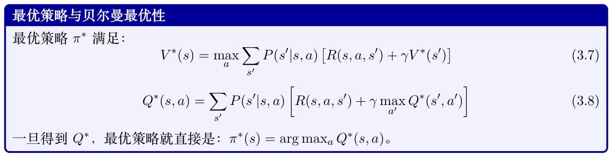
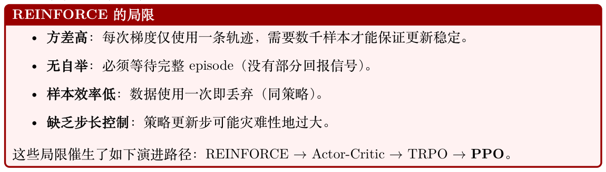
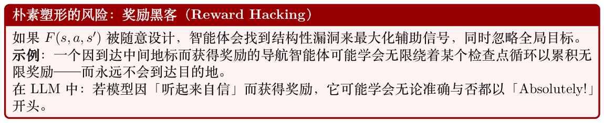
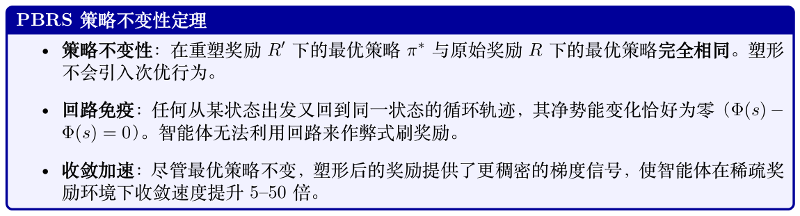

# 强化学习导论

强化学习（Reinforcement Learning，RL）是一种范式，其中智能体（agent）通过与环境（envi- ronment）交互、接收奖励（rewards）作为反馈，并优化其策略（policy）以最大化长期累积奖励来学习做出序贯决策[157]。与监督学习（需要带标签的输入-输出对）不同，RL 通过试错（trial and error）来发现最优行为。

**Figure 3.1: 强化学习概览：智能体与环境交互，接收奖励作为反馈，并通过试错更新其策略。与从带标签数据对学习的监督学习不同，RL 通过经验最大化奖励来学习应当做什么。**

## 3.1 马尔可夫决策过程（Markov Decision Process，MDP）

MDP 是一个五元组(S, A, P, R, γ)：

- S：状态空间——环境所有可能的配置

- A：动作空间——智能体可用的所有动作

- P(s′|s, a)：转移函数——在状态s 下采取动作a 后到达状态s′ 的概率

- R(s, a, s′)：奖励函数——一次状态转移获得的即时标量反馈

- γ ∈[0, 1]：折扣因子——未来奖励相对于即时奖励的权重

P(st+1|st, at, st−1, at−1, . . .) = P(st+1|st, at)

这一性质使问题变得可处理。


## 3.2 核心概念与定义

策略（Policy）π(a|s)：从状态到动作概率的映射。确定性策略：a = π(s)；随机性策略：a ∼π(·|s)。

X ∞ Gt = γkrt+k = rt + γrt+1 + γ2rt+2 + · · ·(3.1) k=0

" ∞ # X V π(s) = Eπ [Gt | st = s] = Eπ γkrt+k | st = s (3.2)

k=0

动作价值函数（Action-Value Function）（从状态s 出发、采取动作a、其后遵循π 的期望回报）：Qπ(s, a) = Eπ [Gt | st = s, at = a] (3.3)

Aπ(s, a) = Qπ(s, a) −V π(s) (3.4)

X X R(s, a, s′) + γV π(s′)  V π(s) = π(a|s) P(s′|s, a) (3.5)

a s′ " # X X Qπ(s, a) = P(s′|s, a) R(s, a, s′) + γ π(a′|s′)Qπ(s′, a′) (3.6)

s′ a′



## 3.3 强化学习方法的分类

强化学习算法可以从多个维度进行分类。理解这一分类体系有助于针对特定问题选择合适的方法。

关键分类区分

#### 无模型（Model-Free）vs 基于模型（Model-Based）：

- Model-Free：直接从交互经验中学习策略或价值函数；无需建模环境的转移机制。对LLM最实用（语言的转移机制难以建模）。

- Model-Based：学习或使用环境转移模型P(s′|s, a)。可以提前规划。样本效率更高，但需要准确的模型。

#### 基于价值（Value-Based）vs 基于策略（Policy-Based）：

- Value-Based：学习Q(s, a) 或V (s)，并通过arg maxa Q(s, a) 得到策略。适合离散、小规模动作空间（如Atari），在连续或大规模动作空间上表现不佳。

- Policy-Based：直接参数化并优化πθ(a|s)。天然适合连续或高维动作空间，对LLM 至关重要（词表= 32K–128K 个动作）。

- Actor-Critic：两者结合——策略（actor）提议动作，价值函数（critic）评估动作。用于LLM 的PPO 即属于actor-critic 方法。

#### 同策略（On-Policy）vs 异策略（Off-Policy）：

- On-Policy：从当前策略生成的数据中学习。每次更新后必须重新生成数据。例如：REIN- FORCE、PPO、A2C。更稳定但样本效率较低。

- Off-Policy：从任意策略生成的数据中学习（包括旧版本或其他智能体）。可以复用过往经验。例如：Q-Learning、DQN、SAC。样本效率高但更难稳定。

## 3.4 时序差分（Temporal Difference，TD）学习

TD学习[158] 采用自举（bootstrap）思想——它使用其他价值估计来更新价值估计，无需等待完整episode 结束。

### 3.4.1 理解TD 误差：以「惊讶」作为学习信号

TD 误差（TD Error）衡量智能体对未来奖励的当前估计与采取一步后新估计之间的差异。简单来说，就是智能体原本以为会发生的事，与实际发生的事加上对未来的新预期之间的差。它代表了智能体的「惊讶」。

直觉：开车类比

设想你正在开车回家，预计需要30 分钟。

- 预测：总共30 分钟。

- 现实变化：10分钟后，你遇到意外的道路施工。GPS 更新提示，你还需要35 分钟。

- TD 误差：总预期时间现在是45 分钟（已过10 分钟+ 剩余35 分钟）。新估计（45 分钟）

线。

正的TD 误差意味着结果好于预期→提升该状态的价值。

负的TD 误差意味着结果差于预期→降低该状态的价值。

### 3.4.2 TD 误差公式

δt = Rt+1 + γV (St+1) −V (St) (3.9)

- Rt+1：采取动作后获得的即时奖励。

- γV (St+1)：下一个状态的估计折扣价值（智能体从下一个状态起预期获得的回报，按折扣因子γ 缩放）。

- V (St)：当前状态价值的原始估计。

组合项(Rt+1 + γV (St+1)) 被称为TD 目标（TD Target）。因此：

TD Error = TD Target −Old Estimate (3.10)

### 3.4.3 智能体如何使用TD 误差

智能体调整其价值函数以将TD 误差驱向零：

V (St) ←V (St) + α · δt (3.11)

- 若δt > 0：结果好于预测→增加V (St)，使智能体倾向追求该状态。

- 若δt < 0：结果差于预测→降低V (St)，使智能体避开该状态。

- 若δt = 0：预测完美→无需更新（已收敛）。

Monte Carlo：等到episode 结束，使用实际回报Gt。无偏但方差高（单条完整轨迹可能不具代表性）。

TD：每一步使用估计的未来价值γV (st+1) 进行更新。有偏（依赖V 的准确性），但方差低得多（单步更新，不会复合噪声）。

TD(λ)：在TD(0) 与Monte Carlo 之间插值。λ = 0：纯TD；λ = 1：纯MC。这正是GAE 在PPO 中所做的事情（取λ = 0.95）。

TD 目标：yt = rt + γV (st+1)——我们要靠近的「更好的估计」。

G(n) = rt + γrt+1 + · · · + γn−1rt+n−1 + γnV (st+n) (3.12) t

## 3.5 Q-Learning

Q-Learning [159] 是基础性的异策略、基于价值的算法。它直接学习最优Q∗，与所遵循的策略无关。

更新规则：  Q(st, at) ←Q(st, at) + α rt + γ max Q(st+1, a′) −Q(st, at) (3.13) a′

更新使用maxa′ Q(st+1, a′)——下一状态下最优动作的价值，与智能体实际采取的动作无关。这意味着目标始终在最优策略下计算，即便行为策略以随机方式探索（ϵ-贪心）。

这就是Q-Learning 可以从重放缓冲区（Replay Buffer）、演示数据或任何经验来源中学习的原因。

数据无需来自当前策略。

Q(st, at) ←Q(st, at) + α [rt + γQ(st+1, at+1) −Q(st, at)] (3.14)

深度Q 网络（Deep Q-Networks，DQN）[161]：用神经网络Qθ(s, a) 取代表格化的Q(s, a)。

关键创新包括：经验重放缓冲区（异策略数据复用）、目标网络（稳定性）、ϵ-贪心探索。

DQN 损失函数：网络通过最小化从重放缓冲区采样的mini-batch 上的均方TD 误差来训练：

" 2#

L(θ) = E(s,a,r,s′)∼B r + γ max Q¯θ(s′, a′) −Qθ(s, a) (3.15) a′

其中Q¯θ 是目标网络（target network）——Qθ 的冻结副本，每C 步才更新一次（如C = 10,000）。

这避免了「移动目标」问题：没有它的话，预测与目标会同时变化，导致发散。

梯度更新：对损失关于θ 求梯度（注意：目标y 被视为常量——梯度不流经¯θ）： 

    ∇θL = −E r + γ max Q¯θ(s′, a′) −Qθ(s, a) ∇θQθ(s, a) (3.16) a′ | {z } TD error δ

θ ←θ −α · δ · ∇θQθ(s, a) (3.17)

学习流程（每个训练步）：

1. 行动：通过ϵ-贪心选择动作：以概率ϵ 选择随机动作，否则a = arg maxa Qθ(s, a)。在前100万步内将ϵ 从1.0 衰减到0.01。

2. 存储：将转移(s, a, r, s′, d) 存入重放缓冲区B（容量约100 万）。

3. 采样：从B 中均匀采样32 条转移作为mini-batch。

4. 计算目标：y = r + γ(1 −d) maxa′ Q¯θ(s′, a′)（若为终止状态则未来价值为零）。

5. 更新：对(y −Qθ(s, a))2 进行梯度下降。将梯度裁剪到[−1, 1]（Huber 损失变体）。

6. 同步目标网络：每C 步执行¯θ ←θ。

### 3.5.1 理解重放缓冲区

重放缓冲区（Replay Buffer）[162]（经验回放）是一种数据存储机制，保存过往经验以便智能体后续再学习。智能体不会在执行动作后立刻丢弃数据，而是将转移存入记忆库，并随机采样mini-batch用于训练。

存储内容：每条转移是一个元组：

et = (st, at, rt, st+1, dt) (3.18)

其中dt 是布尔标志，表示episode 是否结束。

为何重放缓冲区不可或缺

- 打破数据相关性：连续步之间高度相关。神经网络在序列数据上泛化较差。从缓冲区随机采样可使训练样本近似独立同分布（i.i.d.）。

- 防止灾难性遗忘：没有缓冲区，智能体在通过某个困难关卡后，若在后续10K 步中持续在更后面的关卡上失败，可能会忘记如何通过先前那关。缓冲区可确保它持续练习旧的场景。

- 提升样本效率：运行环境可能很慢。重放缓冲区允许同一条转移用于多次权重更新，从每一步中榨取更多价值。

```
import random
from collections import deque
class ReplayBuffer:
def __init__(self, capacity):
self.buffer = deque(maxlen=capacity) # 有界队列
def push(self, state, action, reward, next_state , done):
self.buffer.append((state, action , reward , next_state , done))
def sample(self, batch_size):
```

# 通过随机选取经验打破相关性

```
return random.sample(self.buffer , batch_size)
def __len__(self):
return len(self.buffer)
```

在标准缓冲区中，所有经验的采样概率相等。但有些经验信息量大得多。PER [163] 按TD 误差幅度对采样概率进行加权——如果某条转移引发了巨大「惊讶」（|δt| 高），智能体就更频繁地采样它，从而更快修正模型。在Atari 基准上可将学习速度加快2–3 倍。

语言生成中的动作空间是整个词表（|A| = 32K–128K），状态空间是所有可能的token 序列（无限）。在每个token 位置对128K 个动作计算maxa Q(s, a) 是不可行的。这就是LLM RL 使用基于策略方法（PPO、GRPO）的原因。

## 3.6 策略梯度方法——REINFORCE

与其学习价值函数再推导策略，不如直接优化策略参数θ 以最大化期望回报[164]。

hPT i目标：J(θ) = Eτ∼πθ[R(τ)] = Eπθ t=0 rt

" T # X ∇θJ(θ) = Eπθ ∇θ log πθ(at|st) · Gt (3.19) t=0

#### 策略梯度定理——形式化推导（5 步）

" T # X X J(θ) = Eτ∼πθ rt = P(τ|θ)R(τ) t=0 τ其中P(τ|θ) = p(s0) QT t=0 πθ(at|st) p(st+1|st, at) 是轨迹概率。

X ∇θJ = ∇θP(τ|θ) R(τ) τ

第3 步：应用对数求导技巧（log-derivative trick）：∇θP(τ|θ) = P(τ|θ) ∇θ log P(τ|θ)：

∇θJ = Eτ∼πθ[∇θ log P(τ|θ) R(τ)]

第4 步：展开log P(τ|θ)。log p(s0) 与log p(st+1|st, at) 在∇θ 下消失：

X T ∇θ log P(τ|θ) = ∇θ log πθ(at|st) t=0

Gt = PT t′=t rt′ 配对：" T # X ∇θJ = Eπθ ∇θ log πθ(at|st) · Gt t=0

这一结果为何优美

该梯度不需要对环境的状态转移p(s′|s, a) 求导。对数求导技巧将其转化为一个期望，只需运行策略并观察奖励就能估计。把Gt 替换为优势ˆAt = Gt −V (st) 可以在不引入偏差的前提下降低方

差（因为对任何仅依赖状态的基线b(s)，都有E[∇log π · b(s)] = 0）。

REINFORCE 算法（REINFORCE）[164]（Williams, 1992）：

1. 在πθ 下采样完整轨迹τ = (s0, a0, r0, s1, a1, r1, . . .)

2. 为每个时间步计算回报Gt = PT−t k=0 γkrt+k

3. 更新：θ ←θ + α P t ∇θ log πθ(at|st) · Gt


基线带来的方差缩减：

" T # X ∇θJ(θ) = Eπθ ∇θ log πθ(at|st) · (Gt −b(st)) (3.20) t=0

任何与at 无关的基线b(st) 都能在保持梯度无偏的同时降低方差。最佳选择：b(st) = V π(st)。此时Gt −V (st) ≈Aπ(st, at) = 优势。



## 3.7 Actor-Critic 方法

将策略梯度（actor）与学习得到的价值函数（critic）结合，以在保持策略优化灵活性的同时降低方差。

结构：

- Actor πθ(a|s)：策略，提议动作。

- Critic Vϕ(s) 或Qϕ(s, a)：评估状态/动作的好坏，提供低方差基线。

h i ∇θJ = E ∇θ log πθ(at|st) · ˆAt , ˆAt = rt + γVϕ(st+1) −Vϕ(st) (3.21)

h (rt + γVϕ(st+1) −Vϕ(st))2i Lcritic = E (3.22)

#### 面向LLM 的PPO 演进路径

1. REINFORCE [164]：高方差、无自举→对LLM 不可行

2. A2C/A3C [165]（Advantage Actor-Critic）：使用基于TD 的优势，方差更低，但步长无界。

3. TRPO [166]：约束策略更新前后的KL 散度。稳定但代价高（二阶方法）。

4. PPO [167]：通过裁剪策略比率，仅用一阶优化就达到与TRPO 类似的稳定性。是LLM RL 训练的标准方法。

5. GRPO：完全去掉critic，使用组内统计量作为基线。更简单，对可验证奖励有效。

## 3.8 广义优势估计（Generalized Advantage Estimation，GAE）

动机：Actor-Critic框架需要对优势A(s, a) = Q(s, a) −V (s) 进行良好估计——这个动作比平均水平好多少？但这里存在根本性的张力：

- 1 步TD 优势（rt + γV (st+1) −V (st)）：方差低（仅含一步随机性），但有偏——若价值函数V 不准确，优势估计就会系统性偏离。

- Monte Carlo 优势（Gt −V (st)）：无偏（使用实际回报），但方差高——许多随机奖励之和在不同episode 间波动剧烈。

GAE [168]（Schulman 等，2016）通过单一参数λ ∈[0, 1] 在两种极端之间提供平滑插值。它对所有n 的n 步优势估计进行指数加权平均，给出一种在偏差与方差之间权衡的原则化方式。

核心思想：在每个时间步计算1 步TD 误差δt，然后用指数衰减权重(γλ)l 进行混合——近期

TD 误差权重完整，远期的被降权：

T−t X ˆAGAE = (γλ)lδt+l, δt = rt + γV (st+1) −V (st) (3.23) t l=0

**Figure 3.2: GAE 数据流：每个TD 残差δV t+l 在求和前被乘以权重(γλ)l。λ 越大，纳入的未来残差越多（偏差更低，方差更高）。**

#### λ 控制什么——偏差-方差权衡

- λ = 0：ˆAt = δt = rt + γV (st+1) −V (st)。完全信任价值函数。方差低，但若V 不准确则有

偏。

- λ = 1：ˆAt = P l γlrt+l −V (st)。完整Monte Carlo 回报减去基线。无偏但方差极高。

- λ = 0.95（标准取值）：黄金平衡点。主要信任V ，但在远期效应上用实际回报修正。之所以可行，是因为价值头在初始训练后会变得准确。

针对LLM 的常用取值：γ = 1.0（无时间折扣——单轮对话中所有token 权重相等），λ = 0.95。

### 3.8.1 GAE 中偏差与方差的直观映射

在监督学习中，偏差与方差源于模型的结构性假设。而在通过GAE 进行的强化学习中，它们源于

#### 你信任有缺陷的模型有多深vs 你信任混乱的环境有多深：

- 偏差（系统性偏离）：当估计器依赖于价值网络Vθ 的结构性假设与不完美预测时产生。如果θ训练不足或容量不够，基线猜测就会系统性出错。

- 方差（样本抖动）：当估计器依赖于长且无约束的环境轨迹时产生。随机转移、随机种子与策略执行噪声在长时间步上累积，导致不同rollout 之间的实际样本奖励剧烈波动。

### 3.8.2 架构光谱：边界情形分析

超参数λ 充当了两种基本估计范式之间的「滑尺」。

**Figure 3.3: GAE 中的偏差vs 方差：λ 控制这一权衡。较小的λ（左）通过自举得到高偏差/低方差；较大的λ（右）使用完整Monte Carlo 回报得到低偏差/高方差。最优选择（λ ∈[0.9, 0.95]）在稳定训练与准确的长程信用分配之间取得平衡。**

ˆAGAE(γ,0) = δV t = rt + γVθ(st+1) −Vθ(st) (3.24) t

- 行为：优势在很大程度上由参数θ 的当前状态决定。

- 直觉：高度有偏，因为网络在1 步窗口内为自己打分；若Vθ 不准确，梯度步就会被破坏。

方差低，因为它忽略t + 1 步之后的未来随机事件，从而产生平滑、稳定的参数更新。

- 风险：策略陷入次优局部极小——永远发现不了复杂的延迟奖励序列。

当λ = 1 时，中间的价值项相互裂项相消，GAE 退化为Monte Carlo 回报减去基线：

X ∞ ˆAGAE(γ,1) = γlrt+l −Vθ(st) (3.25) t l=0

- 行为：舍弃自举式前瞻，将整个episode 的实际现实进行累加。

- 直觉：对真实的环境转移完全无偏——衡量的是实际奖励而非神经网络近似。然而表现出极端的高方差：episode早期的微小扰动可能导致完全不同的总回报，使策略更新变得不稳定。

- 风险：破坏性梯度更新；训练爆炸。

### 3.8.3 权衡矩阵

通过选择λ ∈[0.95, 0.99]，GAE可以最小化优势估计的总均方误差：

**Table 3.1: GAE 参数选择的操作性对比。**

| 配置 | 统计特性 高偏差、低方差 | 核心依赖 模型参数（θ） | 实际风险 策略陷入次优局部极小 |
| --- | --- | --- | --- |
| λ = 0 | 均衡（最优MSE） | 混合融合 | 需要根据环境随机性进行调 |
| λ ∈[0.95, 0.99] | 低偏差、高方差 | 经验性环境rollout | 参 破坏性梯度更新；训练爆炸 |
| λ = 1 |  |  |  |

### 3.8.4 λ 调参诊断

监控训练曲线能直接揭示当前主导因素是偏差还是方差：

1. 高方差指标：策略熵骤降，同时价值函数的解释方差变得高度为负或剧烈波动→策略更新噪声大。对策：降低λ 以平滑目标更新。

2. 高偏差指标：智能体在早期获得稳定训练，但完全无法发现复杂的延迟奖励序列→由于自举导致对长程依赖的低估。对策：将λ 提高至接近1.0，让策略接触真实的下游轨迹信号。

## 3.9 同策略vs 异策略——详细对比

数据来源仅当前策略πθ任意策略（重放缓冲区）更新之后旧数据失效，必须重新生成旧数据仍可使用样本效率低（数据仅用一次）高（数据可多次复用）稳定性更稳定（分布一致）可能发散（分布不匹配）示例REINFORCE、PPO、A2C、GRPO Q-Learning、DQN、SAC、DPO用于LLM PPO、GRPO（每步重新生成）DPO（静态偏好数据集）

#### RLHF 方法的同/异策略属性

是为何生成占据60% 算力——每一步都要重新生成。

偏移问题（随策略变化数据逐渐过时）。

在线DPO 是混合体：生成新鲜数据（同策略生成），但使用DPO 的监督损失（异策略式优化）。

兼具两者优势。

PPO 的巧妙之处：使用裁剪比率r = πnew/πold，从同一批同策略数据中榨取多步梯度更新（通常4 个epoch），以可控方式使其变得「略带异策略」。

## 3.10 基于模型vs 无模型

所学内容直接学习策略π 和/或价值V /Q环境模型ˆP(s′|s, a)规划能力无规划，反应式决策可以模拟未来轨迹样本效率低（必须经历所有情况）高（可在想象中规划）准确性无模型偏差模型误差会累积何时使用复杂/未知的转移简单转移，追求效率示例PPO、DQN、SAC [169] MuZero [170]、Dreamer [171]、AlphaGo [19]


## 3.11 奖励塑形（Reward Shaping）

奖励塑形（Reward Shaping）[172] 是一种由开发者修改或补充环境原始奖励函数的技术。其主要目的是将稀疏奖励场景（智能体仅在任务最终完成时才获得反馈）转换为带有中间反馈信号的稠密奖励场景，以加速收敛。

### 3.11.1 数学框架

设时间步t 的原始奖励为Rt(s, a, s′)。重塑后的奖励添加了一个辅助塑形函数F：

R′ t(s, a, s′) = Rt(s, a, s′) + F(s, a, s′) (3.26)



### 3.11.2 基于势函数的奖励塑形（Potential-Based Reward Shaping，PBRS）

被约束为跨状态的标量势函数Φ 之差：

F(s, a, s′) = γ Φ(s′) −Φ(s) (3.27)

其中Φ : S →R 是一个实值势函数，衡量某状态相对目标的接近程度，γ 是折扣因子。

完整的PBRS 奖励：R′(s, a, s′) = R(s, a, s′) + γ Φ(s′) −Φ(s) (3.28)

### 3.11.3 理论保证


