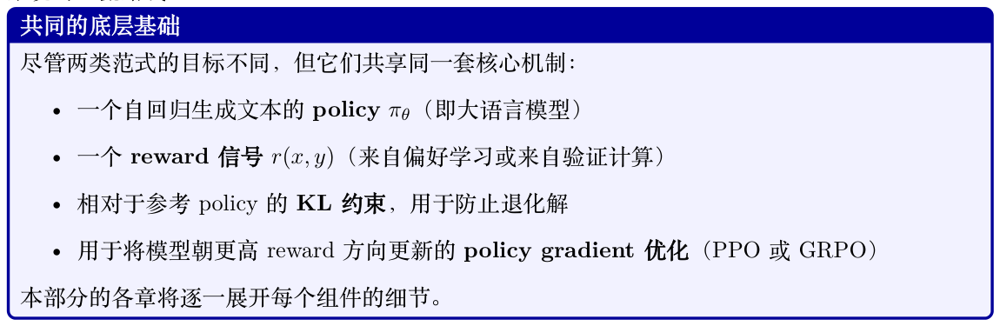
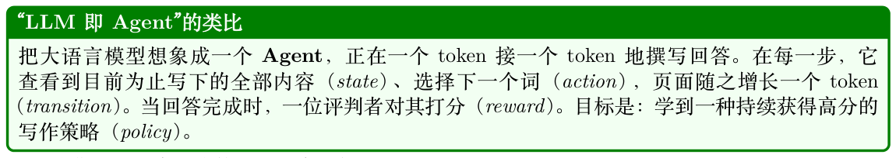

# 大语言模型的强化学习基础

监督微调（Supervised Fine-Tuning, SFT）教模型模仿示例，但模仿存在天花板：模型永远无法超越其训练数据的质量。强化学习突破了这一壁垒。通过生成新文本、接收reward 反馈，并朝着获得更高reward 的行为更新，经过RL 训练的模型能够发现任何人类示范者都未曾写出的策略——产出更有帮助、更准确、且更契合人类偏好的输出[9]。

这是每一款前沿模型背后的机制：GPT-4 [23]、Claude、Llama-3 [25] 和DeepSeek-R1 [15] 都在SFT 之后施加RL，作为把一个能力强但缺乏导向的模型转化为对齐助手的关键一步。

## 4.1 大语言模型RL 的两大范式

面向语言模型的RL 方法可大致划分为两类范式，分别适用于不同的目标：

范式一：通过人类偏好实现对齐（RLHF/DPO）。将RL 应用于大语言模型最初的动机是对齐

- —让模型变得有帮助、无害且诚实。基于人类反馈的强化学习（Reinforcement Learning from Human Feedback, RLHF）[9, 173, 174] 利用人类两两比较的判断（“哪个回答更好？”）来训练reward 模型，然后优化policy 以最大化这一学到的reward。DPO [10] 通过彻底取消reward 模型来简化这一过程，将偏好直接转化为有监督loss。两种方法都能产出能够遵循指令且尊重安全约束的对齐助手。

范式二：通过可验证奖励增强能力（RLVR）。近期，RL 不仅被用于对齐，也被用于教授新能力——尤其是推理、数学和代码生成。此处的reward 不再来自人类偏好，而来自可验证的结果：模型是否给出了正确答案？代码是否通过了所有测试？DeepSeek-R1 [15] 证明，配合基于规则的reward（格式正确性+ 答案准确性）的GRPO 能够在完全不使用人类偏好数据的情况下，训练模型发展出复杂的思维链（Chain-of-Thought，CoT）推理。这一范式——可验证奖励的强化学习（Reinforcement Learning from Verifiable Rewards, RLVR）——如今已成为构建推理模型和agentic系统的主流路线。

## 4.2 将文本生成建模为MDP

让RL 得以应用于语言模型的关键洞察，是将自回归生成重述为一个Markov 决策过程（MDP）：

- State st = (x, y1, . . . , yt−1)：Prompt 与到目前为止已生成的所有token 的拼接。

- Action at ∈{1, . . . , |V|}：从词表（32K–128K 选项）中选出下一个token。

- Transition P(st+1|st, at)：确定性的——只需追加所选token。环境无随机性。

- Reward r：通常仅在生成结束时给出（稀疏）。对RLHF 而言是reward 模型评分；对RLVR而言是最终答案的正确性。

- Policy πθ(at|st)：大语言模型的下一token 概率分布——正是Softmax 输出已经计算出的东西。

- 折扣因子γ = 1.0：Episode是有限的（即一条回答），因此无需折扣。

这种映射之所以强大，是因为大语言模型本身就已经是一个policy——其Softmax 输出为每一个state 定义了πθ(at|st)。我们无需另行构建一个policy 网络；只需调整权重θ，让模型为能获得更高reward 的token 序列赋予更高概率。

## 4.3 RLHF 流水线

经典的RLHF 流水线[9] 包含四个阶段：

1. 监督微调（SFT）：在高质量示例上训练base 模型，得到一个能够遵循指令的policy πSFT。

2. Reward 模型训练：收集人类偏好比较（对同一prompt 满足yw ≻yl），并使用Bradley-Terry模型（Bradley-Terry Model）目标训练reward 模型Rϕ(x, y)。

3. RL 优化：以reward 模型作为信号，通过PPO 或GRPO 优化policy，并对πSFT 施加KL约束。

4. 评估与迭代：评估对齐后的模型，收集新的失败案例，并进行迭代。

对于RLVR（推理/agentic 训练），阶段1–2 被替换：SFT 模型在推理轨迹上训练，reward 模型被替换为验证器（例如检查数学正确性）。阶段3 不变——使用PPO 或GRPO 针对reward 信号进行优化。

大语言模型场景与经典RL 在若干重要方面有所不同：

- 确定性transition：所谓“下一个state”只是先前token 的拼接——没有随机环境。

- 稀疏reward：反馈通常仅在生成结束时给出一次（结果reward），或在关键步骤给出（过程reward）。

- 巨大的action 空间：每一步有32K–128K 个候选token，但探索通过温度采样隐式完成。

- KL 锚：LLM RL 被约束保持在SFT policy 附近，以防止reward hacking，代价是探索受限。

- 无需value function：GRPO 完全去掉了critic 网络，转而采用reward 的组相对归一化。

这些差异解释了为何在大语言模型上PPO 与GRPO 占据主导，而非DQN 式方法。

## 4.4 本部分路线图

后续章节将构建出完整的“面向大语言模型的RL”工具箱：

1. PPO（第5章）——clipped surrogate 目标、用于优势估计的GAE、critic 网络，以及完整的RLHF 训练循环。它是GPT-4 与Claude 背后的主力。

2. DPO（第6章）——通过将偏好转化为对比式有监督loss，从而完全绕开RL。比online RL更简单，但灵活性较低。

3. GRPO（第7章）——DeepSeek 提出的无critic 算法，使用组级reward 归一化。它是DeepSeek- R1 背后的方法，也是推理模型训练的主导选择。

4. 偏好优化变体（第8章）——Online DPO、KTO、Best-of-N 采样（Rejection Sampling），以及方法选型指南。

5. Reward 建模（第9 章）——Bradley-Terry 模型、过程reward 与结果reward 的对比、面向RLVR 的基于规则的reward，以及多目标组合。

6. SFT 最佳实践（第10 章）——序列打包（Sequence Packing）、对话模板、数据混合，以及SFT 质量如何决定RL 的上限。

7. 系统工程（第11章）——大规模分布式训练：并行策略、生成与训练解耦，以及面向数百块GPU 的基础设施。
