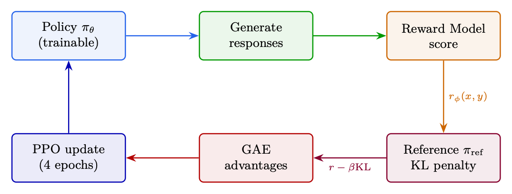
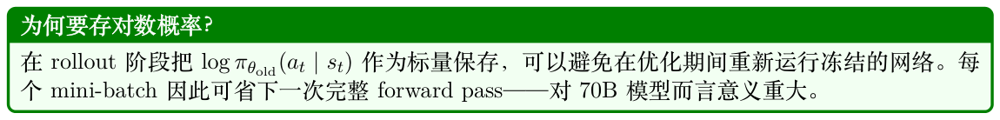
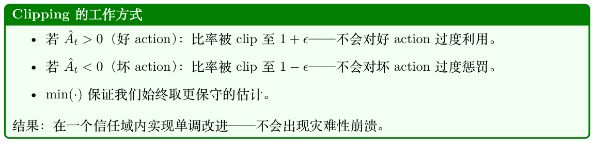

# PPO——近端策略优化

## 5.1 动机与历史

问题：朴素的policy gradient 更新对步长没有任何约束。仅仅一次倒霉的batch 就可能把policy 推入一个生成垃圾文本的区域→垃圾文本获得低reward →下一次gradient 让情况更糟→不可挽回地崩溃。

解决方案的演进：

1. TRPO [166]（2015）：对新旧policy 之间的KL 散度施加约束。效果完美，但需要昂贵的二阶优化（Fisher 信息矩阵、共轭梯度）。

2. PPO（2017）[167]：用一个简单的一阶clipped 目标实现类似的稳定性。实现复杂度低了10×，效果几乎一样，且能轻松扩展到分布式训练。

## 5.2 Clipped 目标

PPO 的核心创新是一个clipped surrogate 目标：它能阻止破坏性的大幅policy 更新，同时保持实现简单。

h  i LCLIP(θ) = Et min rt(θ) ˆAt, clip(rt(θ), 1−ϵ, 1+ϵ) ˆAt (5.1)

其中rt(θ) = πθold(at|st) 是概率比。πθ(at|st)

min 算子构造了一个悲观下界：

- 好的action（ˆA > 0）：我们希望提升其概率。Surrogate r ˆA 会随r 增大而增大，但clip 将

收益上限锁在r = 1 + ϵ。“别因为一个好例子就贪心。”

- 坏的action（ˆA < 0）：我们希望降低其概率。r ˆA 会随r 减小而改善，但clip 将收益上限

锁在r = 1 −ϵ。“别因为一个坏例子就遗忘得太激进。”

净效应：每次更新步中policy 的变化最多在±20% 之内，既能防止灾难性崩溃，也能防止过度自信地走向特化。

## 5.3 完整的PPO Loss

L = LCLIP −c1 (Vθ(st) −V target )2 +c2 H[πθ(·|st)] (5.2) | {z t } | {z } value loss entropy bonus

- Value loss（c1 = 0.1）：训练critic 去预测return；同样被clip 以保持稳定。

- 熵奖励（c2 = 0.01）：防止过早收敛到确定性policy，对探索至关重要。

## 5.4 PPO Gradient 与更新规则的推导

本节追溯从RL 目标到PPO 更新规则的数学路径，说明clipped surrogate 为何有效。

### 5.4.1 第1 步：RL 目标

目标是在policy 下最大化期望累计reward：

" T # X J(θ) = Eτ∼πθ rt (5.3) t=0

### 5.4.2 第2 步：Policy Gradient 定理

J(θ) 关于policy 参数的gradient：

" T # X ∇θJ(θ) = Eπθ ∇θ log πθ(at|st) · ˆAt (5.4) t=0

其中ˆAt 是优势函数（即在state st 下action at 相对平均action 的好坏程度）。用advantage 替

代完整return 是为了降低方差。

### 5.4.3 第3 步：离策略数据的重要性采样

PPO 使用πθold 收集数据，却更新πθ。为修正这种分布失配，需应用重要性采样：

" # πθ(at|st) ∇θJ(θ) = Eπθold πθold(at|st)∇θ log πθ(at|st) · ˆAt (5.5)

定义概率比rt(θ) = πθold(at|st)。利用恒等式∇θ log f = ∇θf πθ(at|st) f ，可得：

h i ∇θJ(θ) = Eπθold ∇θ rt(θ) · ˆAt (5.6)

h i LCPI(θ) = Et rt(θ) · ˆAt (5.7)

### 5.4.4 第4 步：无约束Surrogate 的问题

LCPI 是一个合法的目标，但若无约束，单次gradient 步就可能让rt(θ) 远离1.0，导致：

- 重要性权重变得极端→方差升高

- Policy 进入未经检验的区域→reward 模型给出不可靠的分数

- 灾难性崩溃：policy生成垃圾，且无法恢复

TRPO 方案：约束DKL(πθold∥πθ) ≤δ。需要二阶方法（成本高）。

### 5.4.5 第5 步：PPO 的Clipped Surrogate（一阶近似）

PPO 用一个clipped 目标取代硬性KL 约束，仅使用一阶gradient 即可达到类似行为：

h  i LCLIP(θ) = Et min rt(θ) ˆAt, clip(rt(θ), 1−ϵ, 1+ϵ) ˆAt (5.8)

令Lt = min(rt ˆAt, ¯rt ˆAt)，其中¯rt = clip(rt, 1−ϵ, 1+ϵ)。

( ∇θrt(θ) · ˆAt if rt ˆAt < ¯rt ˆAt (unclipped term is smaller) ∇θLt = (5.9) if rt ˆAt ≥¯rt ˆAt (clipped term is smaller, gradient = 0)

展开各条件：

- 当ˆAt > 0 且rt < 1 + ϵ：Gradient 正常传播——policy 被鼓励提升πθ(at|st)。

- 当ˆAt > 0 且rt ≥1 + ϵ：Gradient 为零——policy 提升已足够，停止继续推。

- 当ˆAt < 0 且rt > 1 −ϵ：Gradient 正常传播——policy 被鼓励降低πθ(at|st)。

- 当ˆAt < 0 且rt ≤1 −ϵ：Gradient 为零——policy 降低已足够，停止继续推。

### 5.4.6 第6 步：完整的PPO 更新规则

将clipped policy loss、value loss 与熵奖励组合起来：

h i θk+1 = θk + α · ∇θ LCLIP(θ) −c1LVF(θ) + c2H[πθ] (5.10)

其中：

 2 LVF(θ) = Vθ(st) −V target (value function regression loss) (5.11) t X H[πθ] = − πθ(a|st) log πθ(a|st) (entropy of the policy) (5.12) a

小结：它为何有效

1. Policy gradient 定理给出了改进policy 的方向。

2. 重要性采样让我们能在多个epoch 中复用来自πθold 的数据。

3. Clipping 防止重要性权重变得极端，保持更新安全。

4. min 算子保证我们始终在(clipped, unclipped) 中取更保守的一项——对改进设置悲观下界。

5. 结果：以概率1 实现单调改进，且只用一阶gradient。无需Hessian、共轭梯度或线搜索。

## 5.5 Rollout Buffer 与Rollout

在PPO 中，数据管理依赖一个被称为Rollout Buffer 的专用短期存储系统。与无限期地在replay buffer 中保存经验的离策略算法（如DQN）不同，PPO 需要一种短暂存在的结构，以满足其在策略的数学约束。

### 5.5.1 什么是Rollout？

#### Rollout（轨迹）是Agent 在环境中执行当前policy 所产生的一段交互序列：

- 过程：Agent观察state、选择action、获得reward，然后转移到下一个state。重复进行固定步数，或直到episode 结束。

- 在大语言模型/RLHF中：一次rollout 即从数据集中取出一条prompt，让语言模型一个token接一个token 地生成完整序列，直到遇到文本结束标记。每个token 就是一个“step”。

### 5.5.2 Rollout Buffer

Rollout buffer 临时存储rollout 阶段收集到的全部数据。对每个生成的token/step，它记录：

B = {(st, at, log πθold(at|st), rt, V (st))}T (5.13) t=1

- st, at, rt：步t 的state、所采取的action 与reward。

- log πθold(at|st)：在生成该action 的那一个policy 下取该action 的对数概率（计算ratio 时需要）。

- V (st)：Value function 给出的基线预测（计算GAE advantage 时需要）。

### 5.5.3 Rollout Buffer 的生命周期

该buffer 按严格的三阶段时钟周期运行：

1. 收集：当前policy 与环境交互，用新鲜轨迹填满buffer（对一个70B 模型，batch=128，max_tokens=512：单次rollout 可达65K 个token 级transition）。

2. 训练：对各轨迹计算GAE advantage。使用clipped 目标在mini-batch 上跑K 个epoch（通常3–10）的gradient 下降，更新policy 权重。

3. 清空：整个buffer 被彻底清空。由于PPO 是on-policy 的，旧policy 产生的数据无法安全地复用于下一轮更新——比率rt(θ) 会变得过期，clipping 保证也会失效。

Replay Buffer（DQN、SAC）：Off-policy。无限期地存储数百万条transition。随机采样。数据跨多次更新复用。

Rollout Buffer（PPO、GRPO）：On-policy。存储一个batch 的轨迹。使用若干epoch 后被完全丢弃。每个周期都需要新鲜数据。

这就是为什么PPO 需要持续生成——每次更新后buffer 被清空，需要新的rollout。这也让生成瓶颈（占wall-clock 时间60–70%）尤为痛苦。

在RLHF 训练中，vLLM 被用于生成阶段（占wall-clock 时间60–70%）。Policy 模型生成rollout，随后由reward 模型打分。其主要优势：

- 批量生成：跨多条prompt 并行生成256+ 条回答。

- 显存效率：可容纳更多并发生成→在生成瓶颈期GPU 利用率更高。

- 前缀共享：当每条prompt 生成N = 8 条回答时（如GRPO），prompt 的KV 只算一次并被8 条共享——无冗余prefill。

- 集成：OpenRLHF、TRL等框架将vLLM 作为生成后端，把生成worker（vLLM）与训练worker（DeepSpeed/FSDP）分离。

## 5.6 用于RLHF 的PPO：完整循环

设置：128条prompt 一个batch，policy 为Llama-3-70B，最大生成512 个token。

第1 步——生成：采样128 条回答（temperature=0.7，top-p=0.9）。耗时占60%。

第2 步——打分：Reward 模型对每个(prompt, response) 对打分。取值范围：0.2–0.95。

第3 步——KL：计算逐token 的KL：KLt = log πθ(yt|y<t) −log πref(yt|y<t)。跨token 的均值KL：通常3–8。

第4 步——最终reward：R = rRM −0.05 × mean_KL（只在最后一个token 给）。

第5 步——GAE：使用value head 的预测，为每个token 位置计算ˆAt。对advantage 做whitening

（零均值、单位方差）。

第6 步——更新：在大小为16 的mini-batch 上跑4 个epoch 的SGD。Clip 比率ϵ = 0.2，梯度范数clip 至1.0。

结果：Policy 每步约提升0.005 的胜率。10K 步后：相对于SFT 绝对提升5–10%。

在计算逐token KL 惩罚与advantage 时，请记住：tokenization 决定了什么算一“步”。单个概念性action（例如输出“2024”）依据tokenizer 的不同可能跨越1–4 个token。这带来若干微妙问题：

- KL 记账：相同的语义内容若被切成不同数量的token，逐token KL 加总会得出不同总额（例如，被切成更多子词的稀有词会获得更高的总KL 惩罚）。

- Credit 分配：GAE 按token 位置分配advantage——但语义“决策”常跨越多个token。模型其实只在词首token 真正“决定”；后续子词token 基本是确定性的。

- Reward 放置：只在最后一个token 给reward 意味着所有先前token 必须通过GAE 向后回传credit——越长的回答信号被稀释得越厉害。

缓解措施：一些系统按序列长度对KL 做归一化，使用词级reward shaping，或在语义边界（而非最末token）处施加reward。

## 5.7 细节机制：Logits 与Policy 更新



**Figure 5.1: PPO 端到端流程：从prompt batch 出发，经过生成、reward 打分、KL 计算、advantage 估计，到clipped policy 更新。反馈环显示更新后的policy 又被用于下一次生成。**

PPO 在内存中维护两份不同的参数状态，它们共享同一神经网络拓扑，但在优化过程中持有不同的权重值：


### 5.7.1 阶段1：Rollout（数据收集）

在数据收集期间，Agent 与环境交互T 步。在每个时间步t：

1. 环境给出当前state/观测st（对大语言模型而言：prompt + 到目前为止已生成的token）。

2. st 被送入当前网络快照（θold）。

3. 网络输出原始未归一化的值——logits zold——一个长度为|V |（词表大小32K–128K）的向量。

4. 通过Softmax 计算概率：

exp(zold,a) P(a | st) = Softmax(zold) = P|V | (5.14) j=1 exp(zold,j)

5. 从P(a | st) 中采样一个action at（下一个token），并将transition 元组⟨st, at, rt, st+1⟩连同log πθold(at | st) 一起存入rollout buffer。



### 5.7.2 阶段2：优化循环（Mini-Batch 更新）

一旦rollout buffer 填满，PPO 就在mini-batch 上跑K 个epoch（通常3–10）。在每个gradient 步中，使用所存state st 为两个policy 同时生成logits：

zold = f(st; θold) −→ log πθold(at | st) = LogSoftmax(zold)[at] (5.15)

实现捷径：复用rollout 时保存的标量，而非重新计算。

znew = f(st; θ) −→ log πθ(at | st) = LogSoftmax(znew)[at] (5.16)

由于每次mini-batch gradient 步后θ 都会更新，znew 会在整个优化循环中持续变化，而zold 则始终保持不变。

### 5.7.3 从Logits 到概率比

PPO 的核心比率衡量某个action 在新policy 下相对旧policy 的概率变化：

πθ(at | st) rt(θ) = (5.17) πθold(at | st)

为了避免直接除原始概率带来的数值下溢/上溢灾难，计算在对数空间中进行：

log πθ(at | st) = LogSoftmax(znew)[at] (5.18)

log πθold(at | st) = LogSoftmax(zold)[at] (5.19)

比率由差值的指数恢复：

rt(θ) = exp(log πθ(at | st) −log πθold(at | st)) (5.20)

该比率随后被代入PPO 的clipping 目标：

h  i LCLIP(θ) = ˆEt min rt(θ) ˆAt, clip(rt(θ), 1−ϵ, 1+ϵ) ˆAt (5.21)



### 5.7.4 PPO 权重生命周期

**Table 5.1: θ 与θold 在PPO 训练各阶段的演化。**

| 阶段 | 实时θ | 旧θold | 比率rt(θ) |
| --- | --- | --- | --- |
| 1. Rollout 起始 | 活动副本 | 同一活动副本 | 恒为1.0（按定义） |
| 2. Batch 第1 步 | 计算gradient | 冻结 | 1.0（初始步） |
| 3. Batch 第N 步 | 正在修改（θ ̸= θold） | 冻结 | 偏离1.0（如1.06、0.94） |
| 4. Clipping 生效 | 受ϵ 限制 | 冻结 | 被锁在边界（1 ± ϵ） |
| 5. 优化结束 | 高度优化后 | 被丢弃 | 不适用 |
| 6. 下一周期 | θ →θold | 接收最新的θ | 重置回1.0 |

### 5.7.5 连续Action 空间扩展

对于连续action 空间（在大语言模型中不常见，但对机器人RL 很重要），网络输出的是分布参数而非离散logits：

- 预测的均值向量µ

- 预测的标准差向量σ

对数概率由高斯对数PDF 计算：

at −µ 2 log π(at | st) = −1 −log(σ) −1 2 log(2π) (5.22) σ

比率rt(θ) = exp(log πθ −log πθold) 的计算方式完全相同，并被代入同一个clipping 目标。

## 5.8 TRL 实现

HuggingFace 的TRL 库[175] 提供了面向大语言模型的所有主流RL 方法的生产级实现。

```
from trl import PPOConfig , PPOTrainer , AutoModelForCausalLMWithValueHead
from transformers import AutoTokenizer
from peft import LoraConfig
# 模型初始化
model = AutoModelForCausalLMWithValueHead.from_pretrained(
"meta-llama/Llama -3.1-8B-Instruct",
torch_dtype=torch.bfloat16 , device_map="auto",
peft_config=LoraConfig(r=64, lora_alpha=16, target_modules=["q_proj","v_proj","
k_proj","o_proj"])
)
tokenizer = AutoTokenizer.from_pretrained("meta-llama/Llama -3.1-8B-Instruct")
# PPO 配置，包含全部关键超参
ppo_config = PPOConfig(
learning_rate=1.5e-6, # 低学习率，利于稳定
batch_size=128, # 每步的prompt 数
mini_batch_size=16, # 梯度累计的单位
```

```
ppo_epochs=4, # 每个batch 的epoch 数（复用数据）
gamma=1.0, # 不做折扣（单轮）
lam=0.95, # GAE lambda
cliprange=0.2, # PPO epsilon
cliprange_value=0.2, # value function 的clip 范围
vf_coef=0.1, # value loss 系数
init_kl_coef=0.05, # 初始KL 惩罚
target_kl=6.0, # 自适应KL 目标
whiten_rewards=True, # 对advantage 做归一化
gradient_accumulation_steps=4,
max_grad_norm=1.0,
)
ppo_trainer = PPOTrainer(config=ppo_config , model=model, tokenizer=tokenizer ,
dataset=prompt_dataset , data_collator=collator)
# 训练循环
for batch in ppo_trainer.dataloader:
# 1. 生成回答
query_tensors = batch["input_ids"]
response_tensors = ppo_trainer.generate(
query_tensors , max_new_tokens=512, temperature=0.7, top_p=0.9, do_sample=True
)
# 2. 用reward 模型打分
texts = [tokenizer.decode(r, skip_special_tokens=True) for r in response_tensors]
rewards = [torch.tensor(reward_model.score(q, r)) for q, r in zip(batch["query"],
texts)]
# 3. PPO 更新（内部完成KL、GAE 、clipping ）
stats = ppo_trainer.step(query_tensors , response_tensors , rewards)
# 监控指标：stats["ppo/mean_scores"] 、stats["ppo/policy/approx_kl"]
```

## 5.9 关键超参

参数典型值设错的影响

cliprange 0.2过低：学不到东西。过高：不稳定。

init_kl_coef 0.01–0.1过低：reward hacking。过高：卡在SFT状态。

target_kl 4–8自适应控制器的目标值；越低越保守。

ppo_epochs过多：在单batch 上过拟合。过少：浪费生成算力。

learning_rate 1−5 × 10−6过高：灾难性遗忘（Catastrophic Forget- ting）。

batch_size 64–256越大：梯度更平滑，但生成算力更多。

temperature 0.7–1.0越低：探索越少。越高：advantage 越嘈杂。
