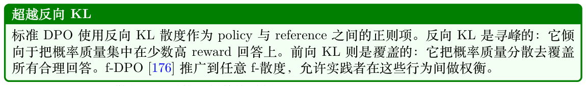
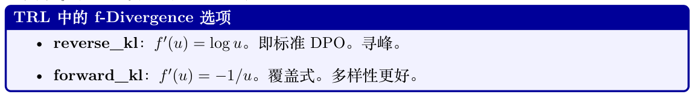
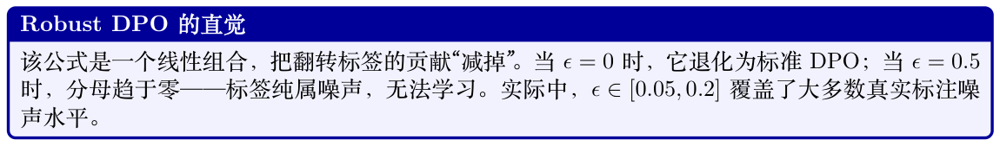
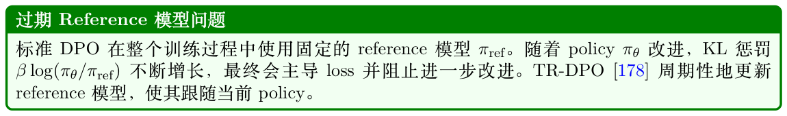
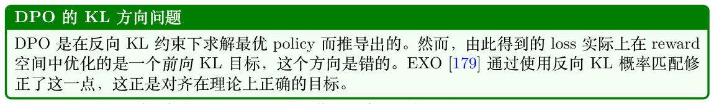
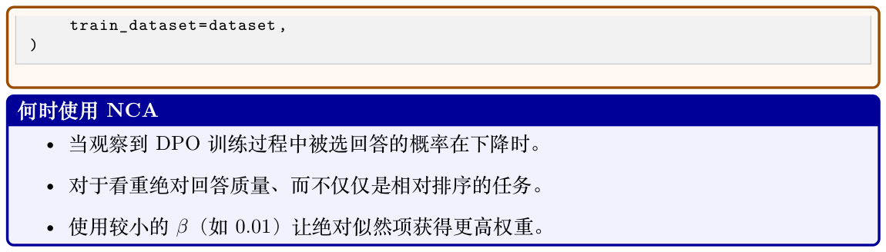
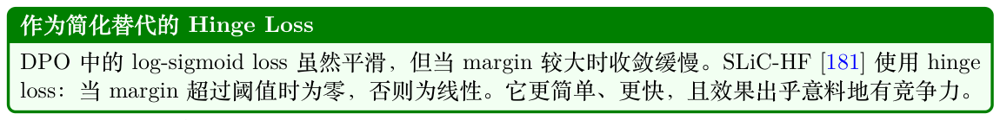
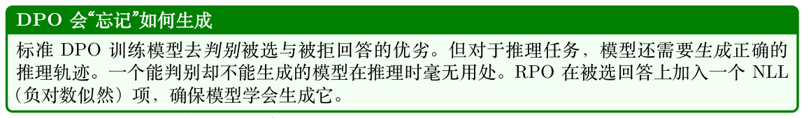
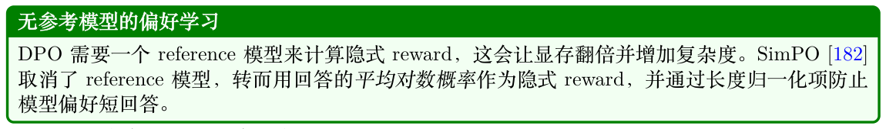

# DPO——直接偏好优化

## 6.1 动机

PPO需要在显存中维持4 个模型（policy、reference、reward 模型、value head）、复杂的RL 基础设施，并且以不稳定著称。DPO [10] 提出的问题是：我们能否跳过RL，直接从偏好中学习？

关键洞察：在RLHF 目标（reward 最大化+ KL 惩罚）下的最优policy 拥有解析解。由此我们可以推导出一个有监督loss，隐式优化同一个目标。

## 6.2 数学推导

第1 步：RLHF 目标：maxπ Ex,y∼π[r(x, y)] −βDKL[π∥πref]  r(x,y) 第2 步：最优解为：π∗(y|x) = Z(x)πref(y|x) exp β第3 步：重排式子，用policy 表达reward：r(x, y) = β log π∗(y|x) πref(y|x) + β log Z(x)

第4 步：代入Bradley-Terry 偏好模型P(yw ≻yl) = σ(r(yw) −r(yl))。Z(x) 项相互抵消！

   β log πθ(yw|x) πref(yw|x) −β log πθ(yl|x) LDPO(θ) = −E(x,yw,yl) log σ (6.1) πref(yl|x)

将隐式reward 定义为ˆr(x, y) = β log πθ(y|x) πref(y|x)。

DPO 在最小化一个交叉熵loss，其中“标签”是：被选回答的隐式reward 应高于被拒回答。Margin由β 控制：

- β 较大：需要较大的margin →policy 移动得更激进→有遗忘风险

- β 较小：较小的margin 就够了→policy 更靠近reference →更保守

Reference 模型起到正则化作用：policy 必须用偏好对齐来“证明”自己偏离reference 的合理性。

## 6.3 Gradient 分析

DPO 的gradient 可分解为：

∇θL = −β ·σ(−ˆrw + ˆrl)· [∇θ log πθ(yw|x) −∇θ log πθ(yl|x)] (6.2) | {z } weight: higher when model is wrong

解读：Gradient 会提升“被选”项的概率，降低“被拒”项的概率。当模型当前更偏好错误答案时，权重最大——也就是说，它把学习重点放在“易混淆”的成对样本上。

#### 一个具体的DPO 例子

被选（yw）：“想象你有两枚魔法硬币。你抛其中一枚，如果它是正面，另一枚不管离多远都会立刻变成反面！”

log πθ(yw|x) = −15.3，log πref(yw|x) = −16.1被拒（yl）：“量子纠缠是一种现象，其中两个粒子相互关联，以致于一个粒子的量子态无法被独立描述。”

log πθ(yl|x) = −12.8，log πref(yl|x) = −12.5隐式reward：ˆrw = 0.1 × ((−15.3) −(−16.1)) = 0.08，ˆrl = 0.1 × ((−12.8) −(−12.5)) = −0.03

Loss：−log(0.527) = 0.64——模型仅略微偏好被选回答。Gradient 会用力推动。

训练之后：被选回答的概率提升、被拒回答的概率下降，直到margin 稳定在约1/(2β)。

## 6.4 TRL 实现

下面给出一个使用HuggingFace TRL 的最小可运行示例。

```
from trl import DPOConfig , DPOTrainer
from transformers import AutoModelForCausalLM , AutoTokenizer
from peft import LoraConfig
from datasets import load_dataset
model = AutoModelForCausalLM.from_pretrained("meta-llama/Llama -3.1-8B-Instruct",
torch_dtype=torch.bfloat16 , attn_implementation="flash_attention_2")
tokenizer = AutoTokenizer.from_pretrained("meta-llama/Llama -3.1-8B-Instruct")
# 数据集格式：{"prompt": str, "chosen": str, "rejected": str}
dataset = load_dataset("argilla/ultrafeedback -binarized -preferences")
lora_config = LoraConfig(r=64, lora_alpha=16, lora_dropout=0.05,
target_modules=["q_proj","k_proj","v_proj","o_proj","gate_proj","up_proj","
down_proj"])
dpo_config = DPOConfig(
output_dir="./dpo_output",
beta=0.1, # KL 正则强度
learning_rate=5e-7, # 学习率非常低，利于稳定
loss_type="sigmoid", # 标准DPO loss
max_length=2048, # 最大序列长度
max_prompt_length=1024, # prompt 截断长度
per_device_train_batch_size=2,
gradient_accumulation_steps=8, # 有效batch = 16
gradient_checkpointing=True,
bf16=True,
num_train_epochs=1, # DPO 易过拟合—— 只跑1 个epoch ！
warmup_ratio=0.1,
logging_steps=10,
eval_strategy="steps",
eval_steps=200,
save_strategy="steps",
save_steps=500,
)
trainer = DPOTrainer(
model=model,
ref_model=None, # 配合LoRA 时，ref = base 模型（无需另外拷贝！）
args=dpo_config ,
train_dataset=dataset["train"],
eval_dataset=dataset["test"],
tokenizer=tokenizer ,
```

```
peft_config=lora_config ,
)
trainer.train()
# 需要监控的关键指标：train/rewards/chosen 、train/rewards/rejected 、train/rewards/
margins
```

## 6.5 DPO 的完整机制

本节给出DPO 的完整计算细节——训练时在token 级别究竟发生了什么。

### 6.5.1 序列级对数概率

DPO 中的关键量是：在给定prompt x 下，整段序列y = (y1, y2, . . . , yT ) 的对数概率。它是逐token对数概率之和：

X T log πθ(y|x) = log πθ(yt | x, y<t) (6.3) t=1

其中每一项log πθ(yt|x, y<t) 都是位置t 处的log-softmax 输出，对应序列中实际出现的token yt。

这与标准语言建模中的交叉熵loss 完全一致——只是这里我们求和而非求均值。

关键细节：Gradient 会流过yw 和yl 中的每一个token 位置。中间token 不做掩码——每个token 都对序列级对数概率有贡献。

### 6.5.2 DPO Loss 的分解

从loss 开始：LDPO(θ) = −E(x,yw,yl)∼D[log σ(β · hθ(x, yw, yl))] (6.4)

其中“隐式reward margin”hθ 为：

log πθ(yw|x) log πθ(yl|x) hθ(x, yw, yl) = − (6.5) πref(yw|x) πref(yl|x) | {z } | {z } chosen reward proxy rejected reward proxy

展开为token 级各项：

|yw| X h i X |yl| h i hθ = log πθ(yt w|x, y<t w ) −log πref(yt w|x, y<t w ) − log πθ(yt l|x, y<t l ) −log πref(yt l|x, y<t l ) (6.6) t=1 t=1

### 6.5.3 Forward Pass：逐步详解

对一个训练样本(x, yw, yl)：

1. 拼接：组成两条序列：[x; yw] 与[x; yl]。在batch 内pad 到相同长度。

2. Forward pass（policy πθ）：把两条序列都喂进模型；在每个回答位置收集logits。

3. 提取对数概率：在回答中每个位置t 处，取log softmax(logitst)[yt]——即实际token 的对数概率。

4. 对token 求和：

X logp_chosen = log πθ(yt w|x, y<t w ) (6.7) t∈response positions X logp_rejected = log πθ(yt l|x, y<t l ) (6.8) t∈response positions

5. 减去参考（预计算或来自第二次forward pass）：

ratio_w = logp_chosen −ref_logp_chosen (6.9)

ratio_l = logp_rejected −ref_logp_rejected (6.10)

6. 计算loss：L = −log σ(β · (ratio_w −ratio_l))

7. Backward pass：Gradient 沿步骤5 →4 →3 →2 回传，更新θ。

### 6.5.4 Token 级Gradient 分析

是不是每个token 都收到gradient？是。在被选序列中，位置t 处logits 上的gradient 为：

∂L·β · ∂log πθ(yt w|·) = −σ(−β · hθ) (6.11) ∂logits(w) | {z } ∂logits(w) t scaling factor t

关键洞察：缩放因子σ(−β · hθ) 在两条序列的所有token 间共享，相当于一个自适应学习率：

- 当hθ 较小（模型分不清被选与被拒）：缩放≈0.5——gradient 强，激进地学。

- 当hθ 较大（模型已经偏好被选）：缩放≈0——gradient 可忽略，避免过拟合。

对被选token 的影响：概率被提升（对数概率被推高）。

对被拒token 的影响：概率被降低（对数概率被压低）。

相对reference：只有相对πref 的差值才重要。如果模型本就给被选回答高概率（与reference 一致），那么gradient 就几乎为零。

### 6.5.5 逐Token vs. 序列级：长度归一化

一个微妙问题：越长的序列对数概率天然越低（求和的项更多，且每项≤0）。若|yw| ≫|yl|，loss会偏向于偏好更短的回答。

解决方案：P

- 长度归一化的DPO：用t log πθ(yt|·) 替换log πθ(y|x)。一些实现采用此做法（SimPO 即|y|如此）。

- 标准DPO：使用原始求和（不归一化）。这会隐式惩罚冗长——模型必须对被选回答中的每个token 都赋予高概率。

- 实际影响：在benchmark 上，长度归一化的DPO 能减少长度博弈，但可能损害指令遵循质量。生产中更常用未归一化的标准版本。

### 6.5.6 标签掩码：哪些token 会收到Gradient

#### DPO 中哪些token 收到Gradient

- Prompt token（x）：无gradient。Loss 仅在回答位置上计算。Prompt token 提供上下文，但其logits 不参与log π(y|x)。

- 被选回答token（yw）：所有token 都收到gradient。每个yt w 都贡献到求和；gradient推高它们的概率。

- 被拒回答token（yl）：所有token 都收到gradient。每个yt l 都贡献到求和；gradient 压低它们的概率。

- Padding token：无gradient。通过attention mask 屏蔽掉。

### 6.5.7 伪代码：DPO 训练步

```
DPO Forward + Backward（PyTorch 风格）
def dpo_loss(model, ref_model , batch, beta=0.1):
"""一个DPO 训练步。"""
# batch 包含：input_ids_chosen 、input_ids_rejected 、
# labels_chosen 、labels_rejected （prompt 被掩为-100 ）
# 1. Forward pass ：得到逐token 对数概率
logps_chosen = get_sequence_logprob(model, batch["chosen"])
logps_rejected = get_sequence_logprob(model, batch["rejected"])
# 2. 参考模型对数概率（预计算或在此处计算）
with torch.no_grad():
ref_logps_chosen = get_sequence_logprob(ref_model , batch["chosen"])
ref_logps_rejected = get_sequence_logprob(ref_model , batch["rejected"])
# 3. 计算隐式reward margin
chosen_rewards = beta * (logps_chosen - ref_logps_chosen)
rejected_rewards = beta * (logps_rejected - ref_logps_rejected)
# 4. DPO loss = -log(sigmoid(被选reward - 被拒reward))
loss = -F.logsigmoid(chosen_rewards - rejected_rewards).mean()
return loss
def get_sequence_logprob(model, sequences):
"""仅在回答token 上求和的对数概率。"""
outputs = model(sequences["input_ids"], attention_mask=sequences["mask"])
logits = outputs.logits[:, :-1, :] # 为next-token 预测做位移
# 收集实际token 的对数概率
labels = sequences["labels"][:, 1:] # 位移后的标签
log_probs = F.log_softmax(logits, dim=-1)
token_logps = log_probs.gather(-1, labels.unsqueeze(-1)).squeeze(-1)
# 掩码：只对回答token 求和（labels != -100 ）
mask = (labels != -100).float()
return (token_logps * mask).sum(dim=-1) # 形状：[batch_size]
```

### 6.5.8 常见陷阱

#### DPO 实现中的陷阱

- 忘记屏蔽prompt：如果prompt token 被纳入对数概率求和，模型就会优化prompt 的似然（无意义），且有效β 也会出错。

P t log π 与P

- 用均值替代求和：1 t log π 会带来不同的隐式长度惩罚。πθ 与πref 之间必须T保持一致。

- 过期的参考模型：若πref 与πθ 相距过远（如base 模型vs. 微调后的模型），KL 项会占主导，gradient 消失。解决办法：使用SFT checkpoint（而非base）作为reference。

- β 过大：放大对数概率差值→sigmoid 饱和→gradient 归零。从β = 0.1 起步，在[0.05, 0.5]区间内调参。

- β 过小：理论上允许policy 更大程度地偏离reference（KL 约束更弱），但gradient ∝β · σ(−βh) 会变得极小→loss 地形平坦→收敛极慢。模型“被允许”走得很远，却几乎收不到任何告诉它往哪走的信号。

## 6.6 DPO 变体及其各自的失败场景

#### DPO 何时会失败

1. 分布漂移：偏好数据来自旧模型。当前policy 生成的文本截然不同→loss 在无关样本上做优化。

2. 无探索：无法发现数据集之外的行为。陷入局部最优。

3. Reference 崩塌：Reference 太强，policy 动弹不得；太弱则失去正则化作用。

4. 数据质量：噪声标签会毒化训练。与对大量样本平均的PPO 不同，DPO 会“记住”单个的样本对。

5. 偏好数据多样性：要确保被选/被拒成对样本覆盖质量差异的完整谱系（而不仅是“好vs 极差”）。在解法思路上有差异的样本对（而不仅是质量差异）能教出更丰富的policy 区分能力。

## 6.7 β 选择指南

β风格使用场景

## 0.01 非常激进仅当数据极其干净、且你需要大幅度分布迁

移时使用

## 0.05 激进数据较好，希望相对SFT 取得明显改进

## 0.1 标准默认起点。质量与稳定性的良好平衡

## 0.2 保守噪声较多，或模型已接近期望行为

## 0.5 非常保守安全微调场景，必须保住已有能力

## 6.8 DPO 的Batch Size 配置与扩展

与在单序列token 预测上工作的标准SFT 不同，DPO 使用一个比较“被偏好序列与被拒序列”的成对loss。这从根本上改变了显存利用与优化稳定性。

### 6.8.1 全局Batch Size 目标

跨多种DPO 实现的经验证据给出了一个最佳全局batch size 范围：

Bglobal ∈[32, 128] (6.12)

- Bglobal < 32：隐式reward 估计中的gradient 噪声严重→policy 在多个对齐目标之间（如有用vs 安全）破坏性振荡。

- Bglobal > 128：收敛速度边际收益递减；分布式算力间通信开销巨大。

### 6.8.2 数学分解

由于DPO 同时加载两份模型副本（活动policy πθ + 冻结reference πref），每条序列的显存翻倍。

全局batch size 可分解为：Bglobal = Bmicro × NGPUs × Kaccum (6.13)

- Bmicro：每设备micro-batch 大小（每次forward pass 的偏好对数）。

- NGPUs：并行处理数据的设备数量。

- Kaccum：在权重更新前累计gradient 的步数。

成对倍数因子：单个DPO 数据样本包含prompt（x）、被选（yw）和被拒（yl）。每个micro-batch的实际tensor 负载为：Tsequences = 2 × Bmicro (6.14)

对于在80GB GPU 上、上下文长度4096–8192 token 的>7B 参数模型，物理上限被刚性约束在Bmicro ∈[1, 2]。

### 6.8.3 分布式扩展配置

**Table 6.1: DPO 训练的分布式扩展配置（目标Bglobal = 64）。**

| 配置 |  |
| --- | --- |
| 单GPU | 8 卡节点 |
| Bglobal |  |
| Bmicro |  |
| 2（4 条序列） | 2（4 条序列） |
| NGPUs |  |
| Kaccum |  |
| 32 步 | 4 步 |
| 吞吐 |  |
| 串行/慢 | 高并行吞吐 |

### 6.8.4 显存优化：预计算Reference 对数概率

DPO loss：   β log πθ(yw|x) πref(yw|x) −β log πθ(yl|x) LDPO(θ) = −E(x,yw,yl) log σ (6.15) πref(yl|x)

由于πref 在整个训练过程中完全静态，其输出可被预先计算：

#### Reference 模型驱逐策略

1. 训练开始前，仅用πref 对数据集D 执行一次forward pass。

2. 将标量log πref(yw|x) 和log πref(yl|x) 缓存到磁盘。

3. 把πref 完全从GPU 显存中驱逐。

效果：可用GPU 显存翻倍→Bmicro 可从1–2 提升到4–8，从而最大化硬件利用率与训练吞吐。

实现：在TRL 中，于DPOConfig 设置precompute_ref_log_probs=True。对70B 模型，这能在整个集群上节省约140GB 的GPU 显存。

## 6.9 DPO 扩展与变体

直接偏好优化（Direct Preference Optimization, DPO）通过推导reward 函数与最优policy 之间的解析映射，把RLHF 重新表述为一个有监督学习问题。标准DPO loss 为：

   β log πθ(yw|q) πref(yw|q) −β log πθ(yl|q) LDPO(θ) = −E(q,yw,yl) log σ , πref(yl|q)

其中yw 为被偏好（获胜）的回答，yl 为被拒（失败）的回答，β 控制KL 惩罚强度。下面的小节涵盖最重要的扩展与变体。

### 6.9.1 f-DPO——广义f-Divergence DPO



  πθ(yw|q)   πθ(yl|q)  Lf-DPO = −E f′ −f′ , πref(yw|q) πref(yl|q)其中f′ 是f-散度生成器函数的导数。



```
• js_divergence：f′(u) = log(2u/(u + 1))。寻峰/覆盖之间的平衡。
• alpha_divergence：f′(u) = uα−1。在前向KL 与反向KL 之间插值。
TRL 中的f-DPO
from trl import DPOConfig , DPOTrainer
# Jensen -Shannon 散度（平衡）
config = DPOConfig(
f_divergence_type="js_divergence",
beta=0.1,
)
# Alpha 散度（alpha=0：前向KL；alpha=1 ：反向KL ）
config_alpha = DPOConfig(
f_divergence_type="alpha_divergence",
f_alpha_divergence_coef=0.5, # alpha 参数
beta=0.1,
)
trainer = DPOTrainer(
model=model,
ref_model=ref_model ,
args=config ,
train_dataset=dataset ,
)
何时使用f-DPO
• 当你想在多样性与质量之间取得平衡时，使用JS 散度。
• 对多样性至关重要的创意任务，使用前向KL。
• 对有唯一正确答案的任务，使用反向KL（即标准DPO）。
• 使用alpha 散度可连续插值并精调这一权衡。
```

### 6.9.2 Robust DPO


Lrobust = (1 −ϵ) LDPO(yw, yl) −ϵ LDPO(yl, yw) , 1 −2ϵ

其中LDPO(yw, yl) 是把yw 视为被偏好的标准DPO loss，而LDPO(yl, yw) 是把标签翻转后的loss。该修正去除了标签噪声引入的偏置。



```
TRL 中的Robust DPO
from trl import DPOConfig , DPOTrainer
config = DPOConfig(
loss_type="robust",
label_smoothing=0.1, # 对应epsilon = 0.1
beta=0.1,
)
trainer = DPOTrainer(
model=model,
ref_model=ref_model ,
args=config ,
train_dataset=dataset ,
)
```

### 6.9.3 TR-DPO——信任域DPO



π(t+1) ←α · π(t) + (1 −α) · π(t) ref, ref θ

其中α ∈(0, 1) 是混合系数。每Tsync 个gradient 步执行一次。

```
TRL 中的TR-DPO
from trl import DPOConfig , DPOTrainer
config = DPOConfig(
loss_type="sigmoid", # 标准DPO loss
sync_ref_model=True, # 启用TR-DPO
ref_model_mixup_alpha=0.6, # alpha ：混入当前policy 的比例
ref_model_sync_steps=512, # T_sync ：每512 步同步一次
beta=0.1,
)
trainer = DPOTrainer(
model=model,
ref_model=ref_model ,
args=config ,
train_dataset=dataset ,
)
何时使用TR-DPO
• Policy 已偏离初始reference 较远的长训练任务。
• 当观察到DPO loss 因KL 惩罚主导而过早平台化时。
• 从当前policy 收集新偏好数据的迭代DPO 流水线。
• α 接近1 表示快更新reference；接近0 表示慢更新。
```

### 6.9.4 EXO——精确优化



  log πθ(y|q) LEXO = Ey∼πθ , p∗(y|q)

其中p∗(y|q) ∝πref(y|q) exp(r(y, q)/β) 即最优policy。实践中，EXO 利用可用的偏好对来近似该量：

   β log πref(yw|q) πθ(yw|q) −β log πref(yl|q) LEXO ≈−E log σ .

πθ(yl|q)

注意：相对于DPO，πθ 与πref 的角色被对调了。

```
TRL 中的EXO
from trl import DPOConfig , DPOTrainer
config = DPOConfig(
loss_type="exo_pair",
beta=0.1,
)
trainer = DPOTrainer(
model=model,
ref_model=ref_model ,
args=config ,
train_dataset=dataset ,
)
```

### 6.9.5 NCA——噪声对比对齐


LNCA = −log σ(rw) −1 2 log σ(−rw) −1 2 log σ(−rl),

其中ry = β log(πθ(y|q)/πref(y|q)) 是隐式reward。第一项鼓励yw 获得高reward；第二、三项则同时惩罚yw 与yl 上的高reward（防止崩塌）。

```
TRL 中的NCA
from trl import DPOConfig , DPOTrainer
config = DPOConfig(
loss_type="nca_pair",
beta=0.01, # beta 较小：绝对似然项占主导
)
trainer = DPOTrainer(
model=model,
ref_model=ref_model ,
args=config ,
```



### 6.9.6 SLiC-HF——序列似然校准



  0, δ −β log πθ(yw|q) πref(yw|q) + β log πθ(yl|q) LSLiC = max , πref(yl|q)

其中δ 是margin 阈值。当模型在被选与被拒回答之间已经赋予δ 大小的margin 时，loss 为零。

```
TRL 中的SLiC-HF
from trl import DPOConfig , DPOTrainer
config = DPOConfig(
loss_type="hinge",
beta=0.1,
)
trainer = DPOTrainer(
model=model,
ref_model=ref_model ,
args=config ,
train_dataset=dataset ,
)
```

### 6.9.7 Iterative RPO——推理偏好优化



LRPO = λ1LDPO(yw, yl) + λ2LNLL(yw),

其中LNLL(yw) = −log πθ(yw|q) 是作用于被选回答的标准语言建模loss。

```
TRL 中的Iterative RPO
from trl import DPOConfig , DPOTrainer
config = DPOConfig(
loss_type="sigmoid", # 标准DPO loss
rpo_alpha=1.0, # NLL 正则权重（RPO ）
```

```
beta=0.1,
)
trainer = DPOTrainer(
model=model,
ref_model=ref_model ,
args=config ,
train_dataset=dataset ,
)
```

#### 何时使用RPO

- 模型必须生成逐步解答的推理任务（数学、代码、逻辑）。

- 当DPO 训练导致模型流畅度或生成质量下降时。

- 迭代式流水线：生成rollout、打标签、用RPO 训练、再重复。

- NLL 项起到正则化作用，防止policy 崩塌。

### 6.9.8 SimPO——简化版偏好优化



rSimPO(y|q) = β |y| log πθ(y|q),

而loss 为：

  β  |yw| log πθ(yw|q) −β LSimPO = −E log σ |yl| log πθ(yl|q) −γ ,

其中γ > 0 是目标reward margin，确保被选回答的reward 至少比被拒回答高出γ。

#### SimPO vs DPO vs ORPO

- DPO：使用reference 模型；基于比率的隐式reward。

- ORPO：无reference；在SFT loss 上加入odds-ratio 项。

- SimPO：无reference；长度归一化的对数概率reward + margin。

- SimPO 比DPO 简单（无reference 模型），且比ORPO 更具理论性。

- SimPO 中的长度归一化至关重要：若没有它，模型会偏好长回答。

#### TRL 中的SimPO

```
from trl import DPOConfig , DPOTrainer
config = DPOConfig(
loss_type="simpo",
simpo_gamma=0.5, # 目标reward margin gamma
```

beta=2.5, # 长度归一化系数# 无需ref_model ！

```
)
trainer = DPOTrainer(
```

```
model=model,
ref_model=None, # SimPO 是无reference 的
args=config ,
train_dataset=dataset ,
)
```
