# GRPO —— 组相对策略优化

组相对策略优化（Group Relative Policy Optimization, GRPO）[14] 是一种专为语言模型设计的强化学习算法，它消除了对独立value network（critic）的需求。GRPO 由DeepSeek 在DeepSeekMath工作中提出，随后在DeepSeek-R1 [15] 中被扩展到更大规模，已经迅速成为LLM 训练中的主流RL方法——被大多数开源对齐框架（TRL、OpenRLHF、veRL）作为默认算法采用。

其核心思想看似简单却出人意料地有效：与其训练一个神经网络去预测期望reward（即PPO 中的critic），GRPO 通过对同一prompt 生成多条响应、利用该组的reward 统计量作为baseline，从经验上估计这一基线。这从显存中去掉了一整个模型，将工程复杂度减半，而且——令人意外的是

- —往往优于PPO，因为经验基线比训练不充分的value function 更准确。

GRPO 在下列场景中尤其有效：

- 推理任务：具有可验证reward（数学、代码），二值正确性提供干净信号。

- 大模型（70B 及以上）：去掉critic 带来的显存节省至关重要。

- 多轮对话（Multi-Turn）与Agent 场景：跨工具调用（Tool Calling）的价值估计本就难以处理。

本章涵盖GRPO 的动机、算法、关键变体（Dr. GRPO、DAPO、2-GRPO、GDPO）以及基于TRL 的实战实现。

## 7.1 动机

PPO 的value model（critic）在语言任务上存在三大问题：

1. 显存：value head与policy 共享主干（70B 模型占140GB）。若分离则显存翻倍。

2. 精度：对部分序列预测期望reward 极其困难。value function 经常出错→advantage 出错→ gradient 方向出错。

3. 训练：value head需要大量样本才能收敛。RL 早期它给出嘈杂的预测，破坏policy 学习的稳定性。

GRPO 的关键洞见[14]：与其学习V (s)，不如从一组样本中经验地估计它。对同一prompt 生成G 条响应，计算它们的reward，并用组统计量作为baseline。

## 7.2 算法

1. 对每个prompt x，采样G 条completion：{y1, . . . , yG} ∼πθ(·|x)

2. 对每条打分：ri = R(x, yi)

P

3. 组内归一化：ˆAi = ri−µG σG ，其中µG = 1 j rj，σG = std({rj}) G

4. 用这些advantage 应用PPO 风格的clipped 更新

ˆAi = ri −µG h  i , L = E min rt(θ) ˆAi, clip(rt(θ), 1±ϵ) ˆAi −βDKL[πθ∥πref] (7.1) σG

为什么组内归一化有效

组均值近似V (s)：若对同一prompt 采样足够多的响应，其平均reward 就是期望reward 的蒙特卡洛估计，即value function。

高于均值= 好动作：ˆAi > 0 表示该响应对该prompt 比平均更好，应强化。

低于均值= 坏动作：ˆAi < 0 表示比平均更差，应抑制。

归一化：除以σG 确保advantage 在不同reward 量级的prompt 之间具有尺度不变性。

DeepSeek-R1 突破[15]：纯GRPO 配合二值正确性reward（答对r = 1，答错r = 0）在数学/代码上训练时，模型自发涌现出思维链（Chain-of-Thought，CoT）推理、自我验证和错误纠正——完全没有被显式指示这么做。


**Figure 7.1: GRPO 实战：对一个数学prompt 采样G=5 条响应。三条正确（r=1），两条错误（r=0）。组均值µG=0.6 充当baseline；正确响应获得正advantage（强化），错误响应获得负advantage（抑制）。**

## 7.3 TRL 实现

下面是基于HuggingFace TRL 的最小可运行示例。

```
from trl import GRPOConfig , GRPOTrainer
from transformers import AutoModelForCausalLM , AutoTokenizer
model = AutoModelForCausalLM.from_pretrained("Qwen/Qwen2.5-7B-Instruct",
torch_dtype=torch.bfloat16 , attn_implementation="flash_attention_2")
tokenizer = AutoTokenizer.from_pretrained("Qwen/Qwen2.5-7B-Instruct")
grpo_config = GRPOConfig(
output_dir="./grpo_output",
num_generations=8, # G = 组大小
temperature=1.0, # 高温度以保证组内多样性
max_completion_length=2048, # 最大响应长度
beta=0.04, # KL 惩罚系数
learning_rate=1e-6,
per_device_train_batch_size=2, # 每设备prompt 数（×8 生成= 16 响应）
gradient_accumulation_steps=8,
num_train_epochs=2,
bf16=True,
gradient_checkpointing=True,
max_grad_norm=0.5,
logging_steps=10,
# vLLM 生成以加速（GRPO 由于8 倍生成，速度至关重要）
use_vllm=True,
vllm_gpu_memory_utilization=0.7,
)
```

```
# Reward 函数：数学任务的二值正确性
def reward_fn(completions , prompts , **kwargs):
"""返回float 列表：正确为1.0 ，错误为0.0 。"""
rewards = []
for completion , prompt in zip(completions , prompts):
answer = extract_answer(completion)
expected = get_ground_truth(prompt)
rewards.append(1.0 if answer == expected else 0.0)
return rewards
# 可以组合多个reward 函数！
def format_reward_fn(completions , **kwargs):
"""对使用正确LaTeX 格式的额外奖励。"""
return [0.5 if "\\boxed{" in c else 0.0 for c in completions]
trainer = GRPOTrainer(
model=model,
args=grpo_config ,
reward_funcs=[reward_fn , format_reward_fn], # 多目标！
train_dataset=math_dataset ,
tokenizer=tokenizer ,
)
trainer.train()
```

## 7.4 组大小分析

G信号质量算力使用场景

极嘈杂（掷硬币）低不推荐——太嘈杂，无法稳定学习中等中等快速实验、简单任务（通过率> 50%）良好（标准）高默认。适合大多数任务的良好平衡极佳非常高困难任务（通过率< 20%），需要多次尝试才能拿到正样本近乎完美极高仅在算力充裕且任务非常困难时使用

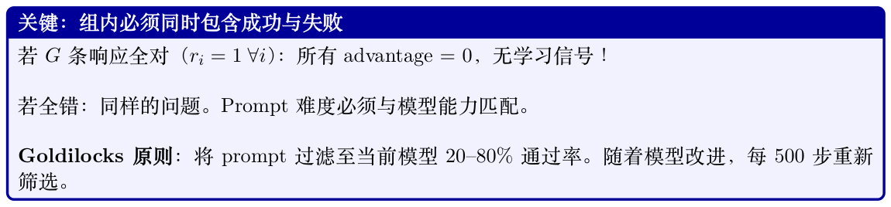

## 7.5 GRPO 变体与扩展

### 7.5.1 GRPO 组中的多样性


- Reward hacking 变得更容易（狭窄输出更容易被利用）

- 泛化能力受损：模型记住的是reward 模式而非推理

KL 惩罚βDKL[πθ∥πref] 是主要的多样性机制，但单靠它并不够。

GRPO 对每个prompt 生成N 条响应并使用组内排序。组内多样性至关重要：

- 高温度（τ = 0.8–1.0）：确保响应多样，便于有意义的比较

- 较大的N（8–16）：样本越多，越可能同时包含好的和差的方案

- DAPO 的“不重复”惩罚：拒绝组内重复响应，强制探索

- 若N 条响应完全相同：advantage 为零，无学习信号

- 若响应过于多样（随机）：reward信号嘈杂，学习缓慢

甜点：温度选取应让方案有差异，同时仍然切题。

**Table 7.1: RL 训练中促进多样性的方法。**

| 方法 | 如何促进多样性 |
| --- | --- |
| 熵奖励（Entropy bonus） | 在reward 中加入αH(πθ)。直接惩罚低熵（确定性）policy。 |
| KL 惩罚 | −βDKL[πθ∥πref] 防止坍塌到单一模式。 |
| 拒绝采样（Rejection Sampling） | 生成大量候选，按reward 保留top-k。自然筛选出多样的高质量响应。 |
| Best-of-N | 推理时：生成N 条响应，全部评分，返回最佳。多样性来自采样。 |
| 带多样性pair 的DPO | 在chosen/rejected 不仅质量不同、方法也不同的pair 上训练。 |
| 多reward | 使用多个reward model（安全、有用性、代码质量）。防止坍塌到单一维 度。 |

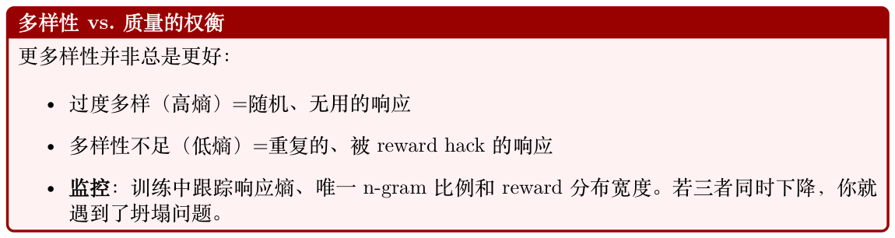

后训练对齐（基于人类反馈的强化学习（Reinforcement Learning from Human Feedback, RLHF）、直接偏好优化（Direct Preference Optimization, DPO））经常因为典型性偏差（typicality bias）而降低输出多样性：人类标注者系统性地偏好熟悉的、“典型的”文本而非新颖的替代方案。这种模式坍塌是数据层面的现象，并非纯算法问题。

Verbalized Sampling（VS）[110] 是一种无需训练的prompt 策略，通过要求模型在单次生成中显式言语化多条响应上的概率分布来规避这种坍塌。

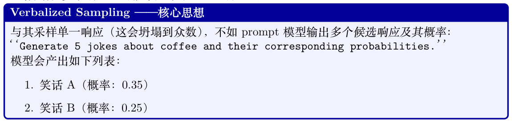

```
3. 笑话C（概率：0.20）
4. 笑话D（概率：0.12)
5. 笑话E（概率：0.08）
然后从这个言语化分布中采样。由于模型显式表征了整个分布（而不仅是argmax），那些概率较
低但富有创意/多样的响应就变得可达。
# Verbalized Sampling ：prompt 模型输出分布
def verbalized_sample(model, tokenizer , task, n=5):
prompt = (
f"{task}\n\n"
f"Generate {n} different responses and assign a probability "
f"to each (probabilities should sum to 1.0). "
f"Format: [response] (probability: X.XX)"
)
output = model.generate(
tokenizer(prompt , return_tensors="pt").input_ids ,
max_new_tokens=1024,
temperature=0.7,
do_sample=True,
)
# 从输出中解析响应及概率
responses , probs = parse_verbalized_distribution(
tokenizer.decode(output[0])
)
# 从言语化分布中采样
import random
chosen = random.choices(responses , weights=probs, k=1)[0]
return chosen
```

#### 为什么Verbalized Sampling 有效

- 绕过模式坍塌：从对齐模型的标准采样高度集中在一两个“安全”响应。VS强迫模型说出那些它知道但通常不会浮现出来的替代方案。

- 多样性是语义的：与温度缩放（词法噪声）不同，VS产出真正不同的方案——模型会就不同选项进行推理。

- 随能力扩展：能力更强的模型产出校准更好的言语化分布——它们从VS 中受益更多（创意写作上获得1.6–2.1× 多样性增益）。

- 无需训练：不需要微调或修改解码；在推理时与任何遵循指令的模型协同工作。

- 用于GRPO：用VS 为每个prompt 生成G 个响应候选——确保组内包含语义多样的方案，而非仅表层变化。

在深入各种扩展之前，让我们简要回顾前几节建立的基础GRPO 算法。其核心机制——采样一组completion、归一化它们的reward、并应用clipped policy gradient——简洁优雅。然而，实践者很快发现了一些具体的失败模式：预训练偏差稀释gradient（Dr. GRPO）、对称clipping 限制探索（DAPO）、过大的组大小造成浪费（2-GRPO）、以及多目标场景下reward 尺度失衡（GDPO）。下面各节依次解决这些问题。

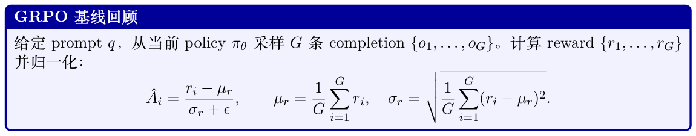

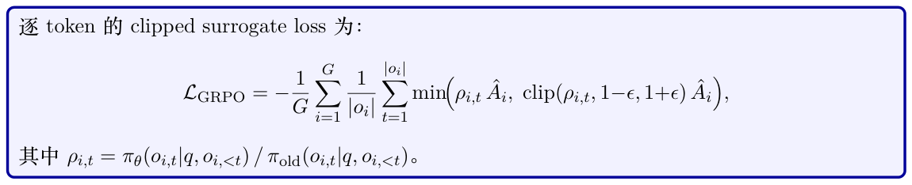

### 7.5.2 DAPO ——Dynamic Adaptive Policy Optimization

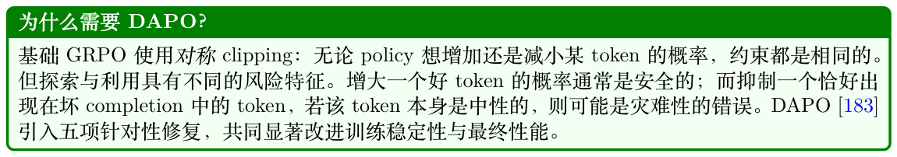

标准PPO/GRPO 在[1 −ϵ, 1 + ϵ] 处对称地clip importance ratio。DAPO 将其替换为非对称区间：

( clip(ρ, 1 −ϵ, 1 + ϵhigh) if A > 0 clipDAPO(ρ, A) = clip(ρ, 1 −ϵ, 1 + ϵ) if A ≤0

其中ϵhigh > ϵ（典型取值：ϵ = 0.2，ϵhigh = 0.28）。当advantage 为正时，允许policy 更进一步偏向好token；当advantage 为负时，应用常规的保守clipping 以避免过度抑制。

基础GRPO 将loss 除以序列数G。DAPO 则除以所有序列的token 总数：

X G X |oi| ρi,t ˆAi, clipDAPO(ρi,t, ˆAi) ˆAi .

Ltoken = − PG min i=1 |oi| i=1 t=1这样可以防止长completion 仅因为token 数更多而主导gradient 信号。

当一条completion 被截断（在最大长度预算内没有EOS token），它会提供误导性信号：模型因为那些被正确生成、只是恰好出现在截断边界之前的token 而被惩罚。DAPO 将这些completion 整条mask 掉：

PG P i=1 mi t(· · · ) mi = 1[EOS ∈oi], Lfiltered = − PG .

i=1 mi|oi|

比起硬mask，更软的变体应用一个长度惩罚，随着completion 接近最大长度Lmax 平滑增长：

  |oi| −Lcache ri ←ri −λ · max 0, , Lmax −Lcache

其中Lcache 是一个“安全”长度阈值。

DAPO 会重新采样那些整组completion 获得相同reward（全对或全错）的prompt，因为此类组在归一化后贡献零gradient。这能在整个训练过程中保持有效batch size 稳定。

```
TRL 中的DAPO
from trl import GRPOConfig , GRPOTrainer
config = GRPOConfig(
# 非对称clipping
epsilon=0.2,
epsilon_high=0.28, # Clip-Higher
# Token 级loss
loss_type="dapo", # 启用token 级聚合
# 过长过滤
mask_truncated_completions=True,
# 生成预算
max_completion_length=1024,
num_generations=8,
# 注意：DAPO loss 内部已处理零方差组过滤
)
trainer = GRPOTrainer(
model=model,
reward_funcs=[reward_fn],
args=config ,
train_dataset=dataset ,
)
trainer.train()
何时使用DAPO
• completion 经常触及长度上限的长篇推理任务。
• 任何观察到reward 方差在训练中途坍塌的场景。
• 当基础GRPO 表现不稳定（loss 尖峰、熵坍塌）时。
• 在大多数任务上推荐作为基础GRPO 的即插即用改进。
```

### 7.5.3 GSPO ——Group Sequence Policy Optimization

GRPO 逐token 地clip importance ratio。但一条500 token 的序列，即使每个单独的ratio 都在[1 −ϵ, 1 + ϵ] 内，逐token ratio 的乘积可能大或小到天文数字。当在同一batch 上进行多次gradient 步（off-policy）时，这种不匹配迅速放大，clipping 界限在序列级别上变得毫无意义。

GSPO [184] 将序列级importance weight 定义为逐token ratio 的几何平均，等价于完整序列概率比的|oi| 次方根：

   πθ(oi | q) 1/|oi| 1 X |oi| log πθ(oi,t|q, oi,<t) si(θ) = = exp .

πold(oi | q) |oi| πold(oi,t|q, oi,<t) t=1

这是长度归一化的序列概率比。GSPO loss 对每条序列clip 这个单一标量：

LGSPO = −1 X G   min si(θ) ˆAi, clip(si(θ), 1−ϵ, 1+ϵ) ˆAi .

G i=1

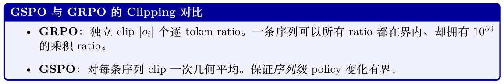

```
• GSPO 在off-policy 重要性采样上理论正确；GRPO 只是近似。
TRL 中的GSPO
from trl import GRPOConfig , GRPOTrainer
config = GRPOConfig(
# 序列级重要性采样
importance_sampling_level="sequence", # GSPO 模式
# Off-policy ：每个batch 复用多次gradient 步
steps_per_generation=4,
num_generations=8,
epsilon=0.2,
)
trainer = GRPOTrainer(
model=model,
reward_funcs=[reward_fn],
args=config ,
train_dataset=dataset ,
)
何时使用GSPO
GSPO 在steps_per_generation > 1（off-policy 训练）时最有用。对于纯on-policy 训练
（steps_per_generation = 1），它与GRPO 的差异可忽略。Off-policy 训练能极大降低生成
成本（最昂贵的步骤），使得GSPO + off-policy 成为强力的效率选择。
```

### 7.5.4 Dr. GRPO ——Debiased Reward GRPO


赋予高概率的token（无论reward 如何）会被降权：

1 −πref(oi,t|q, oi,<t) , wi,t = ˆAi ·

其中πref 是参考（预训练）模型。这是一种token 效率形式：gradient 被集中到policy 真正需要改变的token 上。

```
TRL 中的Dr. GRPO
from trl import GRPOConfig , GRPOTrainer
config = GRPOConfig(
loss_type="dr_grpo",
num_generations=8,
beta=0.04, # KL 惩罚系数
)
trainer = GRPOTrainer(
model=model,
ref_model=ref_model , # token 加权需要参考模型
reward_funcs=[reward_fn],
args=config ,
train_dataset=dataset ,
)
```


### 7.5.5 2-GRPO ——最简的两次Rollout GRPO


自一个结构上类似DPO 的隐式对比目标：

" !# β log πθ(o+|q) πold(o+|q) −β log πθ(o−|q) L2-GRPO ≈−E(o+,o−)∼πθ log σ , πold(o−|q)

其中o+ 是较高reward 的completion，o−是较低reward 的。G = 2 时这一对比结构是显式的；

G = 16 时同样的信号存在，但被冗余对稀释。

#### 2-GRPO 的算力节省

- G = 2 vs G = 16：生成算力减少8×。

- 生成通常是瓶颈（占60–80% 的wall-clock 时间）。

- 端到端总训练加速：约4–6×。

- 在GSM8K、MATH 和代码基准上无精度损失。

#### TRL 中的2-GRPO

```
from trl import GRPOConfig , GRPOTrainer
config = GRPOConfig(
```

num_generations=2, # 关键改动——只做两次rollout loss_type="grpo", # 标准GRPO loss 即可

```
epsilon=0.2,
# G=2 时batch size 至少为2 * num_prompts_per_step
per_device_train_batch_size=2,
)
trainer = GRPOTrainer(
model=model,
reward_funcs=[reward_fn],
args=config ,
train_dataset=dataset ,
)
```

G = 2 时advantage 归一化只对两个值进行，因此归一化后的advantage 总是{+1, −1}（若两reward 相等则为{0, 0}）。这意味着gradient 幅度与reward 差距无关。对于reward 差异的幅度很重要的任务（例如部分得分），更大的G 仍然有利。

### 7.5.6 SAPO ——Soft Adaptive Policy Optimization


 ρ −1     −A · σ· ρ if A > 0 τ+ LSAPO(ρ, A) = 1 −ρ     −A · σ· ρ if A ≤0 τ−

其中σ 是sigmoid 函数，τ+, τ−是非对称温度参数。温度越高gate 越软（更多探索）；温度越低越接近硬clipping。

```
SAPO 温度直觉
• τ+ = 1.0：正advantage 的中等gate（允许探索）。
• τ−= 1.05：负advantage 略软的gate（避免过度抑制）。
• τ →0：恢复硬PPO clipping。
• τ →∞：恢复未clip 的policy gradient。
TRL 中的SAPO
from trl import GRPOConfig , GRPOTrainer
config = GRPOConfig(
loss_type="sapo",
sapo_temperature_pos=1.0, # 正advantage 的tau_+
sapo_temperature_neg=1.05, # 负advantage 的tau_-
num_generations=8,
)
trainer = GRPOTrainer(
model=model,
reward_funcs=[reward_fn],
args=config ,
train_dataset=dataset ,
)
```

### 7.5.7 TIS 与MIS ——Truncated 与Masked Importance Sampling

当使用vLLM 进行快速生成时，vLLM 返回的log-probability 与训练前向传播中计算的不同[188]。这不是bug ——它源于不同的CUDA 内核、不同的浮点精度以及不同的Attention 实现（如FlashAttention vs PagedAttention）。这种不匹配悄悄破坏了on-policy 假设：用于计算importance ratio 的“旧policy”概率是错的，导致gradient 估计出现偏差。

TIS 通过将gradient 乘以一个截断的修正因子来纠正偏差：

  C, πtrain(oi|q) wTIS(oi) = min , πvllm(oi|q)其中πtrain 是训练前向传播给出的概率，πvllm 是vLLM 报告的概率。在C 处截断可防止极端修正破坏训练稳定性。

MIS 采取更激进的策略：对任何修正ratio 超过阈值C 的序列，将其gradient 置零：

πtrain(oi|q)  wMIS(oi) = 1 πvllm(oi|q) ≤C .

这更保守，但避免了大（即使被截断）修正权重的风险。

TIS 和MIS 都既可在token 级、也可在序列级应用：

- 序列级：将ratio 计算为所有token 的几何平均（如GSPO 那样）。理论正确但方差更高。

- Token 级：为每个token 单独计算ratio。有偏（逐token 修正的乘积不等于序列修正），但方差更低。

```
TRL 中的TIS 和MIS
from trl import GRPOConfig , GRPOTrainer
# 针对vLLM 概率不匹配的Truncated IS 修正
config_tis = GRPOConfig(
use_vllm=True,
vllm_importance_sampling_correction=True,
vllm_importance_sampling_mode="sequence_truncate", # TIS
vllm_importance_sampling_cap=5.0, # C 阈值
)
# Masked IS 修正
config_mis = GRPOConfig(
use_vllm=True,
vllm_importance_sampling_correction=True,
vllm_importance_sampling_mode="sequence_mask", # MIS
vllm_importance_sampling_cap=3.0,
)
何时使用TIS/MIS
• 使用vLLM 生成时始终考虑开启。
• 当不匹配较小时（同模型、不同精度）首选TIS。
• 当不匹配较大或不可预测时首选MIS。
• 序列级IS 在理论上更受推荐；token 级是实用上的折中。
```

### 7.5.8 VESPO ——Variational Sequence-Level Soft Policy Optimization

大多数GRPO 变体只是启发式地修改clipping 机制。VESPO 从变分推断框架推导出一个原理性的reward 重塑核，将policy optimization 视为近似后验推断。VESPO [189] 推导出的核是平滑、非对称的，并天然地处理异步或off-policy 训练中的陈旧性问题。

VESPO 从变分目标推导出每条trajectory τ 的加权函数W(τ)。最终的gradient 权重形式为：g(τ) = W(τ)k · exp λ(1 −W(τ)) ,

其中W(τ) = πθ(τ)/πold(τ) 是序列级importance weight，k 控制加权的锐度，λ 控制对陈旧（低权重）trajectory 的指数衰减。该核：

- 处处平滑（在clip 边界没有不连续gradient）。

- 通过指数项天然地降权陈旧trajectory（W ≪1）。

- 是非对称的：高权重trajectory（W > 1）与低权重trajectory 区别对待。

```
TRL 中的VESPO
from trl import GRPOConfig , GRPOTrainer
config = GRPOConfig(
loss_type="vespo",
vespo_k_pos=2.0, # 锐度指数（正advantage ）
vespo_lambda_pos=3.0, # 陈旧性衰减（正advantage ）
num_generations=8,
steps_per_generation=2, # off-policy ；VESPO 处理陈旧性
)
trainer = GRPOTrainer(
model=model,
reward_funcs=[reward_fn],
args=config ,
train_dataset=dataset ,
)
```

### 7.5.9 DPPO ——Direct Policy Divergence Policy Optimization

PPO 的ratio clipping 是约束新旧policy 间KL 散度的代理。但这个代理并不完美：clipping 对低概率token 过度惩罚（这里概率的小绝对变化对应较大的ratio 变化），而对高概率token 惩罚不足（这里大的绝对变化对应较小的ratio 变化）。DPPO [190] 用直接散度估计替换ratio clipping。

DPPO 直接使用新旧policy 分布间的Total Variation（TV）或KL 散度来计算信赖域约束：

h ˆA · πθ(o|q) · 1[D(πθ∥πold) ≤δ] i LDPPO = −E ,

其中D 是所选的散度度量。在实践中，DPPO 用token 级二值或top-k mask 来近似：

- binary_tv：mask 掉|πθ −πold| > δ 的token。

- binary_kl：mask 掉πθ log(πθ/πold) > δ 的token。

- topk_tv：仅保留按TV 贡献排序的top-k token。

- topk_kl：仅保留按KL 贡献排序的top-k token。

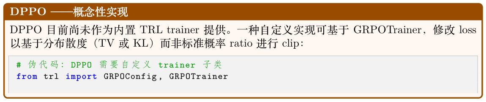

```
config = GRPOConfig(
num_generations=8,
beta=0.04,
)
# 重写loss 计算以使用分布式clipping ：
# 当TV(pi_new || pi_old) > delta 时clip ，而非
# 当pi_new/pi_old 超过[1-eps, 1+eps] 时
DPPO 处于研究阶段
DPPO 是较新的研究贡献，尚未集成到主流RL 库中。它在你观察到标准ratio clipping 失效时
（例如在token 概率分布高度偏斜的任务上）最有用。
```

### 7.5.10 ScaleRL 和CISPO

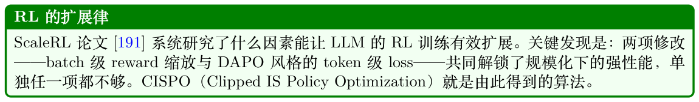

标准GRPO 在单个prompt 的G 条completion 组内归一化reward。CISPO 则在整个batch 上归一化reward：

ˆAi = ri −µbatch σbatch + ϵ ,

其中µbatch 和σbatch 在当前训练batch 的所有reward 上计算。这提供更稳定的baseline，并防止任何单一prompt 主导gradient。

CISPO 结合了batch 级缩放、DAPO 的token 级loss 聚合以及非对称clipping：

X G X |oi| ρi,t ˆAi, clipDAPO(ρi,t, ˆAi) ˆAi , LCISPO = − P mi,t · min i,t mi,t i=1 t=1其中mi,t 是过长过滤mask。

```
TRL 中的CISPO
from trl import GRPOConfig , GRPOTrainer
config = GRPOConfig(
loss_type="cispo",
scale_rewards="batch", # batch 级reward 归一化
mask_truncated_completions=True,
epsilon=0.2,
epsilon_high=5.0, # CISPO 的epsilon_max （ScaleRL 论文）
num_generations=8,
)
trainer = GRPOTrainer(
model=model,
reward_funcs=[reward_fn],
args=config ,
train_dataset=dataset ,
)
```

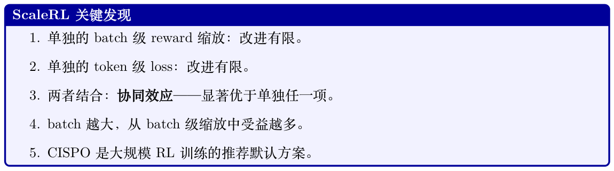

### 7.5.11 GDPO ——Group Reward-Decoupled Policy Optimization


ˆA(i) n = r(i) n −µn σn + ϵ , ˆA(i) = X N wn ˆA(i) n ,

n=1

其中r(i)是completion i 的第n 项reward，µn 和σn 是组内第n 项reward 的均值与标准差，n wn 是用户指定权重。

```
GDPO 与标准多reward GRPO 的对比
P
• 标准：ˆA(i) = n wnr(i) n −µcombined。高方差reward 占主导。
σcombined
• GDPO：单独归一化每项reward 后再组合。每项reward 按其权重wn 按比例贡献。
• 当reward 量级或方差差异极大时，GDPO 不可或缺。
TRL 中的GDPO
from trl import GRPOConfig , GRPOTrainer
config = GRPOConfig(
multi_objective_aggregation="normalize_then_sum",
reward_weights=[1.0, 0.5], # [正确性, 格式] 的权重
num_generations=8,
)
def correctness_reward(completions , **kwargs):
return [1.0 if is_correct(c) else 0.0 for c in completions]
def format_reward(completions , **kwargs):
return [0.1 if has_good_format(c) else 0.0 for c in completions]
trainer = GRPOTrainer(
model=model,
reward_funcs=[correctness_reward , format_reward],
args=config ,
train_dataset=dataset ,
)
```

### 7.5.12 GOPO ——Group Ordinal Policy Optimization

GOPO [193] 始于一个简单观察：reward model 是用成对比较（“A 是否优于B？”）训练的，因此只有其输出的排序是可信的——原始数值分数本身没有内在意义。然而GRPO 直接把这些原始幅度喂入advantage 计算。对于不可验证reward 的任务——摘要、开放式聊天、指令跟随——这种不匹配引入了噪声，因为0.6 reward 分的差距可能在输出空间某个区域反映真实质量，而在另一个区域毫无意义。

关键洞见：完全丢弃reward 幅度。仅使用组内reward 的序数排名。

算法：给定一组N 条响应{o1, . . . , oN} 及其reward {r1, . . . , rN}：

1. 按reward 对响应排名：赋予rank rank(oi) ∈{1, . . . , N}（1 = 最差，N = 最佳）。

2. 用基于rank 的分数替换原始advantage：

rank(oi)  ˆAGOPO = f (7.2) i N

其中f 是单调变换（例如线性映射到[−1, 1] 或分位数归一化）。

3. 用基于rank 的advantage 应用PPO 风格的clipped 目标。

方面GRPO GOPO

Advantage 信号ˆAi = (ri −µ)/σ（使用幅度）ˆAi = f(ranki/N)（仅使用序数rank）对reward 尺度的敏感性高——校准不良的RM 分数会扭曲无——对单调reward 变换不变advantage最适合可验证reward（二值、校准良好）不可验证reward（基于RM、幅度嘈杂）

经验性增益（在不可验证任务上相对GRPO）：

- 整个优化过程中，reward曲线（训练和留出集）都位于GRPO 之上

- 由独立LLM 评估器判定的胜率在大多数训练checkpoint 上有所改进

- 收敛显著更快——以更少的gradient 步数达到GRPO 的最终质量

- 优势随reward model 变得更嘈杂或校准更差而扩大

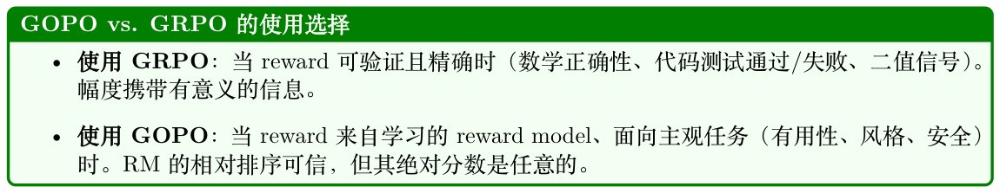
