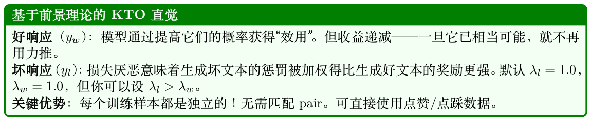
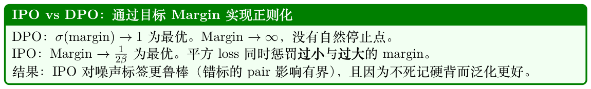
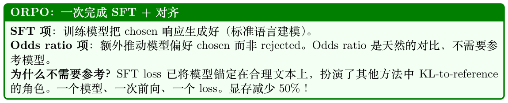
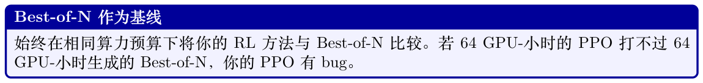
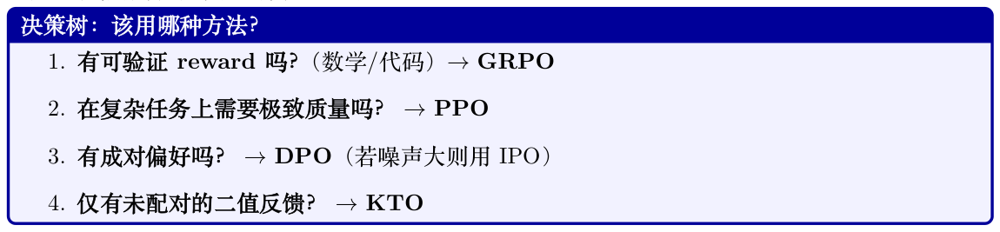
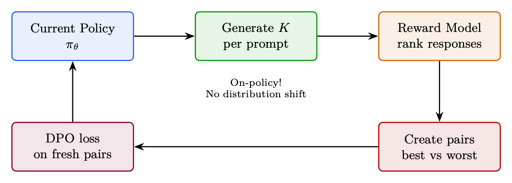

# 偏好优化变体

本章涵盖一类用不同目标、数据假设或架构权衡来扩展或替换DPO 的方法。每种方法都解决标准offline DPO 的某个具体局限：分布偏移（Online DPO）、需要配对数据（KTO）、对噪声标签过拟合（IPO）、参考模型显存开销（ORPO）或训练复杂度（Best-of-N）。

## 8.1 Online DPO

### 8.1.1 动机

标准DPO 的主要局限：偏好数据由一个不同的模型生成（通常是较旧的checkpoint，甚至是不同的模型族）。随着训练推进，policy 生成的文本与训练pair 已完全不同→loss 在一个无关分布上进行优化。

Online DPO 方案[194]：每一步都从当前policy 生成新鲜的偏好pair，用reward model 判定，然后应用DPO loss。

### 8.1.2 算法

1. 从当前πθ 为每个prompt 生成K 条响应

2. 用reward model rϕ 给所有响应打分

3. 构造pair：最高分= chosen，最低分= rejected

4. 在这些新鲜pair 上应用DPO loss

5. 重复（每步重新生成）

#### Online DPO = 两全其美

- 来自DPO：简单的监督式loss，无value function，无GAE，优化稳定

- 来自PPO：on-policy 数据，超越数据集的自我提升，无分布偏移

- 与GRPO 的关键差异：使用DPO loss（基于pair）而非PPO loss（逐样本advantage）

权衡：需要reward model（DPO 不需要），但不需要value head（PPO 需要）。复杂度居中。

### 8.1.3 TRL 实现

下面是基于HuggingFace TRL 的最小可运行示例。

```
from trl import OnlineDPOConfig , OnlineDPOTrainer
from transformers import AutoModelForCausalLM , AutoModelForSequenceClassification
model = AutoModelForCausalLM.from_pretrained("meta-llama/Llama -3.1-8B-Instruct",
torch_dtype=torch.bfloat16)
```

```
reward_model = AutoModelForSequenceClassification.from_pretrained(
"RLHFlow/ArmoRM -Llama3 -8B-v0.1", torch_dtype=torch.bfloat16)
online_dpo_config = OnlineDPOConfig(
output_dir="./online_dpo_output",
learning_rate=5e-7,
beta=0.1, # DPO beta （与标准DPO 同义）
num_generations=4, # 每个prompt 的K 条响应
per_device_train_batch_size=4,
gradient_accumulation_steps=4,
max_new_tokens=512,
temperature=0.7,
bf16=True,
num_train_epochs=1,
logging_steps=10,
)
trainer = OnlineDPOTrainer(
model=model,
reward_model=reward_model ,
args=online_dpo_config ,
train_dataset=prompt_dataset ,
tokenizer=tokenizer ,
)
trainer.train()
```

### 8.1.4 Online DPO vs Offline DPO vs PPO

数据模型Loss最适合

Offline DPO静态pair 2 (policy + reference) DPO快速对齐、算力有限Online DPO从πθ 新鲜采样3 (policy + reference + re- DPO当DPO 停滞、需要探索时ward model) PPO从πθ 新鲜采样4 (policy + reference + re- PPO clip极致质量、复杂推理ward model + value head)

## 8.2 KTO ——Kahneman-Tversky Optimization

### 8.2.1 动机

DPO 需要成对偏好：对同一prompt，你既需要好的也需要坏的响应。实际上大多数反馈是未配对的：用户对单个响应给出点赞/点踩，没有匹配的pair。

KTO 的洞见[11]：使用前景理论（来自行为经济学）。人类对损失的感受比对收益更强烈。“点踩”应当产生比“点赞”更强的gradient。

### 8.2.2 Loss 函数

LKTO = Eyw [λw(1 −v(x, yw))] + Eyl [λl · v(x, yl)] (8.1)

 其中v(x, y) = σ β log πθ(y|x) πref(y|x) −zref，zref 是期望KL 散度（一个滑动baseline）。



```
KTO 数据格式
与DPO 需要{"prompt": ..., "chosen": ..., "rejected": ...} 不同
KTO 只需要：{"prompt": ..., "completion": ..., "label": true/false}
这意味着你可以使用：
• 生产流量中的点赞/点踩
• 论坛上的赞/踩
• 二值化的人类评分（4–5星= 好，1–2 星= 坏）
• 任何单条响应的质量信号
```

### 8.2.3 TRL 实现

下面是基于HuggingFace TRL 的最小可运行示例。

```
from trl import KTOConfig , KTOTrainer
# 数据格式：{"prompt": str, "completion": str, "label": bool}
# label=True 表示好的，label=False 表示坏的
kto_dataset = [
{"prompt": "What's 2+2?", "completion": "The answer is 4.", "label": True},
{"prompt": "What's 2+2?", "completion": "It might be 5.", "label": False},
]
kto_config = KTOConfig(
output_dir="./kto_output",
beta=0.1,
desirable_weight=1.0, # 好样本的权重
undesirable_weight=1.0, # 坏样本的权重（损失厌恶时调高）
learning_rate=5e-7,
max_length=2048,
per_device_train_batch_size=4,
gradient_accumulation_steps=4,
num_train_epochs=1,
bf16=True,
)
trainer = KTOTrainer(
model=model,
ref_model=ref_model , # LoRA 时可为None
args=kto_config ,
train_dataset=kto_dataset ,
tokenizer=tokenizer ,
)
trainer.train()
```

### 8.2.4 何时选择KTO

- 你有二值反馈但没有匹配pair

- 大规模的生产点赞/点踩数据

- 一类占主导（例如90% 好、10% 坏）——KTO 对不平衡更友好

- 在噪声标签下快速迭代（对噪声比DPO 更鲁棒）

## 8.3 IPO ——Identity Preference Optimization

### 8.3.1 动机

DPO 有一个退化解：通过让chosen 与rejected 之间的margin 无限大来达到零loss。实际上这意味着DPO 会过拟合——把chosen 概率推到1、rejected 概率推到0，记住训练数据。

IPO 的修复[12]：与其使用会饱和的log-sigmoid，不如使用一个针对特定margin 的平方loss。

loss 在有限差距处最小，而非无穷远。

### 8.3.2 Loss 函数

" 2# log πθ(yw|x) πref(yw|x) −log πθ(yl|x) πref(yl|x) −1 LIPO = E (8.2) 2β



### 8.3.3 TRL 实现

下面是基于HuggingFace TRL 的最小可运行示例。

```
from trl import DPOConfig , DPOTrainer
# IPO 在TRL 中作为DPO 的loss_type 变体实现
ipo_config = DPOConfig(
output_dir="./ipo_output",
beta=0.1,
loss_type="ipo", # 关键差异！
learning_rate=5e-7,
max_length=2048,
per_device_train_batch_size=4,
gradient_accumulation_steps=8,
bf16=True,
num_train_epochs=1,
)
trainer = DPOTrainer(
model=model, ref_model=None, args=ipo_config ,
train_dataset=pref_dataset , tokenizer=tokenizer , peft_config=lora_config ,
)
trainer.train()
```

### 8.3.4 何时选择IPO 而非DPO

- 噪声偏好数据（众包、AI判定带错误）

- 观察到DPO 过拟合（训练loss →0 但评估退化）

- 想要更保守、更鲁棒的对齐

- 需要多个epoch（DPO 在第一个epoch 后退化；IPO 更稳定）

## 8.4 ORPO ——Odds Ratio Preference Optimization

### 8.4.1 动机

迄今所有方法都需要参考模型——要么是独立副本（显存翻倍），要么通过LoRA 隐式存在。

ORPO [13] 通过将监督微调（Supervised Fine-Tuning, SFT）与偏好对齐合并到单一loss 中，彻底消除了参考模型。

关键洞见：用生成chosen 与生成rejected 的odds ratio（几率比）作为偏好信号。SFT 部分自然防止坍塌（无需KL 正则）。

### 8.4.2 Loss 函数

  log oddsθ(yw|x) LORPO = LSFT(yw) −λ ·log σ (8.3) | {z } oddsθ(yl|x) standard NLL on chosen | {z } preference alignment via odds ratio

其中oddsθ(y|x) = 1−Pθ(y|x)。Pθ(y|x)



### 8.4.3 TRL 实现

下面是基于HuggingFace TRL 的最小可运行示例。

```
from trl import ORPOConfig , ORPOTrainer
orpo_config = ORPOConfig(
output_dir="./orpo_output",
beta=0.1, # Odds ratio 权重（lambda ）
learning_rate=5e-7,
max_length=2048,
per_device_train_batch_size=2,
gradient_accumulation_steps=8,
bf16=True,
num_train_epochs=1,
gradient_checkpointing=True,
)
trainer = ORPOTrainer(
model=model, # 无需ref_model ！
args=orpo_config ,
train_dataset=pref_dataset , # 与DPO 同格式：prompt/chosen/rejected
tokenizer=tokenizer ,
peft_config=lora_config ,
)
trainer.train()
```

### 8.4.4 何时选择ORPO

- 显存受限：负担不起参考模型副本（70B可节省70–140GB）

- 从base 模型起步（尚未SFT）——ORPO 同时做SFT

- 想要最简单的pipeline：一个模型、一个loss、一次训练

- 一开始就有良好的偏好数据

#### ORPO 的局限

- 研究不如DPO/PPO 充分——70B 及以上规模的成熟配方较少

- SFT 部分意味着它需要高质量的chosen 响应（不仅是相对偏好）

- 调试更难：两个loss 分量可能冲突

SimPO [182] 是另一种无参考的偏好方法，使用长度归一化的log-probability 作为隐式reward，彻底消除参考模型。它在Section 6.9.8 与其他DPO 扩展一同介绍，因为它们都共享无参考的理念。

## 8.5 Best-of-N 采样（拒绝采样）

### 8.5.1 动机

有时候最简单的方法获胜。Best-of-N 采样（Rejection Sampling）[195] 在RL 阶段完全不需要训练

- —只需生成多个候选并挑选最佳。

### 8.5.2 算法

1. 对每个prompt，从policy 生成N 条响应（通常N = 4–64）

2. 用reward model 给所有响应打分

3. 选择最高分响应

4.（可选）将选中的响应作为下一轮的SFT 数据

Best-of-N response : y∗= arg yi∼πθ(·|x) rϕ(x, yi) max (8.4)

推理时：Best-of-N在不改动模型权重的情况下提升输出质量。N = 64 时胜率比greedy 提升10–20%——有时匹配甚至超过PPO。

作为训练方法（拒绝采样微调/ RFT）：

1. 生成大量响应，选出最佳

2. 在选出的响应上做SFT

3. 重复（迭代精炼）

许多生产模型就是这样训练的：比PPO 简单、几乎同样有效、完全稳定。

理论联系[196]：Best-of-N 实现了隐式的KL 约束policy：πBoN(y|x) ∝πθ(y|x)1−1/N · r(x, y)1/N。

### 8.5.3 TRL 实现

下面是基于HuggingFace TRL 的最小可运行示例。

```
from transformers import pipeline
import numpy as np
# 推理时Best-of-N （手工实现）
gen_pipeline = pipeline("text-generation", model=model, tokenizer=tokenizer)
```

```
def best_of_n(prompt, n=16, temperature=0.8):
"""生成N 个候选并返回最高reward 者。"""
candidates = gen_pipeline(
prompt, num_return_sequences=n,
temperature=temperature , do_sample=True, max_new_tokens=512,
)
scores = [reward_model.score(prompt , c["generated_text"]) for c in candidates]
return candidates[np.argmax(scores)]["generated_text"]
best_response = best_of_n(prompt, n=16)
# 训练：拒绝采样微调（RFT ）
from trl import SFTConfig , SFTTrainer
# 步骤1：生成并筛选
all_responses = []
for prompt in prompts:
candidates = [generate(prompt, temp=0.9) for _ in range(16)]
scores = [reward_model.score(prompt , c) for c in candidates]
best_idx = np.argmax(scores)
if scores[best_idx] > threshold: # 质量门槛
all_responses.append({"prompt": prompt , "completion": candidates[best_idx]})
# 步骤2：在最佳响应上做SFT
sft_config = SFTConfig(output_dir="./rft_output", learning_rate=2e-5, num_train_epochs
=2, max_seq_length=2048)
trainer = SFTTrainer(model=model, args=sft_config , train_dataset=all_responses ,
tokenizer=tokenizer)
trainer.train()
# 步骤3：用更新后的模型从步骤1 重复（迭代RFT ）
```

### 8.5.4 Best-of-N 的扩展律

N质量增益成本说明

基线1×标准采样+5–8% 胜率4×最低有用值。良好的成本/质量比+10–15% 胜率16×强力。常匹配PPO 质量+15–20% 胜率64×开始边际递减+18–22% 胜率256×仅用于关键应用



## 8.6 总结：如何选择对齐方法

我们已经纵览了偏好优化与基于RL 的对齐方法的完整全景。本节将关键权衡整合为一份参考，帮助实践者根据自身约束选择合适方案。



**Table 8.1: 各对齐方法的横向对比。**

| 方法 | 模型 | 数据 | 算力 稳定性 最适合 |
| --- | --- | --- | --- |
| PPO |  | 在线（生成） | 非常高 低 极致质量、复杂推理 |
| GRPO | 2（无critic） | 在线（生成） 离线pair | 高 中 数学/代码（可验证reward） 低 高 风格/安全、算力有限 |
| DPO |  |  |  |
| Online DPO |  | 在线（生成） | 中 中-高 无分布偏移的DPO |
| KTO |  | 未配对二值 离线pair | 低 高 生产反馈、点赞/点踩 低 非常高 噪声标签、抗过拟合 |
| IPO |  |  |  |
| ORPO |  | 离线pair | 非常低 高 显存受限、SFT+ 对齐合并 |
| Best-of-N | 1+RM | 在线（生成） | 中 完美 强基线、数据生成 |



**Figure 8.1: 近似的质量vs. 算力前沿。位于SFT 上限线之上的方法超越了单纯监督微调所能达到的水平。**

位置仅为示意，与模型有关。

