# 大规模系统架构与基础设施

用基于人类反馈的强化学习（Reinforcement Learning from Human Feedback, RLHF）训练LLM，既是一道算法题，也是一道系统工程题。与标准SFT 不同——后者只涉及单一模型、单次前向-反向传播、扩展规律也已被充分理解——RLHF 需要同时加载多个模型（policy、reference、reward model、value head），通过复杂的rollout-打分-训练循环协调起来，并分布到数十乃至数百块GPU上。本章覆盖让大规模RLHF 训练成为可能的系统级细节：显存预算、并行策略（Data、Tensor、Pipeline、Sequence 及其组合）、生成瓶颈、解耦式架构、权重同步、容错以及生产监控。

## 12.1 4 模型显存挑战

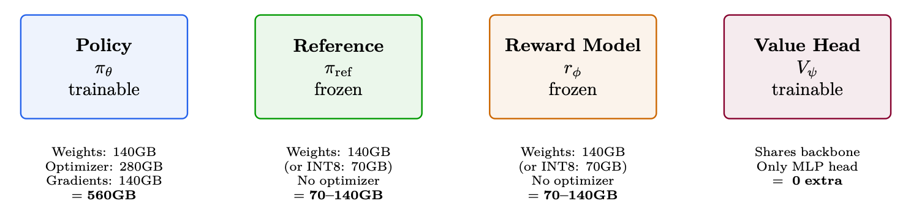

**Figure 12.1: 70B PPO 显存预算：RLHF 所需的四个模型及其显存占用。合计1470–1560GB。朴素方案最少需要19–20 块A100-80GB。使用ZeRO-3 时：8 个节点即可装下。**


## 12.2 并行策略详解

训练大语言模型必须把计算分布到许多GPU 上。可以沿多个本质不同的维度并行，每种都有各自的取舍。本节用数学公式、示意图和实践指引详细介绍每种策略。

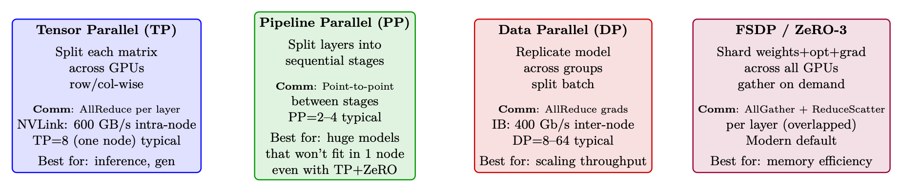

**Figure 12.2: 四种并行策略概览。生产系统通常会同时组合其中2–3 种。**

### 12.2.1 数据并行（Data Parallelism, DP）与分布式数据并行（Distributed Data

数据并行是最简单、也最常见的分布式训练形式[204]。每块GPU 持有模型的完整副本，处理不同的mini-batch，并同步梯度。

原始DP（PyTorch DataParallel）。单进程方案：一块“主” GPU 负责分发输入、汇集输出、广播梯度。受GIL 以及到主GPU 的PCIe 带宽限制。

分布式数据并行（DDP，DistributedDataParallel）。多进程方案：每块GPU 各自运行一个进程。在反向计算继续进行的同时，通过ring-AllReduce [205] 在后台同步梯度。

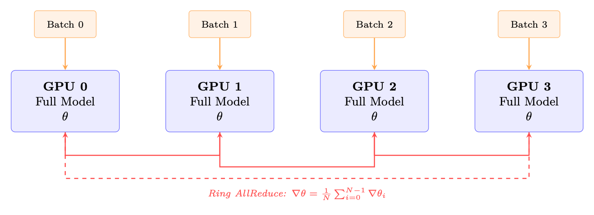

**Figure 12.3: DDP：每块GPU 持有完整的模型副本并处理不同的batch。梯度通过ring AllReduce 取平均，与反向计算重叠。**

#### DDP 的关键特性：

- 显存：每块GPU 都要存完整的模型+ 优化器+ 梯度。70B BF16 模型约∼560 GB/GPU

- —如不做显存优化根本无法承受。

- 通信：每步对梯度张量做一次AllReduce。大小= 模型参数量× 2 字节（BF16）。Ring AllReduce 开销：每GPU 传输2 · N−1· M 字节。

N

- 扩展性：在∼64块GPU 以内接近线性。超过之后通信开始占主导。

- 梯度分桶：DDP把参数按桶分组（默认25 MB），只要某个桶的梯度就绪就启动AllReduce

- —让通信与反向计算重叠。

```
import torch.distributed as dist
from torch.nn.parallel import DistributedDataParallel as DDP
dist.init_process_group(backend="nccl") # NCCL 用于GPU 间通信
model = model.to(local_rank)
model = DDP(model, device_ids=[local_rank],
gradient_as_bucket_view=True, # 显存优化
static_graph=True) # 开启通信优化
```

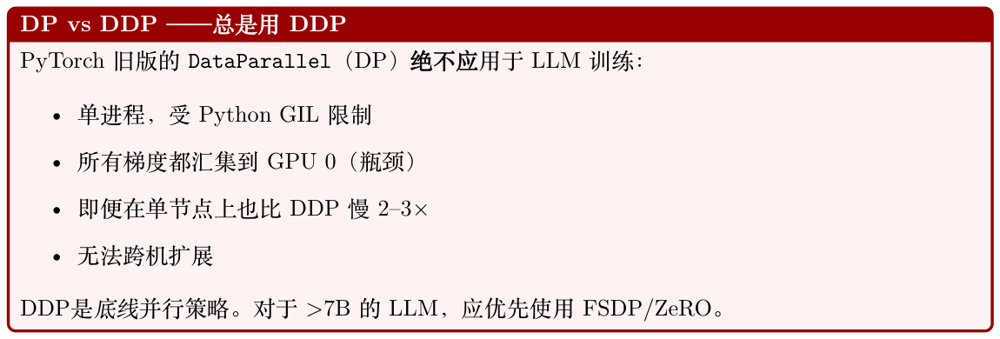

### 12.2.2 张量并行（Tensor Parallelism, TP）

张量并行（Megatron-LM 风格[206]）把单个权重矩阵切到多块GPU 上。每块GPU 计算部分结果，再通过AllReduce 合并。

列并行（Column-Parallel）线性层。权重矩阵W ∈Rd×h 按列切到T 块GPU 上：

W = [W0 | W1 | · · · | WT−1], Wi ∈Rd×h/T (12.1)

每块GPU i 独立计算Yi = XWi（无需通信）。输出沿hidden 维度被切开。

行并行（Row-Parallel）线性层。权重矩阵按行切：W = [W0; W1; . . . ; WT−1]，其中Wi ∈Rd/T×h。

输入X 也必须切开。每块GPU 计算一个部分和，再通过AllReduce 得到最终输出。

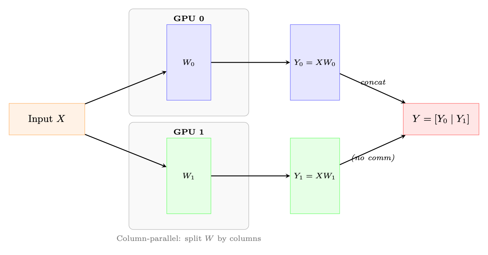

**Figure 12.4: 列并行线性层（TP=2）。权重按列切开；每块GPU 独立计算XWi。MLP 将其与行并行层配对，从而避免多余的AllReduce。**

TP 下的Transformer Block。在Transformer 层中，Megatron-LM 按以下方式应用TP：

1. MLP：第一层线性（h →4h）列并行，第二层线性（4h →h）行并行。行并行层之后做一次AllReduce。

2. Attention：Q、K、V 投影做列并行（按head 切到多块GPU）。输出投影做行并行。输出投影之后做一次AllReduce。

3. 合计：每个Transformer 层2 次AllReduce（attention 一次，MLP 一次）。

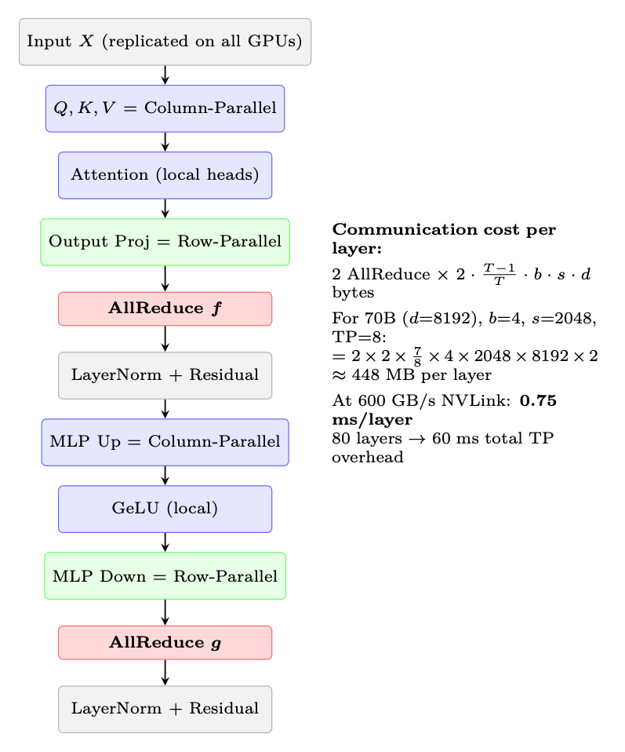

**Figure 12.5: 单个Transformer block 中的张量并行通信模式。每层需要两次AllReduce 操作（红色标注）**

- —attention 之后一次，MLP 之后一次。

每个Transformer 层需要2 次AllReduce 操作（上文标注为f 和g）。对于80 层的70B 模型，每次前向就是160 次AllReduce（算上反向共320 次）。在NVLink 速率（600 GB/s）下，每次AllReduce 耗时<0.5 ms。但在InfiniBand（50 GB/s）上，同一操作要∼4 ms，总开销160 × 4 = 640 ms——比计算本身还长。

规则：TP 度≤节点内GPU 数（通常TP ≤8）。跨节点扩展请用DP/FSDP。

#### TP 度的选取

- TP=1：不做张量并行。模型可放进单块GPU（BF16 下通常≤13B）。

- TP=2：最小切分。适合在2 块GPU 上做13–34B 推理。开销低（<5%）。

- TP=4：34–70B 推理的标准配置。开销8–12%。

- TP=8：占满整节点。70B+ 训练的必备配置。开销12–18%。

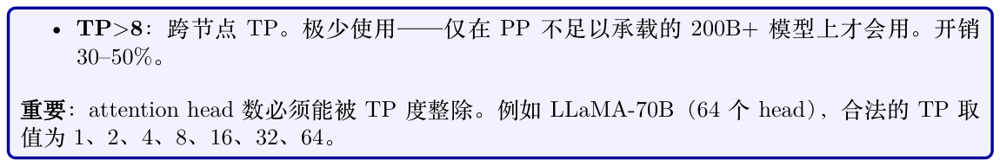

### 12.2.3 序列并行（Sequence Parallelism, SP）

序列并行（Sequence Parallelism, SP）[207] 解决的是张量并行单独无法消除的一个显存瓶颈：LayerNorm 和Dropout 层中的激活值显存。

问题。TP 把权重显存切到了多块GPU 上。但LayerNorm 和Dropout 作用在完整的hidden 维上，并在每块GPU 上都重复存在。它们的激活值（反向传播需要）占用与b × s × d 成正比的显存

- —每块GPU 上一样多，TP 并不会把它降下来。

解法。对那些不需要跨GPU 通信的操作（LayerNorm、Dropout、残差连接），按序列维度切分。

每块GPU 对这些操作只处理s/T 长的序列切片，仅在真正需要的地方（attention、线性层）再gather 出完整序列。

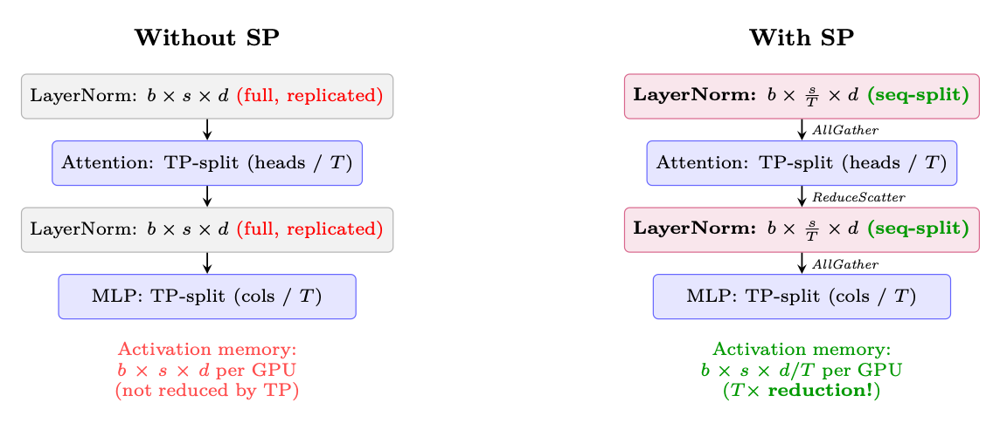

**Figure 12.6: 序列并行通过沿序列维度切分，降低LayerNorm/Dropout 的激活显存。通信（AllGather/ ReduceScatter）取代了标准TP 中的AllReduce——总传输字节数不变，但显存得以节省。**

标准TP 在每个子层后做AllReduce，等价于ReduceScatter + AllGather。SP 只是重排了这些原语：

- 不带SP 的TP：AllReduce（= ReduceScatter + AllGather）→所有GPU 上数据相同→在完整张量上算LayerNorm（浪费）。

- 带SP 的TP：ReduceScatter →每块GPU 拿到1/T 的序列→在部分张量上算LayerNorm →进入下一个TP 层前再AllGather。

总通信量完全相同！SP 是零额外通信开销的纯显存优化，使用TP 时应当始终开启。

激活值节省= (T −1)×b×s×d×nlayers×2 bytes = 7×4×2048×8192×80×2 ≈59 GB/GPU (12.2)

### 12.2.4 流水线并行（Pipeline Parallelism, PP）

流水线并行把模型按层纵向切分，把连续的层组指派给不同的设备（stage）。激活值在stage 间向前流动，梯度向后流动。

气泡（Bubble）问题。朴素流水线执行会产生“气泡”——某个stage 等待前一stage 的输入或后一stage 的梯度时的空闲时间：

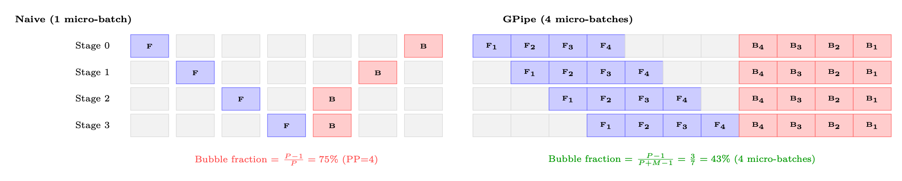

**Figure 12.7: 流水线气泡对比。左：朴素流水线只有一个micro-batch，75% 时间空闲。右：M = 4 个micro-batch 的GPipe 大幅缩小气泡。当M ≫P 时，气泡占比趋近于0。**

气泡占比公式。对于P 个流水线stage、每步M 个micro-batch：

P + M −1 ≈P −1 P −1气泡占比=（当M ≫P 时）(12.3) M

要让气泡开销<10%，需要M ≥10 · (P −1)。PP=4 时：至少需要30 个micro-batch。

**Table 12.1: 流水线调度策略**

| 调度 | 气泡 P −1 | 显存 M× 激活值 | 特性 简单；先全部前向再全部 |
| --- | --- | --- | --- |
| GPipe | M+P −1 P −1 |  | 反向[208] |
| 1F1B | M+P −1 | P× 激活值 | 交错；稳态显存有界[209] |
| Interleaved 1F1B | P −1 M·V +P −1 | P× 激活值 | 虚拟stage（V ）；进一步 减小气泡[210] |
| Zero-Bubble（ZB-H1） | ≈0 | P× 激活值 | 把反向拆成B 和W 两个 阶段[211] |
| 流水线调度。 |  |  |  |
| 1F1B：生产标准 |  |  |  |
| 1F1B（one-forward-one-backward）调度[209] 被大多数生产系统采用（Megatron-LM [210]、 |  |  |  |
| DeepSpeed [212]）： |  |  |  |
| 预热：前向先填满流水线（P-1个micro-batch）。 |  |  |  |
| 稳态：每个时间槽里交替执行一次前向和一次反向。这把激活值峰值显存限制在P 个micro-batch |  |  |  |
| （GPipe 是M 个）。 |  |  |  |
| 收尾：剩余的反向把流水线排空。 |  |  |  |
| 显存优势：GPipe 必须同时保存全部M 个micro-batch 的激活值。1F1B 在稳态下只保存P 组 |  |  |  |
| 激活值——当M = 32 而P = 4 时至关重要。 |  |  |  |

PP 中的通信。与TP（AllReduce）不同，PP 只需要在相邻stage 之间做激活值的点对点（point-

每次传输的数据= bmicro × s × d × 2 bytes (BF16) (12.4)

若micro-batch=4、seq=2048、d=8192：每次传输4×2048×8192×2 = 128 MB。InfiniBand 50 GB/ s 时：每次2.6 ms——相对每个stage 的计算量来说很小。

负载均衡。并非所有层的计算量都相等：

- Embedding 层：非常便宜（查表）。

- Transformer block：计算量均匀。

- 最末的LM head：中等（词表投影是一次大型矩阵乘法）。

把更多Transformer 层分配给中间stage，第一/最后stage 少放一些，以平衡计算。

### 12.2.5 完全分片数据并行（Fully Sharded Data Parallelism, FSDP / ZeRO-3）

FSDP [213]（PyTorch）和ZeRO-3 [212]（DeepSpeed）解决了DDP 固有的显存重复问题：不再让每块GPU 都保存完整的参数、梯度和优化器状态，而是每块GPU 只拥有1/N 的切片，需要时即时重建完整张量。

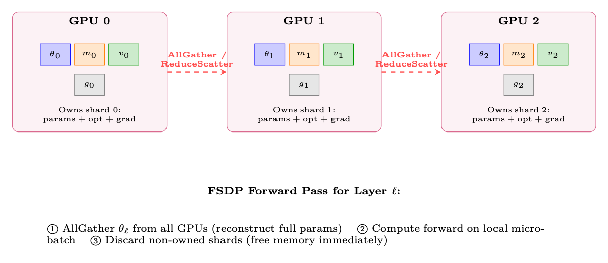

**Figure 12.8: FSDP 把所有模型状态切片到多块GPU 上。每块GPU 拥有1/N 的参数、优化器状态和梯度。在每层计算前，通过AllGather 按需重建完整参数。**

#### FSDP 每层的执行流程：

1. 前向：AllGather参数→计算→丢弃非自有的分片。

2. 反向：再次AllGather 参数→计算梯度→ReduceScatter 梯度（每块GPU 拿到自己的梯度分片）→丢弃非自有的参数分片。

3. 优化器更新：每块GPU 仅用自己持有的梯度分片和优化器状态更新自己拥有的分片。

**Table 12.2: 显存对比：DDP vs FSDP/ZeRO 各阶段（70B 模型，8 GPU）。基线：BF16 参数（140 GB）+**

| BF16 梯度（140 GB）+ FP32 master+m+v（840 GB）= 每GPU 1120 GB。 |  |  |  |
| --- | --- | --- | --- |
| 策略 | 分片对象 | 每GPU 显存 | 通信 |
| DDP（不分片） | 无 | 1120 GB × | AllReduce（仅梯度） |
| ZeRO-1 | 优化器状态 | 385 GB × | AllReduce（梯度） |
| ZeRO-2 | 优化器+ 梯度 | 368 GB × | AllReduce（梯度） |
| ZeRO-3 / FSDP | 全部 | 140 GB ✓ | AllGather + ReduceScatter （每层） |

```
from functools import partial
from torch.distributed.fsdp import FullyShardedDataParallel as FSDP
from torch.distributed.fsdp import ShardingStrategy , MixedPrecision , BackwardPrefetch
from torch.distributed.fsdp.wrap import transformer_auto_wrap_policy
from transformers.models.llama.modeling_llama import LlamaDecoderLayer
# 用FSDP 包装模型
auto_wrap = partial(transformer_auto_wrap_policy ,
transformer_layer_cls={LlamaDecoderLayer})
mp_policy = MixedPrecision(
param_dtype=torch.bfloat16 ,
reduce_dtype=torch.bfloat16 ,
buffer_dtype=torch.bfloat16 ,
)
model = FSDP(
model,
sharding_strategy=ShardingStrategy.FULL_SHARD , # ZeRO-3
mixed_precision=mp_policy ,
```

auto_wrap_policy=auto_wrap , # 对每个transformer 层都做包装

use_orig_params=True, # torch.compile 兼容所需

limit_all_gathers=True, # 限制显存峰值（同一时刻只允许1 个AllGather ）forward_prefetch=True, # 当前层计算时预取下一层参数

```
backward_prefetch=BackwardPrefetch.BACKWARD_PRE , # 反向时预取
)
```

#### FSDP 的通信量

#### FSDP 每步的通信量是DDP 的3×：

- DDP：1 次梯度AllReduce = 环上合计2M 字节（其中M = 模型字节数）。

- FSDP：2 次AllGather（前向+ 反向）+ 1 次ReduceScatter = 3M 字节。

这就是显存与通信的取舍。FSDP 值得使用的场景是：(a) 模型在DDP 下无法装进GPU 显存；或(b) 通信与计算重叠得很好（现代框架可达到70–90% 重叠）。

### 12.2.6 3D 并行：组合多种策略

大规模生产系统（70B+）会同时组合TP、PP 和DP/FSDP：

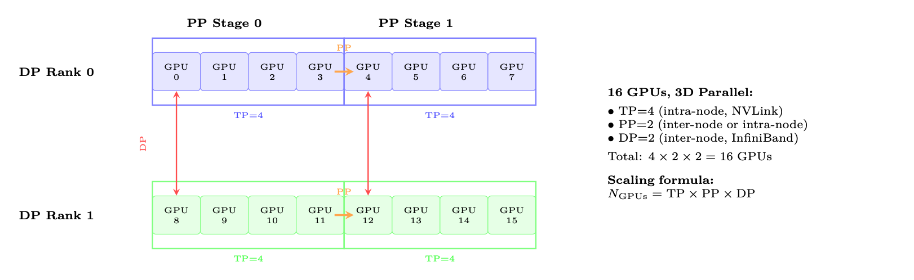

**Figure 12.9: 16 块GPU 上的3D 并行布局：TP=4（每个方框内，走NVLink）、PP=2（橙色箭头，stage之间）、DP=2（红色箭头，梯度同步）。每个维度利用通信层级中不同的一层。**

节点内（NVLink 600GB/s）：生成阶段用TP=8；训练阶段在节点内使用FSDP。

节点间（InfiniBand 400Gb/s）：跨节点FSDP（8 路数据并行）。

结果：每块GPU 持有∼70GB。Policy 权重在前向/反向时按层gather。

流水线并行：仅当模型超过100B+ 且TP+ZeRO 装不下时才用。会引入复杂度（气泡开销10–20%）和调度困难。

决策流程：

1. 模型能装进1 块GPU 吗？→用DDP。

2. 用FSDP 能装进1 个节点吗？→用FSDP（ZeRO-3）。

3. 用TP+FSDP 能装进1 个节点吗？→节点内用TP + 节点间用FSDP。

4. 仍然装不下？→跨节点再加PP。这是最后的手段。

**Table 12.3: 并行策略对比小结**

| 策略 | 切分对象 | 通信 | 扩展上限 | 开销 | 使用时机 |
| --- | --- | --- | --- | --- | --- |
| DP/DDP | Batch | AllReduce（梯度） | ∼64 GPU | 5–10% | 模型可装进1 GPU |
| FSDP | 参数+ 优化器+ 梯度 权重矩阵 | AllGather+RS AllReduce（每层2 次） | 数百GPU 8 GPU（1 节点） | 10–20% | >13B 时的默认 大模型推理+ 训练 |
| TP |  |  |  | 12–18% |  |
| SP | 激活（序列维） | 复用TP 通信 | 同TP | ≈0% 额外 | 与TP 一起常开 |
| PP | 按层切stage | 点对点 | ∼16 stage | 15–30% | 仅100B+ 模型 |

## 12.3 生成瓶颈：定量分析

A100 参数：312 TFLOPS（BF16 tensor core），2 TB/s HBM 带宽。

Roofline 拐点：312T/2T = 156 FLOP/byte。低于156 FLOP/byte 的操作受显存带宽约束。

自回归生成：每生成一个token，需要读完所有权重（70B 模型为140GB），并执行2×70B = 140G FLOPs（batch=1 时）。

算术强度：140G FLOP/140GB = 1 FLOP/byte。比roofline 低了156×！

利用率：1/156 = 0.6% 的峰值FLOPS。GPU 有99.4% 的时间在等显存读。

Token 速率：2TB/s/140GB = 14.3 tokens/秒（单流，batch=1）。

生成512 token：512/14.3 = 35.8 秒每条响应（batch=1，TP=1）。

Batch 化能改善：Batch=64、TP=4 →只读一次权重，并行生成64 个token。算术强度：64×1 = 64 FLOP/byte。好一些，但仍在roofline 之下！

**Table 12.4: 70B 模型在各种配置下的生成吞吐（512 token）**

| 配置 | Batch 每batch 用时 Tok/s/GPU 说明 |
| --- | --- |
| TP=1, batch=1 | 36s 基线，最差情况 |
| TP=4, batch=1 | 9s 生成上TP 线性扩展 接近最佳batch |
| TP=4, batch=32 | 15s |
| TP=4, batch=128, vLLM | 45s 连续batching |
| TP=4, batch=128, INT8 | 25s 带宽减半 |
| 优化栈（累乘加速比）： |  |
| 1. vLLM + PagedAttention [156]（2–4×）：消除KV cache 碎片，使更大batch 成为可能 |  |
| 2. 连续batching（continuous batching）[214]（1.5–2×）：不必等最长序列结束；一旦有序 |  |
| 列结束就插入新的 |  |
| 3. 推测解码（Speculative decoding）[142]（2–3×）：小draft 模型一次猜5 个token，大模型 |  |
| 一次前向就能验证。平均接受3–4 个。 |  |
| 4. 生成用INT8/FP8 权重（2×）：带宽需求减半。因为我们在做采样（不是为训练算精确 |  |
| logits），质量损失极小。 |  |
| 5. CUDA graphs（1.1–1.3×）：消除固定形状操作的kernel 启动开销 |  |
| 6. Prefix caching（共享前缀prompt 下1.5×）：不重新计算system prompt 的KV cache |  |

```
# 生产环境的vLLM 生成配置
from vllm import LLM, SamplingParams
engine = LLM(
model="./policy_checkpoint",
tensor_parallel_size=4, # 每个实例TP=4
gpu_memory_utilization=0.92, # 给KV cache 留余量
max_num_batched_tokens=16384, # 在飞token 上限
max_num_seqs=256, # 并发序列上限
dtype="bfloat16",
enable_prefix_caching=True, # 缓存system prompt 的KV
speculative_model="./draft_1B", # 推测解码
```

```
num_speculative_tokens=5,
block_size=16, # PagedAttention block 大小
swap_space=4, # 用于抢占的swap 空间（GB）
)
# 为RLHF batch 生成响应
sampling_params = SamplingParams(
temperature=0.7, top_p=0.9, max_tokens=512,
logprobs=1, # PPO 的ratio 计算需要log-prob
)
outputs = engine.generate(prompts , sampling_params)
# 提取：responses 以及每个token 的log_probs （PPO/GRPO 所需）
```

## 12.4 解耦式架构：生产级设计

诸如DeepSpeed-Chat [215] 与OpenRLHF [216] 这样的生产级RLHF 系统采用解耦式架构，将生成、打分、训练拆成三个可独立扩展的集群。

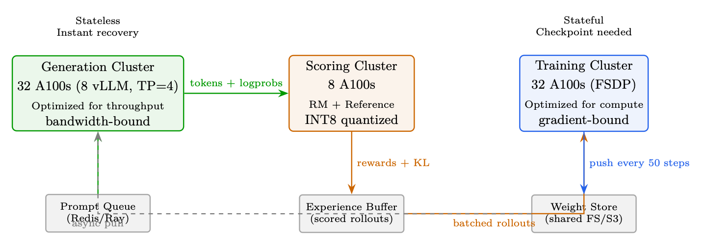

**Figure 12.10: 解耦式RLHF 架构。每个集群针对自己的负载做优化。打分后的rollout 先在经验缓冲（experience buffer）中累积，再被训练消费。**

为什么要解耦？

生成受显存带宽约束（需要高速HBM，浪费算力）。

训练受算力约束（需要tensor core，反向时浪费带宽）。

同一硬件无法同时优化两者：若把所有事情放在一起，要么生成时浪费算力，要么训练时浪费带宽。解耦让每个集群用最优的硬件/配置。

实际好处：

- 生成和训练可以独立扩展

- 生成集群无状态→容错极简

- gen(step N + 1) 与train(step N) 可重叠→30–40% 加速

- 不同精度：生成用INT8（带宽优先），训练用BF16（精度优先）

## 12.5 权重同步策略

策略滞后带宽质量影响

同步（每步）0步140 GB/步完美但太慢周期性（每50 步）平均25 步摊销后2.8 GB/步质量损失<2% Delta 压缩（INT8）平均25 步0.4 GB/步质量损失<3%异步流式5–10 步14 GB/步（后台）质量损失<1%

PPO 的裁剪目标本来就是为离策略数据设计的！裁剪区间[1 −ϵ, 1 + ϵ] 限制了陈旧数据的影响。

当滞后在10–50 步时：

- 每步policy 大约变化∼0.1–1%（合理学习率下）

- 50 步累计：∼5% 的policy 漂移

- PPO 裁剪本身就能处理高达20% 的漂移

- 经验上：50步滞后的质量损失<2%

带宽算账：70B BF16 = 140GB。InfiniBand 400Gb/s = 50GB/s →完整同步2.8s。配合delta压缩：<0.5s。异步同步= 免费（在后台跑）。

## 12.6 显存优化技术

ZeRO 阶段切分对象每GPU 显存（70B，8 GPU）

无（数据并行）无（完整副本）每GPU 560GB（不可行）ZeRO-1仅优化器状态175GB ZeRO-2优化器状态+ 梯度105GB ZeRO-3（FSDP）优化器+ 梯度+ 参数70GB（A100-80GB 装得下！）

其他技术：

- 梯度检查点（Gradient checkpointing）[217]：不存全部激活，反向时重算。节省约60%激活显存，代价是约33% 的额外计算。可选择性：只对attention 层（显存重）做checkpoint，保留FFN 激活（重算成本高）。

- 混合精度（Mixed precision）[218]：前向用BF16（2 字节/参数），优化器状态用FP32（m、v 各4 字节）。master 权重用FP32 累积。

- CPU offloading（ZeRO-Infinity [219]）：把优化器状态放到CPU RAM。显存省一半，但慢2–3×（PCIe 64GB/s 瓶颈）。

- 激活offloading：前向时把激活搬到CPU，反向时再搬回来。仅在显存确实紧张时使用。

- FlashAttention [7, 81]：attention 显存从O(n2) 降到O(n)。快2–4×，长序列时显存节省巨大。

### 12.6.1 FlashAttention 对RLHF 的影响

RLHF 涉及生成长序列（rollout）并对其训练。没有FlashAttention 时：

- 一条4K token、32 个head 的序列，仅attention 矩阵就要∼4 GB

- 这严重限制了PPO/GRPO 训练时的batch 大小

- 对attention 激活做梯度检查点代价昂贵

有了FlashAttention：

- attention 显存为O(n)——由Q, K, V, O 张量主导

- 同等GPU 显存下可承载更长的rollout（8K–32K token）

- 反向从Q, K, V 重算attention 分块（不存n2 矩阵）

- 这是长上下文RLHF（如推理模型）得以成立的关键

```
FlashAttention 与梯度检查点
FlashAttention 的反向在原地从Q, K, V （已存）重算attention 分块。这意味着FlashAttention
已经隐式实现了O(n2) attention 矩阵的激活重算。无需再单独对attention 层做checkpoint——
这样做反而会多余地重算Q, K, V 。
# 70B RLHF 训练的DeepSpeed ZeRO -3 配置
ds_config = {
"bf16": {"enabled": True},
"zero_optimization": {
"stage": 3,
"overlap_comm": True, # 通信与计算重叠
"contiguous_gradients": True, # 更好的显存布局
"reduce_scatter": True, # 比allreduce 更高效
"reduce_bucket_size": 5e7, # 每桶5000 万参数
"prefetch_bucket_size": 5e7, # 预取下一个桶
"param_persistence_threshold": 1e5, # 小参数在所有GPU 上常驻
"offload_optimizer": {"device": "cpu", "pin_memory": True}, # CPU offload
"sub_group_size": 1e9, # 减少碎片
},
"gradient_accumulation_steps": 4,
"gradient_clipping": 1.0,
"train_micro_batch_size_per_gpu": 2,
"wall_clock_breakdown": True,
}
```

## 12.7 大规模容错

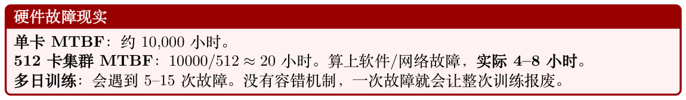

生产级容错栈：

1. 探测：NCCL超时（60s）、GPU 心跳（10s）、NVML 健康监控、ECC 错误计数。

2. Checkpoint：每50–100 步异步保存。非阻塞（后台线程）。保存内容：模型权重、优化器状态（Adam m/v）、调度器状态、RNG 状态、KL 系数、replay buffer。保留最近3 个checkpoint。

70B 用时约30s（并行写入NVMe）。

3. 恢复：(a)生成集群无状态，直接重启并加载最新权重。(b) 训练集群：加载checkpoint，剔除故障节点重建NCCL 进程组，重新分配FSDP 分片，从最近checkpoint 续训。

4. 弹性训练：Torch Elastic / Kubernetes自动扩缩。几分钟内替换故障节点。训练以N −1 块GPU 暂时继续。

5. 预防：训练前做GPU 健康预筛（跑GEMM 压测）。热备机待命。双轨InfiniBand 等冗余网络通路。

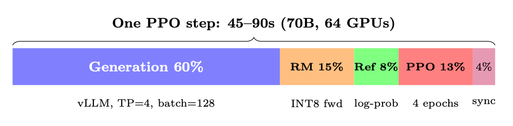

**Figure 12.11: 不重叠（单体式）。解耦后：生成与训练重叠，实际加速1.4×。**

## 12.8 端到端延迟拆解

阶段用时（70B）受限于优化手段

生成（128×512 tok）30–45s显存带宽vLLM、推测解码、INT8 Reward 打分5–8s算力（批量前向）INT8 RM、batch=128 Reference log-prob 4–6s算力（批量前向）INT8 ref，或LoRA（免费）PPO 更新（4 epoch）8–12s算力（反向）FSDP、FlashAttention权重同步0–3s网络（异步）Delta 压缩、异步合计（单体式）50–75s合计（解耦+ 重叠）35–50s生成与上一步训练重叠

## 12.9 监控与可观测性

质量指标（每10 步记录）：

- 平均reward（应当先上升后趋稳）

- 与reference 的KL 散度（应当保持在3–10）

- 响应长度分布（警惕length hacking）

- Entropy（应缓慢下降，不能崩塌）

系统指标（每步记录）：

- GPU 利用率（目标：训练>80%，生成>60%）

- 每GPU 的显存水位（在OOM 发生前发现）

- 生成吞吐（tokens/秒，应稳定）

- Gradient norm（尖峰= 即将出现不稳定）

- NCCL 通信时间（侦测网络劣化）

## 12.10 网络拓扑与通信模式

高效的分布式训练要求理解连接GPU 的分层通信网络。现代集群采用两级架构：超高速的节点内链路，以及较慢但可扩展的节点间网络。

### 12.10.1 节点内：NVLink 与NVSwitch

在单个节点内（通常8 块GPU），NVSwitch 在任意GPU 对之间提供全二分带宽（full-bisection bandwidth）。这意味着任意GPU 可以同时以全NVLink 速率与任意其他GPU 通信——这对张量

**Table 12.5: NVLink 各代及其对LLM 训练的影响**

| 代际 | 每链路带宽 | 每GPU 链路数 | 总带宽 | 平台 A100（DGX A100） |
| --- | --- | --- | --- | --- |
| NVLink 3.0 | 50 GB/s |  | 600 GB/s | H100（DGX H100） |
| NVLink 4.0 | 50 GB/s |  | 900 GB/s | B200（DGX B200） |
| NVLink 5.0 | 100 GB/s |  | 1800 GB/s |  |
| 并行至关重要，因为每层都需要在8 块GPU 间做AllReduce。 |  |  |  |  |

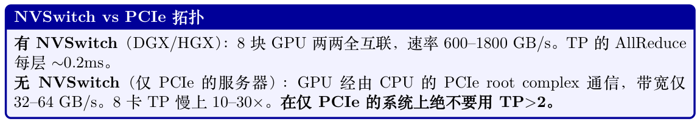

### 12.10.2 节点间：InfiniBand 与RoCE

跨节点做FSDP/ZeRO-3 的AllGather 与ReduceScatter 时，节点间网络成为主要瓶颈。

**Table 12.6: LLM 训练集群的节点间网络选项**

| 技术 | 带宽 | 延迟 | 说明 |
| --- | --- | --- | --- |
| InfiniBand NDR | 400 Gb/s（50 GB/s） | 1–2 µs | 黄金标准，RDMA，无损 |
| InfiniBand NDR（双轨） | 800 Gb/s（100 GB/s） | 1–2 µs | 用于H100 集群 |
| RoCE v2 | 100–400 Gb/s | 2–5 µs | 更便宜，需要调优PFC/ECN |
| Ethernet（TCP） | 100–400 Gb/s | 10–50 µs | 不适合>16 GPU 训练 |

### 12.10.3 通信原语及其代价

理解每种集合通信原语的使用场景有助于诊断瓶颈：

**Table 12.7: 分布式LLM 训练中的NCCL 集合通信操作**

| 通信-计算重叠 |  |  |  |
| --- | --- | --- | --- |
| 现代框架（FSDP、DeepSpeed）会积极地让通信与计算重叠： |  |  |  |
| 前向传播：当第i 层在计算时，AllGather 预取第i + 1 层的参数。第i 层一结束，其参数立刻被 |  |  |  |
| 丢弃（“free-after-forward”）。 |  |  |  |
| 反向传播：当第i 层在算梯度时，ReduceScatter 发送第i + 1 层的梯度。调优得当时，这种重叠 |  |  |  |
| 可隐藏70–90% 的通信延迟。 |  |  |  |
| 调优旋钮：prefetch_factor（提前预取多少层）、reduce_bucket_size（梯度归约的粒度）、 |  |  |  |
| backward_prefetch（反向预取的“pre” 还是“post” 策略）。 |  |  |  |
| 集合通信 | 搬运数据量 | 被谁使用 | 使用时机 |
| AllReduce | 2 · N−1 · M N | TP、DP | 跨GPU 求和梯度或激活 |
| AllGather | N−1 · M N | FSDP 前向 | 矩阵乘前重建完整参数张量 |
| ReduceScatter | N−1 · M N | FSDP 反向 | 反向后分发梯度分片 |
| Broadcast | M | PP | 把激活发到下一个流水线 stage |
| Send/Recv | M | PP | 相邻stage 间的点对点 |
| 其中M 是消息大小（字节），N 是参与者数量。 |  |  |  |

### 12.10.4 网络拓扑设计

#### 生产集群采用fat-tree 或rail-optimized（按轨优化）拓扑：

- Fat-tree：每一级都具备全二分带宽。任一节点都能以满速与任一其他节点通信。代价昂贵（需要大量交换机），但灵活性最高。

- Rail-optimized：每个节点的GPU i 连接到同一台叶子交换机（“轨i”）。轨内AllReduce 便宜，跨轨流量昂贵。Meta 的RSC 和Google 的TPU pod 都采用此拓扑。

- 3D torus / Dragonfly：用于HPC 集群（Frontier、Aurora）。拓扑感知的作业放置至关重要。

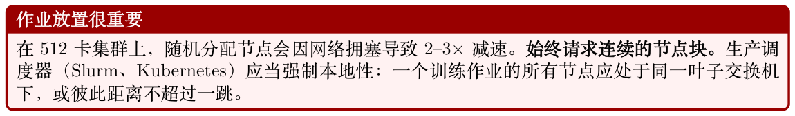

## 12.11 训练吞吐与模型FLOPs 利用率

### 12.11.1 衡量训练效率：MFU

模型FLOPs 利用率（Model FLOPs Utilization, MFU）[220] 是衡量训练效率的标准指标：

MFU = 实际吞吐（tokens/秒）× 每token 的FLOPs (12.5)硬件峰值FLOPS

对于参数量为P、序列长度为s、batch 大小为b 的transformer：

每token 的FLOPs ≈6P + 12 · nlayers · dmodel · s (12.6)

系数6 来自：2（乘加）× 3（前向+ 反向，反向约为前向的2×）。第二项对应attention 的O(s2)代价。

**Table 12.8: 各规模与硬件下的MFU 基准**

| 为什么MFU 会随规模下降 |  |  |  |
| --- | --- | --- | --- |
| 更大的模型需要更多并行，会引入： |  |  |  |
| 1. 通信开销：FSDP的AllGather/ReduceScatter（64 GPU 时∼10–15%） |  |  |  |
| 2. 流水线气泡：PP在micro-batch 的首尾引入空闲（PP=4 时∼15–25%） |  |  |  |
| 3. 辅助模型占用显存：reference/RM占用了本可用于更大batch 的显存 |  |  |  |
| 4. 负载不均：并非所有层计算量相等（embedding vs transformer block） |  |  |  |
| 经验法则：训练目标MFU > 40%。低于30% 时应使用profiling 诊断。 |  |  |  |
| 模型 | 硬件 | MFU | Tokens/秒/GPU 配置 |
| LLaMA-7B | 8×A100 | 57% | 3,200 FSDP, FlashAttn, BF16 |
| LLaMA-13B | 16×A100 | 52% | 1,750 FSDP, FlashAttn, BF16 |
| LLaMA-70B | 64×A100 | 45% | FSDP+TP=8, FlashAttn |
| GPT-4（估计） | 10,000+ H100 | 40–50% | — 3D 并行 |
| PaLM-540B | 6144 TPUv4 | 46% | — DP+TP+PP |

### 12.11.2 算力最优的batch 设计

有效batch 大小与硬件利用率之间存在并非显而易见的相互作用：

有效batch = micro_batch × grad_accum × DP 度(12.7)

- 过小：GPU利用率低（算术强度低），通信占主导。

- 过大：每token 的学习收益递减（超过critical batch size），算力被浪费。

- 最佳点：临界batch size（critical batch size）Bcrit，即梯度噪声等于梯度信号之处。对LLM，Bcrit ∼1–4M token [221]。

对RLHF 而言，batch 包含的是rollout（不仅仅是token）：

RLHF batch = Nprompts × Kgenerations × L平均响应长度(12.8)

生产常见取值：N = 128 条prompt，K = 1–4 个生成，L = 256–512 token →每步32K–256K token。

### 12.11.3 Profiling 与瓶颈诊断

关键的profiling 工具及其揭示的内容：

工具捕获信息擅长

torch.profiler Kernel 计时、显存找慢算子、显存泄漏NVIDIA Nsight Systems完整的GPU 时间线可视化重叠、kernel 间空隙nccl_debug=INFO集合通信大小/耗时诊断通信瓶颈torch.cuda.memory_stats分配模式找碎片、峰值占用DeepSpeed Flops Profiler每层FLOPs识别负载不均py-spy / scalene CPU profiling数据加载、分词瓶颈

#### 诊断MFU 偏低：一份清单

1. GPU 利用率< 80%？→数据加载瓶颈（检查CPU、I/O）。

2. Kernel 之间有大空隙？→Python 开销、同步点。使用CUDA graphs。

3. 通信占步时间> 20%？→降低TP 度、加大batch、检查网络健康。

4. 显存99%？→batch 无法继续增大。尝试梯度检查点、offloading。

5. 生成时OOM？→KV cache 太大。降低max_seq_len 或生成batch。

## 12.12 成本分析与云端部署

理解RLHF 训练的经济账，对规划至关重要。

### 12.12.1 硬件成本对比

**Table 12.9: RLHF 训练大致云端GPU 成本（2024–2025 价格）**

| GPU | 按需/小时 | Spot/小时 | 显存 | 适用场景 |
| --- | --- | --- | --- | --- |
| A100 80GB | $2.50–3.50 | $1.00–1.50 | 80 GB HBM2e | 经济型训练、生成集 群 |
| H100 80GB | $4.00–6.00 | $2.00–3.00 | 80 GB HBM3 | 生产级训练 |
| H200 141GB | $6.00–8.00 | — | 141 GB HBM3e | 大上下文、少卡配置 |
| MI300X 192GB | $3.50–5.00 | $1.50–2.50 | 192 GB HBM3 | 性价比替代方案 |

### 12.12.2 RLHF 训练成本估算

成本= Nsteps × Tstep × NGPUs × CGPU/hr (12.9)

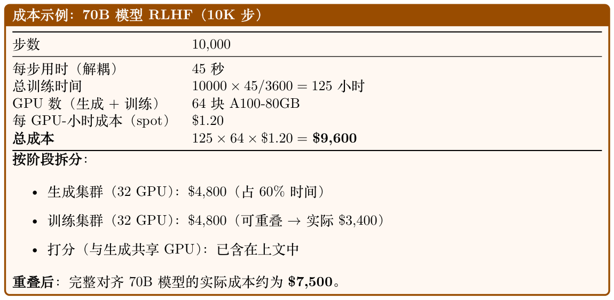

### 12.12.3 成本优化策略

- Spot/可抢占实例：节省50–70%。要求checkpoint 机制健壮（每5 分钟保存一次）。

- 合理配型：不要用H100 做生成（显存带宽瓶颈）；推理时A100 的tokens/$ 相近。

- 量化推理：生成与打分用INT8/FP8 可让相应集群的GPU 数减半。

- 渐进式训练：先用8B 代理模型做reward 工程/调试（约$200），再扩到70B。

- 用LoRA 取消reference：彻底移除reference 模型（显存减少50%）。

- 先短后长：按256→512→1024 token 的curriculum 生成可节省40% 算力。

## 12.13 分布式Checkpointing

在大规模下，朴素checkpointing 会成为瓶颈。一个带优化器状态的70B 模型，每次checkpoint 需要保存∼840 GB（FP32 master 权重+ Adam m + v）。

### 12.13.1 Checkpointing 策略

### 12.13.2 用torch.distributed.checkpoint 做生产级Checkpointing

**Table 12.10: 大规模RLHF 的checkpointing 方案**

| 策略 | 保存耗时（70B） | 每ckpt 存储 | 特性 |
| --- | --- | --- | --- |
| 同步（所有rank） | 30–60s（阻塞） | 420 GB | 简单，会让训练停顿 |
| 异步（后台复制） | <1s（非阻塞） | 420 GB | 与下一步重叠 |
| 增量（delta） | <1s | 5–20 GB | 只保存变化的参数 |
| 分片（FSDP 原生） | 5–10s | 420 GB 分片 | 每个rank 各存自己的分片 |

```
import torch.distributed.checkpoint as dcp
from torch.distributed.checkpoint.state_dict import get_state_dict , StateDictOptions
# 保存：每个rank 并行写自己的分片
state_dict = {"model": get_state_dict(model, options=StateDictOptions(full_state_dict=
False))}
dcp.save(
state_dict=state_dict ,
storage_writer=dcp.FileSystemWriter("/mnt/checkpoints/step_5000"),
planner=dcp.DefaultSavePlanner(), # 自动处理FSDP 分片
)
# 异步保存：非阻塞，运行于后台线程
future = dcp.async_save(
state_dict=state_dict ,
storage_writer=dcp.FileSystemWriter("/mnt/checkpoints/step_5000"),
)
# 训练立即继续；只在需要时才用future.result() 阻塞
RLHF 的Checkpoint 卫生
RLHF 的checkpoint 需要捕获比标准预训练更多的内容：
• Policy 模型权重+ 优化器状态（标准）
• KL 系数（β）及其调度状态
• Replay buffer 内容（用于离策略修正）
• 所有GPU 的RNG 状态（可复现性）
• Prompt 迭代器位置（避免重复处理prompt）
• Reward 模型版本标签（用于审计）
• Wandb/指标run ID（用于连续日志）
```

## 12.14 硬件选型指南

合适的硬件选择取决于模型规模、预算和训练阶段。

**Table 12.11: 按模型规模与训练阶段给出的硬件建议**

| H100 vs A100：何时升级才值得？ |  |  |
| --- | --- | --- |
| H100 提供： |  |  |
| • 峰值FLOPS 约∼1.6×（带稀疏BF16：989 vs 624 TFLOPS；不带稀疏：495 vs 312） |  |  |
| • 显存带宽约∼2×（3.35 vs 2.0 TB/s） |  |  |
| • 支持FP8（推理再快2×） |  |  |
| • NVLink 4.0（900 vs 600 GB/s） |  |  |
| 训练上：端到端约快∼1.8–2.2×（FP8 支持与更高带宽放大了原始FLOPS 优势）。 |  |  |
| 生成上：约快∼1.7×（带宽受限，2× BW 加上开销≈1.7× 吞吐）。 |  |  |
| 性价比：在1.5× 价格下，H100 在训练上几乎总是更划算。仅推理（生成集群）时，A100 在spot |  |  |
| 价格下可能更划算。 |  |  |
| 模型规模 |  |  |
| 训练阶段 | 推荐 | 配置 单节点，无需并行 |
| ≤7B |  |  |
| SFT + RLHF | 1–2× A100 | FSDP，可选生成TP=2 |
| 7–13B |  |  |
| SFT + RLHF | 4–8× A100 |  |
| 13–34B |  |  |
| SFT + RLHF | 8–16× A100/H100 | FSDP + 生成TP=4 |
| 70B |  |  |
| RLHF（完整） | 32–64× A100/H100 | 解耦，FSDP + TP=8 |
| 70B |  |  |
| RLHF（LoRA） | 8–16× A100/H100 | 无reference，LoRA adapter |
| >100B |  |  |
| RLHF | 128+× H100 | 3D 并行（TP+PP+DP） |

## 12.15 RL 训练的优化器配置

RL 训练（PPO、GRPO、DPO）相比预训练或SFT 对优化器有独特要求。Loss 地形非平稳（policy变化会改变生成的数据）、梯度更嘈杂（reward 信号方差大）、且更容易出现灾难性遗忘（Catastrophic Forgetting）或reward hacking。本节以AdamW [79] 作为默认优化器，整理RL 特有的优化器实践指南。

### 12.15.1 为什么RL 需要不同的优化器设置

#### RL vs. SFT 优化——关键差异

- 数据分布非平稳：SFT数据集固定，而RL 每轮迭代都会生成新的rollout——数据分布随policy 一起漂移。

- 高梯度方差：reward信号稀疏且嘈杂；梯度方差远高于在精心策划数据上的交叉熵。

- 需要更小的更新：policy必须贴近reference 模型（KL 约束），所以学习率比SFT 小10–100×。

- 不用weight decay：正则化由KL 惩罚提供，而不是weight decay。再叠加WD 可能与KL 约束相互对抗。

- 更短的warmup：RL 从已收敛的SFT checkpoint 起步——优化器状态只需极短的warmup。

### 12.15.2 各RL 方法的推荐超参

**Table 12.12: RL 训练各阶段的优化器设置。均使用β1 = 0.9、β2 = 0.95、ϵ = 10−8、max_grad_norm=1.0、**

| BF16。 |  |
| --- | --- |
| 方法 | 优化器 LR WD Warmup 调度 |
| DPO | AdamW 5e-7 0.0 50 步 Constant 或Linear |
| PPO（policy） | AdamW 1e-6 0.0 20 步 Constant |
| PPO（critic） | AdamW 1e-6 0.0 20 步 Constant |
| GRPO | AdamW 1e-6 0.0 20 步 Constant |

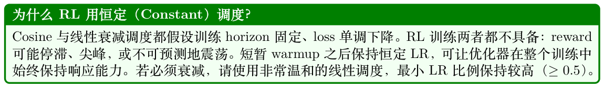

### 12.15.3 RL 用Beta-2 = 0.95：更快的自适应

Adam 默认的β2 = 0.999 给二阶矩留下了非常长的记忆（有效窗口∼1000 步）。在RL 训练中，loss地形随policy 演化迅速变化——1000 步前的梯度方差已无关紧要。使用β2 = 0.95 把窗口缩短到∼20 步，让自适应学习率能够迅速响应变化中的梯度统计。

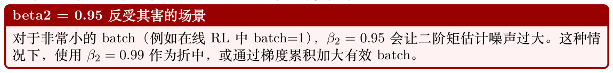

### 12.15.4 RL 的混合精度：FP32 Master 权重至关重要

RL 训练对数值精度尤其敏感：

- 梯度更嘈杂——小幅更新必须在多步中精确累积

- 学习率极小（10−6–10−7），使得∆θ ≪θ

- BF16 尾数（7 位≈0.8% 相对精度）无法表示相对于100 量级权重的10−6 量级更新

RL 训练务必使用FP32 master 权重。纯BF16 训练（不留FP32 副本）几乎必然会让PPO/ GRPO 在100–500 步后出现reward 崩塌。

### 12.15.5 梯度裁剪对RL 至关重要

在PPO 和GRPO 中，reward 信号变异性可能极高，尤其训练早期。一个坏batch 就能产生norm > 100 的梯度，足以彻底破坏模型权重。max_grad_norm=1.0 是标准设置。SFT 下裁剪不那么关键，但仍建议使用。

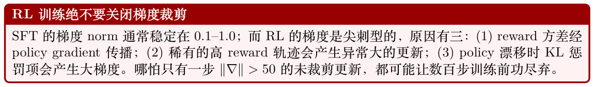

### 12.15.6 诊断RL 训练的不稳定性

症状可能原因与修复

Reward 先升后崩LR 过高或KL 系数过低。将LR 降2–5×，或加大βKL。

梯度norm 一直顶在裁剪阈值更新过于激进。降低LR（持续裁剪意味着每一步都丢失梯度方向信息）。

KL 散度爆炸（>15 nat）LR 过高。降低10× 或加上自适应KL 惩罚。

Reward 卡在基线LR 过低，或reward 模型信号过弱。试着把LR 提2–5×。检查reward 模型校准。

100+ 步后loss NaN缺少FP32 master 权重，或梯度norm 溢出。开启FP32 master 权重；验证BF16 模式。

### 12.15.7 HuggingFace TRL 的RL 配置

TRL 库[175] 为LLM 的PPO、DPO 等RL 方法提供了生产级实现。

```
from trl import PPOConfig , PPOTrainer , DPOConfig , DPOTrainer
# --- PPO 配置---
ppo_config = PPOConfig(
# 优化器（AdamW ，RL 特化设置）
learning_rate=1e-6, # 比SFT 小10-100x
```

```
# PPO 特有
ppo_epochs=4, # 每个rollout 上做的mini-batch 更新次数
mini_batch_size=16,
batch_size=64, # rollout 的batch 大小
# 梯度控制
max_grad_norm=1.0,
# KL 惩罚（取代weight decay 作为正则化）
init_kl_coef=0.2, # 初始KL 惩罚系数
adap_kl_ctrl=True, # 自适应KL 目标
target_kl=6.0, # 目标KL 散度
# 混合精度
bf16=True, # BF16 计算，FP32 master 权重
)
ppo_trainer = PPOTrainer(
model=model,
ref_model=ref_model ,
config=ppo_config ,
tokenizer=tokenizer ,
dataset=dataset ,
)
# --- DPO 配置---
dpo_config = DPOConfig(
output_dir="./dpo_output",
# 优化器
learning_rate=5e-7, # 比PPO 还小
optim="adamw_torch",
adam_beta1=0.9,
adam_beta2=0.95, # RL 用更短的记忆
weight_decay=0.0, # 不用WD —— KL 提供正则化
# 调度
lr_scheduler_type="constant_with_warmup",
warmup_steps=50,
# 梯度控制
max_grad_norm=1.0,
# DPO 特有
beta=0.1, # KL 约束强度
loss_type="sigmoid", # 标准DPO loss
# 混合精度
bf16=True,
# 训练
num_train_epochs=1, # DPO 通常1 个epoch
per_device_train_batch_size=4,
gradient_accumulation_steps=8,
)
dpo_trainer = DPOTrainer(
model=model,
ref_model=ref_model ,
args=dpo_config ,
train_dataset=dataset ,
tokenizer=tokenizer ,
)
dpo_trainer.train()
```

Listing 12.1: 使用TRL 的完整PPO 与DPO 优化器配置。

### 12.15.8 MoE 在RL 训练中的考虑

混合专家（Mixture-of-Experts, MoE）模型[108] 在RLHF 中越来越常见：

- 优势：相同算力下容量提升3–4×。对reward 模型尤其有利（更多容量去打分）。

- 挑战：专家并行需要all-to-all 通信（token 跨GPU 路由），与流水线并行存在冲突。

- GRPO + MoE：效果不错，因为生成成本由激活参数主导（而非总参数）。

- MoE 用LoRA：可以只对路由器+ 共享层加LoRA，或对所有专家都加（昂贵）。

做RL 微调请记住：小LR、不用weight decay、恒定调度、FP32 master 权重、激进裁剪。

把正则化交给KL 惩罚——优化器只管沿policy gradient 前进，且不要冲过头。
