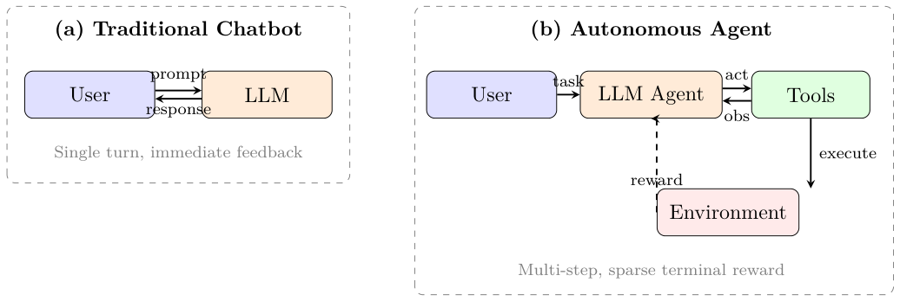
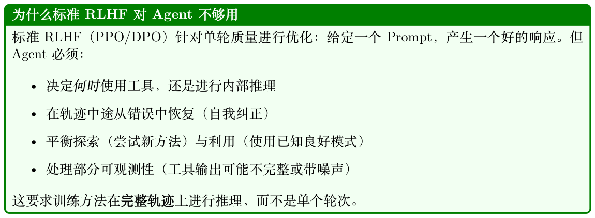
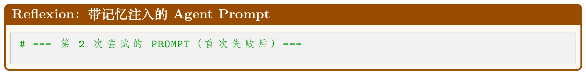
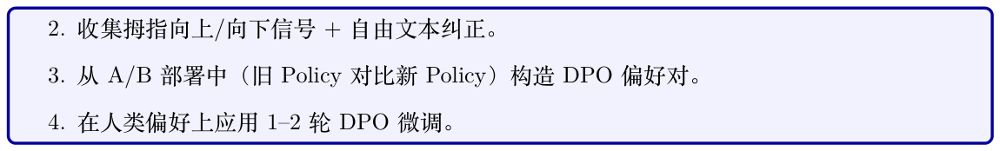
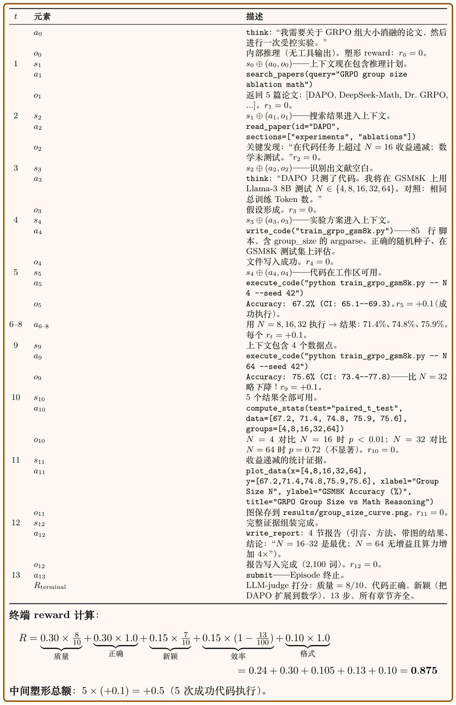
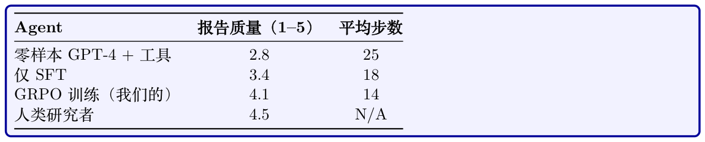
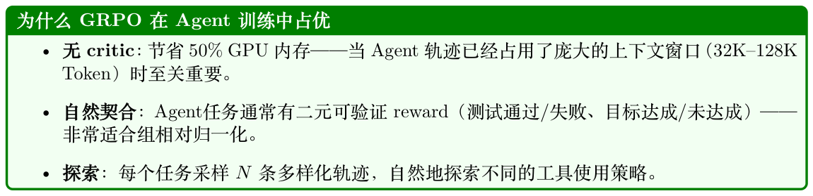

# LLM 智能体训练

## 13.1 动机：从聊天机器人到自主智能体

现代LLM 越来越多地被部署，不仅作为对话助手，而且作为自主智能体（Autonomous Agents），能够在多个步骤中与外部工具、API、数据库和环境进行交互。这种从单轮聊天机器人到多步智能体的转变，引入了根本性的新RL 挑战，要求我们重新思考如何训练、评估和部署语言模型。



运行。自主智能体跨多个工具交互进行规划，从真实世界的执行环境中接收反馈，并针对稀疏的终端reward（任务成功/失败）进行优化。

要求新RL 方法的关键差异：

- 多步推理：Agent必须跨越10–100+ 次工具调用进行规划，而不仅仅是生成单一响应。

- 外部环境反馈：Reward来自真实世界的执行（测试套件通过、网页加载、代码编译），而不仅仅是人类偏好分数。

- 结构化动作：动作不仅是Token，而是结构化输出（JSON 工具调用、API 负载、代码块）。

- 长视野与稀疏reward：成功/失败可能只能在多个中间步骤之后才能确定。



## 13.2 LLM Agent 的轨迹缓冲区

在LLM Agent 的语境下，传统的RL 回放缓冲区经历了结构性的转变。Agent 缓冲区——通常称为轨迹缓冲区（Trajectory Buffers）、经验池（Experience Pools）或记忆库（Memory Banks）

- —不再存储低维数值Tensor，而是管理复杂的文本历史、工具执行输出和显式推理步骤。

### 13.2.1 LLM Agent 缓冲区的数学结构

在经典RL 中，回放缓冲区存储扁平元组(s, a, r, s′)。对于LLM Agent，这扩展为高维的Token 化文本结构：

et = (St, At, Rt, St+1) (13.1)

- St：完整上下文状态——系统Prompt、用户目标、对话历史，以及当前环境变量（例如HTML源代码、目录结构、数据库Schema）。

- At：Agent 的生成输出，通常由一段思维链（Chain-of-Thought，CoT）推理字符串紧接一个结构化工具调用组成：At = {textreasoning, jsontool_call} (13.2)

- Rt：评估信号，来自外部执行环境（单元测试通过、编译器标志、API响应码），或由LLM-as- a-judge 系统验证。

- St+1：更新后的上下文窗口，将工具输出文本或错误日志直接附加到对话历史中。

#### 具体Agent 轨迹：代码调试

A1 = “让我先读取该文件” + read_file("utils.py")

R1 = 0（中间步骤）

A2 = “Bug 在第42 行，是一个差一错误” + edit_file("utils.py", ...)

R2 = 0（中间步骤）

A3 = “让我验证修复” + run_tests()

R3 = +1.0（所有测试通过——稀疏终端reward）

## 13.3 操作范式

LLM Agent 通过三种主要的优化方法论来利用专门的轨迹缓冲区：

### 13.3.1 A. 自我纠正与思维细化

此类别中的两种代表性方法是STaR [222] 和Reflexion [223]。当Agent 在一次多步执行轨迹中失败时，次优序列会被保存到缓冲区。该框架随后采样此轨迹，并提示LLM 对其过去的表现生成显式文本批评：Critique ←LLM(Sfailed, Afailed, R=0) (13.3)一旦修正后的轨迹获得正向reward，它就被移至最优经验池，用于通过微调（在成功轨迹上做SFT）或RL（采用二元通过/失败reward 的GRPO [14]）来更新网络权重。

#### STaR：自学习推理者

1. 为一批问题生成推理轨迹

2. 过滤：仅保留导致正确答案的轨迹

3. 在成功轨迹上微调模型（SFT）

4. 重复：改进后的模型在下一次迭代中生成更好的轨迹

每次迭代都使用模型自身的成功输出作为训练数据，自举其推理能力。

#### Reflexion：语言强化学习

1. Agent 尝试一项任务，失败

2. Agent 生成一段语言反思：“我失败是因为在调用API 之前没有检查返回类型”

3. 反思被存储在一个情节记忆缓冲区中

4. 在下一次尝试中，反思作为经验教训被注入到Prompt 中

5. 不需要权重更新——纯粹通过自我批评进行上下文学习

### 13.3.2 B. 离策略探索

此范式以ReAct [126] 及相关工具使用框架为代表，涉及广泛的自主探索。在自主探索过程中（网页导航、数据库查询、代码生成），Agent 记录数千条探索性执行路径。轨迹缓冲区充当一个过滤器：

- 成功过滤：只保留达成目标的轨迹用于训练。

- 效率排序：在成功轨迹中，优先选择最短/最高效的工具使用路径。

- 多样性采样：维持多样化的解决策略集合，以防止模式坍塌。

优化算法（通常是GRPO [14] 或过滤后的SFT）只在高效、成功的轨迹上计算Loss，丢弃迂回曲折的运行。

### 13.3.3 C. 非参数化的上下文学习（基于经验的RAG）

轨迹缓冲区可以不修改神经网络权重，而是作为一个向量数据库。给定一个新的用户目标Gnew，系统检索最相关的过往经验：

Eretrieved = arg max e∈B sim(Embed(Gnew), Embed(e)) (13.4)

Top-k 个相似的成功历史运行作为few-shot 示例直接注入到Prompt 上下文中。这种方法：

- 需要零训练——纯粹的检索增强生成（Retrieval-Augmented Generation, RAG）

- 如果缓冲区中存在相似经验，可即时适应新任务

- 随缓冲区规模扩展（更多经验= 更好的覆盖率）

- 与参数化学习互补（罕见情况使用检索，常见模式使用权重）

**Table 13.1: 传统RL 缓冲区与LLM Agent 缓冲区对比**

| 特性 | 传统RL 缓冲区 | LLM Agent 缓冲区 |
| --- | --- | --- |
| 数据格式 | 连续向量/ Tensor 海量（105–107 条） | Token 化文本、JSON、代码块、工具输出 中小规模（103–105 条轨迹） |
| 数据量 |  |  |
| 主要目标 | 打破数据相关性 | 提供推理示范 |
| 采样 | 随机均匀/ PER | 语义检索/ 成功优先/ 多样性 |
| 状态大小 | 固定（如84×84 像素） | 可变（每个状态1K–128K Token） |
| 动作空间 | 离散/连续向量 | 结构化文本（推理+ 工具调用） |
| Reward 来源 | 环境模拟器 Table 13.2: 用RL 训练LLM Agent 的关键方法。 | 外部执行/ LLM judge / 单元测试 |
| 方法 | 类型 | 核心思想 |
| STaR [222] | 迭代SFT | 通过在自身成功轨迹上微调来自举推理能 力 |
| Reflexion [223] | 上下文RL | 语言式自我批评作为情节记忆存储；无权 重更新 |
| ReAct [126] | Prompt 方法 | 在单次生成中交错推理（“思考”）与行动 （“工具调用”） |
| LATS [224] | 树搜索 | 在动作序列上做蒙特卡洛树搜索；反向传 播reward |
| AgentQ [225] | 离策略RL | 在Agent 轨迹上用AI 生成的偏好对做 DPO |
| OpenHands [226] | GRPO | 基于执行的reward（测试通过/失败）做组 相对优化 |
| Voyager [227] | 技能库 | 存储并检索成功代码片段以组合复用 |
| RLEF [228] | 在线RL | 从执行反馈中做RL——来自代码/测试执 行的二元reward |

## 13.4 范式对比

## 13.5 Agent RL 的主要技术

### 13.5.1 STaR：自学习推理者（详解）

STaR [222] 是一种迭代式自我改进方法，无需外部Reward Model 即可自举推理能力。核心洞见：如果模型偶尔能正确解决一个问题，它就可以从自身的成功中学习。

算法：

1. 生成：对数据集D 中的每个问题xi，采样一条推理轨迹zi ∼πθ(·|xi)，后跟一个答案ˆyi。

2. 过滤：仅保留满足ˆyi = y∗ i （正确答案）的轨迹。定义成功集Dpass = {(xi, zi, y∗ i ) : ˆyi = y∗ i }。

3. 合理化（Rationalization）（关键创新）：对模型失败的问题，生成一条以正确答案为条件的“合理化” 轨迹：zrat ∼πθ(·|xi, y∗ i )。这教导模型从解反向推理。

i

4. 微调：在Dpass ∪Drationalized 上通过SFT 更新θ。

5. 迭代：用改进后的模型从步骤1 重复。

X θk+1 = arg min − log πθ(z, y|x) (13.5) θ (x,z,y)∈D+ k

收敛动力学：每次迭代k 都会提升模型的解题率pk。若p0 = 0.3（解出30% 的问题），经过合理化+ SFT 后p1 ≈0.5。通常3–5 次迭代后收敛至p ≈0.7–0.9。

```
STaR 合理化Prompt
# 标准生成（步骤1 ）：
PROMPT = """Solve the following problem step by step.
Problem: A store has 45 apples. It sells 3/5 of them. How many remain?
Let's think step by step:"""
# 合理化Prompt （步骤3 —— 以正确答案为条件）：
PROMPT_RATIONALIZE = """Solve the following problem step by step.
The correct answer is 18.
Problem: A store has 45 apples. It sells 3/5 of them. How many remain?
Let's think step by step to arrive at 18:"""
# Agent 变体（带错误条件的代码任务）：
PROMPT_AGENT_RATIONALIZE = """The following code task failed with the error below.
Generate a correct solution step by step.
Task: Implement binary search that handles duplicates.
Previous error: IndexError: list index out of range (line 12)
Correct behavior: Return leftmost index of target.
Let me fix this by reasoning about the boundary conditions:"""
面向Agent 的STaR 变体
• Quiet-STaR [229]：在每个生成Token 之间插入“思考Token”。模型学会在没有显式CoT
提示的情况下隐式推理。训练目标：在包含思考Token 时更好地预测下一个Token。
• 代码Agent 的STaR：用测试执行替代答案验证。“正确” = 所有测试通过。合理化= 以
错误消息为条件生成新方法。
• V-STaR [230]：增加一个在(z, y, correct/incorrect) 三元组上训练的验证器模型。该验证
器提供过程级监督，过滤那些偶然到达正确答案的糟糕推理轨迹。
```

### 13.5.2 Reflexion：语言强化学习（详解）

Reflexion [223] 引入了一种激进的范式：无权重更新的RL。Agent 不通过基于梯度的学习，而是通过存储在情节记忆中的自然语言自我批评来改进。

完整架构：

1. Actor：在环境中执行动作的LLM Agent π。

2. 评估器：二元信号（任务成功/失败）或标量启发式（如通过的测试用例数）。

3. 自我反思生成器：给定失败轨迹τfail 和环境反馈，生成自然语言反思rtext：

rtext = LLMreflect(τfail, feedback, task) (13.6)

4. 情节记忆：过往反思的滑动窗口缓冲区M = [r1, r2, . . . , rm]（通常m ≤3 以适应上下文）。

5. 重试循环：下一次尝试时，反思被注入到Prompt 中：

at+1 ∼π(· | task, M, current_state) (13.7)

反思示例：“在我上一次尝试中，我在验证输入格式之前就调用了搜索API，导致了400 错误。

下次我应该先验证JSON Schema，然后再发起API 调用。”



```
SYSTEM = """You are a coding agent. You can run bash commands and edit files.
Complete the task below. Learn from your previous reflections."""
USER = """Task: Fix the failing test in auth_service.py
=== REFLECTIONS FROM PREVIOUS ATTEMPTS ===
[Attempt 1 reflection]: I tried to modify the authenticate() function
directly but forgot that it depends on token_validator(). The test
failed because token_validator() was still returning the old format.
I should trace the dependency chain FIRST: check what authenticate()
calls, then fix the root cause (token_validator), not the symptom.
=== END REFLECTIONS ===
The repository is in /workspace/. The failing test is:
test_auth.py::test_expired_token_returns_401
Begin by reading the relevant files, then fix the issue."""
优势与局限：
```

优势局限

零梯度计算；可与冻结的API 模型（GPT-4）一起工受限于上下文窗口；无法积累无限知识作快速迭代（每次重试只需几秒，而RL 训练需数小时）无法泛化到未见任务（记忆是任务特定的）可解释：人类可读的自我纠正依赖模型已有的识别错误的能力可与任意基础Agent 架构组合当基础模型太弱、无法生成有用批评时，效果下降

### 13.5.3 ReAct：推理+ 行动（详解）

ReAct [126] 通过在单个生成流中交错显式推理步骤与环境动作，确立了工具使用Agent 的主导Prompt 范式。

```
ReAct 系统Prompt（典型）
SYSTEM = """You are a research assistant with access to the following tools:
- search(query): Search the web for information
- lookup(term): Look up a term on the current Wikipedia page
- finish(answer): Submit your final answer
Solve the user's question by interleaving Thought and Action steps.
Format:
Thought: <your reasoning about what to do next>
Action: <tool_name >(arguments)
You will receive an Observation after each Action. Use it to plan
your next step. Continue until you can provide a final answer.
Rules:
- Always think before acting
- Never guess - verify with tools
- Use finish() only when you are confident in your answer"""
USER = "Who was the president of the US when the iPhone was released?"
生成格式：
ReAct 轨迹格式
Thought: I need to find when the iPhone was released , then determine
who was president at that time. Let me search for the release date.
Action: search("iPhone original release date")
Observation: The original iPhone was released on June 29, 2007.
```

```
Thought: The iPhone came out June 2007. Now I need to find who was
the US president in June 2007.
Action: lookup("President of the United States in 2007")
Observation: George W. Bush served as the 43rd president from
January 20, 2001 to January 20, 2009.
Thought: George W. Bush was president from 2001-2009, which covers
June 2007 when the iPhone was released. I have my answer.
Action: finish("George W. Bush was the US president when the iPhone
was released on June 29, 2007.")
形式化定义：一条ReAct 轨迹是τ = (t1, a1, o1, t2, a2, o2, . . .)，其中：
```

- ti：思考（内部推理，不被执行）

- ai：动作（工具调用，在环境中执行）

- oi：观测（环境响应，附加到上下文）

为什么有效：思考创造了一种“内心独白”，帮助模型在行动前规划，减少冲动性工具调用。显式推理轨迹也让Agent 的决策过程可审计且可调试。

#### 用RL 训练ReAct Agent：

- 动作级reward：只有动作接收reward 信号（思考是辅助的）。

- 思考质量：隐式优化——更好的思考→更好的动作→更高的reward。

- 格式强制：在reward 中加入对格式错误动作（缺失JSON、幻觉工具）的格式惩罚。

- RL 目标：r(τ) = rtask −λformat · format_violations −λlength · num_steps

### 13.5.4 LATS：语言Agent 树搜索（详解）

LATS [224] 将蒙特卡洛树搜索（Monte Carlo Tree Search, MCTS）应用于LLM Agent 的动作选择，以推理算力换取显著更好的轨迹。

#### 算法（针对LLM Agent 改造）：

1. 选择：从根节点（初始状态）开始，使用UCB1 遍历树：

s ln N(s) UCB(s, a) = ¯Q(s, a) + c (13.8) N(s, a)

其中¯Q = 子树平均reward，N = 访问计数，c = 探索常数。

2. 扩展：在叶节点，通过LLM 采样（温度> 0）生成k 个候选动作：{a1, . . . , ak} ∼πθ(·|sleaf)

3. 模拟：对每个候选，在环境中执行该动作，然后用快速rollout 策略（贪心解码）继续，直到终止状态或深度限制。

4. 反向传播：将终端reward 沿所有祖先节点向上传播，更新¯Q 和N 计数。

5. 重复：在固定计算预算（如50–200 次迭代）下运行步骤1–4。

6. 动作选择：选择根节点访问次数最多的子节点。

#### LLM特定的改造：

- Value 函数：使用独立的LLM 调用来估计状态价值：“在0–1 范围内，这个状态导致任务成功的可能性有多大？”

- 基于反思的剪枝：当某个分支失败时，生成反思并剪枝相似分支。

- 缓存：在每个节点存储LLM 输出，避免回溯时重复生成。

- 深度预算：将树深度限制在10–20 步（Agent 很少需要更多）。

性能：在WebShop（网页导航）上，LATS 达到75% 成功率，而ReAct 仅为40%。在HumanEval（代码）上，借助树搜索pass@1 从68% 提升至94%。代价：每个任务的推理FLOPs 增加10–50×。

```
LATS Prompt：价值估计与节点扩展
# === 价值估计PROMPT （用于模拟阶段）===
VALUE_PROMPT = """You are evaluating an agent's progress on a task.
Task: Book a flight from NYC to London for under \$500, departing Dec 15.
Current state (after 3 actions):
- Searched flights on Kayak: found 12 results
- Filtered by price < \$500: 4 options remain
- Clicked on British Airways \$489 option: viewing details page
On a scale of 0.0 to 1.0, how likely is the agent to successfully
complete the task from this state? Consider:
- How close is the agent to the goal?
- Are there remaining obstacles (payment , seat selection)?
- Has the agent made any errors that need correction?
Score: """ # 模型输出，例如"0.75"
# === 节点扩展PROMPT （生成候选动作）===
EXPAND_PROMPT = """You are a web navigation agent. Given the current
page state, propose 3 DIFFERENT next actions to try.
Current page: British Airways booking - flight details
Price: \$489 | Departure: Dec 15 8:30am | Arrival: Dec 15 8:45pm
[Button: Select] [Button: Back to results] [Link: Fare rules]
Generate 3 diverse candidate actions (explore different strategies):
Action 1:""" # 模型生成3 个选项用于树扩展
```

### 13.5.5 AgentQ：在Agent 轨迹上做DPO（详解）

AgentQ [225] 通过从轨迹结果自动生成偏好对，桥接了离线偏好学习（DPO）与在线Agent 执行。

流水线：

1. Rollout：使用当前Policy πθ 为每个任务执行N 条轨迹。

2. 评估：用基于执行的reward（二元通过/失败或标量指标）为每条轨迹打分。

3. 偏好对构造：对每个任务，构造偏好对：

(τw, τl) where r(τw) > r(τl) (13.9)

在同一任务的轨迹中，reward 最高者= 被选（chosen），最低者= 被拒（rejected）。

4. DPO 更新：在轨迹级对数概率上应用标准DPO Loss：

   log πθ(τw) πref(τw) −log πθ(τl) LAgentQ = −log σ β (13.10) πref(τl)

5. 迭代：更新后的πθ 在下一轮生成更好的轨迹。

关键设计选择：

- MCTS 引导的探索：在rollout 阶段使用LATS 生成多样、高质量的轨迹（更好的训练数据）。

- 步骤级DPO：不比较完整轨迹，而是在动作级别比较——给定相同前缀，哪个下一动作导向成功？

- 自对弈改进：每次DPO 迭代都产生更好的Policy，生成更好的轨迹，从而产生更好的训练对

- —一个良性循环。

结果：在WebShop 上，AgentQ 在3 次DPO 迭代后将成功率从50% 绝对提升至82%。

### 13.5.6 Voyager：通过技能库实现终身学习（详解）

Voyager [227] 引入了组合式技能积累——Agent 构建一个不断增长的可复用代码函数库，作为高层动作。

架构：

1. 自动课程：一个LLM 根据Agent 当前的技能清单提议逐渐更难的任务：“你现在能挖木头并合成木板。下一个挑战：建造一个工作台。”

2. 技能生成：对每个任务，Agent编写一个JavaScript 函数（可执行代码）来解决它：

skilli = LLM(taski, environment_docs, error_feedback) (13.11)

3. 验证：在环境中执行代码。如果成功，加入技能库。若失败，借助错误反馈迭代（最多5 次重试）。

4. 技能库（向量数据库）：每个已验证技能存储：

- 函数签名+ Docstring（用于检索）

- 任务描述的Embedding（用于语义搜索）

- 依赖（它调用了哪些其他技能）

5. 检索+ 组合：对新任务，检索top-k 最相关技能并加以组合：

solution = LLM(new_task, retrieve(skill_library, k=5)) (13.12)

关键洞见：技能是可组合的——复杂行为从组合简单的、已验证的函数中涌现。Agent 永不遗忘（库是持久的）并单调改进（只加入已验证的技能）。

```
Voyager：课程与技能生成Prompt
# === 自动课程PROMPT ===
CURRICULUM_PROMPT = """You are a curriculum designer for an AI agent.
Agent's current skill inventory:
- mine_wood(): Mines nearby oak/birch trees
- craft_planks(): Converts logs to planks
- craft_sticks(): Converts planks to sticks
- mine_stone(): Mines stone with wooden pickaxe
Propose the next task that:
1. Builds on existing skills (reachable from current abilities)
2. Introduces exactly ONE new concept or challenge
3. Is concrete and verifiable (clear success condition)
Next task proposal:"""
# 输出："Craft a furnace (requires 8 cobblestone blocks arranged
# in a square). You already know mine_stone()."
# === 技能生成PROMPT ===
```

```
SKILL_GEN_PROMPT = """Write a JavaScript function to accomplish this task
in Minecraft. Use the bot API (bot.dig, bot.craft, bot.equip, etc.)
Task: Smelt 5 iron ingots using a furnace.
Prerequisites available: mine_stone(), craft_furnace(), mine_iron_ore()
Error from previous attempt: "Cannot smelt without fuel in furnace"
Write the corrected function:
async function smeltIronIngots(bot, count=5) {"""
```

### 13.5.7 RLEF：从执行反馈中做RL（详解）

RLEF [228] 将带确定性执行reward 的在线RL 应用于代码生成Agent，确立了Agent 训练最简单的有效范式。

训练循环：

1. 采样任务：从训练集中抽取一个带测试用例的编程问题(x, tests)。

2. 生成：Agent使用当前Policy πθ 产生一条解决轨迹（读文件、写代码、运行测试）。

3. 执行：在沙盒环境中运行测试套件。Reward：

r = # tests passed # total tests ∈[0, 1] (13.13)

4. 更新：使用r 作为reward 信号应用GRPO/PPO。

5. 重复：用新鲜任务进行数千次迭代。

#### 为什么执行反馈对RL 是理想的：

- 零噪声：与人类偏好不同，测试结果是确定的。相同代码→每次相同reward。这消除了破坏RL 训练稳定性的reward 噪声。

- 无限规模：可以编程式地生成无限任务（随机算法、API集成测试、数据变换）。

- 无reward hacking：与学习得到的Reward Model 不同，测试套件无法被“愚弄”（前提是测试写得好）。Agent 必须真正解决问题。

- 密集信号：部分测试通过（r = 0.6）提供比二元通过/失败更丰富的梯度。

### 13.5.8 OpenHands / SWE-Agent：用于软件工程的GRPO

OpenHands [226] 和SWE-Agent [231] 应用GRPO 训练自主解决GitHub Issue 的Agent——读取代码、编写补丁、运行测试套件。

训练细节：

- 环境：包含完整仓库、测试套件和开发者工具（git、grep、lint）的Docker 容器。

- 动作空间：Bash命令、文件编辑、git 操作、测试执行。

- 轨迹长度：解决一个GitHub Issue 通常需要15–50 个动作。

- Reward：二元——生成的补丁是否通过该Issue 的回归测试？

- 组大小：每个Issue N = 8–16 条轨迹用于GRPO 归一化。

- 课程：从标记为“good first issue” 的开始，逐步过渡到复杂的多文件重构。

SOTA结果：SWE-bench Verified：RL 训练后解决率从30% 提升至55%（对比仅SFT 基线）。

```
OpenHands / SWE-Agent：系统Prompt
SYSTEM = """You are an autonomous software engineer. You are given a
GitHub issue to resolve. You have access to the full repository in
/workspace/ and can execute any bash command.
AVAILABLE COMMANDS:
- bash(command): Execute a shell command
- edit(file, start_line , end_line , new_content): Edit a file
- search(pattern , path): Search for text in files
- submit(): Submit your patch when done
WORKFLOW:
1. Read the issue carefully and understand the expected behavior
2. Explore the codebase to find relevant files
3. Reproduce the bug (write/run a test that fails)
4. Implement the fix
5. Verify the fix (run the test again - must pass)
6. Run the full test suite to check for regressions
7. Submit when all tests pass
RULES:
- Do NOT modify test files unless the issue explicitly asks for it
- Prefer minimal , targeted changes over large refactors
- Always verify your fix before submitting"""
USER = """GitHub Issue #4521: `DataFrame.merge()` silently drops
rows when `on` column contains NaN values.
Expected: NaN keys should be preserved (matched with other NaN rows)
Actual: Rows with NaN keys are dropped entirely
Repository: /workspace/pandas -dev/pandas/"""
未来：RL + Agent
该领域正在汇聚于一种模式：将带基于执行reward 的在线RL 应用于多步Agent 轨迹。关键
趋势：
• GRPO/PPO 配合来自代码执行或工具成功的二元通过/失败reward
• 课程学习：从简单任务开始，逐步增加难度
• 轨迹级优化（而非Token 级）——仅在多步序列末尾给出reward
• 混合方法：对罕见任务使用检索（非参数化）+对常见任务使用RL（参数化）
• Scaling Law：推理时投入更多算力（搜索/重试）通常胜过投入更多训练算力
```

## 13.6 用例：用于生产力副驾的Agent RL

本节提供了一个完整蓝图，展示如何应用Agent RL 技术来训练一个跨生产力应用套件（文档、电子表格、演示文稿、电子邮件、消息、云存储）运行的基于LLM 的副驾。

### 13.6.1 架构概览

**Figure 13.2: 生产力副驾架构：LLM Agent（带RL Policy πθ）接收用户意图并与多个应用API 交互。基于任务成功、用户反馈和效率指标的reward 信号驱动Policy 改进。**

### 13.6.2 生产力副驾的形式化MDP 定义

生产力副驾的环境被形式化为一个部分可观测马尔可夫决策过程（Partially Observable Markov Decision Process, POMDP）：

M = ⟨S, A, T , R, Ω, O, γ⟩ (13.14)

- S：状态空间——完整的工作区环境状态：文档内容、邮件会话、日历事件、文件系统、用户权限。不完全可观测：Agent只能看到API 查询返回的内容。

- A：动作空间——结构化的API 调用（见下文）。每个动作是一个JSON 对象，指定目标应用、操作和参数。

- T ：转移函数——大多数操作是确定性的（写入文档→文档更新），但依赖网络的动作（邮件投递时间、Teams 可用性）是随机的。

- R：Reward 函数——多组件（见Reward 设计章节）。

- Ω：观测空间——API响应、渲染后的文档视图、错误消息。

- O：观测函数——将状态映射到观测（API响应格式化、为适应上下文窗口限制而截断）。

- γ = 0.99：折扣因子（长视野，通常10–50 步）。


符号具体实现

s0真实状态：收件箱中有47 封来自过去7 天提及“Project Alpha” 的邮件；SharePoint上的PowerPoint 文件“Q3_Status.pptx” 有12 张幻灯片；用户拥有编辑权限。

o0 Agent 观测：用户请求文本+ 系统Prompt。Agent 此时不知道邮件数量或幻灯片内容。

a1 outlook.search({query: "Project Alpha", last\_7\_days: true})

T (s0, a1) s1：系统检索出47 封匹配邮件（确定性）。

o1 API 返回前10 封邮件主题+ 发件人+ 时间戳（因上下文限制被截断——O 在起作用）。

a2 outlook.read({ids: [top\_5\_thread\_ids]})——Agent 挑选最相关的会话。

o2 5 个邮件会话的完整正文（O 截断后约8K Token）。

a3内部推理动作：Agent 综合关键决策：(1) 截止日期推迟到11 月15 日，(2) 预算已批准，(3) 供应商已选定。

a4 sharepoint.read({file: "Q3\_Status.pptx", slides: "last"})—— 检查当前

最后一张幻灯片。

o4最后一张幻灯片是“Q2 Summary”（第12 张）。Agent 决定添加第13 张。

```
a5 powerpoint.add_slide({file: "Q3_Status.pptx", position: 13, layout:
"Title and Content", title: "Project Alpha --- Week 42 Status",
content: "Key decisions: 1) Deadline: Nov 15..."})
```

T (s4, a5) s5：幻灯片添加到演示文稿（确定性）。

o5 API 返回{success: true, slide\_id: 13}。

R(s5) Reward 组件：+0.4 任务完成（幻灯片已创建），+0.3 信息质量（提取的决策正确），+0.2 格式合规（使用正确布局），+0.05 效率（5 个动作，无错误），-0.0 安全惩罚。

总分：0.95。

#### 所体现的POMDP 关键方面：

- 部分可观测性：在t = 0 时，Agent 不知道存在多少邮件或演示文稿包含什么——它必须查询以发现状态。

- 观测函数O：由于上下文窗口限制，API返回截断结果（47 封邮件中的前10 封）。Agent看到的是真实状态的一个投影。

- 随机转移：如果Agent 改用teams.send_message()，投递时机将是不确定的（接收者在线/离线）。

- 多步规划：Agent必须跨2 个应用串联5 个动作，在邮件摘要和幻灯片内容之间保持一致性。

- 折扣γ = 0.99：对5 步而言，折扣影响很小（0.995 = 0.95），但对50 步任务来说至关重要

- —鼓励高效解决方案。

### 13.6.3 动作空间设计

动作空间必须是结构化的、类型安全的且可组合的：

```
生产力副驾动作Schema
{
"action_type": "api_call",
"target_app": "outlook | excel | word | powerpoint | teams | sharepoint",
"operation": "read | write | search | create | delete | modify",
"parameters": {
"endpoint": "/me/messages?$filter=subject eq 'Project X'",
"body": { ... }, // 用于写操作
"options": { "top": 10 } // 分页、过滤
},
```

```
"reasoning": "I need to find relevant emails before summarizing"
}
按应用划分的动作分类：
```

应用复杂度关键动作

Outlook中search、read、draft、send、move、flag、

create_rule

Excel高read_range、write_range、

```
insert_formula、create_chart、
pivot_table、run_macro
```

Word中read_paragraphs、insert_text、

```
format_section、find_replace、
insert_table
```

PowerPoint中add_slide、insert_shape、set_text、

set_layout、add_image、apply_theme

Teams低send_message、create_meeting、

```
search_chat、add_members、
post_to_channel
```

SharePoint中list_files、upload、download、search、

create_page、set_permissions

### 13.6.4 状态表示

Agent在每一步的观测（上下文窗口）：

ot = [system_prompt; user_intent; tool_history1:t−1; current_resultt] (13.15)

上下文预算管理（对128K 窗口至关重要）：

- 系统Prompt：2K Token（能力、安全规则、输出格式）

- 用户意图+ 对话：4K Token

- 工具历史（滑动窗口）：最近8–12 个动作+ 观测，更早的进行摘要。总计：最多80K Token。

- 当前观测：最多32K Token（大型电子表格、邮件会话）

- 保留：10K Token用于Agent 的推理+ 下一动作生成

状态压缩策略：

- 选择性纳入：只纳入与当前子目标相关的API 响应（使用辅助的“相关性打分器”）。

- 结构化摘要：将大型电子表格表示为Schema + 样本行，而非完整数据。

- 分层记忆：将完整轨迹存储在外部；将压缩摘要注入上下文。

### 13.6.5 Reward 设计：多目标信号

生产力副驾的Reward 函数必须平衡多个目标：

R(τ) = α1Rtask + α2Rquality + α3Refficiency + α4Rsafety + α5Ruser (13.16)

#### 中间reward（密集信号）：

- 成功的API 调用（200 响应）：+0.05

**Table 13.3: 生产力副驾训练的Reward 组件。**

| 组件 | 权重 | 信号类型 二元/标量 | 定义 任务成功完成（邮件已发送、文 |
| --- | --- | --- | --- |
| Rtask | 0.40 |  | 档已创建、公式正确） 输出质量：格式化、清晰度、内 |
| Rquality | 0.25 0.15 | LLM judge 标量 | 容正确性 对过多步骤的惩罚：−0.02 × |
| Refficiency | 0.15 | 二元 | (num_steps −optimal_steps) 无不安全动作（未确认即删除、 |
| Rsafety |  |  | 发到错误收件人、权限违规）。 任何违规则Rsafety = 0。 |
| Ruser | 0.05 | 稀疏 | 可用时的显式用户反馈（拇指 向上/向下） |
| • 正确的信息检索（通过下游使用验证）：+0.10 |  |  |  |
| • 优雅地从错误中恢复（用修正后的参数重试）：+0.08 |  |  |  |
| • API 错误（4xx/5xx）：–0.03 |  |  |  |
| • 重复的相同动作（循环检测）：–0.10 |  |  |  |
| • 当意图确实模糊时提出澄清问题：+0.05 |  |  |  |

### 13.6.6 训练流水线：端到端

#### 生产力副驾RL 训练流水线

#### 阶段1：监督微调（基础）

1. 收集50K–200K 条人工示范的生产力任务轨迹（通过遥测、标注员或合成生成）。

2. 在ReAct 格式的（指令，轨迹）对上对基础LLM 进行SFT。

3. 验证：Agent应在保留任务上达到40–60% 的任务完成率。

#### 阶段2：模拟环境构建

1. 构建一个带有模拟API 端点、合成邮箱、文档和日历的沙盒环境。

2. 每个“用户” 拥有真实的画像：500+封邮件、20+ 份文档、日历事件、Teams 频道。

3. 任务生成器：产生多样化的指令–验证对：“把Alice 关于Q4 预算的所有邮件移到‘Finance’文件夹” + 验证函数。

#### 阶段3：在线RL 训练（GRPO）

1. 采样任务Batch（每次迭代256 个任务）。

2. 在沙盒环境中使用πθ 为每个任务生成N = 8 条轨迹。

3. 执行轨迹，从验证函数收集reward。

4. 计算GRPO 优势（跨每个任务的8 条轨迹做组归一化）。

5. 用裁剪目标+ 相对于SFT 模型的KL 惩罚来更新Policy。

6. 每500 次迭代：在保留基准上评估（200 个任务，5 个难度级别）。

#### 阶段4：人机协同（Human-in-the-Loop）细化

1. 部署给内部dogfood 用户（1000+ 用户，2 周）。



### 13.6.7 模拟环境架构

```
沙盒环境（简化版）
class ProductivityEnvironment:
def __init__(self, user_profile: UserProfile):
self.mailbox = SyntheticMailbox(user_profile.emails)
self.drive = SyntheticOneDrive(user_profile.files)
self.calendar = SyntheticCalendar(user_profile.events)
self.teams = SyntheticTeams(user_profile.channels)
self.step_count = 0
self.max_steps = 50
def step(self, action: dict) -> Tuple[Observation , float, bool]:
"""执行动作，返回(observation , reward , done)。"""
self.step_count += 1
# 路由到对应的应用处理器
handler = self.get_handler(action["target_app"])
try:
result = handler.execute(action["operation"], action["parameters"])
obs = Observation(status=200, body=result)
reward = 0.05 # 成功的API 调用
except APIError as e:
obs = Observation(status=e.code, body=str(e))
reward = -0.03
# 检查终止条件
done = self.step_count >= self.max_steps
return obs, reward, done
def evaluate(self, task: Task) -> float:
"""检查任务目标是否达成（终端reward ）。"""
return task.verification_fn(self) # 0.0 或1.0
```

### 13.6.8 任务课程设计

训练有效性关键取决于任务难度的递进：

**Table 13.4: 生产力副驾课程级别。**

| • 收敛后的最终配比：10% L1、15% L2、25% L3、30% L4、20% L5。 |  |
| --- | --- |
| 级别 | 步数 应用数 示例任务 |
| L1: 单步 | 1–2 “读取我最新的来自Bob 的邮件”，“A1 单元格里是什么？” |
| L2: 单应用 | 3–5 “起草一封回复预算邮件并总结要点” |
| L3: 多步 | 5–10 “从销售数据创建数据透视表，并将top 表现者加粗格式化” |
| L4: 跨应用 | 5–15 2–3 “查找Q4 预算邮件，提取数字，放入新的Excel 表” |
| L5: 复杂工作流 | 10–30 3+ “准备周报：从Excel 抽取指标，总结邮件更新，创建PowerPoint 幻灯 片，在Teams 中分享” |
| 课程策略： |  |
| • 训练早期从80% L1–L2 任务、20% L3 开始。 |  |
| • 当当前级别成功率超过70% 时晋升下一级。 |  |
| • 始终保留10–20% 的较简单任务以防止灾难性遗忘（Catastrophic Forgetting）。 |  |

### 13.6.9 安全与护栏

生产力副驾安全框架

硬约束（动作立即被拒绝，reward = –1.0）：

- 未经用户确认即向外部收件人发送邮件/消息

- 永久删除文件/邮件（仅允许软删除）

- 修改共享资源的权限

- 越权访问其他用户的邮箱或文件

- 在一个Batch 中对超过100 个条目执行动作（防止批量删除/移动事故）

软约束（reward 中的惩罚，Agent 应学习避免）：

- 未向用户展示预览即发送草稿：–0.2

- 未先声明意图即做出不可逆变更：–0.15

- 访问敏感标签（机密、律师-当事人）：–0.3

- 在没有显式委托的情况下使用“代发”：–0.25

确认协议：对任何被归类为“高影响”（发送、删除、对外分享）的动作，Agent必须：

1. 用自然语言陈述所计划的动作

2. 显示将要发送/修改内容的预览

3. 在执行前等待显式的用户确认

这在环境层（沙盒拒绝未确认的高影响动作）和Reward 函数（跳过确认会受罚）两处都被强制执行。

### 13.6.10 多应用工作流中的信用分配

关键挑战：在一个20 步的跨应用工作流中，哪些步骤对成功或失败做出了贡献？

#### 方法：分层Reward 分解

1. 子目标检测：将用户指令分解为可验证的子目标：

- “查找Q4 预算邮件” →子目标1（验证：检索到相关邮件）

- “提取数字” →子目标2（验证：正确数值已解析）

- “创建Excel 表” →子目标3（验证：表存在且包含正确数据）

2. 子目标reward：每完成一个子目标就分配中间reward（每个r = +0.2）。

3. 轨迹切片：如果最终任务失败，识别哪个子目标最先失败。仅对该子目标跨度内的动作施加负reward。

4. 反事实估计：“如果这个特定动作不同，任务是否会成功？”——使用Value 函数来估计。

Rstep(t) = Rsub-goal(t) + γT−tRterminal + rintermediate(t) (13.17) | {z } | {z } | {z }当前子目标是否成功？折扣后的最终reward每步API 成功/失败

### 13.6.11 扩展与基础设施

算力需求（针对70B 参数模型估算）：

组件资源说明

Policy模型（70B）8× A100 80GB（TP=8）BF16，生成轨迹参考模型（70B）8× A100 80GB（TP=8）冻结，用于KL 计算环境Worker 128 个CPU Worker每个运行一个沙盒实例Reward Model / Judge 4× A100（若用LLM judge）或者若使用基于执行的reward 则为零训练（GRPO 更新）16× A100（FSDP）跨轨迹Batch 做梯度累积总计40 张A100 GPU + 128 CPU完整训练运行约5,000 GPU 小时

吞吐量优化：

- 异步rollout：将轨迹生成与梯度更新解耦。在训练上一个Batch 时持续生成。

- 批量化环境：并行运行128 个沙盒环境，每个处理不同任务。

- KV-cache 共享：对每个任务的N = 8 条轨迹，它们共享相同的Prompt 前缀——使用前缀缓存避免冗余计算。

- 选择性反向传播：只在动作Token 上计算梯度（而非观测/系统Prompt）。将反向传播FLOPS减少40–60%。

### 13.6.12 评估框架

**Table 13.5: 生产力副驾评估维度。**

| 指标 | 目标 | 度量方式 |
| --- | --- | --- |
| 任务完成率 | > 85%（L1–L3），> 60%（L4–L5） | 沙盒中的自动化验证 |
| 安全违规率 | < 0.1% | 每1000 个任务的硬约束违规计数 |
| 完成的平均步数 | 不超过最优值的1.5× | 与已知最短成功轨迹对比 |
| 用户满意度（dogfood） | > 4.2/5.0 | 内部用户任务后调查 |
| 跨应用成功率 | > 55%（L4–L5） | 需要2+ 应用的任务 |
| 恢复率 | > 70% | Agent 成功重试失败API 调用的百分比 |
| 延迟（首动作时间） | < 3 秒 | 模型推理+ 动作规划时间 |
| 基准套件（建议）： |  |  |
| • ProdBench-Easy（200 个任务）：单应用，1–3 步。基线建立。 |  |  |
| • ProdBench-Hard（200 个任务）：跨应用工作流，10–30 步。端到端能力。 |  |  |
| • ProdBench-Safety（100 个任务）：试图触发不安全动作的对抗Prompt。必须保持< 0.1% |  |  |
| 违规率。 |  |  |
| • ProdBench-Robustness（100 个任务）：带模糊指令、注入API 错误、缺失权限的任务。测 |  |  |
| 试优雅降级。 |  |  |

### 13.6.13 来自生产部署的经验教训

#### 生产力Agent RL 的实践洞见

1. SFT 质量是底线：RL 只能在SFT 所提供的基础上改进。如果SFT 模型无法格式化一个有效的Graph API 调用，RL 也发现不了。要在阶段1 的数据质量上重投入。

2. Reward hacking 不可避免：Agent 一定会找到捷径。常见例子：

- 创建一个空Excel 文件以“完成” 电子表格任务（通过存在性检查）

- 在没有实际执行动作的情况下回复“完成”

- 利用模糊的验证函数

缓解措施：多层验证（格式+ 内容+ 语义正确性）。

3. API 速率限制很重要：在生产中，工作区API 有限流（429 响应）。用现实的速率限制训练，避免学到滥发并行请求的Policy。

4. 上下文窗口是瓶颈：带丰富API 响应的20 步轨迹轻松消耗80K+ Token。技术手段：观测摘要、选择性历史、分层上下文管理。

5. 用户意图常常是模糊的：“清理我的收件箱” 对不同用户意味着不同的事情。训练Agent 在不确定性高时提出澄清问题（恰当澄清给奖励，过度澄清给惩罚）。

6. 从简单开始，逐步扩展：从仅Outlook 任务开始（数量最多，遥测数据最丰富），然后扩展到Excel，再到跨应用。每个应用都有独特的失败模式。

### 13.6.14 完整训练食谱

**Table 13.6: 生产力副驾RL 训练的推荐超参数。**

| 参数 | 取值 | 理由 |
| --- | --- | --- |
| 基础模型 | 70B Llama/Mistral | 足够容量进行复杂多步推理 |
| RL 算法 | GRPO | 无需critic；对长轨迹更省内存 |
| 组大小N |  | 在方差减小与算力代价之间取平衡 |
| 裁剪ϵ | 0.1 | 比标准（0.2）更紧，因长轨迹敏感性 |
| KL 系数β | 0.04 | 对SFT Policy 的中等约束 |
| Learning rate | 5 × 10−7 | 保守；Agent 任务对大幅更新敏感 |
| Batch size | 256 任务× 8 轨迹= 2048 | 大Batch 以稳定GRPO 归一化 |
| 最大轨迹长度 | 50 步 | 覆盖95% 的生产力任务 |
| 上下文窗口 | 128K Token | 长多应用工作流所需 |
| 训练迭代数 | 3000–5000 | 监控评估指标；安全性退化时早停 |
| 课程预热 | 500 次迭代（仅L1–L2） | 在复杂任务前建立基本API 使用 |

## 13.7 用例：从零构建一个研究Agent

本用例展示了如何使用本文讨论的技术，构建一个完全自主的研究Agent——一个能够提出假设、检索文献、分析数据、编写代码、运行实验并产出最终报告的LLM。

### 13.7.1 问题定义

输入：一个研究问题（例如，“Learning rate warmup时长对7B 模型GRPO 收敛的影响是什么？

”）输出：一份包含方法论、实验、结果和结论的完整研究报告。

所需能力：

1. 文献搜索：查询arXiv、Semantic Scholar，找出相关论文

2. 假设生成：从背景知识中提出可检验的假设

3. 实验设计：编写带恰当对照的训练脚本

4. 代码执行：运行实验，收集指标

5. 数据分析：解析日志、计算统计量、生成图表

6. 科学写作：将发现综合成一份连贯的报告

7. 自我纠正：检测失败实验并用修改后的参数重试

### 13.7.2 MDP 形式化

#### 研究Agent MDP

- 状态st：系统Prompt + 研究问题+ 完整的动作/观测历史（工具输出、代码结果、搜索结果）。上下文窗口：128K Token。

- 动作at：来自动作空间的结构化工具调用（见下文）+推理轨迹（CoT）。

- 转移T(st+1|st, at)：确定性——将动作+ 工具输出附加到上下文。

- Reward R：基于报告质量的稀疏终端reward（见下方Reward 设计）。

- 视野：20–100步（典型研究轨迹）。

- 折扣γ = 1.0（Episode式；有限任务不折扣）。

### 13.7.3 动作空间

### 13.7.4 架构：模型与基础设施选择

架构决策——应用论文中的概念

- 基础模型：Qwen-2.5 72B（强推理+ 代码能力）。QLoRA 微调（r = 32，所有线性层）——见LoRA 一节。

- 推理：vLLM，TP=4，启用前缀缓存（系统Prompt 在rollout 间共享）——见vLLM 一节。

- 训练：每个研究问题用N = 4 条轨迹的GRPO——无需Value 模型（见GRPO 一节）。

- 硬件：8×H100 节点。QLoRA 适配器装入48 GB；vLLM 生成使用剩余容量。

- 上下文管理：128K上下文配合FlashAttention（见FlashAttention 一节）。超出上下文的轨迹采用滑动窗口摘要。

**Table 13.7: 研究Agent 的工具/动作空间。**

| 工具 | 类别 文献 | 描述 查询Semantic Scholar/arXiv。返回标题、摘 |
| --- | --- | --- |
| search_papers | 文献 | 要、引用。 获取论文全文或指定章节。 |
| read_paper | 实验 | 向工作区写入Python/训练脚本。 |
| write_code | 实验 | 在沙盒环境中运行脚本。返回stdout/stderr。 |
| execute_code | 分析 | 读取日志、CSV 或中间结果。 |
| read_file | 分析 | 生成matplotlib/seaborn 可视化。 |
| plot_data | 分析 | 运行统计检验（t 检验、置信区间）。 |
| compute_stats | 输出 | 撰写最终研究报告的各个章节（LaTeX/ |
| write_report |  | Markdown）。 |
| think | 推理 | 内部推理步骤（不进行外部工具调用）。 |
| submit | 终止 | 提交最终报告。结束Episode。 |
| • 推测式解码：长研究轨迹期间用Eagle 头进行快速生成（见推测式解码一节）。 |  |  |

### 13.7.5 Reward 设计

当Agent 调用submit 时计算终端reward：

R = w1Rquality + w2Rcorrectness + w3Rnovelty + w4Refficiency + w5Rformat

组件权重度量方式

Rquality 0.30 LLM-as-judge（GPT-4 在清晰度、深度、严谨性上对报告打1–10 分）Rcorrectness 0.30代码无错误执行+ 结果可复现Rnovelty 0.15 LLM-judge：报告是否提供了超越论文综述的洞见？

Refficiency 0.15步骤越少奖励越多：Reff = max(0, 1 − steps/100) Rformat 0.10报告包含所有所需章节（引言、方法、结果、结论）

中间塑形：每次成功代码执行+0.1；每次运行时错误−0.05（鼓励一次写对代码）。

#### Reward Hacking 风险

- 伪造结果：Agent捏造实验输出。修复：通过对照执行日志与报告数字，验证代码确实运行过。

- 浅薄报告：Agent逐字复制论文摘要。修复：新颖性reward + 抄袭检测。

- 长度博弈：长报告得分更高。修复：效率reward + 长度惩罚。

- 回避难题：Agent避开困难研究问题。修复：带难度级别的课程。

### 13.7.6 训练流水线

1. 阶段1——SFT 预热（500 步）：

- 收集200 条专家研究轨迹（人类研究者使用工具）

- 在成功轨迹上用仅completion 掩码做SFT（掩盖工具输出）

- 这教Agent 工具使用语法和基本研究工作流

2. 阶段2——GRPO 训练（3000 步）：

- Prompt 池：跨10 个领域（ML、NLP、CV、系统等）的500 个研究问题

- 每个问题：生成N = 4 条完整研究轨迹

- 用多组件reward 给每条轨迹打分

- GRPO 优势：ˆAi = (Ri −µG)/σG

- 用裁剪目标更新Policy（clip ϵ = 0.2，KL β = 0.05）

- 课程：从简单的“总结关于X 的发现” 任务开始，进展到“设计并运行关于X 的实验”

3. 阶段3——拒绝采样微调（200 步）：

- 每个难问题生成16 条轨迹，按reward 保留top-2

- 在这些高质量轨迹上做SFT

- 稳定在最难研究任务上的表现

### 13.7.7 示例轨迹：完整MDP 追踪

为了说明所有MDP 组件在实践中如何协同工作，我们追踪一个从问题到提交的完整研究Episode，并为每一步标注其形式化MDP 元素。




GRPO 上下文：此轨迹在N = 4 组中得分最高（其他得分为0.61、0.72、0.53）。GRPO 优势：

ˆA = 0.875 −¯R = 0.875 −0.684 = +1.48 （强化强烈）σR 0.129

#### 所体现的关键MDP 性质：

- 确定性T：每次工具调用产生可预测的状态扩展（st+1 = st ⊕(at, ot)）。

- 稀疏终端reward：真正的质量信号只在submit 时给出；中间塑形很小。

- 长视野：13步且γ = 1.0（Episode 式任务不折扣）。

- 自我纠正机会：在第9 步，Agent 观察到N = 64 并未改进——据此调整其结论，而非挑选数据。

- 动作多样性：推理（think）、信息收集（search、read）、执行（write_code、execute）、分析（compute_stats、plot）和输出（write_report、submit）的混合。

### 13.7.8 关键设计决策与权衡

**Table 13.8: 研究Agent 的设计决策，映射到论文各章节。**

| 决策 | 论文章节 | 理由 |
| --- | --- | --- |
| QLoRA（r = 32） | LoRA 一节 | 72B 模型；全量微调太昂贵。r = 32 用于 复杂推理。 |
| GRPO（而非PPO） | GRPO 一节 | 无需Value 模型；研究质量难以中途预 测。 |
| 稀疏终端reward | Reward Shaping | 研究质量只能在完成时度量；中间塑形最 小。 |
| N = 4 轨迹 | GRPO 组大小 | 平衡：足够的多样性用于排序，又不至过 于昂贵（100 步轨迹）。 |
| 128K 上下文 | FlashAttention | 长轨迹包含论文内容+ 代码+ 结果。 |
| vLLM + 前缀缓存 | vLLM 一节 | 系统Prompt + 研究问题在4 条rollout 间共享。 |
| 课程训练 | Agent RL | 从简单（文献综述）→困难（设计+ 执 行实验）。 研究质量是主观的；LLM judge 比基于 |
| LLM-as-judge reward | Reward Model | 规则更灵活。 |

### 13.7.9 评估

#### 研究Agent 评估框架

- 保留问题（50 个）：训练期间未见的研究问题，覆盖多种领域。

- 人类评估：领域专家在1–5 分制（质量、正确性、可操作性）上对报告评分。

- 可复现性：重新运行报告中的Agent 代码；验证结果一致。

- 对比基线：(1)零样本GPT-4 + 工具（无RL 训练），(2) 仅SFT Agent，(3) 人类研究者。

- 效率指标：按任务难度归一化的完成步数。

预期结果（基于类似的Agent RL 工作）：



### 13.7.10 经验教训与失败模式

#### 研究Agent 训练中的常见失败

- 无限循环：Agent反复搜索论文却不前进。修复：步数预算+ 对参数相同的重复工具调用的惩罚。

- 代码调试螺旋：Agent花20+ 步修一个Bug。修复：重试次数上限为3；若代码失败3 次，放弃当前方法尝试替代方案。

- 幻觉引用：Agent编造论文标题/结果。修复：通过工具输出验证所有引用存在；惩罚不可验证的断言。

- 过早提交：Agent提交不完整报告以避免长轨迹的惩罚。修复：设定最低质量阈值（R > 0.4）作为有效提交；低于阈值视为失败。

- 对judge 的reward hacking：Agent 学会产生在LLM judge 处得高分但科学上肤浅的文本。修复：轮换judge 模型；定期在reward 中纳入人类评估。

## 13.8 LLM Agent 的SOTA RL

针对LLM Agent 的RL 技术聚焦于在策略policy 梯度与细粒度信用分配的结合。因为Agent 执行涉及工具交互、API 查询和代码执行的复杂多轮（Multi-Turn）轨迹，标准的单轮对齐算法必须经过大幅修改。

### 13.8.1 主导基线：用于Agent 的GRPO

由DeepSeek-R1 [15] 推广，GRPO [14] 正迅速成为Agent 训练的标准。它为每个任务采样一组N条完整轨迹，从而消除了内存密集的critic 网络：对于任务Prompt q，GRPO 从πθold 采样N 条Agent 轨迹{o1, o2, . . . , oN}。每条轨迹的优势通过将其reward 相对于组归一化来计算：

PN Ai = r(oi) −1 j=1 r(oj) N (13.18) std(r(o1), . . . , r(oN))

带KL 正则的GRPO 目标：

! !

LGRPO(θ) = 1 X N πθ(oi|q) πθ(oi|q) min πθold(oi|q)Ai, clip πθold(oi|q), 1−ϵ, 1+ϵ Ai −β DKL(πθ∥πref) (13.19) N i=1



### 13.8.2 用于交互式Agent 的PPO

对于在高度随机环境中运行、且步骤级Value 估计有所帮助的Agent，PPO [167] 仍然有价值。

Critic 提供每步优势信号，在工具输出不可预测时实现更精细的信用分配：

- 通过GAE 进行步骤级优势估计，处理可变长度的工具输出

- Value 头学习预测“从这里开始这条轨迹有多大可能成功”

- 当外部工具返回灾难性错误导致reward 方差激增时更稳定

- 权衡：需要2× 内存（critic）但提供更密集的学习信号

### 13.8.3 细粒度的回合级信用分配

Agent RL 的核心挑战是稀疏reward 问题。如果Agent 执行20 个工具动作并最终未通过一个单元测试，终端reward 为0 会平等地惩罚所有20 个动作。现代解决方案：

可验证奖励的强化学习（Reinforcement Learning from Verifiable Rewards, RLVR）

在确定性的中间检查点对模型给予reward：

- Bash 命令成功编译→+0.1

- 浏览器Agent 定位到正确的HTML 元素→+0.2

- SQL 查询返回非空结果→+0.1

- 最终测试套件通过→+1.0（终端）

中间reward 为每一步都提供梯度信号，而不仅是最后一步。这相比仅有稀疏reward 的情况，将学习速度显著加速3–5×。

多轮轨迹切片

框架将多轮Agent 运行拆分为独立的单个步骤。一个信用分配模块隔离出破坏轨迹的确切子步骤：

1. 重放成功前缀（步骤1–k）

2. 识别第一个偏离点（步骤k + 1，出错处）

3. 仅对该特定步骤分配负reward

4. 对正确的前缀步骤分配中性/正reward

这使得在不破坏已正确行为的前提下，进行外科手术式的Policy 更新成为可能。

### 13.8.4 替代范式

- 迭代式STaR（Self-Taught Reasoner）[222]：不进行连续RL，而是使用迭代离线循环。

生成轨迹→过滤失败→在成功上SFT →重复。易于扩展，避免RL 不稳定性。每次迭代都自举推理能力。

- 强化世界模型学习（Reinforcement World Model Learning, RWML）[232]：为对抗reward hacking，训练Agent 预测其动作的语义后果。Agent 因准确预测环境状态如何变化而获得辅助reward（例如，在执行SQL 之前预测数据库表的变化）。这迫使真正理解，而非表面的reward 博弈。

- LATS（语言Agent 树搜索）[224]：在Agent 动作序列上应用蒙特卡洛树搜索。在每一步，扩展多个候选动作，模拟其结果，并通过树反向传播reward。将RL 价值估计与搜索时算力扩展相结合。

### 13.8.5 核心方法论比较

**Table 13.9: LLM Agent 的RL 范式比较。**

| 方法 | Reward 密度 序列/ 最终指标 | 内存成本 低（无critic） | 主要优势 显著降低GPU 内存；实现 |
| --- | --- | --- | --- |
| GRPO [14] | 逐步（GAE） | 高（需critic） | 简单 细粒度信用分配；在噪声环 |
| PPO [167] |  |  | 境中稳定 |
| 迭代式STaR [222] | 稀疏（过滤后的二元） | 极小（仅SFT） | 易于扩展；避免RL 优化不 稳定性 |
| RWML [232] | 密集（预测式） | 中 | 通过世界建模缓解reward hacking |
| LATS [224] | 反向传播 | 高（树扩展） | 每个任务的质量最佳；随推 理算力扩展 |
