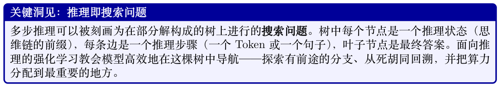
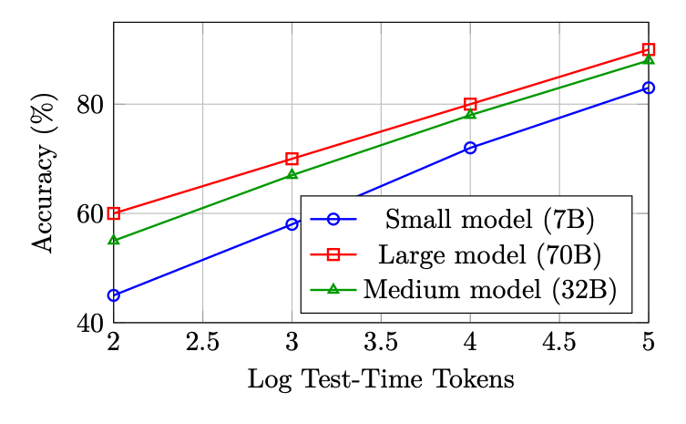
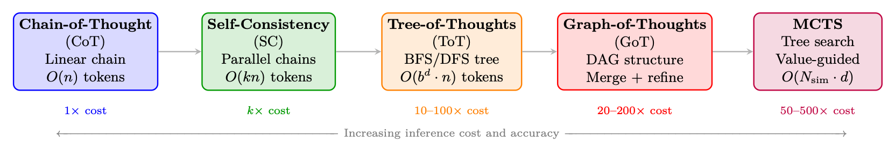
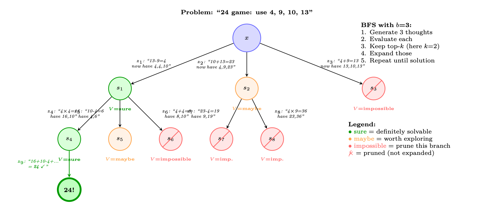
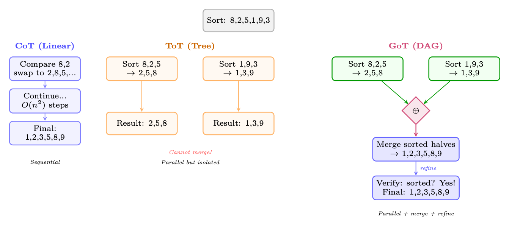
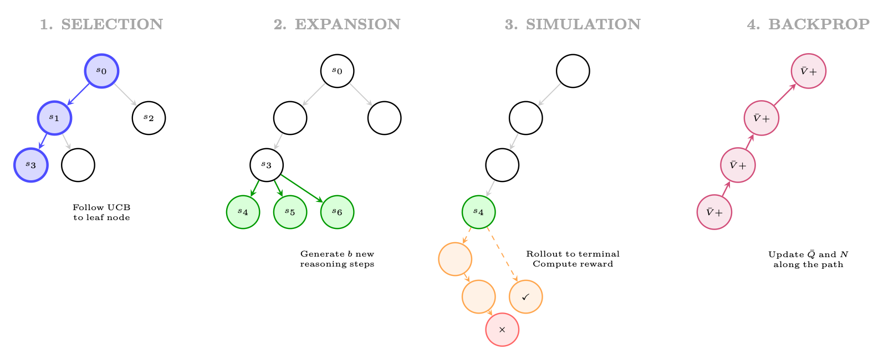
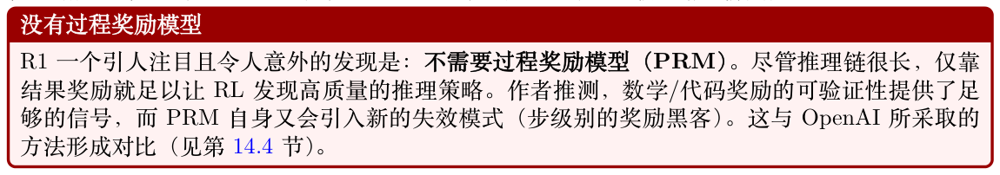
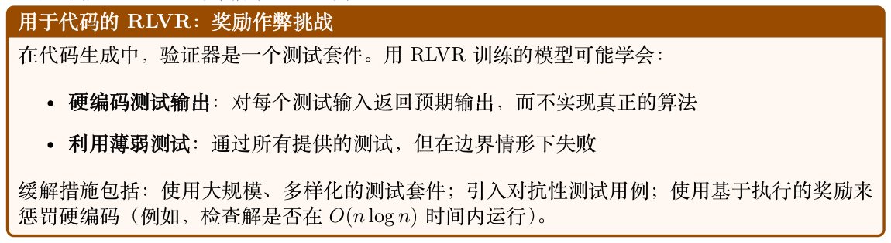

# 面向大型推理模型的强化学习

大型推理模型的出现是现代AI 最重要的进展之一。与优化下一个Token 预测的标准语言模型训练不同，面向推理的强化学习教会模型在回答之前先思考——在推理时分配额外算力以探索、验证并精炼中间步骤。本节系统地介绍支撑这一范式的方法、架构与扩展律。

## 14.1 动机与背景

### 14.1.1 为什么推理需要不同的强化学习方法

标准的基于人类反馈的强化学习（Reinforcement Learning from Human Feedback, RLHF）（见第

## 4.3 节）针对一段完整回答优化一个标量奖励。对于需要多步推理的任务——数学、形式化验证、竞

赛编程、科学推导——这种表述在以下几个方面不够充分：

- 稀疏奖励：一道数学题可能需要20 个中间步骤；单一的结果奖励无法为导致错误的中间步骤提供梯度信号。

- 长时序：推理链可能跨越数百到数千个Token，造成严重的信用分配问题。

- 组合搜索：有效推理路径的空间呈指数级膨胀；模型必须学会高效搜索这一空间。

- 可验证性：与主观的文本质量不同，数学与逻辑的正确性是可客观验证的，从而无需人工标注即可自动计算奖励。



### 14.1.2 思维链：涌现行为vs. 训练得到的能力

思维链（Chain-of-Thought，CoT）推理最初是在足够大的语言模型中被观察到的一种涌现能力[121]：当用逐步示例进行Prompt 时，大型模型（通常≥100B 参数）会自发地产生中间推理步骤，并由此提升准确率。这引出了一个基本问题：CoT 是规模带来的涌现性质，还是可以被显式训练？

正如DeepSeek-R1 及相关工作所表明的，答案是两者皆是——但有若干重要的微妙之处：

- 涌现的CoT 源于上下文学习并需要大型基础模型。它脆弱、对Prompt 敏感，且泛化不稳定。

- 通过RL 训练得到的CoT 让模型内在地把生成推理链作为生成过程的一部分，与提示风格无关。这些链条更长、更具探索性，并表现出质上不同的行为（自我纠正、回溯、验证）。

在对推理模型进行RL 训练时，DeepSeek 的研究者观察到一个引人注目的涌现行为：训练到某一阶段，模型开始在推理链中途自发地重新审视自己最初的思路，使用诸如“Wait, let me reconsider…”或“Actually, I think I made an error…”这样的措辞。这种自我纠正行为——并未被显式训练——纯粹由“最大化最终答案准确率”的RL 目标涌现而出。它表明RL 能够发现对求解难题工具性有用的元认知策略。

### 14.1.3 测试时计算的扩展律

推动推理模型研究的一个核心经验发现是：测试时算力与性能之间存在可预测的扩展关系。记Ctrain为训练算力（FLOPs），Ctest 为推理算力（生成的Token 数）。关键观察是：

Accuracy(Ctrain, Ctest) ≈f(α log Ctrain + β log Ctest) (14.1)

其中f 是某个单调函数，α, β > 0 为常数。这意味着：使用更多推理算力的较小模型可以匹敌使用较少推理算力的较大模型——这是算力与性能权衡的根本性转变。



**Figure 14.1: 测试时算力扩展曲线示意图。在各种模型规模下，性能随推理Token 数对数线性提升；较小模型在更多算力下可以逼近较大模型在更少算力下的表现。**

其实践含义深远：推理模型用推理算力换取训练算力。不必总是部署尽可能大的模型，而是可以部署一个具备推理能力的较小模型，并在难题上分配更多Token 用于“思考”。

## 14.2 测试时扩展方法

上述扩展律表明，在推理阶段投入更多算力可以显著提升推理性能。本节系统介绍将测试时扩展（Test-Time Scaling）落地的各类方法——从简单的思维链到复杂的树与图搜索算法。这些方法构成了一个用推理成本换取准确率的连续谱，理解其结构对于设计现代推理系统至关重要。

### 14.2.1 思维链（CoT）

思维链Prompt [121] 是所有测试时扩展方法的基础。模型不再直接输出答案，而是生成中间推理步骤，将复杂问题分解为可处理的子问题。

零样本CoT。Kojima 等[122] 证明，仅在Prompt 末尾追加“Let’s think step by step”就能在没有任何示例的情况下激发推理行为。这一简单触发器可以激活足够大模型（≥100B 参数）中的潜在推理能力。



**Figure 14.2: 测试时扩展方法的连续谱。每种方法都以额外的推理算力换取更高的推理准确率。各方法在概念上层层递进：CoT 引入显式推理，Self-Consistency 加入采样，ToT 引入结构化搜索，GoT 加入合并操作，而MCTS 加入学习到的价值引导。**

少样本CoT。Wei 等[121] 表明，提供少量带有显式推理轨迹的示例能够让较小的模型也有效地进行推理：Prompt = [(x1, z1, y1), (x2, z2, y2), . . . , (xk, zk, yk), (xtest, ?)] (14.2)

其中zi 是为示例(xi, yi) 手工编写的推理轨迹。

形式化刻画。CoT 将单步预测p(y|x) 转化为多步序列生成：

X p(y|x) = p(y|x, z) · p(z|x) ≈p(y|x, z∗) · p(z∗|x) (14.3) z

其中z∗= (z1, z2, . . . , zT ) 是贪心推理链。对所有可能链条求和是不可计算的；标准CoT 仅采用单一样本（贪心或温度采样）。

局限性。单链CoT 是脆弱的：一旦早期推理步骤出错，后续所有步骤都会建立在错误基础上，且没有任何恢复机制。

### 14.2.2 自洽性（多数投票）

自洽性（Self-Consistency）[123] 通过采样多条独立的推理链并对最终答案取多数投票，来缓解CoT单链脆弱的问题：

X N ˆy = arg max 1[yi = y], where (zi, yi) ∼p(·|x), T > 0 (14.4) y i=1

关键性质：

- 使用温度T > 0 的采样以产生多样的链条（通常T = 0.7–1.0）

- 链条之间无交互——完全可并行化

- 准确率随N 单调提升（N ≈40 之后收益递减）

- 在GSM8K 上：CoT = 56.5%，Self-Consistency（N=40）= 74.4%（使用PaLM-540B [220]）

- 等价于使用结果奖励的Best-of-N（多数投票充当隐式的ORM）


### 14.2.3 思维树（ToT）

思维树（Tree-of-Thoughts，ToT）[233] 将CoT 从线性链推广为树形结构，使模型能够探索多条推理路径、评估中间状态，并从前景不佳的分支回溯。这为推理过程引入了刻意的规划。

核心抽象。推理问题被分解为对一棵树的搜索，其中：

- 根节点：初始问题陈述x

- 节点：部分推理状态s = (x, z1, . . . , zk)

- 边：单个推理步骤（“想法”）zk+1

- 叶子：包含最终答案的完整解答

- 价值函数：V (s) 估计某个部分解的前景如何

形式化定义。

ToT = (G, E, V, πθ, Search) (14.5)

其中：

- G：想法生成器——产生b 个候选的下一想法：{z(1), . . . , z(b)} ∼πθ(·|s)

- E：状态评估器——为部分解打分：V (s) ∈{sure, maybe, impossible} 或V (s) ∈[0, 1]

- πθ：生成想法的语言模型

- Search：搜索算法（BFS 或DFS）



**Figure 14.3: 思维树在“24 点”任务上的运行：对4, 9, 10, 13 进行四则运算得到24。在每一层，模型生成b = 3 个候选想法，分别评估（sure/maybe/impossible），剪掉前景不佳的分支，并扩展最有希望的分支。绿色路径通向解答；红色路径在早期被剪枝。**

搜索算法。BFS（广度优先搜索）：

1. 为当前深度的每个节点生成b 个候选想法

2. 用V (·) 评估所有候选

3. 保留前k 个最有希望的状态（束搜索）

4. 将这k 个状态全部推进到下一层

5. 重复，直到找到解答或达到深度上限

#### DFS（深度优先搜索）：

1. 为当前状态生成b 个候选想法

2. 评估：若V (s) = impossible，立即回溯

3. 若V (s) = sure/maybe，向更深处递归（选择最有希望的一个）

4. 若达到深度上限仍未得到解答，则回溯

5. 继续直到找到解答或所有分支都被探索完

```
ToT：价值评估Prompt
# LLM 用于评估部分推理状态：
EVAL_PROMPT = """Evaluate if this partial solution can reach 24.
Numbers remaining: [4, 4, 10]
Steps so far: 13 - 9 = 4
Can these remaining numbers (4, 4, 10) be combined using +,-,*,/
to make 24?
Analysis: 4 * (10 - 4) = 4 * 6 = 24. Yes!
Judge: sure/maybe/impossible
Answer: sure"""
# 想法生成Prompt ：
GEN_PROMPT = """Input: 4 9 10 13
Possible next steps:
1. 13 - 9 = 4 (left: 4 4 10)
2. 10 + 13 = 23 (left: 4 9 23)
3. 9 - 4 = 5 (left: 5 10 13)
..."""
```

计算成本。对于分支因子为b、深度为d、束宽为k 的ToT：

LLM calls (BFS) = k · b + k · b = 2kb per level =⇒Total = 2kbd (14.6) |{z} |{z} generation evaluation

对于24 点游戏：b = 3, k = 2, d = 3 =⇒36 次LLM 调用，而标准CoT 仅需1 次。

结果。在24 点游戏（一个具挑战性的算术推理任务）上，ToT 达到74% 的成功率，而CoT 仅4%——在相同基础模型（GPT-4）之上，结构化搜索带来了巨大的提升。

### 14.2.4 思维图（GoT）

思维图（Graph-of-Thoughts，GoT）[234] 将ToT 从树推广到有向无环图（DAG），引入了一项关键能力：合并来自不同分支的部分解。这让模型可以把多条推理路径中的洞见综合到一个精炼的解答中。

关键操作。GoT 在ToT 之上引入了三种操作：

- Generate：从一个状态产生新的想法（与ToT 相同）

- Aggregate/Merge：把多个想法合并为一个更精炼的想法——这是树结构中不可能做到的

- Refine：基于反馈对一个想法进行迭代改进

- Score：评估想法的质量（与ToT 的价值函数相同）



**Figure 14.4: CoT（线性链）、ToT（树——只能分支不能合并）与GoT（DAG——分支可以合并）的对比。**

对于一个排序任务，GoT 可以把数组拆为子问题、独立（并行）求解，然后合并结果——在纯树结构中不可能做到。这使得分治式推理成为可能。

图操作（形式化）。设V = {v1, . . . , vn} 为想法节点，E ⊆V × V 为有向边。GoT 支持：

Generate(v) : v →{vc1, . . . , vcb} (创建子节点) (14.7)

Aggregate(v1, . . . , vk) →vmerged (将k 个想法合并为一个) (14.8) Refine(v, n) →v′ (通过n 次迭代改进v) (14.9)

Score(v) →s ∈[0, 1] (评估想法质量) (14.10)

Aggregate 操作是关键差异：它从多个父节点向单个子节点连边，从而形成DAG 而非树。这使得以下能力成为可能：

- 分治：拆分问题→并行求解子问题→合并解答

- 集成推理：生成多个视角，然后综合出最佳想法

- 迭代精炼：把评估结果反馈回去以改进早期想法

结果。在排序任务（一项需要合并的任务）上，GoT在质量相当时相比ToT 节省62% 成本。在集合求交与关键词计数任务上，由于合并操作支持更高效的分解，GoT 在相同质量下减少了30–40%的LLM 调用。

### 14.2.5 结合奖励模型的Best-of-N

Best-of-N 采样（Rejection Sampling）（BoN）[195, 235] 是最简单的扩展方法，它利用一个学习得到的奖励模型在候选中进行选择：

y∗= arg y∈{y1,...,yN} Rϕ(x, y), max yi ∼πθ(·|x) (14.11)

按奖励模型类型的变体：

- 结合ORM 的BoN：对完整解答打分，选择得分最高者。当ORM ≈正确性检查时等价于Self-Consistency。

- 结合PRM 的BoN：对每一推理步打分，选择最小步得分最高的解答（即在任何步骤上出错的可能性最小）。

- 加权BoN：按奖励对候选加权：y∗∼softmax(R(y1)/τ, . . . , R(yN)/τ)。

对于单样本准确率为p 的模型，N 次采样中至少有一个正确样本的概率为：

P(success with BoN) = 1 −(1 −p)N (14.12)

在完美奖励模型（总能正确选择的预言机）下：

- p = 0.3, N = 10：成功率= 97%

- p = 0.1, N = 50：成功率= 99.5%

在实践中，不完美的奖励模型会限制有效的N——超过N ≈64–256 后，奖励模型的误差开始主导，准确率趋于停滞甚至下降（奖励黑客）。

### 14.2.6 面向推理的蒙特卡洛树搜索（MCTS）

蒙特卡洛树搜索（MCTS）[19, 236] 将ToT 的结构化探索与学习到的价值估计及访问计数统计结合起来，从而最优地分配推理算力。MCTS 最初为博弈而设计（AlphaGo [19]），后被AlphaProof [237]、rStar [238] 等系统改造用于LLM 推理。

算法（针对LLM 推理改造）。每次MCTS 迭代包含四个阶段：



**Figure 14.5: 面向推理的MCTS 的四个阶段：(1) 选择：用UCB 遍历树以找到一个有前途的叶子节点；(2)扩展：从该叶子节点生成新的推理步骤；(3) 模拟：将推理补全到终止状态并进行评估；(4) 反向传播：沿路径更新价值估计。**

推理中的UCB。节点选择使用PUCT（Predictor + UCB applied to Trees）：" pP # b N(s, b) a∗= arg max Q(s, a) + cpuct · P(s, a) ·(14.13) a 1 + N(s, a)

其中P(s, a) = πθ(a|s) 是LLM 从状态s 生成步骤a 的先验概率。这使探索偏向LLM 本就认为可能的步骤，而UCB 项鼓励尝试探索不足的备选方案。

√问题：证明2 是无理数。

#### 第1 次迭代（Selection →根节点，Expansion）：

- 生成3 个候选的首步：

√

1. “Assume for contradiction that 2 = p/q in lowest terms.”（P = 0.7）√

2. “Consider the decimal expansion of 2 = 1.414...”（P = 0.15）

3. “Use the fundamental theorem of arithmetic.”（P = 0.10）

- 从z1 做Rollout：4 步内得到正确证明→r = 1.0

- 从z2 做Rollout：失败（小数展开不能证明无理性）→r = 0.0

- 反向传播：Q(s0, z1) = 1.0，N(s0, z1) = 1

√

- 从状态“Assume 2 = p/q...”进行扩展：

1. “Then 2 = p2/q2, so p2 = 2q2.”（P = 0.8）

2. “Then p and q share no common factors.”（P = 0.15）

- 从z4 做Rollout：正确续推→r = 1.0

- 反向传播：Q(s0, z1) = 1.0，Q(s1, z4) = 1.0

20次迭代之后：树已探索8 条不同的推理路径。访问次数最多的路径被选为最终证明：z1 →z4 → z6 →z8（基于奇偶性论证的经典反证法）。

**Table 14.1: 面向推理的Tree-of-Thoughts 与Monte Carlo Tree Search 对比。**

| 维度 | ToT | MCTS |
| --- | --- | --- |
| 价值估计 | LLM Prompt（“sure/maybe/impossible”） | 学习得到的价值网络+ Rollout 统计 |
| 探索方式 | 固定束宽；不回访 | UCB 自适应地把预算分配给有前途的节点 |
| 算力分配 | 各深度层均匀 | 聚焦：在更难的子问题上做更多模拟 |
| 训练集成 | 无训练；纯Prompt | 可将MCTS 策略蒸馏回基础模型[19] |
| 最适用于 | 分支简单的问题（24 点） | 需要深度探索的复杂问题（证明、代码） |
| 对比：ToT vs. MCTS。 |  |  |

### 14.2.7 推理步级的束搜索

束搜索——在NMT 与文本生成中长期作为标准方法——也可以在推理步层面而非Token 层面应用。我们不再跟踪前k 个Token 序列，而是跟踪前k 个推理前缀：

( ) X d Bd = top-k (s1, . . . , sd) : log πθ(si|s<i) + λ · Vϕ(s1, . . . , sd) (14.14) i=1其中评分将LLM 的对数概率（流畅性）与价值模型估计（正确性）相结合。这本质上是用学习到的价值函数取代提示式价值函数的ToT-BFS。

### 14.2.8 迭代精炼与自我纠正

与探索广度（多条并行链）不同，迭代精炼把算力投入到深度——反复改进同一个解答：

“Improve this solution:”, y(t), “Errors found:”, e(t) y(t+1) = LLM (14.15)

其中e(t) 可来自：

- 自我验证：让模型检查自己的答案

- 外部验证：运行代码、符号化地校验数学

- 评判模型：由一个独立模型识别错误

代表性方法：Self-Refine [239]（迭代自我反馈）、Reflexion [223]（通过存入记忆的反思实现的语言化RL）以及LATS [224]（树搜索+ 基于反思的剪枝）。

### 14.2.9 方法对比与选型指南

**Table 14.2: 测试时扩展方法的综合比较。**

| 方法 | 结构 | LLM 调用 可并行 需要RM？ | 最适用于 |
| --- | --- | --- | --- |
| CoT [121] | 链 | N/A 否 | 简单—中等难度问题 |
| Self-Consistency [123] | 并行链 并行链 | N ✓完全 否（多数投票） ✓完全 是（ORM） | 答案离散的数学题 有良好RM 的通用任务 |
| Best-of-N + ORM |  | N + 1 |  |
| Best-of-N + PRM | 并行链 | N + N·K ✓完全 是（PRM） | 复杂多步推理 |
| ToT [233] | 树（BFS/DFS） | O(kbd) 部分 LLM 作判官 部分 LLM 作判官 | 结构化搜索问题 可分解的问题 |
| GoT [234] | DAG | O(kbd) |  |
| MCTS [236] | 树+ 价值 | O(Nsim · d) 部分 是（价值网络） | 困难证明、编程 |
| Self-Refine [239] | 线性（迭代） | 2T 否 自我评判 | 开放式生成 |
| LATS [224] | 树+ 反思 | O(N · d) 部分 LLM 作判官 | Agent 任务 |
| 何时选用哪种方法 |  |  |  |
| • 预算< 5× 基础成本：使用CoT 或Self-Consistency。性价比最高。 |  |  |  |
| • 预算5–50×：使用结合PRM 的Best-of-N（若你有好的奖励模型）或b = 3, k = 2 的 |  |  |  |
| ToT-BFS。 |  |  |  |
| • 预算50–500×：使用配备已训练价值函数的MCTS。这正是DeepSeek-R1 与OpenAI o1 |  |  |  |
| 所处的区间——以长推理链实现的隐式树搜索。 |  |  |  |
| • 需要并行：Self-Consistency与Best-of-N 完全可并行；ToT/MCTS 需要顺序的深度扩展。 |  |  |  |
| • 无可用奖励模型：使用Self-Consistency（多数投票）或采用LLM 作判官评估的ToT。 |  |  |  |
| • 可分解的问题：当问题具有天然子问题时（排序、多文档综合、带模块的代码），GoT表现 |  |  |  |
| 出色。 |  |  |  |
| 推理模型中的隐式测试时扩展 |  |  |  |
| 现代推理模型（DeepSeek-R1 [15]、OpenAI o1/o3 [240, 241]）通过生成长思维链来执行隐式测试 |  |  |  |
| 时扩展。它们的“思考”Token起到了类似MCTS Rollout 的作用：模型探索多种思路、回溯（“Wait, |  |  |  |
| let me reconsider...”）、验证中间步骤，并在更难的子问题上分配更多Token。R1/o1 训练的关键洞 |  |  |  |
| 见是：GRPO/RL 让模型在一次生成内就执行这种隐式搜索，从而无需外部编排（ToT Prompt、 |  |  |  |
| MCTS 基础设施）。模型自身即成为搜索算法。 |  |  |  |

## 14.3 DeepSeek-R1

DeepSeek-R1 [15] 是首个在主要基准上达到或超越OpenAI o1 的完全开源大型推理模型。其训练流程在技术上完全透明，已成为基于RL 的推理的事实参考实现。

### 14.3.1 两阶段训练流程

阶段1：冷启动监督微调基础模型（DeepSeek-V3）首先在一个经过精心整理的小规模长思维链示例数据集上做微调。这个“冷启动”阶段服务于两个目的：

1. 格式初始化：模型学会在给出最终答案之前，以<think>...</think> 的格式输出推理。

2. 稳定性：若没有冷启动SFT，直接在基础模型上从零进行纯RL 会导致训练动力学不稳定与退化输出（例如混语、重复循环）。

冷启动数据集仅包含∼数千条样本，刻意保持较小规模，以避免过度约束RL 后续将发现的推理风格。

阶段2：基于GRPO 的强化学习冷启动SFT 之后，模型进入使用组相对策略优化（Group Relative Policy Optimization, GRPO）的大规模RL 阶段。R1 中使用的完整GRPO 目标见第14.3.3 节。

#### R1 训练流程总结

1. 基础模型：DeepSeek-V3（671B MoE，37B激活参数）

2. 冷启动SFT：∼数千条长CoT 样本，格式：<think>...</think><answer>...</answer>

3. RL 阶段：在数学与代码问题上使用带可验证奖励的GRPO

4. 拒绝采样（Rejection Sampling）：生成多个解答，保留正确的

5. 在RL 输出上做SFT：在高质量的RL 生成链上微调

6. 最终RL：用于对齐与有用性的第二轮RL

### 14.3.2 奖励设计：准确率奖励与格式奖励

R1的一个关键设计选择是不使用过程奖励模型（PRM）。取而代之，R1 使用两种简单且可自动计算的奖励：

准确率奖励对答案可验证的数学问题：( if verify(y, y∗) = True racc(y, y∗) = (14.16) otherwise

其中y 是模型的最终答案（从<answer> 标签中提取），y∗是真实答案。verify 函数使用符号数学比较（如SymPy）来处理等价形式。

对于代码问题，准确率奖励由通过测试用例决定：X rcode acc (y, T ) = 1[execute(y, t) = expected(t)] (14.17) |T | t∈T

格式奖励用于强制<think>...</think> 结构：( y 含有有效的<think> 与<answer> 标签rfmt(y) = (14.18)否则

组合奖励r(y, y∗) = racc(y, y∗) + λfmt · rfmt(y) (14.19)

在原始实现中λfmt = 0.1（足够小以不至于主导优化，足够大以防止格式崩塌）。



### 14.3.3 R1 中的GRPO 公式

GRPO [14] 是一种策略梯度方法，它通过对一组采样回答估计优势，从而避免训练独立的价值网络。

对于一个问题q，GRPO 从当前Policy πθ 采样G 个回答{y1, y2, . . . , yG}，并相对组均值计算优势。

分组采样与优势归一化给定问题q，采样G 个输出：

{yi}G i=1 ∼πθ(· | q) (14.20)

使用式[eq:r1_combined_reward] 的奖励函数计算Reward {ri}G i=1。第i 个回答的归一化优势为：

ˆAi = ri −µr (14.21) σr + ϵ q其中µr = 1 PG i=1 ri，σr = PG i=1(ri −µr)2，ϵ = 10−8 用于数值稳定。

G G GRPO 目标GRPO 目标对概率比做截断（与近端策略优化（Proximal Policy Optimization, PPO）相同），并对参考Policy πref 加上KL 惩罚：

" X G X |yi| LGRPO(θ) = −Eq∼D, {yi}∼πθ(·|q) G |yi| i=1 t=1 #   min ρi,t ˆAi, clip(ρi,t, 1−ε, 1+ε) ˆAi −β DKL[πθ ∥πref] (14.22)

其中：

πθ(yi,t | q, yi,<t)

- ρi,t = πθold(yi,t | q, yi,<t) 是逐Token 的概率比

- ε ∈{0.1, 0.2} 是PPO 的截断参数

- β > 0 控制KL 惩罚的强度

- |yi| 是第i 个回答的长度（长度归一化可防止偏向较短回答）

KL 惩罚的具体形式KL 散度项逐Token 计算：

  X |y| log πθ(yt | q, y<t) DKL[πθ ∥πref] = Ey∼πθ(·|q)   (14.23) πref(yt | q, y<t) t=1

在实践中，R1 使用一种KL 的无偏估计器，通过下列近似避免在每一步都计算πref：

DKL[πθ ∥πref] ≈πref(yt | q, y<t) πθ(yt | q, y<t) −log πref(yt | q, y<t) πθ(yt | q, y<t) −1 (14.24)

该估计器恒为非负，且当πθ = πref 时为零。

在R1 的训练中，每个问题采样G = 8 个回答。这是一个关键超参数：

- 过小（G = 2）：优势估计方差高，训练噪声大。

- 过大（G = 32）：计算成本线性增长，收益递减。

- G = 8：经验上在方差缩减与计算成本之间取得平衡。

分组采样还提供了天然的课程学习信号：随着训练推进，模型的平均奖励µr 上升，方差σr 下降。所有G 个回答全对（或全错）的问题贡献零梯度，从而自然地将学习聚焦于模型能力前沿的问题上。

### 14.3.4 蒸馏：R1-Distill 系列

R1 的一项重要实践贡献在于证明：推理能力可以通过在R1 生成链上进行监督微调蒸馏到小得多的模型中。R1-Distill 系列（1.5B、7B、8B、14B、32B、70B 参数）的训练方式为：

1. 使用R1（671B）为一个大规模问题集生成长CoT 解答

2. 过滤，仅保留正确的解答

3. 在这些解答上对较小的基础模型（Qwen2.5、Llama-3）进行微调

一个引人注目的发现：在小模型上，蒸馏胜过从零开始的RL 训练。DeepSeek-R1-Distill-Qwen-7B在MATH 基准上的得分高于直接用GRPO 训练的7B 模型。这表明：

- 小模型缺乏通过RL 探索去发现推理策略的能力

- 但它们可以学会模仿大模型发现的推理策略

- 小模型的瓶颈是探索，而非表示

蒸馏路径引出了一个关于推理本质的重要问题：小模型究竟是真的在“推理”，还是只是在对推理链的表面形式进行模式匹配？经验上，蒸馏模型对新颖问题类型表现出一定的泛化能力，提示其确实在某种程度上内化了推理策略，而非纯粹的记忆。

## 14.4 OpenAI o1/o3 系列

OpenAI 的o1 [240]（2024 年9 月发布）以及后续的o3/o4-mini [241] 模型代表了推理模型开发的商业前沿。尽管完整的技术细节仍属专有，但已公开的系统卡（system card）、技术报告和实证观察为理解其方法论提供了充足的线索。

### 14.4.1 带隐藏推理Token 的思维链RL

o1 最具标志性的架构选择是使用隐藏推理Token（hidden reasoning tokens）：模型生成一段不向用户展示的内部思维链（称为“推理轨迹（reasoning trace）”或“思考Token（thinking tokens）”）。

最终只返回答案本身。这一设计具有若干意涵：

- 无格式约束：隐藏推理可以使用任意格式，包括草稿纸式记法、伪代码，甚至非英文推理。

- 风格上无奖励作弊（reward hacking）：由于用户从未看到推理过程，模型没有为了“好看”而牺牲“有用”的压力。

- 专有保护：推理过程不被暴露，防止直接模仿。

训练流程被描述为“使用RL 训练模型进行推理”，其RL 目标作用于完整的（隐藏推理+ 最终答案）序列，奖励仅基于最终答案的质量。

### 14.4.2 过程奖励模型与结果奖励模型

OpenAI 的方法据信在结果奖励之外还使用了过程奖励模型（Process Reward Model, PRM）[242]，这与DeepSeek-R1 仅采用结果奖励的方式形成对比。这一推断基于OpenAI 已发表的PRM研究（PRM800K 数据集，”Let’s Verify Step by Step”）以及o1 系统卡中对推理链RL 训练的描述，尽管o1/o3 的精确训练配方并未公开披露。

结果奖励模型（ORM）结果奖励模型（Outcome Reward Model, ORM）对完整回复(q, y) 打分：

RORM(q, y) ∈[0, 1] (14.25)

对于可验证任务（数学、代码），它简化为精确匹配验证；对于开放式任务，则使用一个学习得到的奖励模型。

过程奖励模型（PRM）PRM 为推理链y = (s1, s2, . . . , sK) 中的每一个推理步骤sk 分配奖励：

X K γK−k · rk(q, s1, . . . , sk) RPRM(q, y) = (14.26) k=1其中rk ∈[0, 1] 是步骤级奖励，γ ∈(0, 1] 是折扣因子。步骤级奖励rk 估计部分解(s1, . . . , sk) 能够导向正确最终答案的概率：

rk(q, s1, . . . , sk) = P(correct final answer | q, s1, . . . , sk) (14.27)

#### PRM 与ORM：信用分配的权衡

误步骤，所获得的零奖励与完全随机的回复并无区别。

#### PRM 提供稠密奖励以直接处理信用分配，但也引入了新的挑战：

- 训练数据：步骤级标签需要人工标注或自动化生成（Math-Shepherd，见14.6.2 节）。

- 奖励作弊：模型可能学会产生在PRM 眼中看起来正确、但实际上并不正确的步骤。

- 分布漂移：在某一推理链分布上训练的PRM 可能无法泛化到RL 产生的新颖推理链。

经验证据表明，PRM 对搜索（在候选解中选择）是有益的，但对训练的收益则不那么明确。

### 14.4.3 推理时计算扩展

o1技术报告展示了一条清晰的扩展律：在困难推理任务上，更多的思考Token 单调地提升性能。这通过一个控制隐藏推理Token 数量上限的“思考预算（thinking budget）”参数得以实现。

设T 为思考Token 预算。经验上观察到的扩展律近似为：

Pass@1(T) ≈a −b · T −c (14.28)

其中a, b, c > 0 为常数，a 表示渐近准确率上限，c 刻画提升速率。在AIME 2024 上，配备完整思考预算的o1 达到约83% 的准确率，而未使用扩展思考的GPT-4o 仅约13%。

### 14.4.4 训练计算量与测试时计算量

o1/o3 系列带来的一个根本性洞见是计算等价原理（compute equivalence principle）：训练计算量Ctrain 与测试时计算量Ctest 之间存在一条权衡曲线，曲线上的各点能够达到相近的性能：

Performance(Ctrain, Ctest) = g(αCp train + βCq test) (14.29)

经验上，对于推理任务p ≈q，这意味着训练计算量与测试时计算量大致可互相替代。这对部署有深远影响：一个更小、更便宜但拥有扩展思考能力的模型，可以在困难问题上匹敌更大的模型，代价是更高的延迟。

### 14.4.5 o3 与o4-mini 的架构洞察

尽管o3 和o4-mini 的细节大多仍属专有，但已经浮现出一些观察：

- o3：思考预算显著大于o1；在ARC-AGI 上达到接近人类的表现（高算力下87.5%）。据信在推理时使用了更复杂的搜索策略。

- o4-mini：证明了经过RL 训练推理能力的更小模型同样极具竞争力。在AIME 2025 上配合扩展思考达到93%，表明在数学任务上模型规模的重要性不及推理能力。

- 工具调用（Tool Calling）：o3/o4-mini将工具调用（代码执行、网络搜索）集成到推理过程中，使模型能够以程序化方式验证中间步骤。

## 14.5 QwQ 与Qwen 推理模型

阿里巴巴Qwen 团队开发了一系列推理模型（QwQ-32B [243]、Qwen3 [244]），与DeepSeek-R1 一同代表了开源前沿。其方法在若干关键方面有所不同。

### 14.5.1 多阶段RL 流水线

Qwen 的推理流水线采用了更精细的多阶段方法：

1. 基础预训练：具备强大数学与编码能力的Qwen2.5 基础模型

2. 多样推理任务上的SFT：在涵盖广泛推理任务（数学、代码、科学、逻辑）的混合数据上进行监督微调（Supervised Fine-Tuning, SFT）

3. 拒绝采样微调（Rejection Sampling Fine-Tuning, RFT）：对每个问题生成N 个解，保留正确的解，再进行微调

4. RL 第一阶段：在数学和代码上使用可验证奖励的组相对策略优化（Group Relative Policy Optimization, GRPO）

5. RL 第二阶段：更广泛的RL，包括指令遵循与安全

### 14.5.2 拒绝采样与RL 的结合

#### Qwen 方法的一项关键创新是拒绝采样与RL 的迭代结合：

1. 初始化：以SFT 模型作为Policy π0。

2. 拒绝采样（Rejection Sampling）：采样N 个解{yi}N i=1 ∼πk−1(· | q)，保留正确的解Y+(q) = {yi : r(yi, y∗) = 1}。

←SFT(πk−1, S

3. SFT 更新：πSFT q Y+(q)) k

4. RL 更新：πk ←GRPO(πSFT , D) k

5. 重复步骤2–4 共K 次迭代，得到最终Policy πK。

拒绝采样步骤提供高质量的正样本来锚定Policy，而RL 则在当前分布之外进行探索。这种组合比纯RL 更稳定，又比纯SFT 更有能力。

### 14.5.3 工具集成推理

QwQ-32B 与Qwen3 模型支持工具集成推理（tool-integrated reasoning）：模型可以在其推理链中调用外部工具（Python 解释器、搜索引擎、计算器）。这通过特殊Token 实现：

```
<think>
Let me solve this step by step.
First, I'll compute the eigenvalues of the matrix.
<tool_call >
{"name": "python", "arguments": {"code": "import numpy as np\nA = np.array
([[2,1],[1,3]])\neigenvalues = np.linalg.eigvals(A)\nprint(eigenvalues)"}}
</tool_call >
<tool_response >
[1.38196601 3.61803399]
</tool_response >
The eigenvalues are approximately 1.382 and 3.618.
These are (5 +/- sqrt5)/2, which are the golden ratio and its conjugate...
</think>
<answer >The eigenvalues are (5 +/- sqrt5)/2</answer >
```

RL 训练奖励基于最终答案计算，但模型会学会策略性地使用工具，因为工具调用能提升得到正确答案的概率。

## 14.6 关键方法及其数学基础

### 14.6.1 用于推理的蒙特卡洛树搜索

蒙特卡洛树搜索（Monte Carlo Tree Search, MCTS）为将推理视作树搜索提供了一个有原则的框架。在AlphaProof [237] 等相关系统中，MCTS 作用于推理步骤而非棋类走子。

状态与动作空间

- 状态sk：部分推理链(q, r1, r2, . . . , rk)，其中ri 为推理步骤

- 动作a：下一个推理步骤（一句话或一段话）

- 终止状态：包含最终答案的状态

- 奖励：R(sterminal) = racc（见公式[eq:r1_accuracy_reward]）

部分解的价值函数价值函数V (sk) 估计从部分状态sk 出发达到正确答案的概率：

V (sk) = P(correct answer | sk) ≈1 X M R(rolloutm(sk)) (14.30) M m=1

其中rolloutm(sk) 是从sk 出发、使用当前Policy 走到终止状态的一次蒙特卡洛rollout。

UCB 探索节点选择使用为推理场景改编的置信上界（Upper Confidence Bound, UCB）公式：

p N(sk) UCB(sk, a) = Q(sk, a) + cpuct · πθ(a | sk) ·(14.31) 1 + N(sk, a)

其中：

P

- Q(sk, a) = visits V (sk+1) 为子状态的平均价值N(sk,a)

- πθ(a | sk) 为Policy 先验（语言模型对步骤a 的概率）

- N(sk) 为状态sk 的访问次数

- N(sk, a) 为边(sk, a) 的访问次数

- cpuct 为探索常数

MCTS 引导的训练MCTS 可被用于生成高质量训练数据：

X X LMCTS(θ) = − πMCTS(a | sk) log πθ(a | sk) (14.32) k a

其中πMCTS(a | sk) ∝N(sk, a)1/τ 是MCTS Policy（带温度τ 的访问计数分布）。

### 14.6.2 过程奖励模型

Math-Shepherd：自动化PRM 训练Math-Shepherd [245] 提出了一种无需人工步骤级标注、自动训练PRM 的方法。其核心洞见是使用基于结果的估计（outcome-based estimation）：如果存在从sk 出发的某一补全能够到达正确答案，则将步骤sk 标注为正确。

形式化地，对于部分解(s1, . . . , sk)：

ˆrk = 1[∃(sk+1, . . . , sK) : verify(sK, y∗) = 1] (14.33)在实践中，这通过从sk 采样M 个补全并检查是否有任何一个正确来估计：" M # X ˆrk ≈1 verify(completem(sk), y∗) > 0 (14.34) m=1

随后用二元交叉熵训练PRM：

X K LPRM(ϕ) = − [ˆrk log rϕ(sk) + (1 −ˆrk) log(1 −rϕ(sk))] (14.35) k=1

用PRM 进行Best-of-N 选择PRM 的一个主要应用是Best-of-N 选择：生成N 个候选解，选择PRM 分数最高的那一个：y∗= arg y∈{y1,...,yN} RPRM(q, y) max (14.36)

这比（使用ORM 的）多数投票更有效，因为PRM 能够区分通过不同质量推理路径达到相同答案的解。

### 14.6.3 结果奖励模型与多数投票

多数投票（自洽性，Self-Consistency）测试时扩展（Test-Time Scaling）最简单的形式是多数投票[123]：生成N 个解并返回最常见的答案：

X N y∗= arg max 1[yi = a] (14.37) a i=1

在每个解独立正确概率为p > 0.5 的假设下，多数投票正确的概率为：

!

P(majority correct) = X N N pk(1 −p)N−k N→∞ −−−−→1 (14.38) k k=⌈N/2⌉

用ORM 加权的多数投票ORM 可以通过按置信度加权来改进多数投票：

X N y∗= arg max RORM(q, yi) · 1[yi = a] (14.39) a i=1

### 14.6.4 用于推理的自博弈

自博弈（self-play）方法让模型同时扮演生成器和验证器两种角色，从而生成训练数据。

STaR：自学推理者（Self-Taught Reasoner）STaR [222] 通过迭代方式自举推理能力：

1. 为问题集生成推理链

2. 保留导向正确答案的推理链（拒绝采样）

3. 在保留的推理链上微调

4. 用改进后的模型重复上述过程

其核心洞见是模型可以为正确答案进行合理化（rationalize）：即便它无法从零开始解决一个问题，给定答案后它仍能生成一条合理的推理链，这条推理链可作为训练数据。

自博弈RL在用于推理的自博弈RL 中，模型同时生成问题与解答：

Lself-play(θ) = Eq∼πgen θ Ey∼πsolve (·|q) [r(y, y∗)] (14.40) θ其中πgen生成问题，πsolve解答它们。生成器因产生具有挑战性但可解的问题而获得奖励。

θ θ

### 14.6.5 可验证奖励的强化学习（RLVR）

可验证奖励的强化学习（Reinforcement Learning from Verifiable Rewards, RLVR）[246] 是一个使用真值验证（ground-truth verification）作为奖励信号的框架，适用于任何可以自动检查正确性的领域。

可验证领域

- 数学：通过SymPy、Lean 或Isabelle 进行符号验证

- 代码：单元测试执行

- 形式逻辑：证明检查

- 事实问答：数据库查找

- 游戏：胜负结果

LRLVR(θ) = −E(q,y∗)∼DEy∼πθ(·|q) [verify(y, y∗)] + βDKL[πθ ∥πref] (14.41)

RLVR 相对于基于人类反馈的强化学习（Reinforcement Learning from Human Feedback, RLHF）的关键优势在于不存在奖励模型误差：由于奖励由确定性验证器而非学习得到的模型计算，因此不存在针对有缺陷奖励模型的奖励作弊。唯一的失败模式是模型找到了能通过验证、但并非真正正确的解（例如，利用代码评估中测试用例的弱点）。



### 14.6.6 旅程学习（Journey Learning）

旅程学习（Journey Learning）[247] 主张在完整推理轨迹上训练，包括失败的尝试和纠正，而不仅仅是成功的最终解。

动机标准的拒绝采样会丢弃失败尝试。但失败尝试包含有价值的信息：

- 哪些方法行不通（负样本）

- 如何识别错误并从中恢复（纠正模式）

- 问题空间的结构（探索数据）

Journey Learning目标给定一条可能包含回溯的轨迹τ = (s0, a0, s1, a1, . . . , sT )：

X T Ljourney(θ) = − wt log πθ(at | st) (14.42) t=0其中权重wt 被设计为强调：

- 最终导向成功的步骤（wt > 1）

- 错误之后的纠正步骤（wt > 1）

- 失败分支中的步骤（wt < 1，但> 0）

### 14.6.7 Quiet-STaR：在每个Token 上推理

Quiet-STaR [229] 将推理范式扩展到每一个Token 位置：模型不仅在最终答案之前生成一条推理链，而是在每个Token 位置都生成一段“思考（thought）”。

形式化对于每个Token 位置t，模型在预测下一个Token xt+1 之前先生成一段隐藏思考zt：

P(xt+1 | x≤t) = Ezt∼πθ(·|x≤t) [πθ(xt+1 | x≤t, zt)] (14.43)

在实践中，这通过混合带思考与不带思考的预测来近似：

P(xt+1 | x≤t) = α · πθ(xt+1 | x≤t, zt) + (1 −α) · πθ(xt+1 | x≤t) (14.44)

使用REINFORCE 训练由于思考zt 是离散潜变量，梯度使用REINFORCE 估计：

∇θLQS = Ezt [∇θ log πθ(zt | x≤t) · (log P(xt+1 | x≤t, zt) −bt)] (14.45)

其中bt 为基线（例如无思考预测log πθ(xt+1 | x≤t)）。


## 14.7 推理的扩展律

近期工作[248, 249] 已经证实测试时计算量与推理性能之间存在可预测的扩展关系，将经典扩展律[250] 延伸到了推理阶段。

### 14.7.1 训练计算量与测试时计算量的权衡

推理模型的根本性扩展问题是：给定固定的总计算预算Ctotal = Ctrain + N · Ctest（其中N 为查询数量），应如何分配计算？

设A(Ctrain, Ctest) 表示用Ctrain FLOPs 训练、每个查询给定Ctest 推理FLOPs 的模型准确率。

经验上：

  A(Ctrain, Ctest) ≈1 −exp −a · Cα train · Cβ (14.46) test

其中a, α, β > 0 为常数。对于固定总预算Ctotal，最优分配满足训练与推理之间每FLOP 的边际回报相等的条件：∂A = 1 ∂A N ·(14.47) ∂Ctrain ∂Ctest

直觉上：一个FLOP 的训练计算惠及全部N 个查询，而一个FLOP 的测试时计算只惠及单个查询。在最优点，测试时计算的单查询边际价值是训练计算的N 倍（因为训练成本被摊销）。将此应用于公式[eq:reasoning_scaling_law] 可得到最优训练计算占比：

C∗ α train = (14.48) Ctotal α + β

对于特定预算结构Ctotal = Ctrain + N · Ctest，在乘性准确率模型下该占比与N 无关。然而在实际中α 和β 是问题相关的：对于高流量部署（大N），即便基础模型的微小提升也会占主导，倾向于训练投入；对于低流量、高价值的查询（小N），测试时计算则更具成本效益。

### 14.7.2 何时投资于更长推理链vs. 更好的基础模型

推理链长度与模型容量

对于容量为C 的模型在难度为D 的问题上，最优推理链长度L∗满足：

L∗∝D (14.49) Cγ

其中γ > 0。这意味着：

- 困难问题无论模型规模如何都需要更长的推理链

- 在相同问题难度下，更大的模型需要更短的推理链

- 收益递减：超过L∗后，额外的Token 不再带来收益，反而可能有害（过度思考）

“过度思考（overthinking）”现象——拥有极长推理链的模型反而比拥有适中推理链的模型表现更差——已被经验观察到，归因于：

- 长推理链中错误的累积（误差传播）

- 偏离主解路径的干扰

- 对错误中间结论的过度自信

### 14.7.3 最优Token 预算分配

对于给定Token 预算B 的模型，“思考”Token Tthink 与“作答”Token Tanswer 之间的分配应满足：

T ∗ think = arg max A(T, B −T) (14.50) T

经验上，最优划分是问题相关的：

- 简单问题：T ∗ think/B ≈0.3（30% 思考）

- 困难问题：T ∗ think/B ≈0.8（80% 思考）

- 极困难问题：T ∗ think/B ≈0.95（95% 思考，极简作答）

这促成了自适应思考预算（adaptive thinking budgets）：为更难的问题分配更多Token，难度可由模型在初次解题尝试中的不确定度来估计。

## 14.8 推理模型比较

**Table 14.3: 推理模型训练方法对比。**

| 方法 | PRM | ORM | MCTS | 蒸馏 | 工具 | 开源 |
| --- | --- | --- | --- | --- | --- | --- |
| OpenAI o1/o3 | ✓ | ✓ | 未知 | – | ✓ | × |
| DeepSeek-R1 | × | ✓ | × | ✓ | × | ✓ |
| QwQ / Qwen3 | 部分 | ✓ | × | × | ✓ | ✓ |
| AlphaProof | ✓ | ✓ | ✓ | – | ✓ | × |
| Math-Shepherd | ✓ | ✓ | × | – | × | ✓ |
| STaR / Quiet-STaR | × | ✓ | × | – | × | ✓ |

## 14.9 总结与开放问题

RL 用于推理模型的领域进展极为迅速。已经浮现出若干关键经验：

1. 可验证奖励已经足够：对于具备真值验证的领域（数学、代码），仅靠结果奖励就足以让RL发现复杂的推理策略，无需过程奖励模型。

2. 测试时计算是一个新维度：推理模型引入了新的扩展维度——推理计算——在困难推理任务上它与训练计算大致可互相替代。

3. 蒸馏极为有效：大型推理模型可以通过对生成推理链进行监督微调，将能力迁移到小得多的模型上，往往优于对小模型直接进行RL 训练。

4. 涌现的元认知：在推理任务上的RL 训练会涌现出未被显式训练的自我纠正与验证行为。

若干根本性问题仍待回答：

- 泛化：在数学/代码上训练得到的推理能力，能否迁移到其他领域（科学推理、规划、社会推理）？

- 忠实性（Faithfulness）：生成的推理链对最终答案是因果性负责的，还是事后合理化？

- 最优搜索：推理时的最优搜索策略是什么——束搜索（beam search）、MCTS，还是其他？

- 奖励设计：对于没有真值验证器的领域，如何为推理设计可靠的奖励信号？

- 过度思考：模型如何学会分配恰当的思考量——既不过少也不过多？

- 组合式推理：经过RL 训练的推理模型能否解决需要组合多种不同推理技能的问题？

推理模型的发展代表了一次范式转变：从知道事情的语言模型，转向能够推演事情的语言模型。

本节所描述的RL 方法是驱动这一转变的主要引擎，它们的持续发展很可能成为未来数年AI 研究的中心焦点。
