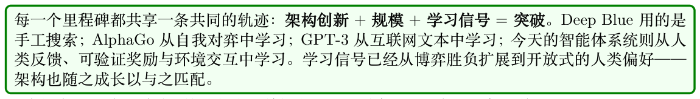

# 引言

宏观图景

本指南将带你从第一原理走到生产系统。它面向想要理解并构建现代AI 完整技术栈的从业者——研究者、工程师与应用科学家：从Transformer 架构与运行它们的硬件，到使模型与人类意图对齐并教会它们推理的训练算法，再到把模型作为自主系统部署出去的智能体架构。

核心论点很简单：构建优秀的AI 系统需要理解整条流水线，而不仅是某一层。调试训练过程的工程师需要理解GPU 显存层级与优化器动力学。做微调的从业者要知道何时LoRA 已足够、何时全参数训练值得这个成本。Agent 开发者需要理解底层模型是如何训练出来的。评估框架的技术负责人需要理解每个框架做出了怎样的权衡。本指南提供这幅完整的图景。

通往智能体AI 之路：一段简史

今天的智能体AI 系统并非凭空出现。它们站立在数十年间一系列里程碑式系统之上——每一个都解决了一个更窄的问题，但它们共同积累起的技术、硬件与雄心，最终让自主智能体成为可能。

1. Deep Blue（1997）[16]——IBM 的象棋引擎以暴力搜索（每秒2 亿个局面）配合手工评估函数，击败了世界冠军Garry Kasparov。它证明了机器在边界清晰的对抗性领域可以超越人类，但无法泛化到其他任何任务。

2. IBM Watson ——Jeopardy!（2011）[17]——Watson 结合了信息检索、NLP 与大规模并行，在开放领域问答中战胜人类冠军。它表明AI 能够在规模上处理非结构化文本，但需要多年针对领域的工程，且如果没有大量人力，便无法学习新领域。

3. AlexNet 与深度学习革命（2012）[18]——Krizhevsky 等人的CNN 在ImageNet 上以惊人的领先优势夺冠，证明了在GPU 上训练的深度神经网络可以从原始数据中学到表征。仅此一个结果便引爆了现代深度学习时代，以及最终让LLM 成为可能的硬件投入。

4. AlphaGo（2016）[19]——DeepMind 的系统用深度RL（policy 网络+ value 网络+ 蒙特卡洛树搜索）击败了围棋世界冠军Lee Sedol。与Deep Blue 的暴力搜索不同，AlphaGo 是学会下棋的——证明了RL 能够攻克仅靠搜索无法处理的领域（10170 个棋盘状态）。随后AlphaGo

Zero（2017）[20] 完全通过自我对弈学习，根本不需要任何人类棋谱。

5. GPT-2/GPT-3（2019–2020）[21]——OpenAI 表明，把decoder-only Transformer 扩展到数十亿参数会涌现出few-shot learning 能力。GPT-3（175B 参数）仅凭上下文示例，就能完成它从未被显式训练过的任务——翻译、算术、代码生成。基础模型的时代由此开始。

6. AlphaFold（2020）[22]——DeepMind 解决了悬而未决50 年的蛋白质折叠问题，以原子级精度预测蛋白质3D 结构。AlphaFold 证明了深度学习能够攻克此前被认为距离我们还有数十年的根本性科学难题，同时也展示了“架构创新（在残基对上做attention）+ 大规模算力”组合的威力。

7. ChatGPT 与RLHF（2022）[9]——InstructGPT/ChatGPT 证明：一个有能力的base 模型，在经过RLHF 对齐后，会变成真正有用的助手。这是一个拐点：AI 从研究工具变成了被亿万用户使用的消费产品。其对齐技术（reward 模型、PPO）成为此后所有LLM 后训练的模板。

8. GPT-4 与多模态模型（2023）[23]——多模态能力（视觉+ 语言）、更长的上下文与更强的推理能力，把LLM 推向通用认知。工具使用（代码解释器、浏览网页）已经初见智能体能力的端倪。

9. 推理模型（2024）[15]——OpenAI 的o1 与DeepSeek-R1 表明，仅依靠reward 信号，RL 就能教会模型推理：思维链、回溯与自我验证自发地涌现。模型开始攻克竞赛级数学题与复杂编码任务。

10. 智能体AI（2025 至今）——汇合点到来：具备推理能力的LLM，配上标准化工具访问（MCP）、智能体间通信（A2A）、持久化记忆与成熟的编排框架。Agent 现在能够自主编写代码、开展研究、管理工作流，并与其他Agent 协作——正是本指南的主题。

你将看到什么

第一部分：基础（第1–3 章）搭建本指南其余部分所依赖的基础知识。我们从LLM 在内部如何工作开始——决定能力的架构决策——然后覆盖让训练与推理成为可能的硬件与系统，最后从第一原理引入强化学习。

- 第1 章——LLM 架构与优化：Transformer 内部机制（self-attention、multi-head attention、RoPE、GQA）、FlashAttention、优化方法（AdamW、学习率调度、梯度裁剪）、混合精度、LoRA/QLoRA、量化、知识蒸馏与Mixture of Experts。

- 第2 章——系统基础：GPU 架构（A100/H100/B200）、内存层级、NVLink/NVSwitch、分布式训练（FSDP、DeepSpeed ZeRO、张量/流水线并行），以及用于高吞吐推理的vLLM。

- 第3 章——RL 简介：MDP、Bellman 方程、TD 学习、Q-learning、policy gradient（REIN- FORCE）、actor-critic 方法、GAE——支撑第二部分的算法工具箱。

第二部分：面向LLM 的RL 方法（第4–12 章）是训练与对齐的核心。在这里你会学到如何对齐、改进与微调语言模型——从完整的数学推导到可运行的代码。

- 第4–8 章：每一个主流RL / 偏好算法都配有数学推导、直觉解释与TRL 代码——PPO、DPO、GRPO，以及偏好优化变体（Online DPO、KTO、IPO、ORPO、SimPO、Best-of-N）。

- 第9–10 章：Reward 模型训练（Bradley-Terry、scaling laws、reward hacking）与SFT 最佳实践（数据质量、课程学习、格式化）。

- 第11–12 章：大规模系统架构（解耦训练、容错、GPU 分配）与LLM 智能体训练——如何用轨迹级RL 端到端训练Agent。

第三部分：推理（第13 章）覆盖模型能力的前沿——教LLM 解决多步问题。

- 第13 章——大型推理模型的RL：DeepSeek-R1、OpenAI o1/o3/o4-mini、QwQ——RL 如何发现思维链、MCTS、过程奖励模型与测试时算力扩展。

第四部分：评估（第14 章）提供测量“上面这些是否真的有效”的方法论。

- 第14 章——LLM 评估：指标（perplexity、pass@k、ELO）、LLM-as-Judge 模式、污染检测、基准套件，以及智能体评估方法论。

第五部分：智能体AI（第15–26 章）带你从一个训练好的模型走向一个被部署出去的自主系统。

这是篇幅最大的部分，覆盖了一个Agent 在真实世界中运作所需的一切。

- 第15 章——智能体AI 简介：是什么让一个系统具备“智能体性”，从聊天机器人到自主Agent的光谱，以及第五部分余下章节所需的基础概念。

- 第16 章——RAG：检索方法、分块、Embedding 模型、混合检索、重排，以及生产架构。

- 第17 章——记忆系统：用于Agent 持久知识的工作记忆、情景记忆、语义记忆与程序性记忆。

- 第18 章——编排：ReAct、Plan-and-Execute、LLM Compiler、reflexion 模式、上下文管理与harness 设计。

- 第19 章——设计模式：prompt chaining、路由、并行化、评估驱动的编排，以及“简洁性原则”。

- 第20 章——环境与基准：WebArena、SWE-bench、OSWorld、GAIA——评估智能体能力的环境。

- 第21 章——Model Context Protocol (MCP)：架构、传输层，tool/resource/prompt 原语、安全与部署。

- 第22 章——Agent Skills：技能库、工具组合与能力抽象。

- 第23 章——A2A 通信：Google 的Agent-to-Agent 协议——Agent Cards、任务生命周期、流式通信与企业级模式。

- 第24 章——多智能体系统：层级式、辩论式、市场式与群体式架构——大规模协作。

- 第25 章——开发框架：LangGraph、CrewAI、AutoGen、OpenAI Agents SDK、Google ADK

- —附代码的对比分析。

- 第26 章——智能体UI：流式界面、生成式UI、canvas 范式、工具可视化与人机协同（Human-in-the-Loop）模式。

现代AI 流水线

从base 模型到部署Agent 的完整流水线：

**Figure 1: 现代LLM 开发流水线：从预训练base 模型，经由对齐与推理，走向自主的智能体能力（The modern LLM development pipeline: from pre-trained base model through alignment and reasoning to autonomous agentic capability）。每一阶段对应本指南的一个部分。**
