# LLM 评估

评估是任何严谨机器学习流水线的支柱，但它或许是大语言模型开发中最被低估的组成部分。与经典的监督学习不同——在那里，一个带有真实标签的留出测试集就能提供干净的信号——评估LLM需要应对开放式生成、主观质量判断、多步推理链，以及无处不在的基准污染风险。本节系统性地梳理评估领域的全景：从评估类型的分类法、人工标注的机制，到排序指标的数学原理、LLM-as-Judge的实操要点，再到那些悄无声息地腐蚀评估流水线的陷阱。

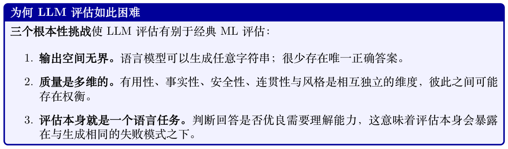

## 15.1 评估方案设计

在收集任何一个数据点之前，从业者必须先决定要测量什么以及如何测量。一套有原则的分类法能避免一个常见错误：仅凭便利性而非与部署目标的对齐性来选择指标。

### 15.1.1 评估类型分类法

内在评估与外在评估（Intrinsic vs. Extrinsic）。内在（Intrinsic）评估孤立地度量模型输出的性质，不参照下游应用。留出语料上的困惑度、相对参考译文的BLEU 分数、编码基准上的pass@k，都属于内在评估。外在（Extrinsic）评估则度量模型对真实任务或系统的影响：将LLM 接入客服流水线后，工单升级率是否下降？编码助手是否提升了开发者的开发速度？


自动评估与人工评估（Automatic vs. Human）。自动评估使用确定性函数（BLEU、精确匹配）或学习得到的模型（BERTScore、LLM-as-Judge），无需人工参与即可对输出打分。人工评估则由标注者对模型输出进行打分或排序。表15.1 总结了二者的权衡。

基于参考与无参考评估（Reference-Based vs. Reference-Free）。基于参考的指标（BLEU、ROUGE、BERTScore）将模型输出与一个或多个金标准参考进行比较。无参考指标（困惑度、LLM- as-Judge、人类偏好）则无需参考即可评估质量。当输出空间过大、无法穷尽收集参考时（例如开放式对话），无参考方法是必不可少的。

**Table 15.1: 评估方法分类法及其关键权衡。**

| 类型 | 成本 | 速度 | 可复现性 | 效度 |
| --- | --- | --- | --- | --- |
| 自动（基于规则） | 极低 | 极快 | 完美 | 低–中 |
| 自动（基于模型） | 低 | 快 | 高 | 中–高 |
| 众包人工 | 中 | 数天 | 中 | 中 |
| 专家人工 | 高 | 数周 | 低–中 | 高 |
| 外在/ A/B 测试 | 极高 | 数月 | 低 | 极高 |

### 15.1.2 何时使用何种方法

对话助手的评估策略

开发阶段：使用自动指标（困惑度、摘要子任务上的ROUGE、工具调用上的pass@k）进行快速迭代。每晚在标准评测套件（MMLU、HellaSwag、HumanEval）上运行基准测试。

发布前阶段：开展人类偏好研究，将新模型与上一个检查点对比。在多样化的Prompt 集合上使用LLM-as-Judge 进行可扩展的成对比较。

发布后阶段：监控外在指标（用户满意度分数、任务完成率），并留意生产Prompt 中的分布漂移。

一个实用的决策框架：

- 若任务有明确正确答案（数学、代码、事实型问答）：使用精确匹配或基于执行的指标。

- 若任务是开放式的但存在参考输出：使用基于参考的指标作为下界，并辅以LLM-as-Judge。

- 若任务是主观的（有用性、语气、创造性）：使用人工评估或经过良好校准的LLM 评判者。

- 若任务涉及多步Agent 行为：使用任务成功率与轨迹效率（见第15.6 节）。

## 15.2 评估数据采集

高质量的评估数据是可信基准的基础。本节涵盖人工标注流水线的设计、标注质量的统计度量，以及在众包与专家标注之间如何取舍。

### 15.2.1 人工标注流水线

一条健壮的标注流水线包含五个阶段：

1. 任务定义。精确说明标注任务：评分对象是什么、采用何种量表、依据哪些标准。此阶段的歧义会传导为带噪标签。

2. 规范编写。撰写标注规范，并配以覆盖边界情形的详细示例。在全面部署前先用小规模试点组反复打磨。

3. 标注者招募与培训。选择具备相应背景知识的标注者。组织一次校准会议，让标注者标注相同样本并讨论分歧。

4. 质量控制。在标注队列中嵌入带已知标签的金标样本。对在金标样本上准确率低于阈值的标注者进行标记。

5. 聚合。使用多数投票、平均，或概率模型（如Dawid–Skene）来合并每条样本的多次标注。

### 15.2.2 标注者间一致性

原始一致率（所有标注者达成一致的样本比例）是一个不充分的度量，因为它没有考虑偶然一致。

两个标准的偶然性修正度量是Cohen’s κ [251]（两位标注者）和Fleiss’ κ [252]（多位标注者）。

Cohen’s Kappa。给定两位标注者将N 个样本标注为k 个类别，令po 为观察到的一致率，pe为独立性假设下的期望一致率：κ = po −pe (15.1) 1 −pe

其中

po = 1 X N 1[annotator 1 agrees with annotator 2 on item i] (15.2) N i=1以及X k pe = p1c · p2c (15.3) c=1其中pjc 是标注者j 将样本判为类别c 的比例。Cohen’s κ 的取值从−1（完全不一致）经0（偶然一致）到1（完全一致）。一般认为0.6 以上可以接受；0.8 以上为强一致。

Fleiss’ Kappa。对于n 位标注者将N 个样本标注为k 个类别，令nij 为将样本i 标注为类别j的标注者人数。定义：

X k ¯P = 1 X N ¯Pi = nij(nij −1), ¯Pi (15.4) n(n −1) N j=1 i=1

X N X k  ¯P e 2 ¯P e j = nij, Pe = (15.5) Nn j i=1 j=1

¯P −Pe κF = (15.6) 1 −Pe

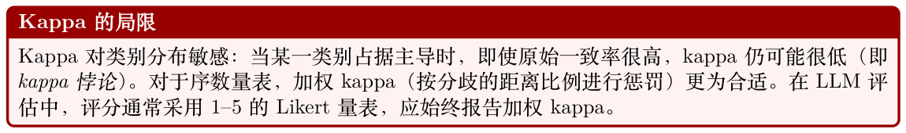

### 15.2.3 标注规范设计

有效的标注规范通常具备以下若干特征：

- 可操作化的标准。用具体、可观察的行为替换“有用”这类模糊词汇：例如“回答直接处理了用户的问题，并提供了完成所述任务所需的全部信息”。

- 详细示例。每个评分等级至少提供两个示例，包括边界情形。

- 决策树。对于复杂任务，用流程图引导标注者完成一系列二元决策，可降低认知负担并提升一致性。

- 明确的范围。说明标注者不应考虑哪些因素（例如“不要因风格偏好而扣分；只关注事实准确性”）。

### 15.2.4 众包标注与专家标注

对于安全关键型评估（例如检测有害输出、评估医疗建议），专家标注是不可妥协的。对于大规模偏好采集（例如构建Reward 模型训练集），配以严格质量控制的众包往往是唯一可行的选择。

## 15.3 评估用合成数据生成

人工标注昂贵且缓慢。合成数据生成利用LLM 自身大规模生产评估数据。本节涵盖其主要范式。

**Table 15.2: LLM 评估中众包标注与专家标注的对比。**

| 维度 | 众包 | 专家标注 |
| --- | --- | --- |
| 单条样本成本 | 低（$0.01–$0.10） | 高（$1–$50） |
| 吞吐量 | 极高 | 低 |
| 领域知识 | 低 | 高 |
| 一致性 | 不稳定 | 高 |
| 适用任务 | 简单偏好、流畅度 | 技术准确性、安全性 |
| 平台 | MTurk、Prolific、Scale AI | 领域专家、内部团队 |
| 质量控制 | 金标样本、注意力检查 | 校准会议、同行复核 |

### 15.3.1 用于校准的LLM-as-Judge

当用LLM 生成评估标签时，校准至关重要：评判者的分数必须与人类判断对齐。令hi ∈[0, 1] 为样本i 的人类偏好分数，ˆhi 为评判者预测分数。校准误差由期望校准误差（Expected Calibration

Error, ECE）[253] 度量：X B |Bb| ECE = |acc(Bb) −conf(Bb)| (15.7) n b=1其中Bb 是第b 个置信度区间，acc(Bb) 是该区间内评判者与人类一致的样本比例，conf(Bb) 是该区间内评判者的平均置信度。

一个良好校准的评判者满足：对所有p ∈[0, 1]，E[ˆhi | ˆhi = p] = p。校准可通过温度缩放改善：把

评判者的原始logit z 替换为z/T，其中T 在留出的校准集上通过最小化负对数似然来调优。

### 15.3.2 Self-Instruct

Self-Instruct [254] 从一个由人工撰写的种子任务集合自举出指令跟随数据。算法如下：

1. 维护一个任务池，初始化为175 个种子任务。

2. 从任务池中采样8 个任务，将其作为少样本示例，提示LLM 生成新任务。

3. 过滤生成的任务：移除近似重复项（与任何已有任务的ROUGE-L 相似度> 0.7），区分分类与非分类任务，并生成输入–输出实例。

4. 将接受的任务加入任务池。

5. 重复直到达到目标任务池规模。

```
Self-Instruct Prompt 模板
system_prompt = """
Come up with a series of tasks:
Task 1: {seed_task_1_instruction}
Task 2: {seed_task_2_instruction}
...
Task 8: {seed_task_8_instruction}
Task 9:"""
模型补全该Prompt，生成新的任务指令。随后由另一个Prompt 为该新任务生成输入–输出对。
```

### 15.3.3 Evol-Instruct

Evol-Instruct [255] 通过迭代地将指令改写得更复杂或更多样，来演化一个种子指令集。应用两类演化算子：

- 深度演化（In-depth evolution）：增加约束、提升推理步骤数、将抽象具体化、加深对领域知识的要求。

- 广度演化（In-breadth evolution）：在相关但不同的主题上生成新指令，提升主题多样性。

若指令通过淘汰过滤器，则被接受：演化后的指令不能是简单复制、不能包含”I’m sorry”或类似的拒绝表述，且长度不能短于原指令。

### 15.3.4 Constitutional AI 数据生成

Constitutional AI（CAI）[128] 通过让模型依据一组原则（即“宪法”）对自身输出进行批评与修订，从而生成偏好数据。流水线如下：

1. 监督学习阶段：采样一个有害Prompt，生成初始回答，然后提示模型依据某条宪法原则对回答进行批评并修订。将修订后的回答作为监督微调（SFT）的目标。

2. RL 阶段：生成回答对（原始vs. 修订），用模型标注哪一个更符合宪法，并在这些标签上训练偏好模型。将偏好模型作为RLHF 的Reward 信号。

这种方法无需让人工标注有害内容即可生成偏好数据，减少了标注者暴露于令人不适素材的风险。

### 15.3.5 评估数据的蒸馏

一个强大的教师模型（例如GPT-4）可以生成高质量的评估数据，用于训练较小的评判模型。蒸馏流水线如下：

1. 收集多样化的Prompt 与模型回答集合。

2. 使用教师模型生成详尽的判断（分数+ 理由）。

3. 在（Prompt、回答、判断）三元组上微调一个较小的模型。

4. 在留出的人工标注上验证学生评判者。

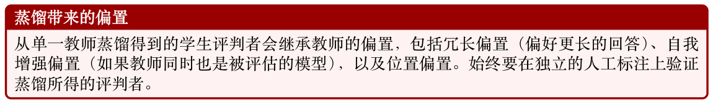

### 15.3.6 Arena 风格的成对生成

Chatbot Arena [256] 通过一个众包对战平台来生成评估数据：用户提交Prompt 并在两个匿名化的模型回答之间投票选择偏好。这能产生一个大规模、自然多样的成对偏好数据集。关键设计选择包括：

- 匿名化：隐藏模型身份，防止品牌偏置。

- 用户提交的Prompt：保证Prompt 的多样性以及与真实世界的相关性。

- 平局处理：用户可声明平局，或表明两个回答都很差。

- 去重：过滤近似重复的Prompt，防止常见查询被过度代表。

## 15.4 排序任务的指标

当目标是按质量对模型进行排序时，成对比较数据比绝对分数更为可靠。本节推导LLM 评估中常用的主要排序系统。

### 15.4.1 ELO 评分系统

ELO 系统[257] 最初为国际象棋而设计，它为每位选手（模型）赋予一个标量评分R，使得选手A对阵选手B 的期望得分为：

EA = (15.8) 1 + 10(RB−RA)/400推导。ELO 模型假设：每位选手在某一局比赛中的表现是一个以其评分为中心的Logistic 分布所抽取的随机变量。A 击败B 的概率为：RA −RB  P(A ≻B) = σ = (15.9) s 1 + e−(RA−RB)/s

其中s = 400/ ln(10) ≈173.7 是一个尺度参数，其选择使得400 分的差距对应于10 : 1 的胜率比。

每场比赛后，给定结果SA ∈{0, 0.5, 1}（负、平、胜），评分更新如下：

RA ←RA + K(SA −EA), RB ←RB + K(SB −EB) (15.10)

其中K 是控制学习率的K-因子。在Chatbot Arena 中使用K = 4。

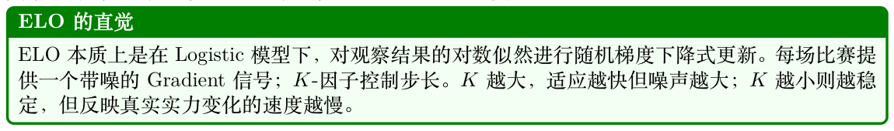

ELO 的Bootstrap 置信区间。由于ELO 评分依赖于比赛被处理的顺序，置信区间通过Bootstrap重采样计算：对对战日志有放回地重采样B = 1000 次，对每次重采样都从头重新计算ELO 评分，并以第2.5 与第97.5 百分位作为95% 置信区间。

### 15.4.2 Bradley–Terry 模型

Bradley–Terry（BT）模型[197] 是ELO 的一种最大似然替代方案。给定n 个模型，其实力参数为β1, . . . , βn > 0，模型i 击败模型j 的概率为：

βi P(i ≻j) = (15.11) βi + βj

给定一组成对结果{(ik, jk, yk)}M k=1，其中若ik 击败jk 则yk = 1，否则yk = 0，对数似然为：

" # X M βik βjk ℓ(β) = yk log + (1 −yk) log (15.12) βik + βjk βik + βjk k=1

极大似然估计ˆβ 可通过迭代缩放或梯度上升求得。BT 模型仅在相差一个乘法常数的意义下可辨识；常用的归一化是P i log βi = 0。在对数空间中令θi = log βi 得：

P(i ≻j) = σ(θi −θj) (15.13)

这等价于一个带条目特定截距的Logistic 回归。在能拿到完整对战历史时，BT 模型优于ELO，因为它同时利用了所有数据，而不是顺序处理比赛。

### 15.4.3 TrueSkill

TrueSkill [258] 是一种贝叶斯式的实力评分系统，将每位选手的实力建模为高斯随机变量si ∼ N(µi, σ2 i )。选手i 在某一局中的表现为pi = si + ϵi，其中ϵi ∼N(0, β2) 为比赛特定的噪声。当pi > pj 时，选手i 击败选手j。

观察到i ≻j 后的后验更新通过期望传播（Expectation Propagation, EP）计算。胜方的关键更新方程为：µi −µj  µi ←µi + σ2 c · v i (15.14) c " µi −µj # 1 −σ2 σ2 i ←σ2 c2 · w i (15.15) i c q其中c = 2β2 + σ2 i + σ2 j ，v(t) = ϕ(t)/Φ(t)，w(t) = v(t)(v(t) + t) 为截断高斯修正因子（ϕ 与Φ 分

别是标准正态的PDF 与CDF）。TrueSkill 的不确定性估计σi 在识别需要更多评估数据的模型时尤其有用。

### 15.4.4 带置信区间的胜率

最简单的排序指标是胜率：模型A 在成对比较中胜出的比例。给定n 次比较，其中w 次胜出，胜率为ˆp = w/n。在p = 0 与p = 1 附近，Wilson 分数置信区间[259] 的覆盖性能优于朴素的Wald区间，因此更被推荐：q ˆp + z2 2n ± z ˆp(1−ˆp) + z2 CI = n 4n2 (15.16) 1 + z2 n其中95% 区间对应z = 1.96。对于多方比较，胜率应针对一个固定的基线模型来计算，以确保可比性。

### 15.4.5 Chatbot Arena 方法论

Chatbot Arena [256] 将上述要素组合为一个生产规模的评估系统：

1. 用户提交Prompt，并获得两个匿名化模型的回答。

2. 用户对偏好的回答进行投票（或声明平局）。

3. 投票通过BT 模型聚合以生成排行榜。

4. 对每个模型的分数报告Bootstrap 置信区间。

5. 置信区间重叠的模型在统计上被视为无法区分。

截至2024 年，Chatbot Arena 已累计收集超过一百万条人类偏好投票，是目前公开可得的最大规模LLM 偏好数据集。

## 15.5 生成任务的指标

生成指标量化了在具备参考答案或明确正确性标准的任务上模型输出的质量。

### 15.5.1 BLEU

BLEU（Bilingual Evaluation Understudy）[260] 度量假设译文h 与一个或多个参考R 之间的n-gram 精度：N !

X BLEU = BP · exp wn log pn (15.17) n=1其中pn 是修正后的n-gram 精度，wn = 1/N 为均匀权重，BP 为简短惩罚（brevity penalty）：

( if |h| > |r| BP = (15.18) e1−|r|/|h| if |h| ≤|r|

其中|r| 为长度最接近的参考的长度。修正后的n-gram 精度将每个n-gram 的计数截断到其在任一参考中的最大出现次数：

P ngram∈h min(count(ngram, h), maxr∈R count(ngram, r)) pn = P (15.19) ngram∈h count(ngram, h)

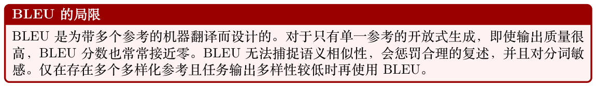

### 15.5.2 ROUGE

ROUGE（Recall-Oriented Understudy for Gisting Evaluation）[261] 是一类面向召回的指标，专为摘要任务设计：

P P ngram∈r min(count(ngram, h), count(ngram, r)) ROUGE-N = r∈R P P (15.20) ngram∈r count(ngram, r) r∈R

ROUGE-L = LCS(h, r) (15.21) |r|

其中LCS 表示最长公共子序列（Longest Common Subsequence）。ROUGE-1 与ROUGE-2 度量unigram 与bigram 的召回；ROUGE-L 则捕捉句子级结构。F-measure 变体在精度与召回之间取得平衡：ROUGE-NF = (1 + β2) · P · R (15.22) β2P + R

当β = 1 时为等权。

### 15.5.3 BERTScore

BERTScore [262] 使用预训练BERT 模型的上下文Embedding 来计算Token 级相似度。给定假设Token ˆx = ⟨ˆx1, . . . , ˆxm⟩与参考Token x = ⟨x1, . . . , xn⟩，及其Embedding ˆei 与ej：

RBERT = 1 X ˆe⊤ i ej max (15.23) |x| ˆxi∈ˆx ∥ˆei∥∥ej∥

PBERT = 1 X ˆe⊤ i ej max (15.24) |ˆx| xj∈x ∥ˆei∥∥ej∥

FBERT = 2 · PBERT · RBERT (15.25) PBERT + RBERT

BERTScore 与人类判断的相关性优于BLEU 与ROUGE，尤其在处理复述以及语义等价但词面不同的输出时。使用逆文档频率（IDF）进行重要性加权可进一步提升相关性：

P

Ridf BERT = P (15.26)

#### xj∈x idf(xj)

### 15.5.4 METEOR

METEOR [263] 通过在unigram 匹配上计算F-score，并配合词干化与同义词匹配模块，解决了BLEU 对召回的盲视：METEOR = Fmean · (1 −Pen) (15.27)

其中Fmean = 10PR R+9P （召回加权的调和平均），碎片化惩罚Pen = 0.5 · (c/um)3 对非连续匹配进行惩罚（c 为块数，um 为匹配的unigram 数）。

### 15.5.5 困惑度（Perplexity）

困惑度（Perplexity）衡量语言模型对留出文本序列w1, w2, . . . , wT 的预测能力：

!

−1 X T PPL(w1:T ) = exp log Pθ(wt | w1:t−1) (15.28) T t=1

困惑度越低，预测性能越好。困惑度适合在相同分词与测试集上比较模型，但在词表或分词器不同的模型间不能直接比较。在评估中，困惑度最实用的用途是作为一种合理性检查（sanity check）以及用于检测分布漂移。

### 15.5.6 代码任务的Pass@k

对于代码生成，功能正确性通过在测试用例上执行生成的代码来衡量。pass@k 指标[264] 估计在k个生成样本中至少有一个通过全部测试的概率：

" n−c  #

pass@k = Eproblems 1 − n k  (15.29) k

其中n 是每个问题生成的样本总数，c 是其中通过测试的样本数。该无偏估计量避免了朴素估计量（精确采样k 个解并检查是否通过）的高方差问题。在实践中通常生成n = 200 个样本，并报告pass@1、pass@10、pass@100。

```
Pass@k 计算
import numpy as np
from scipy.special import comb
def pass_at_k(n: int, c: int, k: int) -> float:
"""pass@k 的无偏估计量。
Args:
n: 每个问题生成的样本总数
c: 通过全部测试的样本数
k: 考虑的样本数
"""
if n - c < k:
return 1.0
return 1.0 - comb(n - c, k, exact=True) / comb(n, k, exact=True)
# 示例：200 个样本，15 个通过，计算pass@1 、pass@10 、pass@100
for k in [1, 10, 100]:
score = pass_at_k(n=200, c=15, k=k)
print(f"pass@{k}: {score:.4f}")
# pass@1: 0.0750
# pass@10: 0.5391
# pass@100: 0.9999
```

### 15.5.7 精确匹配与F1

对于抽取式问答（例如SQuAD），有两个标准指标：

- 精确匹配（Exact Match, EM）：二元指示量，判断归一化（小写化、去除冠词与标点）后的预测答案字符串是否与任一金标答案完全相同。

- Token 级F1：将预测与金标答案视为Token 的多重集，并计算F1 分数：

F1 = 2 · |pred ∩gold| (15.30) |pred| + |gold|

对于多答案设置，报告对所有金标答案取最大值后的F1。

## 15.6 Agent 任务的指标

Agent 化的LLM 在环境中运作、执行动作序列，并须完成多步任务。标准生成指标在此并不充分；Agent 评估需要能够刻画任务完成度、效率以及中间步骤质量的指标。

**Table 15.3: 生成指标汇总：适用性与关键性质。**

| 指标 | 任务 翻译 | 是否无参考？ 否 | 与人类判断的相关性 低–中 |
| --- | --- | --- | --- |
| BLEU | 摘要 | 否 | 中 |
| ROUGE | 通用NLG | 否 | 高 |
| BERTScore | 翻译 | 否 | 中–高 |
| METEOR |  |  |  |
| Perplexity | 语言模型质量 | 是 | 低 |
| Pass@k | 代码生成 | 否（依赖测试） | 极高 |
| Exact Match | 抽取式问答 | 否 | 极高 |
| Token F1 | 抽取式问答 | 否 | 高 |

### 15.6.1 任务成功率

Agent 任务的主要指标是任务成功率（Task Success Rate, TSR）：Agent 达成指定目标状态的任务比例：X TSR = 1[goal(τ) achieved] (15.31) |T | τ∈T

目标的达成通常由一个确定性的Oracle 来验证（例如检查数据库状态、文件系统状态或测试用例执行结果）。对于允许部分得分的任务，可以定义分级成功度量：

X TSRgraded = score(τ) ∈[0, 1] (15.32) |T | τ∈T

### 15.6.2 轨迹效率

一个成功的Agent 应以尽可能少的非必要动作完成任务。轨迹效率衡量最优轨迹长度与Agent 实际轨迹长度之比：L∗ η = (15.33) Lagent

其中L∗是最短成功轨迹的长度（由Oracle 或人类专家计算得出），Lagent 是Agent 所执行的动作数。η ∈(0, 1]，η = 1 表示最优效率。对于失败的轨迹，η = 0。

一个互补指标是冗余率（redundancy rate）：Agent 动作中不出现在任何最优轨迹里的比例。

### 15.6.3 工具调用准确性

对于调用外部工具（API、代码解释器、搜索引擎）的Agent，工具调用（Tool Calling）准确性衡量调用的正确性：TUA = # correct tool calls (15.34) # total tool calls

一次工具调用被视为正确当且仅当：（a）选择了正确的工具，（b）参数有效，（c）该调用发生在轨迹中合适的时机。当工具选择正确但参数错误时，可酌情给予部分得分。

### 15.6.4 多步推理准确性

对于需要推理链的任务（例如多跳问答、数学解题），步骤级准确性衡量正确推理步骤所占的比例：

X X SRA = 1[s is correct] (15.35) |T | |Sτ| τ∈T s∈Sτ

其中Sτ 是轨迹τ 中的推理步骤集合。步骤的正确性可由过程奖励模型（Process Reward Model, PRM）或人工标注来验证。

### 15.6.5 SWE-bench 方法论

SWE-bench [265] 在真实软件工程任务上评估LLM：给定一个GitHub issue 描述与仓库代码库，模型必须生成解决该issue 的patch。评估流程如下：

1. 将issue 描述与相关代码上下文提供给模型。

2. 模型生成一个patch（统一diff 格式）。

3. 将patch 应用到仓库。

4. 执行仓库的测试套件；若全部测试通过，则任务成功。

主要指标为% Resolved：生成的patch 能通过全部测试的issue 所占比例。SWE-bench Verified是一个经过人工标注者验证为可解且无歧义的500 题精选子集。SWE-bench Lite 则是一个300 题的子集，专为更快的评估而设计。

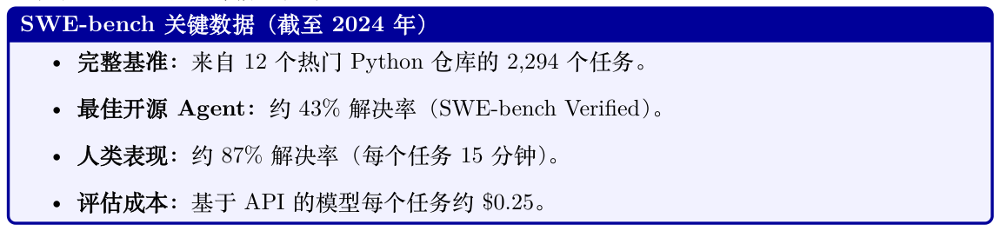

### 15.6.6 WebArena 方法论

WebArena [266] 在沙箱浏览器环境中以贴近真实的网页导航任务评估Agent。该基准包含跨五个Web 应用（电商、社交论坛、协作开发、内容管理与地图）的812 个任务。评估方式如下：

- 功能性评估：通过检查应用状态来验证任务结果（例如“商品是否已加入购物车？”“帖子是否已创建？”）。

- 基于URL 的评估：对于导航任务，将最终URL 与期望URL 进行比较。

- 基于程序的评估：由自定义评估脚本检查复杂条件（例如“价格是否小于$50？”）。

主要指标是任务成功率。人类表现约为78%；当前最先进的Agent 约为35–45%。

**Table 15.4: Agent 评估基准对比。**

| 基准 | 领域 | 任务数 | 评估方式 | SOTA（%） |
| --- | --- | --- | --- | --- |
| SWE-bench | 软件工程 | 2,294 | 测试执行 | ∼43 |
| SWE-bench Lite | 软件工程 |  | 测试执行 | ∼50 |
| WebArena | 网页导航 |  | 状态/URL/程序 | ∼40 |
| ALFWorld [267] | 家居任务 | 3,553 | 仿真器状态 | ∼90 |
| AgentBench [268] | 多领域 | 1,091 | 任务特定 | ∼45 |

## 15.7 LLM-as-Judge

LLM-as-Judge [256] 使用一个能力强的LLM 来评估其他（或同一个）LLM 的输出。该方法无需人工标注就能扩展到大规模评估集合，并能为其判断提供详尽的理由。

### 15.7.1 设置与Prompt 模板

向评判者提供一个Prompt、一个或多个模型回答，以及一份评估细则。常见的三种格式：

点评式评分（Pointwise scoring）。评判者对单个回答给出绝对分数：

```
Pointwise Judge Prompt
POINTWISE_PROMPT = """
You are an expert evaluator. Rate the following response on a scale
of 1-10 for helpfulness , accuracy , and clarity.
[Question]
{question}
[Response]
{response}
Provide your evaluation in the following format:
Reasoning: <step-by-step analysis >
Score: <integer from 1 to 10>
"""
```

成对比较（Pairwise comparison）。评判者比较两个回答并选出更优者：

```
Pairwise Judge Prompt
PAIRWISE_PROMPT = """
You are an expert evaluator. Compare the two responses below and
determine which is better. Consider helpfulness , accuracy , and
depth of explanation.
[Question]
{question}
[Response A]
{response_a}
[Response B]
{response_b}
Output exactly one of: [[A]], [[B]], or [[C]] (tie).
Reasoning: <your analysis >
Verdict: <[[A]], [[B]], or [[C]]>
"""
```

参考引导式评分（Reference-guided scoring）。向评判者提供参考答案，并据此对回答进行打分。这对评判者本身可能缺乏可靠知识的事实型任务尤其有用。

### 15.7.2 位置偏置的缓解

LLM评判者会表现出位置偏置（position bias）：系统性地偏好出现在特定位置（首位或末位）的回答。此偏置可能高达10–15 个百分点。缓解策略：

1. 交换增强：对每一对回答都以两种顺序（A vs. B 与B vs. A）进行评判。判断一致则采纳；判断不一致则记为平局。

2. 校准式Prompt：显式指令评判者：“你的评估不应受到回答呈现顺序的影响。”

3. 评判者集成：使用多个评判者并配以不同的位置顺序，再聚合其裁决。

4. 强制思维链：要求评判者在给出裁决前先产出详尽理由，以降低对表层位置线索的依赖。

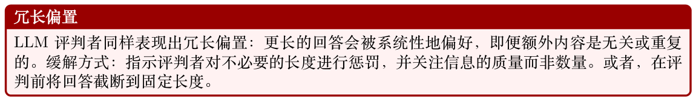

### 15.7.3 多评判者面板

单一评判者可能带有系统性偏置。来自不同模型家族的评判者面板能提供更稳健的评估。给定J 位评判者，其裁决为v1, . . . , vJ ∈{A, B, tie}，面板裁决由多数投票决定。面板一致率为：

X Agreement = J  1[vi = vj] (15.36) i<j

对于三人评判者面板，一致裁决（三人全部同意）视为高置信度；2–1 分裂视为中置信度；三方平局视为低置信度。

### 15.7.4 LLM 评判者的一致性指标

为验证LLM 评判者，将其裁决与留出集上的人工标注进行比较。关键指标：

- 一致率：评判者与人类标注一致的样本比例。

- Cohen’s κ：经偶然性修正的一致率（公式15.1）。

- Spearman’s ρ：评判者分数与人类分数之间的秩相关，适用于序数评分。

- Kendall’s τ：另一种秩相关，对平局更具鲁棒性。

若评判者在一份具有代表性的样本上与人类标注者达到κ > 0.6 且一致率> 80%，则视为可靠。

### 15.7.5 G-Eval 框架

G-Eval [269] 是一个面向LLM 评估的结构化框架，使用思维链（Chain-of-Thought，CoT）提示与Token 概率加权来产出更可靠的分数。框架如下：

1. 生成评估步骤：提示LLM 为评估任务生成详尽的评分细则（例如“列出你评估一篇摘要连贯性时所采取的步骤”）。

2. 以概率加权方式打分：对每个分值s ∈{1, 2, 3, 4, 5}，从评判模型获取对数概率log Pθ(s | prompt, steps, response)。最终分数为以概率加权的平均：

X elog Pθ(s) G-Eval score = s ·P5 (15.37) s′=1 elog Pθ(s′) s=1

3. 归一化：将分数除以最大分值，映射到[0, 1]。

G-Eval与人类判断的相关性高于直接提示，尤其在连贯性与一致性这类细腻维度上，因为概率加权捕捉了评判者的不确定性，而非强制其作离散选择。

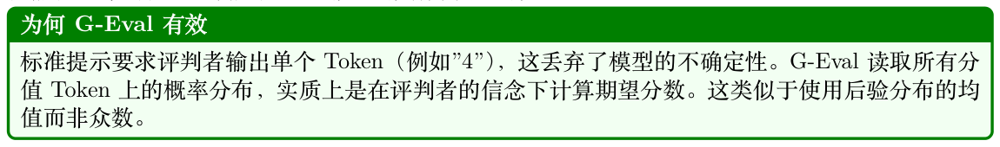

## 15.8 评估陷阱

即便是精心设计的评估流水线也可能给出误导性的结果。本节梳理最常见的失效模式。

### 15.8.1 基准污染

当评估数据出现在模型的训练集中时（直接以原文出现，或间接以复述/语义相似形式出现），就发生了基准污染（benchmark contamination）。被污染的模型会取得虚高的分数，无法反映其真实的泛化能力。

检测方法：

- n-gram 重叠：计算与训练语料具有高n-gram 重叠（例如ROUGE-L > 0.8）的评估样本比例。

- 成员推断（Membership Inference）：使用成员推断攻击来估计每个评估样本曾出现在训练集中的概率。

- 金丝雀串（Canary strings）：在评估样本中嵌入独特的随机生成字符串，并检查模型是否能将其补全。

- 时间留出：使用模型训练截止日期之后产生的评估数据。

缓解：

- 维护一个永不公开发布的私有测试集。

- 定期用新样本刷新基准。

- 报告训练数据截止日期以及去污染流程。

### 15.8.2 对基准的过拟合

即使没有直接污染，模型也可能通过反复评估与超参调优而被隐式地为特定基准而优化。这是一种自适应过拟合（adaptive overfitting）：基准向模型开发决策泄漏了信息。

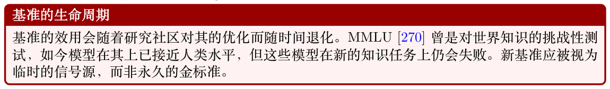

### 15.8.3 评估中的Goodhart 定律

Goodhart 定律指出：“当一个度量成为目标时，它就不再是好的度量。” [271] 在LLM 评估中，这有多种体现：

- Reward 欺骗（Reward hacking）：用基于人类反馈的强化学习（Reinforcement Learning from Human Feedback, RLHF）训练的模型可能学会利用Reward 模型，而非真正提升质量。

模型可能学会输出冗长、听起来自信但实际上事实错误的回答，这类回答在Reward 模型上得分却很高。

- 指标博弈：为最大化BLEU 或ROUGE 而微调的模型，可能产出在这些指标上得分良好但对人类用处不大的输出。

- 评判者博弈：用LLM-as-Judge 反馈训练的模型可能学到评判者的偏置（例如冗长偏置），而非真正提升质量。

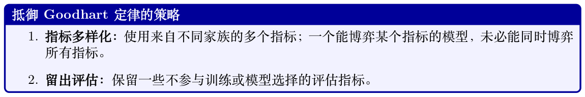

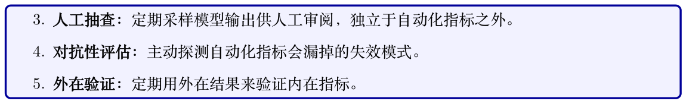

### 15.8.4 其他陷阱

Prompt敏感性。LLM 的性能可能因评估Prompt 的微小改动而剧烈变化（例如加入”Think step by step” 或更改回答格式）。务必报告所使用的确切Prompt，并考虑在多种Prompt 变体上进行评估。

聚合伪影。在难度水平与分数分布各异的任务上对分数取平均，可能产生误导性的聚合指标。一个在简单任务上表现优异但在困难任务上失败的模型，可能与一个表现均衡的模型获得相同的平均分。

人工评估中的选择偏差。人类评估者并不是终端用户的随机样本。众包平台上的标注者与目标用户群体可能在偏好、文化背景与领域知识上存在差异。

评估—部署失配。评估Prompt 往往比真实用户查询更短、更干净、形式也更规整。在基准Prompt上表现良好的模型，在生产环境中遇到嘈杂、含糊的多轮对话（Multi-Turn）时可能显著退化。

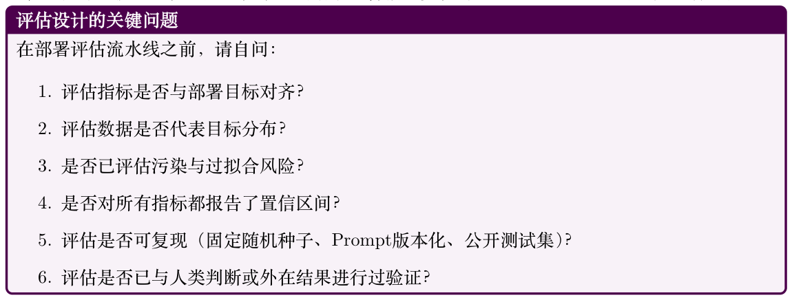
