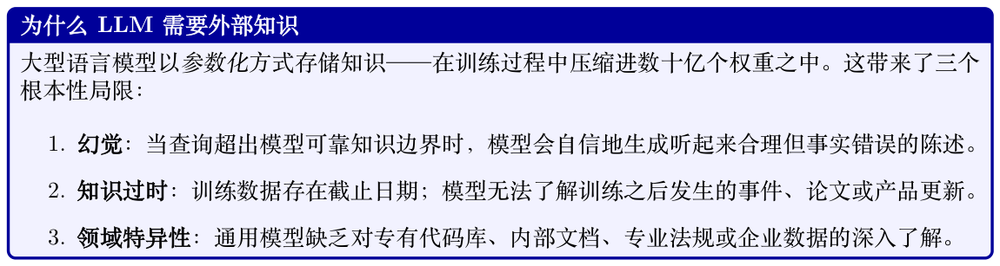
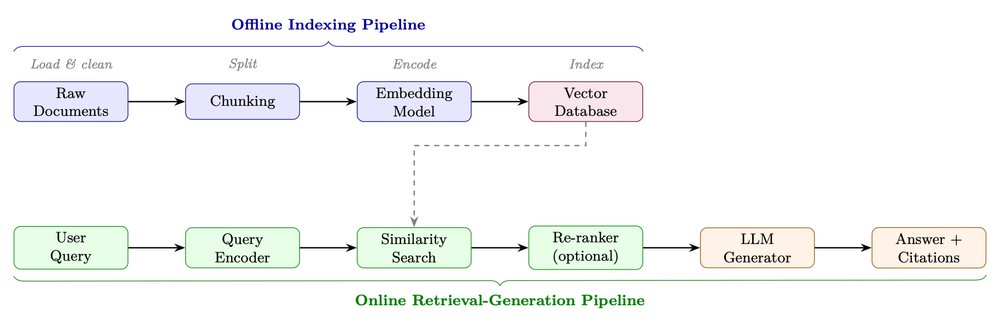
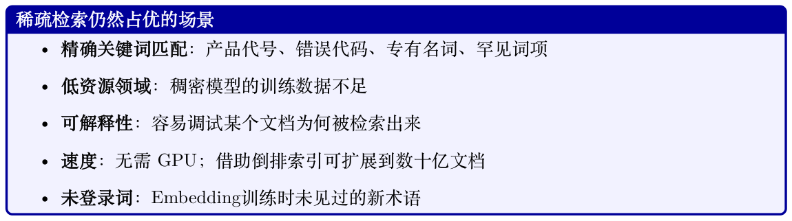
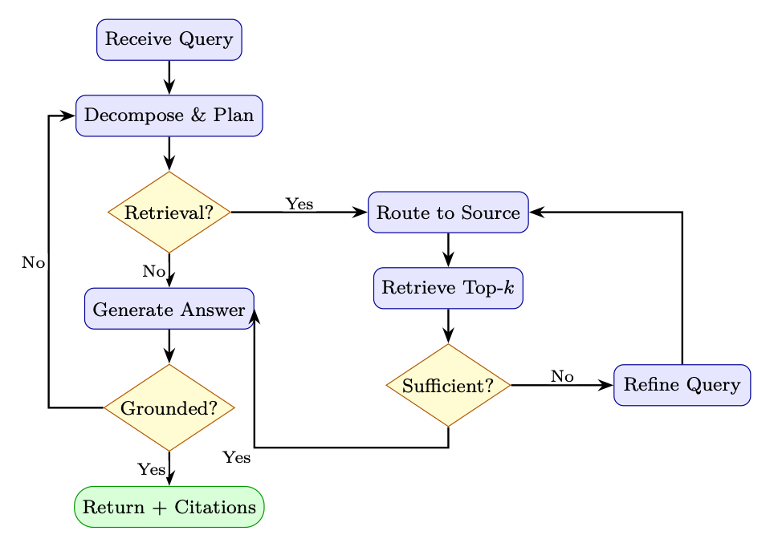
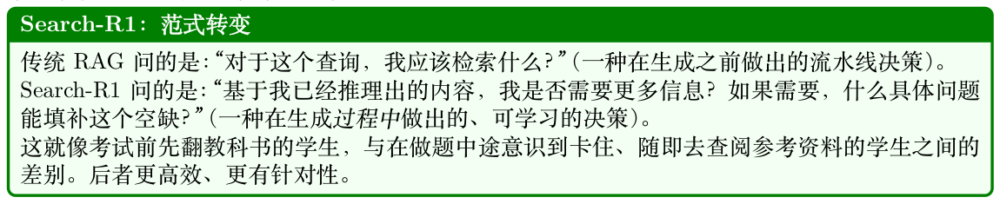

# 检索增强生成（RAG）

检索增强生成（Retrieval-Augmented Generation, RAG）[127] 已成为在生产环境中部署大型语言模型时最具实际影响力的技术之一。RAG 不再仅依赖训练时编码进模型权重中的知识，而是为LLM配备一个动态、可更新的外部记忆——使其能够在广泛的知识密集型任务中给出准确、有据可查且可验证的响应。

## 17.1 动机与问题陈述



### 17.1.1 参数化知识vs. 非参数化知识

我们可以将两种知识来源之间的区别形式化。令Mθ 表示参数为θ 的语言模型，D = {d1, d2, . . . , dN}为外部文档语料库。在每种范式下，给定查询q 生成回答a 的概率为：

Pparametric(a | q) = PMθ(a | q) (17.1)

X PRAG(a | q, D) = PMθ(a | q, d) Pret(d | q, D) (17.2) d∈D

其中Pret(d | q, D) 是关于文档的检索分布。RAG 对检索到的证据进行边缘化，使生成过程接地于非参数化知识。


**Table 17.1: 决策指南：RAG vs. 微调vs. 长上下文**

| 标准 | RAG | 微调 | 长上下文 | RAG + 微调 |
| --- | --- | --- | --- | --- |
| 知识频繁更新 | ✓ | × | × | ✓ |
| 需要引用/ 接地 | ✓ | × | ✓ | ✓ |
| 专有大型语料库 | ✓ | × | × | ✓ |
| 适配风格/ 格式 | × | ✓ | × | ✓ |
| 教授新推理技能 | × | ✓ | × | ✓ |
| 语料库可放入上下文窗口 | × | × | ✓ | × |
| 要求低延迟 | × | ✓ | × | × |

### 17.1.2 何时选择RAG vs. 微调vs. 长上下文


## 17.2 核心RAG 架构

一个标准的RAG 系统由两个阶段构成：处理和存储文档的离线索引流水线，以及为查询提供服务的在线检索—生成流水线。

### 17.2.1 完整流水线图



**Figure 17.1: 端到端RAG 架构。离线流水线（蓝色）对文档进行一次性索引；在线流水线（绿色/橙色）在推理时为每个查询提供服务。**

### 17.2.2 索引流水线

文档加载。文档以异构格式抵达（PDF、HTML、Markdown、DOCX、代码）。加载器提取干净的文本，并保留元数据（来源URL、页码、章节标题、时间戳），这些元数据会与Embedding 一并存储，用于过滤和引用。

分块（Chunking）。长文档必须切分成可放入Embedding 模型上下文窗口（通常为512 个Token）并保持语义连贯的块。分块策略是RAG 系统设计中影响最大的决策之一（参见Section 17.4）。

Embedding。每个块ci 通过Embedding 模型fϕ 编码为稠密向量ei = fϕ(ci) ∈Rd。这些向量与原始文本和元数据一同存储到向量数据库中。

### 17.2.3 检索

#### 给定查询q，检索步骤将其编码为q = fϕ(q)，并通过余弦相似度找出最相似的k 个块：

sim(q, ei) = (17.3)

返回top-k 块Ck = {c(1), . . . , c(k)} 作为上下文。

### 17.2.4 生成

检索到的块被注入到一个Prompt 模板中：

```
SYSTEM_PROMPT = """You are a helpful assistant. Answer the question using ONLY
the provided context. If the context does not contain enough information ,
say so explicitly. Cite your sources using [Doc N] notation."""
def build_rag_prompt(query: str, chunks: list[dict]) -> str:
context_str = "\n\n".join(
f"[Doc {i+1}] (Source: {c['source ']}, Page: {c.get('page','N/A')})\n{c['text
']}"
for i, c in enumerate(chunks)
)
return f"""{SYSTEM_PROMPT}
Context:
{context_str}
Question: {query}
Answer:"""
```

#### Listing 17.1: 标准RAG Prompt 模板

## 17.3 检索方法

### 17.3.1 稀疏检索：BM25 与TF-IDF

稀疏检索方法将文档和查询表示为词汇表上的高维稀疏向量。给定查询q（含词项t1, . . . , tn）时，针对文档d 的经典BM25 评分函数[272] 为：

X n f(ti, d) · (k1 + 1) BM25(d, q) = IDF(ti) ·  (17.4) f(ti, d) + k1 ·1 −b + b ·|d| i=1 avgdl

其中f(ti, d) 为词频，|d| 为文档长度，avgdl 为平均文档长度，k1 ∈[1.2, 2.0]、b = 0.75 为可调参数。



### 17.3.2 稠密检索：DPR

稠密段落检索（Dense Passage Retrieval, DPR）[273] 使用两个独立的、基于BERT 的编码器——一个查询编码器EQ 和一个段落编码器EP ——通过对比Loss 进行训练，使相关的查询—段落对在Embedding 空间中彼此靠近。

双编码器（Bi-Encoder）架构。

sim(q, p) = EQ(q)⊤EP (p) (17.5)

使用Batch 内负样本进行训练。给定包含B 个查询—段落对的Batch {(qi, p+ i )}B i=1，对比Loss将Batch 中所有其他段落视为负样本：

  LDPR = −1 X B exp EQ(qi)⊤EP (p+ i )/τ log PB (17.6) B j=1 exp(EQ(qi)⊤EP (pj)/τ) i=1

其中τ 是温度超参数。硬负样本（词面相似但语义无关的段落）对训练强检索器至关重要。

近似最近邻搜索。在大规模场景下，对数百万个Embedding 进行穷举搜索不可行。FAISS [274]（Facebook AI Similarity Search）提供了高效的近似最近邻（Approximate Nearest Neighbor, ANN）搜索，所用方法包括：

- IVF（倒排文件索引，Inverted File Index）：将向量聚类到Voronoi 单元中；只搜索邻近的单元

- HNSW（分层可导航小世界，Hierarchical Navigable Small World）[275]：基于图的索引，搜索复杂度O(log N)

- PQ（乘积量化，Product Quantization）：压缩向量以减少内存占用

### 17.3.3 基于倒数排名融合的混合检索

混合检索结合稀疏和稠密得分。一个简单的线性组合为：

shybrid(d, q) = α · sdense(d, q) + (1 −α) · ssparse(d, q) (17.7)

然而，来自不同系统的分数无法直接比较。倒数排名融合（Reciprocal Rank Fusion, RRF）[276] 通过在排名而非分数上操作来规避这个问题：

X RRF(d) = (17.8) k + rankr(d) r∈R

其中R 是排名列表集合（如BM25 排名和稠密排名），rankr(d) 是文档d 在列表r 中的排名，k = 60 是平滑常数，用于削弱排名极高的文档带来的影响。


### 17.3.4 学习式稀疏检索：SPLADE 与SPLADEv2


SPLADE（v1）——核心思想。SPLADE（Sparse Lexical and Expansion Model）[277] 使用预训练的掩码语言模型（如BERT/DistilBERT），为每个文档或查询生成一个覆盖整个词汇表的稀疏向量。关键洞见在于：MLM 头部已经知道文本中每个位置在语义上与哪些词相关——SPLADE 把这种知识重新利用为词项重要性权重。

架构。给定输入文本x = [x1, . . . , xn]：

1. 通过Transformer 编码器，并经由MLM 头部得到上下文表示H ∈Rn×|V|

2. 跨位置聚合，并应用一个饱和激活：

!!

wt(x) = log 1 + ReLU i∈[1,n] Hi[t] max (17.9)

其中Hi[t] 是输入位置i 处针对词汇Token t 的MLM logit。

- log(1 + ·) 饱和防止任何单个词项占主导（类似BM25 中的TF 饱和）

- ReLU 保证稀疏性——绝大多数词汇项的权重为零

- 跨位置的max 池化为每个词项从文本任意位置中捕获最强信号

- 扩展：即使是原文中未出现的Token 也可获得非零权重（例如关于”neural networks” 的文档可能为”deep learning”、”AI”、”backpropagation” 赋权）

打分。查询和文档分别映射为稀疏向量wq, wd ∈R|V|。相关性得分就是一个简单的点积：X s(q, d) = wq t · wd (17.10) t t∈V由于两个向量都是稀疏的（在30K 词汇表中通常只有20–200 个非零项），这可以使用标准倒排索引（Lucene、Anserini）高效计算——查询时无需GPU。

训练。SPLADE 通过对比学习（Batch 内负样本+ 硬负样本）进行训练，并附加两个正则项：

L = Lcontrastive + λq∥wq∥1 + λd∥wd∥1 (17.11)

查询和文档表示上的L1 惩罚鼓励稀疏性——若没有它们，模型将学到稠密表示，从而背离设计初衷。

SPLADEv2 ——关键改进。SPLADEv2 [278] 引入了若干改进，显著提升了效率与效果：

1. 从交叉编码器蒸馏：SPLADEv2不只用二元相关性标签训练，而是借助交叉编码器教师（如MonoT5 [279]）提供软相关性得分，从而获得更丰富的训练信号：

Ldistill = KL(σ(sstudent) ∥σ(steacher)) (17.12)

2. 分离的查询/文档编码器：SPLADEv2为查询与文档设置不同的稀疏度目标。查询被鼓励更稀疏（查找更快），而文档可以稍稠密（离线预计算）：

λq > λd (e.g., λq = 3 × 10−4, λd = 1 × 10−4) (17.13)

3. FLOPS 正则化：SPLADEv2 不再使用简单的L1，而是引入了一个感知FLOPS 的正则项，直接惩罚预期检索代价：

LFLOPS = X (aq t)2 + X  ad 2 (17.14) t t∈V t∈V其中at 是Batch 中词项t 的平均激活。该项会惩罚在许多文档上都非零的词项（倒排列表长= 检索慢）。

4. 高效骨干：使用DistilBERT（66M 参数）替代BERT-base（110M），编码时间减半，质量损失极小。

方面SPLADE（v1）SPLADEv2

训练信号二元相关性+ 硬负样本交叉编码器蒸馏

稀疏度控制L1 正则化感知FLOPS 的正则化

查询/文档对称性同一编码器、同一λ非对称（查询更稀疏）

骨干BERT-base（110M）DistilBERT（66M）

MRR@10（MS MARCO [280]）34.0 36.8

平均每文档非零项数∼200 ∼120（更稀疏40%）

#### 何时使用SPLADE

- 适合使用SPLADE/v2 的场景：你需要在查询时不依赖GPU 完成语义检索；你的基础设施已有倒排索引（Elasticsearch、Lucene）；或你需要可解释的相关性得分（可以查看是哪些扩展词项匹配上了）。

- 更适合使用稠密检索的场景：你有GPU 预算用于查询编码；需要多语言支持（稠密模型的迁移性更好）；或者查询非常短（1–2 个词时扩展帮助较小）。

- 最佳实践：用SPLADEv2 作为第一阶段检索器+ 在top-k 上使用交叉编码器重排序器。这种组合可在更低延迟下匹敌甚至超越稠密检索流水线。

### 17.3.5 ColBERT：晚期交互

ColBERT [281] 将查询和文档编码为Token 级Embedding 的集合，并使用MaxSim 算子进行打分：

X s(q, d) = max j∈|d| q⊤ i dj (17.15)

这种晚期交互（Late Interaction）机制比单向量双编码器更具表达力，又因为文档Embedding可离线预计算而远比交叉编码器更快。

架构。查询编码器EQ 和文档编码器ED 都是基于BERT 的模型，产生逐Token 的Embedding（而不是单个[CLS] 向量）。每个Token Embedding 通过一个线性层投影到更低维度（通常为128）：

qi = Linear(EQ(q)i) ∈R128, i = 1, . . . , |q| (17.16)

dj = Linear(ED(d)j) ∈R128, j = 1, . . . , |d| (17.17)

训练。ColBERT 在正、负段落上以成对的Softmax 交叉熵Loss 进行训练。给定查询q、正段落d+ 和一组负段落{d− 1 , . . . , d− N}：

exp(s(q, d+)) LColBERT = −log exp(s(q, d+)) + PN (17.18) k=1 exp(s(q, d− k ))

其中s(q, d) 是Equation 17.15 中的MaxSim 分数。负样本来自：

- Batch 内负样本：同一训练Batch 中的其他段落（无额外成本、数量充足）

- 硬负样本：由BM25 检索出的、词面相似但语义无关的段落（对质量影响最大）

- 蒸馏负样本（ColBERTv2 [282]）：使用交叉编码器教师挖掘最难的负样本，并将其得分蒸馏到ColBERT 中索引与服务。在索引阶段，所有文档Token 的Embedding 都被预计算并存储（在ColBERTv2 中可选地使用残差量化压缩）。在查询阶段，只需实时编码查询Token，并与已存储的文档Embedding计算MaxSim。这种分离带来：

- 离线文档编码：编码一次，服务于多次查询

- PLAID 索引[282]：对文档Embedding 聚类，用聚类中心进行初步候选检索，然后只在候选集上计算精确的MaxSim——延迟可降低5–10×

- 索引大小：每文档|d| × 128 个浮点数（比单向量方法更大，但通过量化可压缩到约每维度2字节）

### 17.3.6 检索方法对比

**Table 17.2: 检索方法在关键维度上的对比**

| 方法 | 延迟 准确率 索引大小 GPU 最佳适用场景 |
| --- | --- |
| TF-IDF [283] | 极低 低 小 无需 基线、精确匹配 |
| BM25 [272] | 极低 中等 小 无需 关键词搜索、罕见词项 |
| DPR / 双编码器[273] | 低 高 大 需要 语义相似度 |
| SPLADE [277] | 低 高 中等 需要 兼顾精度与速度的混合方案 |
| ColBERT [281] | 中等 极高 极大 需要 高精度检索 |
| 交叉编码器[284] | 高 最高 N/A 需要 对top-k 重排序 |
| 混合（RRF）[276] | 低 极高 大 需要 生产系统 |

## 17.4 分块策略

分块是将文档切分为以下段落的过程：(1) 足够小，能放入Embedding 模型的上下文窗口；(2) 语义连贯；(3) 即使被单独检索出来，也包含足够的上下文以发挥作用。

### 17.4.1 带重叠的固定大小分块

最简单的策略：每W 个Token 切分一次，相邻块之间保留O 个Token 的重叠。

```
from langchain.text_splitter import RecursiveCharacterTextSplitter
splitter = RecursiveCharacterTextSplitter(
chunk_size=512, # 每个块的Token 数
chunk_overlap=64, # 重叠量，用于在边界处保留上下文
length_function=len,
separators=["\n\n", "\n", ". ", " ", ""]
)
chunks = splitter.split_documents(documents)
```

重叠公式：对于长度为L 个Token 的文档，块的数量为：

 L −O  Nchunks = (17.19) W −O

### 17.4.2 语义分块

语义分块不在固定间隔处切分，而是在通过相邻句子间Embedding 相似度检测出的话题边界处切分：

```
from langchain_experimental.text_splitter import SemanticChunker
from langchain_openai import OpenAIEmbeddings
chunker = SemanticChunker(
```

```
embeddings=OpenAIEmbeddings(),
breakpoint_threshold_type="percentile", # 或"standard_deviation"
breakpoint_threshold_amount=95, # 在最不相似的前5% 处切分
)
chunks = chunker.split_documents(documents)
```

#### Listing 17.3: 通过Embedding 相似度进行语义分块

### 17.4.3 基于文档结构的分块

对于结构化文档（Markdown、HTML、代码），在自然边界处切分：

- Markdown：在## 标题处切分，保留章节上下文

- HTML：在<section>、<article>、<p> 标签处切分

- 代码：在函数/类定义处切分，并在每个块中保留import 语句

- 表格：将整个表格保留为单个块；切勿在行中间切分

### 17.4.4 父—子分块

这是一种将检索粒度与生成上下文解耦的强大模式：

1. 索引较小的子块（如128 个Token）以实现精确检索

2. 将较大的父块（如512 个Token）返回给LLM 以提供更丰富的上下文

```
from langchain.retrievers import ParentDocumentRetriever
from langchain.storage import InMemoryStore
from langchain.text_splitter import RecursiveCharacterTextSplitter
parent_splitter = RecursiveCharacterTextSplitter(chunk_size=2000)
child_splitter = RecursiveCharacterTextSplitter(chunk_size=400)
retriever = ParentDocumentRetriever(
vectorstore=vectorstore ,
docstore=InMemoryStore(),
child_splitter=child_splitter ,
parent_splitter=parent_splitter ,
)
retriever.add_documents(documents)
```

#### Listing 17.4: 使用LangChain 实现父—子分块

### 17.4.5 块大小的经验指南

**Table 17.3: 按使用场景推荐的块大小**

| 使用场景 | 推荐块大小 | 重叠 |
| --- | --- | --- |
| 事实型问答（精确事实） | 128–256 Token | 20–32 Token |
| 摘要/ 综合 | 512–1024 Token | 64–128 Token |
| 代码检索 | 完整函数 | 无 |
| 法律/ 监管文档 | 段落级 | 1 句 |
| 对话/ 聊天 | 256–512 Token | 32–64 Token |

## 17.5 高级RAG 模式

### 17.5.1 查询变换

用户的原始查询往往含糊、过短，或与文档语言匹配不佳。查询变换技术在搜索之前改进检索。

HyDE（假设性文档Embedding，Hypothetical Document Embeddings）[285]。不直接对查询做Embedding，而是生成一个假设性回答并对其做Embedding：

ˆd = LLM(q), equery = fϕ( ˆd) (17.20)

直觉在于：假设性回答与真实文档处于相同的语言风格中，从而缩小查询—文档之间的分布差距。

后退式提示（Step-Back Prompting）。对于具体问题，先生成一个更通用的“后退”问题，对两者都进行检索，再合并上下文。例如：“乙醇在2 atm 下的沸点是多少？”→后退问题：“哪些因素影响液体的沸点？”

多查询生成。生成M 种多样化的查询改写，对每个改写都进行检索，并对结果取并集：

```
from langchain.retrievers.multi_query import MultiQueryRetriever
from langchain_openai import ChatOpenAI
retriever = MultiQueryRetriever.from_llm(
retriever=vectorstore.as_retriever(search_kwargs={"k": 5}),
llm=ChatOpenAI(temperature=0.7),
include_original=True, # 同时也对原始查询进行检索
)
# 内部生成3 个查询变体，对每个进行检索并去重
docs = retriever.get_relevant_documents(query)
```

#### Listing 17.5: 多查询检索

### 17.5.2 重排序

在初步检索出top-k 候选后，交叉编码器重排序器会对每个查询—文档对联合打分（同时关注两者），以更高延迟为代价产生更准确的相关性得分：

scross(q, d) = CrossEncoder([q; d]) (17.21)

交叉编码器无法用于第一阶段检索（没有预计算的文档Embedding），但非常适合对小规模候选集（通常k = 20–100）进行重排序。

```
from sentence_transformers import CrossEncoder
reranker = CrossEncoder("BAAI/bge-reranker -large")
def rerank(query: str, docs: list[str], top_n: int = 5) -> list[str]:
pairs = [(query, doc) for doc in docs]
scores = reranker.predict(pairs)
ranked = sorted(zip(scores , docs), reverse=True)
return [doc for _, doc in ranked[:top_n]]
```

#### Listing 17.6: 使用BGE 进行交叉编码器重排序

### 17.5.3 上下文压缩

检索到的块往往在相关段落周围包含许多无关句子。上下文压缩使用LLM 仅提取相关部分：

```
from langchain.retrievers import ContextualCompressionRetriever
from langchain.retrievers.document_compressors import LLMChainExtractor
compressor = LLMChainExtractor.from_llm(llm)
compression_retriever = ContextualCompressionRetriever(
base_compressor=compressor ,
base_retriever=vectorstore.as_retriever()
)
compressed_docs = compression_retriever.get_relevant_documents(query)
```

#### Listing 17.7: 基于LLM 的上下文压缩

### 17.5.4 Self-RAG

Self-RAG [286] 训练单个模型完成以下任务：(1) 决定是否进行检索，(2) 在带或不带检索的条件下生成，(3) 使用特殊的反思Token 批评自己的输出：

- [Retrieve]：模型是否应检索更多段落？

- [IsRel]：检索到的段落是否与查询相关？

- [IsSup]：生成的陈述是否可由检索到的段落支持？

- [IsUse]：整体回复是否有用？

模型经过端到端训练，与回复一起预测这些Token，从而实现对检索与自我评分的细粒度控制。

### 17.5.5 CRAG：纠正式RAG

CRAG [287] 增加了一个检索评估器，对检索到的文档打分并触发纠正动作：

1. 检索top-k 文档

2. 对每个文档打分：正确/ 模糊/ 错误

3. 如果所有文档都为错误或模糊→回退到网页搜索

4. 如果部分文档正确→使用知识精炼（剔除无关句子）

5. 基于精炼后的上下文生成回答

### 17.5.6 自适应RAG

自适应RAG（Adaptive RAG）[288] 根据预测出的查询复杂度将其路由到不同的检索策略：

- 不检索：模型可凭参数化知识回答的简单事实型查询

- 单步RAG：对中等复杂度的查询采用标准的“先检索后生成”

- 多步RAG：针对复杂的多跳问题进行迭代检索

一个在查询复杂度标签上训练的轻量级分类器对每个传入查询进行路由。

### 17.5.7 Graph RAG

Microsoft 的Graph RAG [289] 从文档语料库构建知识图谱，并使用社区检测生成分层摘要：

1. 实体抽取：LLM从每个块中抽取实体与关系

2. 图构建：构建图G = (V, E)，其中节点是实体、边是关系

3. 社区检测：在多种分辨率下应用Leiden 算法寻找社区

4. 社区摘要：LLM为每个社区生成摘要

5. 查询：对全局查询，对社区摘要执行map-reduce；对局部查询，使用标准向量搜索


### 17.5.8 RAG-Fusion

RAG-Fusion [290] 从原始查询生成多条搜索查询，对每条都进行检索，再使用RRF（Equation 17.8）融合排名列表：

```
def reciprocal_rank_fusion(ranked_lists: list[list[str]], k: int = 60) -> list[str]:
"""使用RRF 融合多个有序文档列表。"""
scores: dict[str, float] = {}
for ranked in ranked_lists:
for rank, doc_id in enumerate(ranked , start=1):
scores[doc_id] = scores.get(doc_id, 0.0) + 1.0 / (k + rank)
return sorted(scores, key=scores.get, reverse=True)
def rag_fusion(query: str, retriever , llm, n_queries: int = 4) -> str:
# 第1 步：生成查询变体
variants = generate_query_variants(query, llm, n=n_queries)
# 第2 步：对每个变体进行检索
all_ranked = [retriever.retrieve(q) for q in [query] + variants]
# 第3 步：使用RRF 融合
fused_docs = reciprocal_rank_fusion(all_ranked)
# 第4 步：生成回答
return generate_answer(query, fused_docs[:5], llm)
```

#### Listing 17.8: 使用RRF 的RAG-Fusion

## 17.6 高效RAG 解码：REFRAG

RAG 的一个实际瓶颈是解码延迟：拼接到LLM 上下文中的检索段落往往很长但相关性稀疏，从而拉高首Token 时延（Time-to-First-Token, TTFT）和KV-cache 内存。REFRAG [291] 观察到，由于检索到的段落是独立来源的（通过重排序中的多样性或去重），它们的Attention 模式呈块对角

- —大多数跨段落Attention 接近于零。这种稀疏性意味着解码阶段对RAG 上下文的大部分计算其实是不必要的。

压缩—感知—展开（Compress–Sense–Expand）框架。REFRAG 通过三阶段解码策略利用这种结构：

1. 压缩：用紧凑的摘要（如对每个段落块的Key/Value 进行均值池化）替换检索段落的完整KV表示，大幅降低内存占用。

2. 感知：在每个解码步骤上，对压缩后的表示执行轻量级Attention，识别哪些段落块与当前Token 相关。

3. 展开：仅为被选中的块重建完整的KV 项，对稀疏的活跃集合执行精确Attention。

结果。在基于LLaMA 的模型上，REFRAG 实现了最高30.85× 的TTFT 加速（比此前的稀疏Attention 基线提升3.75×），且困惑度无损。在固定内存预算下，它还将有效上下文长度扩展了16×。这些收益在RAG、多轮对话以及长文档摘要任务中均成立。


## 17.7 智能体RAG

### 17.7.1 动机：静态RAG 的局限

标准RAG 遵循固定的“先检索后生成”模式。这在以下情况下会失败：

- 多跳问题：“是谁创办了在2023 年收购OpenAI 主要竞争对手的那家公司？”这类问题需要串联多次检索

- 歧义查询：正确的检索策略取决于已找到的内容

- 异构来源：不同子问题需要不同的知识库

- 迭代精炼：初次检索可能揭示需要换一种查询方式


### 17.7.2 智能体RAG 架构



**Figure 17.2: 智能体RAG 控制流。Agent 在返回答案前迭代地进行规划、检索、判断充分性，并自检接地性。**

### 17.7.3 多源路由

智能体RAG 系统可以将子查询路由到专门化的知识源。其核心洞见是：不同问题类型需要不同的检索后端——没有任何单一索引能在所有方面都表现出色。

为什么要路由？设想一个金融分析师助手处理四种查询：

- “我们公司的带薪休假（PTO）政策是什么？”→向量数据库（内部文档）

- “美联储昨天宣布了什么？”→网页搜索（实时）

- “按地区展示Q3 营收”→SQL 数据库（结构化数据）

- “我们的鉴权中间件如何校验Token？”→代码索引（代码库）

“从单一索引扁平化检索”的做法要么错过答案，要么返回无关段落。路由在检索开始前，为合适的子问题选择合适的工具。

路由策略。按复杂度递增的三种主要方法：

1. 基于规则的路由。通过关键词触发（例如，SQL关键字→数据库，URL 模式→网页）。快速且可解释，但对歧义查询非常脆弱。

2. 基于分类器的路由。由一个轻量模型（如微调过的BERT 分类器，或在查询Embedding 上的逻辑回归）预测最佳来源。延迟低（<10 毫秒），可基于路由日志训练，但需要带标签数据。

3. 基于LLM 的路由。LLM 本身在一次结构化输出调用中决定来源（见下面的代码清单）。最为灵活——可以处理新颖的查询类型并解释其推理——但会增加一次LLM 调用的延迟。


实践考量。

- 回退链：若主要来源返回的结果置信度较低，则尝试次优来源。

- 并行扇出：对于歧义查询，同时从多个来源检索，并通过倒数排名融合（Table 17.2）合并结果。

- 成本感知：网页搜索和API 调用可能存在金钱开销或速率限制；路由器应将其纳入考量。

- 可观测性：记录每个路由决策及其推理过程——对调试和再训练至关重要。

```
from enum import Enum
from pydantic import BaseModel
class KnowledgeSource(str, Enum):
VECTOR_DB = "vector_db" # 内部文档
WEB_SEARCH = "web_search" # 实时网页
SQL_DB = "sql_db" # 结构化数据
CODE_INDEX = "code_index" # 代码库
API = "api" # 外部API
class RouteDecision(BaseModel):
source: KnowledgeSource
refined_query: str
```

```
reasoning: str
def route_query(query: str, llm) -> RouteDecision:
"""使用LLM 决定该查询哪个知识源。"""
prompt = f"""Given the query: "{query}"
Decide which knowledge source to use:
- vector_db: for internal documents , policies , past reports
- web_search: for current events , recent information
- sql_db: for numerical data, statistics , structured records
- code_index: for code examples , API documentation
- api: for real-time data (weather , stock prices , etc.)
Return a JSON with: source , refined_query , reasoning."""
return llm.with_structured_output(RouteDecision).invoke(prompt)
```

#### Listing 17.9: 多源智能体RAG 路由器

### 17.7.4 完整的智能体RAG 实现

前面几节介绍了各个独立组件——路由、检索、评估。一个完整的智能体RAG 系统将它们编排为一个有状态节点的图，其中控制流取决于中间结果。下面的实现使用LangGraph 将四个节点串成一个循环：

1. Plan（规划）：将用户查询分解为子查询（每个信息需求对应一个）。

2. Retrieve（检索）：将每个子查询路由到合适的来源并取回文档。

3. Evaluate（评估）：判断累积的上下文是否足以回答原始查询。

4. Generate（生成）：综合检索到的文档生成带引用的最终答案。

关键设计模式是条件循环：评估之后，Agent要么进入生成阶段（如果上下文足够，或迭代预算耗尽），要么带着精炼后的子查询回到检索阶段。这与一个在信息收集动作上运行的RL Agent 所遵循的“感知—行动—评估”循环如出一辙。

```
from typing import TypedDict , Annotated
from langgraph.graph import StateGraph , END
from langgraph.prebuilt import ToolNode
import operator
class AgentState(TypedDict):
query: str
sub_queries: list[str]
retrieved_docs: Annotated[list[dict], operator.add]
context_sufficient: bool
answer: str
iterations: int
max_iterations: int
def plan_node(state: AgentState) -> AgentState:
"""将查询分解为子查询。"""
sub_queries = decompose_query(state["query"])
return {**state, "sub_queries": sub_queries , "iterations": 0}
def retrieve_node(state: AgentState) -> AgentState:
"""为当前的子查询检索文档。"""
new_docs = []
for sq in state["sub_queries"]:
source = route_query(sq)
docs = retrieve_from_source(sq, source)
new_docs.extend(docs)
return {**state, "retrieved_docs": new_docs ,
```

```
"iterations": state["iterations"] + 1}
def evaluate_node(state: AgentState) -> AgentState:
"""评估检索到的上下文是否充分。"""
sufficient = evaluate_context_sufficiency(
query=state["query"],
docs=state["retrieved_docs"]
)
return {**state, "context_sufficient": sufficient}
def generate_node(state: AgentState) -> AgentState:
"""基于检索到的上下文生成回答。"""
answer = generate_with_citations(
query=state["query"],
docs=state["retrieved_docs"]
)
return {**state, "answer": answer}
def should_retrieve(state: AgentState) -> str:
if state["context_sufficient"]:
return "generate"
if state["iterations"] >= state["max_iterations"]:
return "generate" # 放弃继续检索，用现有内容生成
return "retrieve"
# 构建图
workflow = StateGraph(AgentState)
workflow.add_node("plan", plan_node)
workflow.add_node("retrieve", retrieve_node)
workflow.add_node("evaluate", evaluate_node)
workflow.add_node("generate", generate_node)
workflow.set_entry_point("plan")
workflow.add_edge("plan", "retrieve")
workflow.add_edge("retrieve", "evaluate")
workflow.add_conditional_edges("evaluate", should_retrieve ,
{"retrieve": "retrieve", "generate": "generate"})
workflow.add_edge("generate", END)
agent = workflow.compile()
# 运行
result = agent.invoke({
"query": "What were the main causes of the 2023 banking crisis?",
"max_iterations": 3,
"retrieved_docs": [],
"iterations": 0,
})
```

#### Listing 17.10: 基于LangGraph 的智能体RAG

### 17.7.5 工具增强的RAG

智能体RAG 可以将检索与计算工具结合：

```
from langchain.agents import create_tool_calling_agent , AgentExecutor
from langchain.tools import tool
@tool
def search_documents(query: str) -> str:
"""搜索内部文档知识库。"""
docs = vectorstore.similarity_search(query, k=5)
return "\n\n".join(d.page_content for d in docs)
@tool
```

```
def query_database(sql: str) -> str:
"""在分析数据库上执行SQL 查询。"""
return db.run(sql)
@tool
def web_search(query: str) -> str:
"""在网上搜索最新信息。"""
return tavily_client.search(query)
@tool
def execute_python(code: str) -> str:
"""执行Python 代码进行计算。"""
return python_repl.run(code)
tools = [search_documents , query_database , web_search , execute_python]
agent = create_tool_calling_agent(llm, tools, prompt)
executor = AgentExecutor(agent=agent, tools=tools, verbose=True)
```

#### Listing 17.11: 结合SQL 与检索的工具增强RAG

### 17.7.6 Search-R1：RL 训练的智能体RAG

上述智能体RAG 方法依赖Prompt 工程的编排——Agent 的搜索行为由指令控制，而非通过训练学习。Search-R1 [292] 采取了根本不同的方法：通过强化学习训练LLM，使其学会在推理过程中何时、检索什么、检索多少次。

核心思想。Search-R1 扩展了DeepSeek-R1 [15] 推理框架，将搜索引擎查询视为RL 训练循环中的Action。在思维链（Chain-of-Thought，CoT）生成过程中，模型可以输出特殊Token <search>query</search>，触发对搜索引擎的实时检索。检索结果被注入回推理上下文，模型继续生成。

形式化设定。模型生成一个与搜索动作交错的推理轨迹：

think1 →<search>q1</search> →[results1] →think2 →<search>q2</search> →· · · →answer | {z } | {z } | {z } reasoning action observation

整条轨迹（推理+ 搜索+ 最终答案）由一个终端Reward 打分：最终答案相对于真实标签的正确性。

训练算法。Search-R1 使用组相对策略优化（Group Relative Policy Optimization, GRPO）：

1. 每个问题采样N 条轨迹，每条可能包含0–5 次搜索调用

2. 实时执行搜索——环境返回真实的搜索引擎结果

3. 对终端答案的正确性打分（与真实答案的精确匹配或F1）

4. 计算组相对优势：ˆAi = (Ri −µG)/σG

5. 使用GRPO 的裁剪目标更新Policy——强化那些有效搜索的轨迹

模型学会：

- 在不确定时才搜索——避免对已掌握的知识进行不必要的搜索

- 构造有效查询——学会能返回相关结果的查询措辞

- 多次搜索——基于初次结果迭代精炼查询

- 整合检索到的上下文——利用搜索结果支撑或修正其推理

**Table 17.4: Search-R1（RL 训练）与基于Prompt 的智能体RAG 对比。**

| 维度 | 基于Prompt 的智能体RAG | Search-R1 |
| --- | --- | --- |
| 搜索决策 | Prompt / 启发式 | 通过RL 学习 |
| 查询构造 | 由Prompt 指引（“改写查询”） | 端到端训练 |
| 搜索次数 | 固定或推理时由LLM 决定 | 学习到的最优次数 |
| 训练信号 | 无（冻结模型） | 正确性Reward |
| 搜索结果整合 | 追加到上下文 | 交错在CoT 中 |
| 失败恢复 | 启发式重试 | 学习到的退避/ 重构造 |
| 推理开销 | 框架开销（LangGraph） | 原生模型行为 |
| Search-R1 与基于Prompt 的智能体RAG 的差异。 |  |  |

结果。在开放域问答基准（NQ [293]、TriviaQA [294]、HotpotQA [295]）上，使用7B 模型的Search-R1 优于：

- 标准RAG（单次检索）准确率高出15–20%

- 基于Prompt 的智能体RAG（ReAct 风格）准确率高出8–12%

- 接近搭配标准RAG 的大得多模型（70B）的性能

关键洞见是：学习“何时以及如何搜索”比拥有一个知道更多内容的大模型更有价值。一个善于搜索的小模型可以击败不搜索的大模型。



## 17.8 评测

评测一个RAG 系统比单独评测检索或生成更难，因为错误可能源自流水线的任何阶段——而且会逐级累积。完美的生成器无法弥补无关的检索结果，而当生成器产生幻觉或忽略上下文时，完美的检索器也会被浪费。

因此，有效的RAG 评测在三个层面进行：

1. 检索质量：检索器是否找出了正确的段落？（Recall、Precision、MRR、NDCG）

2. 生成质量：答案是否正确、忠实于检索上下文且完整？（正确性、忠实度、答案相关性）

3. 端到端质量：整个系统是否令用户满意？（人类偏好、任务成功率、按延迟调整的效用）

一种常见的失败模式是只优化某一层——例如，通过大K 最大化Recall@K 会让上下文塞满边缘相关的段落，反而降低生成质量。下文的指标涵盖检索与生成两端，便于从业者诊断瓶颈所在阶段。

### 17.8.1 检索指标

令Rk 为前k 名的检索文档集合，R∗为相关文档集合。

Recall@K。

Recall@K = |RK ∩R∗| (17.22) |R∗| Precision@K。

Precision@K = |RK ∩R∗| (17.23) K

平均倒数排名（Mean Reciprocal Rank, MRR）。

X |Q| MRR = (17.24) |Q| ranki i=1

其中ranki 是查询i 第一个相关文档的排名。

归一化折损累计增益（NDCG@K）。

NDCG@K = DCG@K X K reli IDCG@K , DCG@K = (17.25) log2(i + 1) i=1

其中reli ∈{0, 1, 2, . . .} 是第i 个结果的分级相关性，IDCG 是理想（完美）的DCG。

### 17.8.2 生成指标

忠实度（Faithfulness）。衡量生成的答案是否接地于检索到的上下文——即答案中的每一项主张都能归因到某一篇检索到的文档。由LLM 判官评估：

Faithfulness = # claims supported by context (17.26) # total claims in answer

答案相关性（Answer Relevance）。衡量答案是否针对问题作答。计算方式是从答案中生成问题，并衡量其与原始查询的相似度：

AnswerRelevance = 1 X N cos(E(q), E(ˆqi)) (17.27) N i=1其中ˆqi 是从答案中生成的问题。

上下文精度与召回率。

ContextPrecision@K = 1 X K Precision@k · 1[dock is relevant] (17.28) K k=1 ContextRecall = # ground-truth claims attributable to context (17.29) # total ground-truth claims

### 17.8.3 RAGAs 框架

RAGAs（Retrieval Augmented Generation Assessment）[296] 提供了一个使用LLM 判官的无参考评测框架：

```
from ragas import evaluate
from ragas.metrics import (
faithfulness ,
answer_relevancy ,
context_precision ,
context_recall ,
answer_correctness ,
)
from datasets import Dataset
eval_dataset = Dataset.from_dict({
```

```
"question": questions ,
"answer": generated_answers ,
"contexts": retrieved_contexts , # 嵌套列表（每条样本对应一个上下文列表）
"ground_truth": reference_answers ,
})
results = evaluate(
dataset=eval_dataset ,
metrics=[
faithfulness ,
answer_relevancy ,
context_precision ,
context_recall ,
answer_correctness ,
],
)
print(results.to_pandas())
```

Listing 17.12: RAGAs 评测（v0.1 API；v0.2+ 使用user_input、response、retrieved_contexts、

reference）

### 17.8.4 常见失败模式

#### 需监控的RAG 失败模式

1. 检索遗漏：相关文档存在于语料库中却未被检索到。原因：分块不佳、Embedding模型不匹配、查询—文档词汇差距。

2. 上下文污染：检索到的文档包含误导性或矛盾的信息，导致模型生成错误答案。

3. 中部迷失（Lost-in-the-Middle）：LLM对长上下文的开头和结尾关注更强；中间部分的相关信息可能被忽略[297]。

4. 过度检索：检索块过多会稀释相关信号，并增加延迟与成本。

5. 即便检索仍幻觉：模型忽略检索到的上下文，基于参数化记忆生成内容，尤其当上下文与训练数据相冲突时。

6. 引用伪造：模型将主张归因到并不支持这些主张的文档。

## 17.9 生产考量

### 17.9.1 Embedding 模型选型

Embedding 模型是RAG 系统中影响最大的单一组件选择——它决定了检索质量的上限。该领域发展迅速；Table 17.5 汇总了当前在成本—质量光谱上的可选项。

**Table 17.5: 面向生产RAG 的Embedding 模型（截至2026 年）。MTEB 分数为检索、分类、聚类与STS**

| 选型标准。 |  |
| --- | --- |
| • 领域匹配：专门化模型（如代码领域的voyage-code-3、金融领域的voyage-finance-2）在 |  |
| 领域任务上可比通用模型高出5–15%。 |  |
| • 上下文长度：具有32K Token 上下文的模型（Voyage-4、NV-Embed-v2）可对整篇文档进行 |  |
| Embedding 而无需分块，简化流水线。 |  |
| • 套娃式Embedding（Matryoshka）：支持灵活输出维度（256–4096）的模型允许你在服务 |  |
| 时以质量换取存储/延迟，而无需重新编码。 |  |
| • 量化支持：模型层面支持int8 或二值量化的（Cohere、Voyage）能将索引大小缩减4–32×，召 |  |
| 回率损失极小。 |  |
| • 多语言：对非英语或跨语言RAG，优先选择明确做过多语言训练的模型（BGE-M3、Jina-v3、 |  |
| Voyage-4）。 |  |
| 任务上的总体平均。 |  |
| 模型 | 维度 最大Token MTEB 均值 访问方式 备注 |
| 基于API（托管） |  |
| Voyage voyage-4-large | 1024* 32K — API 最佳检索质量 套娃式维度（Matryoshka） |
| OpenAI text-embedding-3-large | 64.6 API |
| Cohere embed-english-v3.0 | 64.5 API 支持int8/二值 |
| Google text-embedding-005 | — API 集成于Vertex AI |
| 开放权重（自托管） |  |
| nvidia/NV-Embed-v2 [298] | 32K 72.3 免费 MTEB #1（2024 年9 月） |
| Alibaba-NLP/gte-Qwen2-7B [299] | 32K 70.2 免费 Apache-2.0，多语言 免费 稠密+ 稀疏+ 多向量 |
| BAAI/bge-m3 [300] | 65.0 |
| jinaai/jina-embeddings-v3 | 66.0 免费 多语言，LoRA 适配器 |
| BAAI/bge-large-en-v1.5 [301] | 64.2 免费 成熟，生态完善 |

### 17.9.2 向量数据库对比

**Table 17.6: 面向生产RAG 系统的向量数据库对比**

| 数据库 | 托管方式 规模 过滤 混合检索 最佳适用场景 自托管 数十亿 有限 否 研究、离线 |
| --- | --- |
| FAISS1 |  |
| Pinecone2 | 托管 数十亿 是 是 Serverless，易部署 |
| Weaviate3 | 两者皆可 数十亿 是 是 GraphQL、多模态 自托管 百万级 是 否 本地开发、原型 |
| Chroma4 |  |
| Qdrant5 | 两者皆可 数十亿 是 是 高性能 |
| Milvus6 | 两者皆可 数十亿 是 是 企业级、GPU 加速 自托管 百万级 是 是 已有Postgres 用户 |
| pgvector7 |  |
| 5https://qdrant.tech 6https://milvus.io 7https://github.com/pgvector/pgvector |  |

### 17.9.3 延迟优化

1. 预过滤：在ANN 搜索之前，使用元数据过滤器（日期范围、类别、来源）缩减搜索空间

2. 近似最近邻：使用HNSW 或IVF 索引代替精确搜索；以约1% 的召回率损失换取10× 加速

3. Embedding 缓存：为频繁重复出现的查询缓存Embedding

4. 异步检索：并行地从多个来源检索

5. 流式生成：在检索完成的同时流式输出LLM 结果

6. 量化：对Embedding 使用int8 或二值量化，以降低内存并提升吞吐

异步并行检索。上述技术(3) 和(4) 天然可组合：缓存查询Embedding，然后将检索请求扇出（fan out）到多个后端并发执行。在多源RAG 系统（Section 17.7）中，用户查询可能需要同时从向量数据库、关键词索引和Web API 中获取结果。顺序检索会累加延迟；并行检索仅需支付最慢来源的代价。Listing 17.13 使用Python 的asyncio 展示了这一模式——lru_cache 装饰器确保重复查询完全跳过Embedding 模型，而asyncio.gather 同时分派所有来源的查询。

```
import asyncio
from functools import lru_cache
@lru_cache(maxsize=1024)
def get_cached_embedding(text: str) -> list[float]:
return embedding_model.embed_query(text)
async def parallel_retrieve(
query: str,
sources: list[str],
```

```
k: int = 5
) -> list[dict]:
"""并行从多个来源检索。"""
tasks = [
asyncio.create_task(retrieve_from_source_async(query, src, k))
for src in sources
]
results = await asyncio.gather(*tasks, return_exceptions=True)
# 扁平化并去重
all_docs = []
for r in results:
if not isinstance(r, Exception):
all_docs.extend(r)
return deduplicate_by_content(all_docs)
```

#### Listing 17.13: 面向低延迟的异步并行检索

### 17.9.4 增量索引与版本管理

在生产环境中，文档语料库从不是静态的——政策会被修订、新报告每天涌入、过时内容必须移除。

一次完整的重新索引（重新分块、重新Embedding、重新上传）代价高昂并会导致停机。增量索引通过在文档级别应用变更来解决这一问题。

核心操作。

- Upsert（更新插入）：当一篇文档被创建或更新时，删除该doc_id 对应的所有已有块，对新内容重新分块、Embedding 并插入。这保证不会有过时片段残留。

- 删除/ 过期：按文档ID 移除块（显式删除）或按TTL（针对新闻、市场数据等时效性来源的自动垃圾回收）。

- 版本追踪：在块元数据中存储version 和indexed_at 时间戳。这支持回滚（从来源恢复旧版本）与可审计性（“模型看到了哪个版本？”）。

一致性挑战。

- Embedding 模型漂移：升级Embedding 模型时，新旧向量不兼容。解决方案：(a) 为每个模型版本维护独立索引，在后台迁移；或(b) 使用Matryoshka 兼容的模型，通过维度截断保持兼容性。

- 分块边界变化：更改分块策略会使所有现有块失效。版本元数据让你能识别并选择性地重新索引受影响的文档。

- 最终一致性：在分布式向量数据库中，新upsert 的向量可能无法立即被检索到。请将流水线设计为可容忍短暂的索引滞后（通常为秒级到分钟级）。

实现。Listing 17.14 展示了一个最小化的RAGIndexManager 类，封装了upsert 与过期逻辑，适合包装任何支持元数据过滤的向量存储。

```
class RAGIndexManager:
def __init__(self, vectorstore , metadata_store , chunker , embedder):
self.vs = vectorstore
self.meta = metadata_store
self.chunker = chunker
self.embedder = embedder
def upsert_document(self, doc_id: str, content: str,
metadata: dict) -> None:
"""添加或更新一篇文档，替换旧块。"""
# 删除该文档现有的块
```

```
self.vs.delete(filter={"doc_id": doc_id})
# 对新版本分块（向量库内部完成Embedding ）
chunks = self.chunker.split_text(content)
self.vs.add_texts(
texts=chunks,
metadatas=[{**metadata , "doc_id": doc_id ,
"version": metadata.get("version", 1),
"indexed_at": datetime.utcnow().isoformat()}
for _ in chunks],
)
def expire_old_documents(self, ttl_days: int = 365) -> int:
"""移除早于TTL 的文档。"""
cutoff = (datetime.utcnow() - timedelta(days=ttl_days)).isoformat()
return self.vs.delete(filter={"indexed_at": {"$lt": cutoff}})
```

#### Listing 17.14: 带版本管理的增量索引更新

## 17.10 RAG 与微调的协同

### 17.10.1 何时将RAG 与微调结合

微调与RAG 解决的是互补的弱点：

- 仅微调：模型学到风格与格式，但可能在事实上产生幻觉

- 仅RAG：模型能访问事实，但可能不知道如何最优地使用它们

- 组合：对模型进行微调，使其善于使用检索到的上下文——引用来源、承认不确定性、忽略无关上下文

### 17.10.2 RAFT：检索增强微调（Retrieval-Augmented Fine-Tuning）

RAFT [302] 在混合了相关文档与干扰文档的设置下训练模型回答问题，教会模型识别并只使用相关上下文：

1. 对每个训练样本(q, a, d∗)，采样k −1 个干扰文档{d− i }

2. 在[q, d∗, d− 1 , …, d− k−1] →[chain-of-thought + a] 上微调

3. 思维链显式引用d∗中的内容，教模型对答案进行接地

h   q, d∗, {d− i LRAFT = −E(q,a,d∗,{d− log Pθ CoT(d∗) ⊕a i } (17.30) i })

### 17.10.3 检索器—生成器联合训练

为获得极致性能，可以对检索器与生成器进行联合训练。REALM [303] 与RAG [127] 论文提出了端到端训练方法，让Gradient 流经检索步骤：

  X ∇θL = ∇θ −log Pθ(a | q, d) · Pϕ(d | q)  (17.31) d∈D

检索器参数ϕ 通过REINFORCE 估计器更新，或将Pϕ(d | q) 视为关于文档的可微Attention 进行更新。


## 17.11 各种RAG 方法的综合对比

**Table 17.7: 各种RAG 方法在关键维度上的对比**

| 方法 | 准确率 延迟 复杂度 成本 最佳适用场景 |
| --- | --- |
| 朴素RAG [127] | 中等 低 低 低 原型、简单问答 |
| RAG + 重排序[284] | 高 中等 中等 中等 生产级问答系统 |
| HyDE [285] | 高 中等 低 中等 语义不匹配的领域 |
| 多查询RAG | 高 中等 中等 中等 歧义查询 |
| RAG-Fusion [290] | 高 中等 中等 中等 多样化的查询类型 |
| Self-RAG [286] | 高 中等 高 中等 选择性检索 |
| CRAG [287] | 高 中等 高 高 不可靠的语料库 |
| 自适应RAG [288] | 高 低–高 高 中等 查询复杂度混合 |
| Graph RAG [289] | 极高 高 极高 高 全局综合查询 |
| 智能体RAG | 极高 高 极高 高 多跳推理 极高 低 极高 极高 特定领域部署 |
| RAFT [302] |  |
| RAG 系统的关键设计问题 |  |
| 在为生产环境设计RAG 系统时，请考虑以下问题： |  |
| 1. 查询分布是怎样的？事实型vs. 分析型vs. 多跳查询需要不同的检索策略。 |  |
| 2. 语料库有多大、变化多频繁？数百万文档且频繁更新更适合具备增量索引的托管向量数据 |  |
| 库。 |  |
| 3. 延迟需求如何？低于100ms 的响应排除了重排序和智能体循环；批处理或异步场景则可以 |  |
| 承受。 |  |
| 4. 接地有多关键？高风险领域（医疗、法律、金融）需要忠实度评估与引用验证。 |  |
| 5. 词汇是否专业化？特定领域术语可能需要混合检索或经过领域适配的Embedding 模型。 |  |
| RAG 最佳实践总结 |  |
| • 从简单开始：分块得当的朴素RAG 往往优于分块糟糕的复杂系统 |  |
| • 独立评估检索：先修好检索，再优化生成 |  |
| • 使用混合检索：BM25 +稠密检索+ RRF 是一个强大的默认方案 |  |
| • 加上重排序：在top-20 候选上使用交叉编码器重排序器具有很高的ROI |  |
| • 监控忠实度：在生产中使用LLM 判官跟踪幻觉率 |  |
| • 积极缓存：文档只Embedding 一次；缓存频繁查询的Embedding |  |
| • 带重叠地分块：10–15%的重叠可防止在边界处丢失信息 |  |
| • 存储丰富的元数据：来源、日期、章节和文档类型能支持强大的预过滤，显著提升精度 |  |
