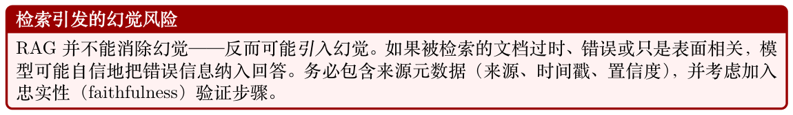
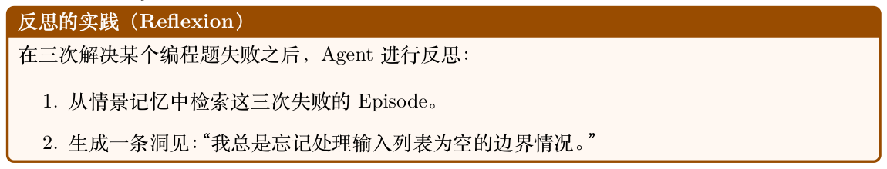
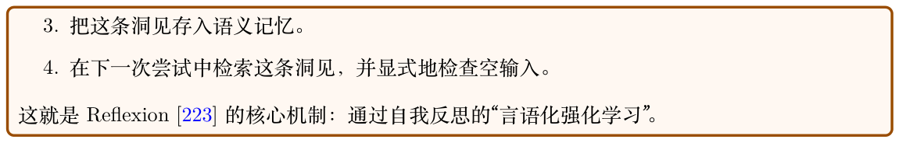
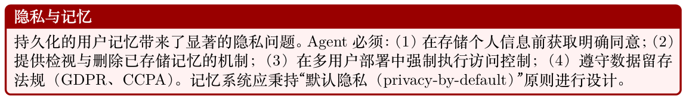
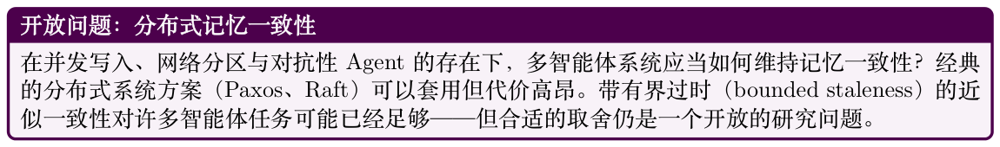
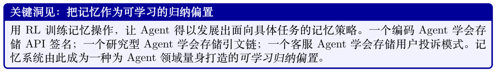
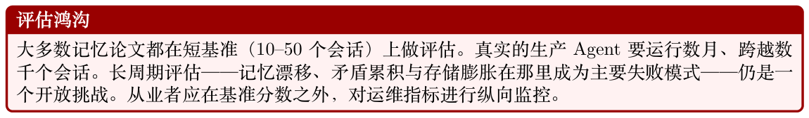
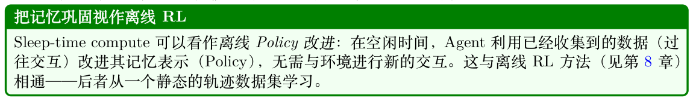

# 智能体记忆系统

## 18.1 动机：为什么Agent 需要记忆

大语言模型本质上是无状态的函数近似器：给定Prompt x，它们产生续写分布pθ(y | x)。每一次推理调用都从零开始。上下文窗口（context window）——模型可以关注的有限Token 序列——是生成时唯一可用的信息。对短小、自包含的任务而言这已足够；但对长周期的智能体任务而言，这是一个根本性瓶颈。

上下文窗口瓶颈

设L 为最大上下文长度（例如GPT-4o 的L = 128,000 个Token）。单个Token 大约编码4 个字符；一本典型书籍约含∼500,000 词≈670,000 个Token。即便不计成本，一个运行数日的自主Agent 所累积的观察、工具输出和推理轨迹不可能塞进任何固定窗口。记忆系统正是对这一物理约束的工程回应。

当Agent 缺乏持久化记忆时，会出现三种截然不同的失败模式：

1. 上下文的灾难性遗忘（Catastrophic Forgetting）。一旦事件滚出上下文窗口便不可挽回地丢失。Agent 无法回溯一万个Token 前所做的决策。

2. 无法从经验中学习。没有情景式（episodic）存储，每个Episode 对Agent 都像是第一次。成功的策略无法复用，错误则反复发生。

3. 缺乏个性化。用户偏好、领域事实、关系历史必须在每次会话中重新建立，导致用户体验与效率双双下降。

记忆作为认知架构

认知科学在生物智能体中区分出多种记忆系统[304, 305]：工作记忆（对信息的主动操控）、情景记忆（自传式事件）、语义记忆（世界知识）以及程序记忆（技能与习惯）。有效的智能体AI 系统从类似的划分中获益——并非因为我们要模拟神经科学，而是因为这些类别真实地反映了截然不同的访问模式、更新频率和检索机制。

形式化地，我们把Agent 建模为一个元组A = (πθ, M, R, W)，其中πθ 是Policy（LLM），M 是记忆存储，R : Q × M →D 是把查询映射到检索结果的检索函数，W : M × E →M 是用新经验E更新记忆的写入函数。在每一步t，Agent 观察到ot，检索相关上下文ct = R(ot, M)，并采取行动：

at ∼πθ(· | [st; ct; ht]) ,

其中st 是当前的系统Prompt，ct 是检索到的记忆，ht 是近期的上下文历史。行动之后，Agent 可写入新信息：M ←W(M, (ot, at, rt))。

## 18.2 记忆类型分类

### 18.2.1 工作记忆（短期）

工作记忆是Agent 的活动工作空间：当前正在被操控的信息。在LLM Agent 中它对应于：

**Figure 18.1: 智能体记忆系统的四分类法，与认知科学的划分相对应。每种记忆类型具有截然不同的访问模式、更新频率和检索机制。**

- 草稿板（Scratchpads）。在产出最终答案之前写入专用缓冲区的中间推理步骤（例如思维链Chain-of-Thought [121]、scratchpad [306]）。

- 思维链缓冲区。在答案Token a 之前生成的推理Token 序列z1, z2, . . . , zk，建模为p(a | x) = P z p(a | x, z) p(z | x)。

- 对话上下文。保留在上下文窗口中的近期轮次历史[(u1, a1), . . . , (ut, at)]。

工作记忆是快速的（零检索延迟——它已经在上下文中）、易失的（上下文清空时即丢失），且容量受限（受L 约束）。

### 18.2.2 情景记忆（基于经验）

情景记忆存储具体的过往事件，并按上下文与时间索引。对Agent 而言：

- 过往交互。先前对话、任务尝试及其结果的完整或摘要记录。

- 成功轨迹。可作为少样本范例被检索、以服务于未来相似任务的高Reward 动作序列。

- 失败案例。带有根因标注的错误记录，使Agent 能够避免重复犯错。

- 检索增强的情景回忆。给定新任务q，检索最相似的k 个过去Episode {ei}k i=1 并加入上下文。

情景记忆通常实现为基于Episode 摘要Embedding 的向量存储（见18.3.1 节）。

### 18.2.3 语义记忆（世界知识）

语义记忆编码与具体Episode 解耦的一般性事实与概念：

- 事实性知识。实体、属性与关系（例如“Paris 是France 的首都”）。

- 领域概念。与Agent 任务领域相关的定义、分类法与本体。

- 知识图谱。结构化表示G = (V, E)，节点v ∈V 为实体，边e ∈E 为带类型的关系。

与情景记忆不同，语义记忆是上下文无关的：水在100◦C 沸腾这一事实，无论何时何地学到都成立。

### 18.2.4 程序记忆（技能）

程序记忆编码如何做事——已被自动化的技能与动作模式：

- 习得的工具使用模式。对哪种任务调用哪个API、如何格式化输入、如何处理错误。

- 动作序列。多步过程（例如“部署代码：跑测试→构建镜像→推送→更新manifest”）。

- 作为记忆的Policy。模型权重θ 本身即编码了程序性知识；在成功轨迹上微调是程序记忆巩固的一种形式。

记忆类型的分类示例

一个协助软件开发的Agent 会用到：

- 工作记忆：当前正在编辑的文件、刚收到的错误信息。

- 情景记忆：“上周我在模块X 第42 行加了一个空值检查，修复了一个类似的

NullPointerException。”

- 语义记忆：“Python的asyncio.gather 并发运行协程；除非设置return_exceptions=True，否则异常会向上传播。”

- 程序记忆：标准调试工作流——复现→隔离→提假设→验证→修复。

## 18.3 记忆架构

### 18.3.1 基于RAG 的记忆

检索增强生成（Retrieval-Augmented Generation, RAG）[127] 是LLM Agent 外部记忆的主流范式。记忆存储M 是文档集合{di}N i=1；检索把查询q 映射到一个有序子集。

Embedding 存储与向量数据库。每个文档di 由Embedding 模型ϕ 编码：vi = ϕ(di) ∈RD。查

X Retrieve(q, M, k) = arg max sim(q, vi), S⊆[N], |S|=k i∈S

其中sim(·, ·) 通常为余弦相似度。近似最近邻（Approximate Nearest-Neighbor, ANN）索引（FAISS [274]、HNSW [275]、ScaNN [307]）使得N ∼107 量级下仍然可行。

检索策略。

- 稠密检索（Dense retrieval）。查询和文档都由神经编码器编码（例如DPR [273]、text- embedding-3-large）。能捕捉语义相似度，但需要GPU 推理。

- 稀疏检索（Sparse retrieval）。基于Token 重叠的BM25 或TF-IDF。快速、可解释、在精确关键词匹配上表现强劲。

- 混合检索（Hybrid retrieval）。通过倒数排名融合（Reciprocal Rank Fusion, RRF）合并稠密与稀疏分数：X RRF(d, k) = k + rankr(d), r∈rankers其中k = 60 是平滑常数。混合检索一致地优于单独使用任一种[308]。

重排序（Re-ranking）。交叉编码器（cross-encoder）重排序器fψ(q, d) ∈[0, 1] 与查询联合打分每个被检索文档，以O(k) 次前向传播的代价换取更高准确率。整体流水线为：用ANN 检索k′ ≫k

个候选，再用交叉编码器重排序，返回top k。



### 18.3.2 基于摘要的记忆

当原样存储过于昂贵或过于嘈杂时，摘要化在存储之前先压缩信息。

渐进式摘要（Progressive Summarization）。在每一步t，Agent 维护一个运行中的摘要St。当新信息et 到达时：St+1 = LLM(``Summarize: [St] + [et]'') .

这样把记忆规模保持在O(1)，但有丢失细节的风险。

分层压缩（Hierarchical Compression）。将记忆组织为层级L0 ⊃L1 ⊃· · · ⊃LK，其中L0 是原文，每个Li+1 都是Li 的摘要。检索首先访问LK（压缩程度最高、最快），按需逐层深入。这呼应了Forte [309] 的渐进式摘要技术。

何时摘要、何时原样存储。

- 原样存储：精确事实、代码片段、数值结果、用户原话。

- 摘要存储：叙事性上下文、推理链、冗余观察。

- 直接丢弃：噪声、无信息量的失败工具调用。

### 18.3.3 基于图的记忆

知识图谱。知识图谱G = (V, E, R) 把事实存储为三元组(h, r, t)，其中h, t ∈V 是实体，r ∈R 是关系。Agent 可通过SPARQL [310]、Cypher [311] 或自然语言到图的翻译进行查询。

实体-关系抽取。新观察由抽取模型IE : text →{(hi, ri, ti)} 解析并合并到G 中。共指消解（coreference resolution）与实体链接（entity linking）保证一致性。

GraphRAG。GraphRAG [289] 在RAG 之上叠加图遍历：给定一个查询，先检索种子实体，然后通过k 跳邻域遍历来挖掘Embedding 相似度未直接匹配到的相关事实。这对多跳推理尤其强大：[ GraphRetrieve(q, G, k) = Nk(v, G),

v∈seeds(q)

其中Nk(v, G) 是v 的k 跳邻域。

时序知识图谱。事实具有有效期：(h, r, t, [tstart, tend])。时序知识图谱[312] 支持类似“2023 年OpenAI 的CEO 是谁？”的查询，而不会把过去与现在的状态混淆在一起。

### 18.3.4 键值记忆网络（Key-Value Memory Networks）

可微分记忆网络[313, 314] 把记忆表示为一组键值对{(ki, vi)}M i=1，并通过基于软Attention 的检索访问：!

q⊤ki X M αi = softmax √ , c = αivi.

D i=1检索得到的上下文c 是查询的可微函数，从而支持端到端训练。现代Transformer 的Attention 就是这种机制的特例。在智能体场景中，记忆槽可以通过梯度下降更新，也可以通过显式的写入操作更新。

### 18.3.5 MemGPT 与虚拟上下文管理

MemGPT [315] 引入了类似操作系统虚拟内存的虚拟上下文抽象。记忆被组织为多层：

页入/页出策略（Page-In / Page-Out）。Agent 基于以下因素决定哪些记忆要提升到热上下文（page-in），哪些要逐出（page-out）：

- 近期性（Recency）：最近访问过的条目更有可能再次被需要。

- 相关性（Relevance）：与当前查询相似度高的条目。

- 重要性（Importance）：写入时被标记为高重要性的条目。

自驱动的记忆管理。在MemGPT 中，LLM 自身把记忆管理的函数调用（memory_search、memory_insert、memory_delete）作为其动作空间的一部分发出。这使记忆管理成为可学习的行为而非硬编码的Policy——天然适合作为RL 训练的目标（见18.7 节）。

## 18.4 记忆操作

### 18.4.1 写入：把信息提交到记忆

并非每条观察都应被存储。写入决策本质上是一个过滤问题：

其中τ 为阈值，importance(e) 可以是：

- 惊讶度（Surprise）：−log pθ(e | context)——出乎意料的事件信息量更大。

- Reward 信号：与高|rt|（正或负）相关联的事件值得记住。

- LLM 自评：提示模型在1–10 的尺度上为重要性打分。

冲突检测。在写入新事实fnew 之前，应检查它与已有记忆是否冲突：

Conflict(fnew, M) = ∃f ∈M : Contradicts(fnew, f).

冲突检测可以通过自然语言推理（NLI）模型实现，也可以通过提示LLM 来完成。一旦发生冲突，Agent 必须决定：覆盖、带时间戳并保留两者，或者标记为需要人工审查。

记忆格式与粒度。除了存什么，怎么存也至关重要。记忆条目从原子事实到冗长对话记录不等，各有不同的取舍：

**Table 18.1: 不同记忆粒度的取舍。**

| 设计准则。 |  |  |
| --- | --- | --- |
| • 粒度匹配查询类型。如果用户问的是事实性问题（“我的API key 是什么？”），原子事实更佳； |  |  |
| 如果问的是上下文性问题（“我们当时为什么决定用Redis？”），就需要Episode 摘要。 |  |  |
| • 在可承受的前提下用尽可能细的粒度存储，然后在其上构建粗粒度视图。把原子事实摘要化很 |  |  |
| 容易；但从有损摘要中恢复原子是不可能的。 |  |  |
| • 记录来源。每条记忆都应回链至来源（对话轮次、文档、工具输出），以便Agent 可校验、用 |  |  |
| 户可审计。 |  |  |
| 格式 | 优点 | 缺点 |
| 原子事实 |  |  |
| “用户偏好Python。” | 检索精确；可组合；去重与冲突检测容易 | 失去上下文；存在抽取错误；对细微信息 脆弱 |
| 结构化笔记 |  |  |
| (A-MEM [316]) | 元数据丰富（标签、链接）；支持图遍历； 在精确性与上下文之间取得平衡 | 写入成本更高；需要预先设计schema |
| 摘要式Episode |  |  |
| (MemGPT [315]) | 保留叙事连贯性；紧凑；适合多轮（Multi- Turn）推理 | 摘要有损；难以局部更新 |
| 原始对话记录 | 无损；无抽取错误；支持精确引用 | 存储量大；检索嘈杂；扫描代价高 |
| 实际生产系统往往会组合多种粒度[317]：抽取原子事实以支持精确召回，维护摘要式Episode |  |  |
| 以保留叙事性上下文，并把原始对话记录存入冷存储以满足可审计性需求。Generative Agents 架 |  |  |
| 构[318] 将观察存储为原子的“记忆对象”，附带自然语言描述、重要性分数与时间戳——同时支持精 |  |  |
| 确检索与时序推理。 |  |  |

### 18.4.2 读取/ 检索

查询的构造。检索查询q 未必要直接使用原始观察。更好的策略包括：

- HyDE（假设性文档Embedding，Hypothetical Document Embeddings）[285]：先生成一个假设性的答案，对其做Embedding，然后以该Embedding 作为查询。

- 查询扩展（Query expansion）：生成查询的多个改写，并取检索结果的并集。

- 回退式Prompt（Step-back prompting）：在检索之前先把具体查询抽象为一个更一般的问题。

时间衰减与近期性偏置。更久远的记忆可能相关性更低。一个带时间权重的评分是：!

−t −td score(d, q, t) = λ · sim(q, vd) + (1 −λ) · exp , τdecay

其中td 是记忆的创建时间，τdecay 控制衰减速率。Generative Agents 论文[318] 采用了类似的近期性加权检索。

### 18.4.3 更新：冲突解决与巩固

记忆巩固（consolidation）会合并相关记忆，以减少冗余并浮现出更高层的模式：

M′ = Consolidate(M) = Cluster(M) ∪Summarize(Cluster(M)).

遗忘机制。生物记忆会遗忘；人工记忆也应如此。可用策略包括：

- LRU 驱逐：容量超限时移除最近最少使用的条目。

- 重要性加权的遗忘：p(forget | d) ∝exp(−importance(d))。

- 间隔重复（Spaced repetition）：反复被访问的记忆保留得更久，遵循指数遗忘曲线[319]。

### 18.4.4 反思：元认知操作

反思（reflection）[223, 318] 是一种高阶记忆操作：Agent 读取自己的记忆并生成洞见：

Reflect(M) →{i1, i2, . . .} ⊂Msemantic,

其中每条洞见ij 都是从多条情景记忆中归纳出的更高层抽象。





反思结果存放在哪里？反思从情景记忆读取，但向语义记忆写入。所产生的洞见是上下文无关的概括（“始终检查空输入”），并非具体Episode 的记录——因此属于语义记忆Msemantic。然而在反思过程本身中，中间推理（检索到的Episode + 综合Prompt + 生成的洞见）占用的是工作记忆（上下文窗口）。一言以蔽之：

- 输入：情景记忆（具体的过往事件）

- 计算：工作记忆（上下文中的主动推理）

- 输出：语义记忆（持久化的、归纳后的洞见）

这与生物记忆巩固相对应——情景经验在睡眠与反思中逐渐被转化为语义知识。

## 18.5 多轮对话中的记忆

### 18.5.1 用户建模与偏好追踪

持久化的用户模型U 存储：

- 显式偏好：用户明确表达的喜好/厌恶、沟通风格偏好。

- 隐式偏好：从行为中推断（例如用户总是要求Python 代码、偏好简洁回答）。

- 专业水平：从词汇与问题复杂度中推断出的领域知识水平。

- 目标与上下文：进行中的项目、当前任务、组织角色。

用户模型在每次交互后更新：

Ut+1 = Update(Ut, (ut, at, feedbackt)).

### 18.5.2 会话连续性

没有记忆，每次对话都从“冷启动”开始。有了会话记忆后：

1. 在会话开始时，检索用户模型U 与近期会话摘要。

2. 注入个性化的系统Prompt：“你正在帮助Alice，一位从事分布式训练项目的高级ML 工程师。

上次会话你帮她调试了一个Gradient 同步问题。”

3. 在会话结束时，对会话进行摘要并更新U。

### 18.5.3 通过记忆实现个性化

个性化同时提升效率（更少的澄清问题）与质量（针对用户专业度校准的回答）。核心技术包括：

- 自适应详尽度：根据用户的历史互动调整回答长度。

- 领域引导（Domain priming）：从语义记忆中预置相关领域上下文。

- 主动回忆：无需用户提示即主动浮现相关的历史交互（“你上个月问过这个话题，当时我们的结论是⋯⋯”）。



## 18.6 多智能体系统中的记忆

当多个Agent 协作完成一个共享任务时，记忆变成了一种协调机制——而不仅是个人的知识库。负责任务分解的规划Agent 必须把子目标传达给执行Agent；批评者（critic）Agent 必须访问到与被评估Agent 相同的上下文；研究型Agent 团队必须避免重复工作。如果没有共享记忆，Agent 之间就只能通过直接消息传递一切，造成带宽瓶颈，并在对话滚出上下文时丢失信息。共享记忆通过提供所有Agent 都可读写的、持久化且可查询的底座来解决这一问题——把隐式协调（“我希望对方记得”）转换为显式状态（“答案就在blackboard 上”）。

### 18.6.1 共享记忆池

在多智能体系统中，Agent 可以在共享记忆存储Mshared 之外，再各自保留私有存储Mi：

contexti(t) = R(Mi, qi) ∪R(Mshared, qi).

共享记忆使隐式协调成为可能：Agent A 写入一个发现；Agent B 无需显式通信即可检索到。

### 18.6.2 Blackboard 架构

blackboard（黑板）模式[320] 是一种经典的多智能体协调机制：每个Agent 都从blackboard 读取并向其写入。一个控制器监控blackboard，并在某个Agent 的前置条件满足时将其激活。这把Agent 彼此解耦：它们通过共享状态而非直接消息进行通信。

### 18.6.3 共享知识中的共识与冲突

当多个Agent 同时写入共享记忆时，冲突难以避免。常用的解决策略包括：

- Last-write-wins（后写者胜出）：简单但会丢失信息。

- 版本化记忆：维护所有写入的历史；Agent 可以查询任一版本。

- 投票/ 共识：在某个事实被提交之前，要求n 个Agent 中有k 个达成一致。

- 置信度加权合并：fmerged = P i wifi，其中wi 是Agent i 的置信度。

- 指定权威：把不同记忆区域的所有权分配给特定的Agent。



## 18.7 用强化学习训练记忆系统

### 18.7.1 记忆操作的奖励信号

记忆操作（读、写、更新、反思）可以被视为RL 框架中的动作。挑战在于设计能激励有用记忆行为的Reward 信号：

- 任务Reward 回传。如果某次记忆检索导致了正确答案，则把功劳归于该检索动作。稀疏但毫不含糊。

- 检索精度Reward。rretrieve = Relevance(dretrieved, task)，由一个学习得到的相关性模型估计。

- 记忆效率Reward。对不必要的写入施加惩罚：rwrite = −λ · 1[write]，从而鼓励选择性存储。

- 一致性Reward。奖励内部一致（无矛盾）的记忆状态。

在第t 步对一次记忆操作mt 的组合Reward：

rmem = rtask + α · rretrieve + β · rwrite + γ · rconsistency .

t t t t t

### 18.7.2 学习“记什么”

“记什么”是一个元学习挑战：Agent 必须学到一个能最大化未来任务表现的写入Policy πwrite(e)。其难点在于：

1. 一条记忆的价值只有在未来才会显现（延迟Reward）。

2. 写入时未来可能查询的空间是未知的。

3. 记忆之间相互影响：存储e 的价值依赖于M 中已有的其他内容。

常见的方法有：

- 事后重标记（Hindsight relabeling）[321]。一个Episode 成功后，回溯性地把被检索到的记忆标记为“重要”，并训练写入Policy 去存储类似条目。

- 元强化学习（Meta-RL）[322]。在一组任务分布上训练写入Policy；Policy 学到存储能在任务间泛化的信息。

- 好奇心驱动的存储（Curiosity-driven storage）[323]。存储令人意外（预测误差高）的观察，因为它们更可能蕴含信息。

### 18.7.3 记忆增强的Policy 优化

联合优化Policy 与其记忆系统的思想可追溯到可微分记忆网络[324]，并由REALM [303] 推广到检索增强的LLM。一个记忆增强Agent 的完整Policy Gradient 目标为：

" T # X L(θ, ϕ) = Eτ∼πθ γtrt −λ · Lmem(ϕ), t=0

其中θ 是LLM 参数，ϕ 是记忆系统参数（例如检索模型权重），Lmem 是对记忆复杂度的正则项。



## 18.8 记忆方案的对比

## 18.9 评估记忆系统

评估智能体记忆颇具挑战，因为记忆操作的质量只能间接显现——通过长时间跨度的下游任务表现。

一个对所存事实有完美召回率的记忆系统，若检索出无关上下文或撑爆LLM 的上下文窗口，仍可能整体失败。

**Table 18.2: 在关键维度上对智能体记忆架构的对比。**

| 架构 | 容量 | 检索 | 更新成本 | 可训练 | 最适合 |
| --- | --- | --- | --- | --- | --- |
| 上下文内（工作记忆） | O(L) Token O(107) 文档 | 0 ms | 免费 | 通过微调 | 短任务、主动推理 |
| 稠密RAG [127] |  | 10–50 ms | O(1) Embedding | 仅编码器 | 语义检索、问答 |
| 稀疏（BM25）[272] | O(108) 文档 | 1–5 ms | O(|d|) 索引 | 否 | 关键词检索、法律/医疗 |
| 混合RAG [308] | O(107) 文档 | 15–60 ms | O(1) Embedding | 仅编码器 | 通用检索 |
| 摘要 | 无上限 | 0 ms（在上下文内） | O(|e|) 次LLM 调用 | 通过微调 | 长对话、叙事 |
| 知识图谱[312] | O(109) 三元组 | 5–100 ms | O(1) 插入 | Embedding 层 | 结构化事实、多跳 |
| 键值记忆网络[314] | O(M) 槽位 | O(M) Attention | 一次Gradient 更新 | 完全可训 | 端到端可微任务 |
| MemGPT 分层[315] | 无上限 O(107) 节点 | 0–100 ms | 混合 | 通过RL | 长周期Agent、助手 |
| Graph RAG [289] |  | 20–200 ms | O(1) 插入 | 仅编码器 | 复杂推理、社区结构 |

### 18.9.1 评估维度

LongMemEval [325] 提出长期记忆系统必须展现的五项核心能力：

1. 信息抽取。系统能否从对话轮次中识别并存储显著事实？通过事实召回率衡量：有多少真值事实可从记忆中恢复？

2. 跨会话推理。系统能否综合分散在多次过往会话中的信息？例如：“根据我们上周和昨天的对话，项目范围发生了哪些变化？”

3. 时序推理。系统能否正确回答与时间相关的查询？例如“在组织调整之前我说我的优先事项是什么？”这就要求区分不同时间的状态。

4. 知识更新。当事实发生变化时（用户搬到新城市、偏好改变），记忆能否反映最新状态，同时保留历史？

5. 拒答（Abstention）。当系统并无相关记忆时，它能否正确地说“我不知道”，而不是幻觉出一段看似合理却完全是捏造的回忆？

### 18.9.2 基准（Benchmarks）

**Table 18.3: 评估智能体记忆系统的基准。**

| 基准 | 发表会议/期刊 | 规模 | 关注点 |
| --- | --- | --- | --- |
| LongMemEval [325] | ICLR 2025 | 500 个问题，可扩展的历史 | 五项记忆能力；多会话对话 |
| LOCOMO [326] | EMNLP 2024 | 多会话对话 | 对话之上的单跳、时序、多 跳与开放域问答 |
| InfiniteBench [327] | ACL 2024 | 100K+ Token 上下文 | 长上下文召回，并非专门为 记忆设计，但能测试上限 |

### 18.9.3 度量指标

记忆层面的指标。

- 记忆召回率（Memory Recall）：可从记忆中检索到的真值事实数。衡量存储的完备程度。

真值事实总数

- 记忆精确率（Memory Precision）：top-k 检索中相关条目数。衡量检索的噪声。

k

- 延迟（Latency）：从查询到取回上下文的耗时（p50与p95）。

- Token 效率：每次查询注入上下文的Token 总数。越低越好——多余的上下文既降低LLM准确率又增加成本。

下游指标。

- 回答准确率：在记忆条件下最终回答的正确性（EM、F1或LLM-as-judge）。

- 忠实性（Faithfulness）：回答是否准确反映记忆中的内容，而没有捏造？

- 个性化质量：用户满意度，通过偏好评分或在记忆增强与无记忆系统之间做A/B 测试来衡量。

- 自相矛盾率：系统给出与此前所述事实不一致回答的频率。

运维层面的指标。

- 写入选择性：触发记忆写入的轮次比例。过高→噪声；过低→信息缺口。

- 过时率（Staleness）：尽管已存在更新，仍检索到过时事实的频率。

- 存储增长率：每小时交互所存储的Token 数。无界增长是不可持续的。



## 18.10 实现模式

### 18.10.1 基于Embedding 的向量存储记忆

最常见的记忆模式把条目存储为Embedding 向量，并附带元数据（时间戳、重要性分数、标签）。

检索把余弦相似度与时间衰减结合起来，使近期且重要的记忆优先浮现；去重与LRU 驱逐则把存储规模约束在上限以内。

```
import numpy as np
from dataclasses import dataclass , field
from datetime import datetime
from typing import Optional
import json
@dataclass
class MemoryEntry:
# """A single memory entry with metadata."""
"""带元数据的单条记忆条目。"""
content: str
embedding: np.ndarray
timestamp: datetime = field(default_factory=datetime.now)
importance: float = 0.5
access_count: int = 0
last_accessed: Optional[datetime] = None
tags: list[str] = field(default_factory=list)
source: str = "agent"
class VectorMemoryStore:
"""
Hybrid dense+sparse memory store with temporal decay.
Supports importance -weighted retrieval and LRU eviction.
带时间衰减的稠密+稀疏混合记忆存储。
支持基于重要性的加权检索与LRU 驱逐。
"""
def __init__(
self,
embed_fn , # callable: str -> np.ndarray # 可调用对象：str -> np.
ndarray
max_entries: int = 10_000,
decay_rate: float = 0.01, # per hour # 每小时
recency_weight: float = 0.3,
):
self.embed_fn = embed_fn
self.max_entries = max_entries
self.decay_rate = decay_rate
self.recency_weight = recency_weight
self.entries: list[MemoryEntry] = []
# -- Write --------------------------------------------------------------
```

```
# -- 写入--------------------------------------------------------------
def write(
self,
content: str,
importance: float = 0.5,
tags: list[str] | None = None,
check_duplicates: bool = True,
) -> MemoryEntry:
# """Commit a new memory , evicting if at capacity."""
"""提交一条新记忆，若已达容量上限则驱逐。"""
if check_duplicates and self._is_duplicate(content):
# Skip near-duplicate entries
return None # 跳过近似重复条目
embedding = self.embed_fn(content)
entry = MemoryEntry(
content=content ,
embedding=embedding ,
importance=importance ,
tags=tags or [],
)
if len(self.entries) >= self.max_entries:
self._evict()
self.entries.append(entry)
return entry
def _is_duplicate(self, content: str, threshold: float = 0.95) -> bool:
# """Check if a near-duplicate already exists."""
"""检查是否已存在近似重复项。"""
if not self.entries:
return False
emb = self.embed_fn(content)
sims = self._cosine_similarities(emb)
return float(np.max(sims)) > threshold
def _evict(self):
# """Remove the least important + least recent entry."""
"""移除最不重要且最久未访问的条目。"""
now = datetime.now()
scores = []
for e in self.entries:
age_hours = (now - e.timestamp).total_seconds() / 3600
recency = np.exp(-self.decay_rate * age_hours)
score = e.importance * (1 - self.recency_weight) \
+ recency * self.recency_weight
scores.append(score)
worst_idx = int(np.argmin(scores))
self.entries.pop(worst_idx)
# -- Retrieve -----------------------------------------------------------
# -- 检索-----------------------------------------------------------
def retrieve(
self,
query: str,
k: int = 5,
recency_boost: bool = True,
) -> list[MemoryEntry]:
"""
Hybrid retrieval: dense similarity + temporal recency.
Returns top-k entries sorted by combined score.
混合检索：稠密相似度+ 时间近期性。
返回按组合分数排序的前k 条。
```

```
"""
if not self.entries:
return []
q_emb = self.embed_fn(query)
dense_scores = self._cosine_similarities(q_emb)
now = datetime.now()
combined = []
for i, (entry, d_score) in enumerate(
zip(self.entries , dense_scores)
):
if recency_boost:
age_h = (now - entry.timestamp).total_seconds() / 3600
recency = np.exp(-self.decay_rate * age_h)
score = (1 - self.recency_weight) * d_score \
+ self.recency_weight * recency
else:
score = d_score
combined.append((score, i))
combined.sort(reverse=True)
top_k = [self.entries[i] for _, i in combined[:k]]
# Update access metadata
# 更新访问元数据
for entry in top_k:
entry.access_count += 1
entry.last_accessed = now
return top_k
def _cosine_similarities(self, query_emb: np.ndarray) -> np.ndarray:
# """Vectorized cosine similarity against all stored embeddings."""
"""对所有已存Embedding 进行向量化余弦相似度计算。"""
matrix = np.stack([e.embedding for e in self.entries])
norms = np.linalg.norm(matrix , axis=1, keepdims=True)
matrix_norm = matrix / (norms + 1e-8)
q_norm = query_emb / (np.linalg.norm(query_emb) + 1e-8)
return matrix_norm @ q_norm
# -- Reflect ------------------------------------------------------------
# -- 反思------------------------------------------------------------
def reflect(self, llm_fn, k: int = 10) -> list[str]:
"""
Meta-cognitive reflection: retrieve recent memories ,
synthesize higher -level insights , and store them back.
元认知反思：检索近期记忆，综合出更高层的洞见，并写回存储。
"""
if len(self.entries) < 3:
return []
# Retrieve recent high-importance memories
# 检索近期高重要性的记忆
recent = sorted(
self.entries , key=lambda e: e.timestamp , reverse=True
)[:k]
context = "\n".join(f"- {e.content}" for e in recent)
# Ask LLM to generate insights
# 请LLM 生成洞见
prompt = (
"Given these recent memories , extract 2-3 high-level "
"insights or patterns:\n" + context
)
```

```
raw_insights = llm_fn(prompt)
# Store each insight as a high-importance memory
# 把每条洞见作为高重要性记忆存储
insights = []
for line in raw_insights.strip().split("\n"):
line = line.strip().lstrip("-*").strip()
if len(line) > 20:
self.write(
f"[INSIGHT] {line}",
importance=0.9,
check_duplicates=True,
)
insights.append(line)
return insights
def get_stats(self) -> dict:
# """Return memory statistics for monitoring."""
"""返回记忆统计信息，便于监控。"""
return {
"total_entries": len(self.entries),
"avg_importance": float(
np.mean([e.importance for e in self.entries])
) if self.entries else 0.0,
"oldest_entry": min(
(e.timestamp for e in self.entries), default=None
),
}
```

Listing 18.1: 基于Embedding、带重要性打分与混合检索的向量存储记忆。

### 18.10.2 分层记忆管理器

受MemGPT [315] 启发，这一模式把记忆组织为三层：热（hot）（在上下文内，立即可访问）、温（warm）（向量存储，可快速检索）和冷（cold）（归档，容量无上限）。条目根据访问频率与重要性自动升级或降级——类似CPU 的缓存层级。

```
from enum import Enum
from collections import OrderedDict
class MemoryTier(Enum):
# HOT = "hot" # In-context: immediate access
HOT = "hot" # 在上下文内：立即可访问
# WARM = "warm" # Vector store: fast retrieval
WARM = "warm" # 向量存储：可快速检索
# COLD = "cold" # Archival: slow but unlimited
COLD = "cold" # 归档：慢但容量无上限
class HierarchicalMemoryManager:
"""
Three-tier memory manager inspired by MemGPT.
Hot tier is an LRU cache; warm is a vector store;
cold is append -only archival storage.
受MemGPT 启发的三层记忆管理器。
热层是LRU 缓存；温层是向量存储；
冷层是只追加的归档存储。
"""
def __init__(
self,
vector_store: VectorMemoryStore ,
# max entries in hot tier
hot_capacity: int = 20, # 热层最大条目数
warm_capacity: int = 5_000,
# callable for summarization
```

```
llm_summarize_fn=None, # 用于摘要的可调用对象
):
self.vector_store = vector_store
self.hot_capacity = hot_capacity
self.warm_capacity = warm_capacity
self.summarize = llm_summarize_fn
# Hot tier: ordered dict for LRU semantics
# 热层：用OrderedDict 实现LRU 语义
self.hot: OrderedDict[str, MemoryEntry] = OrderedDict()
# Cold tier: append -only list (would be a DB in production)
# 冷层：只追加列表（生产环境中通常是一个数据库）
self.cold: list[MemoryEntry] = []
# -- Page-in: promote warm -> hot ---------------------------------------
# -- 页入（Page-in ）：把温层提升到热层---------------------------------------
def page_in(self, query: str, k: int = 3) -> list[MemoryEntry]:
"""
Retrieve from warm store and promote to hot tier.
Evicts least-recently -used hot entries if needed.
从温层检索并提升到热层。
如有必要会驱逐热层中最近最少使用的条目。
"""
candidates = self.vector_store.retrieve(query, k=k)
promoted = []
for entry in candidates:
# use prefix as key
key = entry.content[:64] # 用前缀作为键
if key not in self.hot:
if len(self.hot) >= self.hot_capacity:
self._evict_hot()
self.hot[key] = entry
self.hot.move_to_end(key)
promoted.append(entry)
return promoted
def _evict_hot(self):
# """Evict LRU entry from hot tier back to warm."""
"""把热层中的LRU 条目驱逐回温层。"""
# OrderedDict: first item is LRU
# OrderedDict ：第一个元素即为LRU
key, entry = self.hot.popitem(last=False)
# Re-insert into warm store (already there, just update access)
# In a real system , we'd update the warm store's metadata
# 重新插入温层（实际上已存在，只需更新访问信息）
# 在真实系统中我们会更新温层中的元数据
# -- Write with tier assignment ------------------------------------------
# -- 带层级分配的写入------------------------------------------
def write(
self,
content: str,
importance: float = 0.5,
tier: MemoryTier = MemoryTier.WARM,
) -> MemoryEntry:
# """Write to the appropriate tier."""
"""写入到合适的层级。"""
if tier == MemoryTier.HOT:
entry = MemoryEntry(
content=content ,
embedding=self.vector_store.embed_fn(content),
importance=importance ,
)
key = content[:64]
```

```
if len(self.hot) >= self.hot_capacity:
self._evict_hot()
self.hot[key] = entry
return entry
elif tier == MemoryTier.WARM:
return self.vector_store.write(content , importance=importance)
else: # COLD # 冷层
entry = MemoryEntry(
content=content ,
# no embedding for cold
embedding=np.array([]), # 冷层不存Embedding
importance=importance ,
)
self.cold.append(entry)
return entry
# -- Summarize and compress ---------------------------------------------
# -- 摘要与压缩---------------------------------------------
def compress_hot_to_warm(self) -> Optional[str]:
"""
Summarize hot tier contents and write summary to warm.
Called when hot tier is full and new important content arrives.
对热层内容做摘要并把摘要写入温层。
在热层已满且有新的重要内容到来时调用。
"""
if not self.hot or not self.summarize:
return None
hot_contents = "\n".join(
f"- {e.content}" for e in self.hot.values()
)
summary = self.summarize(
f"Summarize these memory entries concisely:\n{hot_contents}"
)
self.vector_store.write(summary , importance=0.7)
return summary
# -- Unified retrieval --------------------------------------------------
# -- 统一检索--------------------------------------------------
def retrieve(self, query: str, k: int = 5) -> list[MemoryEntry]:
"""
Retrieve from all tiers, prioritizing hot.
Returns up to k entries sorted by relevance.
从所有层级检索，热层优先。
最多返回按相关性排序的k 条。
"""
results = []
# 1. Check hot tier (exact + semantic)
# 1. 检查热层（精确匹配+ 语义匹配）
q_emb = self.vector_store.embed_fn(query)
for entry in self.hot.values():
if entry.embedding.size > 0:
sim = float(
np.dot(q_emb, entry.embedding)
/ (np.linalg.norm(q_emb) * np.linalg.norm(entry.embedding) + 1e-8)
)
if sim > 0.7:
# +1 hot bonus
results.append((sim + 1.0, entry)) # +1 的热层加成
# 2. Retrieve from warm store
```

```
# 2. 从温层检索
warm_results = self.vector_store.retrieve(query, k=k)
for entry in warm_results:
results.append((0.5, entry))
# 3. Deduplicate and sort
# 3. 去重并排序
seen = set()
final = []
for score, entry in sorted(results , reverse=True):
key = entry.content[:64]
if key not in seen:
seen.add(key)
final.append(entry)
if len(final) >= k:
break
return final
def get_hot_context(self) -> str:
# """Return hot tier as a formatted context string."""
"""把热层格式化为上下文字符串返回。"""
if not self.hot:
return ""
lines = ["[Memory Context]"]
# last 10
for entry in list(self.hot.values())[-10:]: # 最后10 条
lines.append(f" * {entry.content}")
return "\n".join(lines)
```

Listing 18.2: 实现热/温/冷三层、并支持自动升降级的分层记忆管理器。

### 18.10.3 记忆增强的Agent 循环

这一模式由MemGPT [315] 提出，并在CoALA 框架[328] 中得到形式化。它通过一个读—行动—反思—写入的循环把记忆系统接入Agent 的推理流程：响应之前，Agent 检索相关记忆；响应之后，Agent 决定要存什么。LLM 输出中的特殊Token 会触发记忆操作，从而把对自身持久化的控制权交给模型本身。

```
import re
from typing import Any
class MemoryAugmentedAgent:
"""
An LLM agent with a full read-act-reflect -write memory cycle.
Implements the MemGPT -style self-directed memory management.
一个具有完整“读— 行动— 反思— 写入” 记忆循环的LLM Agent 。
实现MemGPT 风格的自驱动记忆管理。
"""
SYSTEM_PROMPT = """You are a memory -augmented AI assistant.
You have access to persistent memory across conversations.
At each turn you may issue memory commands:
[MEMORY_SEARCH: <query >] - retrieve relevant memories
[MEMORY_WRITE: <content >] - store important information
[MEMORY_REFLECT] - synthesize insights from memory
Always think step by step. Use memory to avoid repeating mistakes
and to personalize your responses."""
def __init__(
self,
# callable: messages -> str
llm_fn, # 可调用对象：messages -> str
memory_manager: HierarchicalMemoryManager ,
```

```
importance_threshold: float = 0.6,
max_memory_tokens: int = 1500,
):
self.llm = llm_fn
self.memory = memory_manager
self.importance_threshold = importance_threshold
self.max_memory_tokens = max_memory_tokens
self.conversation_history: list[dict] = []
# -- Main agent step ----------------------------------------------------
# -- Agent 主循环单步----------------------------------------------------
def step(self, user_message: str) -> str:
"""
Full agent step:
1. Retrieve relevant memories
2. Construct augmented prompt
3. Generate response (possibly with memory commands)
4. Execute memory commands
5. Reflect and consolidate
6. Return response to user
Agent 的完整单步：
1. 检索相关记忆
2. 构造增强Prompt
3. 生成响应（可能包含记忆命令）
4. 执行记忆命令
5. 反思与巩固
6. 把响应返回给用户
"""
# Step 1: Retrieve relevant memories
# 步骤1：检索相关记忆
memories = self.memory.retrieve(user_message , k=5)
memory_context = self._format_memories(memories)
# Step 2: Construct augmented prompt
# 步骤2：构造增强Prompt
messages = self._build_messages(user_message , memory_context)
# Step 3: Generate response
# 步骤3：生成响应
raw_response = self.llm(messages)
# Step 4: Execute any memory commands in the response
# 步骤4：执行响应中的所有记忆命令
clean_response , memory_ops = self._parse_memory_commands(
raw_response
)
self._execute_memory_ops(memory_ops , user_message , clean_response)
# Step 5: Auto-write important information
# 步骤5：自动写入重要信息
self._auto_write(user_message , clean_response)
# Step 6: Update conversation history
# 步骤6：更新对话历史
self.conversation_history.append(
{"role": "user", "content": user_message}
)
self.conversation_history.append(
{"role": "assistant", "content": clean_response}
)
return clean_response
# -- Memory retrieval and formatting -----------------------------------
```

```
# -- 记忆检索与格式化-----------------------------------
def _format_memories(self, memories: list[MemoryEntry]) -> str:
if not memories:
return ""
lines = ["Relevant memories:"]
for i, m in enumerate(memories , 1):
age = (datetime.now() - m.timestamp).days
lines.append(
f" [{i}] (importance={m.importance:.1f}, "
f"{age}d ago) {m.content}"
)
return "\n".join(lines)
def _build_messages(
self, user_message: str, memory_context: str
) -> list[dict]:
system = self.SYSTEM_PROMPT
if memory_context:
system += f"\n\n{memory_context}"
system += f"\n\n{self.memory.get_hot_context()}"
messages = [{"role": "system", "content": system}]
# Include recent conversation history (last 6 turns)
# 包含最近的对话历史（最后6 轮）
messages.extend(self.conversation_history[-6:])
messages.append({"role": "user", "content": user_message})
return messages
# -- Memory command parsing ---------------------------------------------
# -- 记忆命令解析---------------------------------------------
def _parse_memory_commands(
self, response: str
) -> tuple[str, list[dict]]:
# """Extract and remove memory commands from response."""
"""从响应中抽取并移除记忆命令。"""
ops = []
patterns = {
"search": r"\[MEMORY_SEARCH:\s*(.+?)\]",
"write": r"\[MEMORY_WRITE:\s*(.+?)\]",
"reflect": r"\[MEMORY_REFLECT\]",
}
clean = response
for op_type , pattern in patterns.items():
for match in re.finditer(pattern , response , re.DOTALL):
content = match.group(1) if op_type != "reflect" else None
ops.append({"type": op_type , "content": content})
clean = clean.replace(match.group(0), "").strip()
return clean, ops
def _execute_memory_ops(
self,
ops: list[dict],
user_msg: str,
response: str,
):
# """Execute memory commands issued by the LLM."""
"""执行LLM 发出的记忆命令。"""
for op in ops:
if op["type"] == "search":
results = self.memory.retrieve(op["content"], k=3)
# Page results into hot tier for immediate use
# 把结果页入热层，以便立即使用
self.memory.page_in(op["content"], k=3)
```

```
elif op["type"] == "write":
self.memory.write(
op["content"],
# explicitly written = important
importance=0.8, # 显式写入= 重要
tier=MemoryTier.WARM,
)
elif op["type"] == "reflect":
self._reflect()
# -- Auto-write heuristic -----------------------------------------------
# -- 自动写入启发式-----------------------------------------------
def _auto_write(self, user_msg: str, response: str):
"""
Automatically store important information without explicit command.
Uses a simple heuristic: write if response contains facts,
decisions , or user preferences.
在无显式命令的情况下自动存储重要信息。
使用简单的启发式：当响应包含事实、决策或用户偏好时即写入。
"""
importance_keywords = [
"remember", "important", "note that", "you prefer",
"your name is", "decided to", "the answer is",
"key insight", "learned that",
]
combined = (user_msg + " " + response).lower()
if any(kw in combined for kw in importance_keywords):
summary = f"User: {user_msg[:100]} | Agent: {response[:200]}"
self.memory.write(
summary ,
importance=self.importance_threshold ,
tier=MemoryTier.WARM,
)
# -- Reflection --------------------------------------------------------
# -- 反思--------------------------------------------------------
def _reflect(self):
"""
Meta-cognitive reflection: synthesize insights from recent memory.
Stores high-level insights back into semantic memory.
元认知反思：从近期记忆中综合出洞见。
将高层洞见写回语义记忆。
"""
recent = self.memory.retrieve("recent important events", k=10)
if len(recent) < 3:
# Not enough to reflect on
return # 不够支撑反思
recent_text = "\n".join(f"- {m.content}" for m in recent)
insight_prompt = [
{"role": "system", "content": "You extract high-level insights."},
{"role": "user", "content":
f"Based on these memories , what are 2-3 key insights?\n"
f"{recent_text}\nRespond with bullet points only."},
]
insights = self.llm(insight_prompt)
# Store each insight as a high-importance semantic memory
# 把每条洞见作为高重要性的语义记忆存储
for line in insights.split("\n"):
line = line.strip().lstrip("*-").strip()
if len(line) > 20:
self.memory.write(
f"[INSIGHT] {line}",
```

```
importance=0.9,
tier=MemoryTier.WARM,
)
```

Listing 18.3: 完整的记忆增强Agent 循环，含读—行动—反思—写入四个阶段。

读—行动—反思—写入循环

记忆增强的Agent 循环实现了一个四阶段的认知周期：

1. 读（Read）：在行动之前，检索相关记忆以指引响应。

2. 行动（Act）：基于检索到的上下文生成响应。

3. 反思（Reflect）：定期从已累积的记忆中综合出更高层的洞见。

4. 写入（Write）：选择性地把重要的新信息提交到持久化存储中。

这一循环呼应了军事战略中的observe-orient-decide-act（OODA）循环，以及认知心理学中的encode-store-retrieve（编码—存储—检索）模型。关键洞见在于：记忆并非被动的存储库，而是认知过程的主动参与者。

## 18.11 智能体记忆的最新进展

上文描述的记忆系统奠定了基础模式。近期若干工作进一步推进了边界：

### 18.11.1 CoALA：面向语言Agent 的认知架构

Sumers 等人[328] 提出了面向语言Agent 的认知架构（Cognitive Architectures for Language Agents, CoALA），这是一个借用认知科学与符号AI 原则、用于组织日益庞杂的LLM Agent 生态的统一框架。CoALA 将一个语言Agent 拆解为：

- 模块化记忆：工作记忆（上下文窗口）、情景记忆（过往经验）、语义记忆（世界知识）以及程序记忆（动作schema）——与18.2 节的分类体系相对应。

- 结构化的动作空间：内部动作（推理、检索、记忆写入）与外部动作（工具调用Tool Calling、与环境交互）。

- 决策循环：一个广义的“感知—规划—行动”循环，其中带有显式的检索与写入步骤。

CoALA的贡献与其说是一个新系统，不如说是一种设计语言：它提供了一种系统化的方式来分析已有Agent 并识别缺失能力，对从业者而言是一个有用的参考架构。

### 18.11.2 Mem0：生产级记忆层

Mem0 [317] 致力于弥合研究型记忆系统与生产部署之间的鸿沟。核心思路：

- 自动抽取：Mem0并不依赖LLM 显式发出记忆写入命令，而是自动从对话轮次中抽取显著事实，并将其巩固到持久化存储中。

- 基于图的记忆：除了扁平的向量存储之外，Mem0还在抽取出的实体与事实之上维护一张关系图，以支持多跳记忆查询（“用户在项目Y 的语境下，对话题X 说过什么？”）。

- 记忆压缩：冗余或被取代的事实会自动合并，使记忆存储保持紧凑与最新。

在LOCOMO 基准上，Mem0 相对OpenAI 的基线记忆取得了26% 的相对提升，与全上下文方案相比，p95 延迟降低91%，Token 成本降低>90%。

### 18.11.3 睡眠时计算（Sleep-Time Compute）：离线记忆处理

Lin 等人[329] 提出了sleep-time compute（睡眠时计算）范式，让Agent 在用户交互的间隔之间处理并巩固记忆，而不是只在查询时才计算。其类比是生物的睡眠——大脑在睡眠中巩固记忆并预先建立有用的联想。

工作机制。在空闲时段（“睡眠”）中，Agent 会：

1. 基于当前上下文预测未来可能出现的查询。

2. 预先计算推理链、摘要与结构化表示。

3. 把这些预计算产物存储下来，以便测试时（test-time）推理可检索并复用。

效果。在推理类基准上，sleep-time compute把达成等价准确率所需的测试时计算降低约5×。如果在同一上下文的多个相关查询上进行摊销，平均每次查询的成本下降2.5×。当用户查询是可预测的——即上下文强约束了可能被问到的问题时——该方法最为有效。



### 18.11.4 A-MEM：受Zettelkasten 启发的智能体记忆

A-MEM [316] 引入了一种借鉴Zettelkasten 方法的记忆系统——该方法是一种基于密集互联原子笔记的笔记系统——为LLM Agent 实现动态、自组织的记忆。

关键设计原则。

- 结构化笔记。每条记忆条目都不是原始文本块，而是一条带有多种结构化属性的笔记：上下文描述、关键词、标签，以及指向相关笔记的显式链接。这些元数据使检索比单纯的Embedding相似度更丰富。

- 动态链接。当一条新记忆被加入时，系统会分析已有记忆，识别语义上有意义的关联并建立双向链接。结果是一张知识网络，而不是扁平的列表。

- 记忆演化。关键之处在于，新增笔记可以触发对已有笔记的更新——随着Agent 理解的加深，对它们的上下文表示与属性进行细化。这让记忆成为一个随时间不断演进的活体结构，而非静态归档。

- Agent 驱动的组织。与固定schema 的记忆系统不同，A-MEM 让LLM 自身决定如何组织、链接与更新记忆——使组织结构能够自适应任务领域。

效果。在六个基础模型、多种多会话推理任务上，A-MEM 稳定优于扁平向量存储、基于摘要的记忆与图数据库方案，说明记忆如何组织与存什么同等重要。

## 18.12 小结

智能体记忆系统是有能力的AI Agent 的基础组件，用以应对有限上下文窗口这一根本限制。我们已综述：

- 一个四分类法（工作记忆、情景记忆、语义记忆、程序记忆），对应认知科学，并反映了截然不同的工程需求。

- 五大架构家族：基于RAG、基于摘要、基于图、键值网络，以及分层虚拟上下文（MemGPT）。

- 四种核心操作：写入（含重要性打分与冲突检测）、读取/检索（含时间衰减与查询扩展）、更新（含冲突解决与巩固），以及反思（元认知洞见生成）。

- 多轮与多智能体扩展：用户建模、会话连续性、共享记忆池与blackboard 架构。

- 记忆系统的RL 训练：记忆操作的Reward 信号、学习“记什么”，以及记忆增强的Policy 优化。

该领域仍在快速演进。关键的开放挑战包括：（1）记忆落地（memory grounding）——确保被检索到的记忆被忠实地纳入回答，而非被忽略或被幻觉所覆盖；（2）可扩展的一致性——在大型多智能体系统中维持连贯的共享记忆；（3）保护隐私的记忆——在不损害用户数据的前提下实现个性化。

随着上下文窗口的增长，上下文内记忆与外部记忆之间的边界会发生移动，但对有选择、有结构、可检索的信息存储的根本需求将一直存在。
