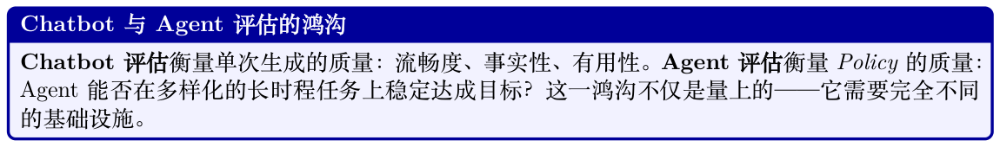
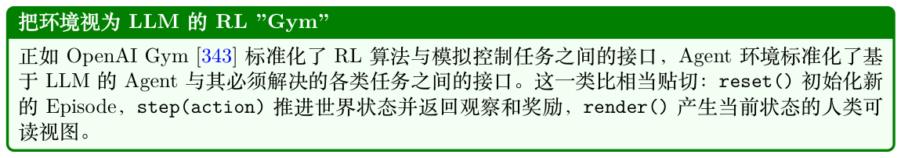
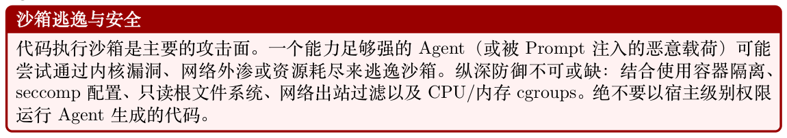
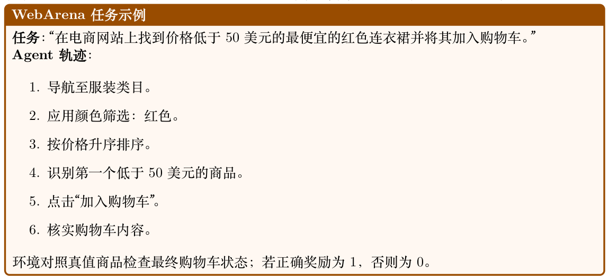
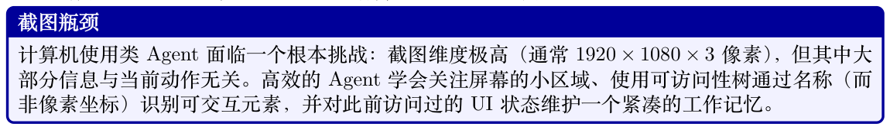
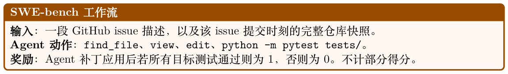
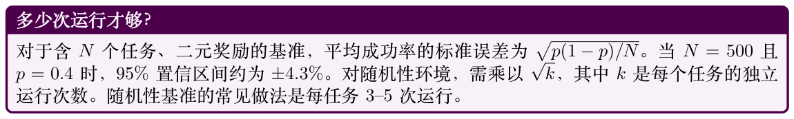
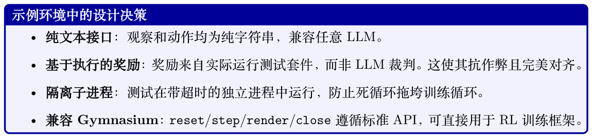
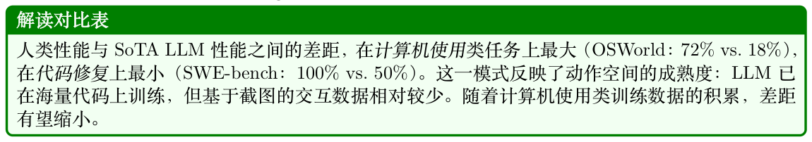
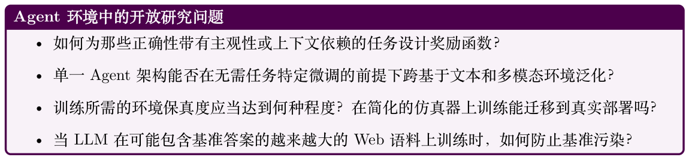

# Agent 环境与基准

## 21.1 动机：为什么Agent 需要环境

对话式语言模型的评估在原则上是直截了当的：给出一个Prompt、收集一次回复，并依据参考答案或人工评判进行打分。Agent 评估则根本不同：Agent 必须在世界中行动、观察后果，并在一连串步骤中调整其行为。任何单次回复都无法刻画这一点；只有结构化的环境才能做到。

范围说明。我们在强化学习意义上使用环境一词：Agent 为训练或评估而与之交互的世界——而非在线服务时承载Agent 的生产基础设施（harness、编排器）。执行沙箱出现在此处，是因为它们使这种环境成为可能，但Agent harness 本身在第18 章讨论。



安全探索。真实世界系统——生产数据库、在线网站、金融API——无法承受训练中Agent 的探索行为。沙箱环境提供一个忠实副本，Agent 可在其中失败、恢复、学习，且不造成不可逆的损害。

安全隔离（如Docker 容器、受限网络的虚拟机）不是可选项，而是一等设计要求。

可复现的评估。基准测试要求每个Agent 在相同条件下面对相同任务。环境必须按需具备确定性、受版本控制并可分发，以便一个实验室报告的结果能在另一个实验室复现。该性质的缺失历来使Agent 基准难以比较。

课程学习。从零开始在困难任务上训练Agent 在样本效率上很低。提供难度课程的环境——随着Agent 的进步逐步增加任务复杂度——可显著减少达到目标性能所需的环境交互次数。这与人类学习的方式相似：子技能的掌握先于整体的掌握。



## 21.2 环境设计原则

一个设计良好的Agent 环境暴露出四个正交的设计轴：观察空间、动作空间、奖励信号和Episode结构。让每一项都正确是必要的；让四者同时正确则是环境工程的手艺所在。

### 21.2.1 观察空间设计

观察是Agent 在每一步看到的内容。对于基于LLM 的Agent，观察几乎总以文本形式呈现，但其来源材料差异极大：

- 纯文本：终端输出、文件内容、API响应、错误信息。与任意LLM 兼容度最高，但丢失空间和视觉结构。

- 结构化（JSON/XML）：机器可读的状态表示。可实现精确的指代落地，但要求Agent 解析结构而非阅读散文。

- 多模态：截图、可访问性树（accessibility tree）、渲染后的HTML。GUI 和Web 任务必备；需要具视觉能力的模型或独立的感知模块。

- 混合：截图配合可访问性树（OSWorld和VisualWebArena 中使用），同时提供视觉上下文和结构化元素标识符，融合两种模态的优势。


### 21.2.2 动作空间设计

动作空间定义了Agent 可以做什么。对LLM Agent 而言，动作通常是一段文本字符串，由环境解析并执行。常见动作类型包括：

- 工具调用：对外部函数（搜索、计算器、日历）的结构化调用。常以JSON 或XML 函数调用语法格式化。

- 代码执行：Agent写出的代码在沙箱中运行；stdout/stderr 作为下一次观察返回。这是最具表达力的动作类型。

- API 交互：对Web 服务的HTTP 请求、数据库查询、Shell 命令。

- GUI 动作：click(x,y)、type("text")、scroll(direction)、key("Enter")。用于计算机使用类环境。

- 自然语言：发送给另一个Agent、人类或子任务规划器的自由文本。

### 21.2.3 奖励信号设计

奖励设计是环境工程中最难的部分。奖励必须：

1. 对齐：高奖励应对应真正的任务完成，而非表面代理指标。

2. 可学习：信号必须足够稠密，以使Agent 能够取得进展；长时程任务上的纯稀疏奖励若无额外塑形（shaping）通常无法学习。

3. 抗作弊：Agent不应能够在未真正完成任务的情况下获得高奖励（reward hacking，奖励欺骗）。

### 21.2.4 Episode 结构

Episode 可以采用若干结构：

- 定长：Agent恰好走T 步。实现简单；在已解决的任务上浪费算力。

- 提前终止：当Agent 标示完成或达到终止状态时Episode 结束。更高效，但需要可靠的终止检测器。

- 开放式：无固定时程；Agent持续运行直到资源预算（Token、API 调用次数、墙钟时间）耗尽。最接近真实部署，但最难评估。

**Table 21.1: Agent 环境中各类奖励信号及其权衡。**

| 奖励类型 | 优点 | 缺点 |
| --- | --- | --- |
| 稀疏（结束时0/1） | 对齐性好，难以作弊 | 难以学习 |
| 稠密（步级） | 易于学习 | 易产生塑形伪影 |
| 内在（好奇心） | 驱动探索 灵活、细腻 | 可能偏离任务 昂贵、不一致 |
| LLM-as-judge |  |  |
| 基于执行 | 真值依据 | 仅适用于可验证任务 |
| 自适应Episode 长度与提前终止。 | 近期工作挑战了“Episode 长度必须在训练前固定”的假设： |  |
| • 时程课程。AELA [344] 从短Episode 开始，并随Agent 能力的提升（以Policy 熵的收敛来 |  |  |
| 度量）逐渐扩展时程。前期的短Episode 每个训练样本能暴露更多样化的初始状态。 |  |  |
| • 截断作为RL 惩罚。DLER [345] 表明，对于推理模型，最简单的长度控制——硬截断——只 |  |  |
| 要配合批级别的奖励归一化和动态采样，就能很好地工作，从而避免被截断的rollout 丢失奖 |  |  |
| 励信号。 |  |  |
| • 学习停止。模型本身可以学习何时停止推理，而非依赖固定预算。[346] 提出三种策略：当连 |  |  |
| 续推理步骤收敛到同一答案时停止；提升“思考结束”Token 的概率；或在隐状态激活上训练一 |  |  |
| 个轻量分类器以预测最优停止点。 |  |  |
| • 部分rollout 回收。APRIL [347] 超额发起rollout 请求，一旦达到目标Batch 数即终止；未 |  |  |
| 完成的回复被回收作为后续步骤的热启动前缀，从而消除了少数慢样本阻塞整个Batch 的长 |  |  |
| 尾停顿（吞吐提升20–35%）。TLT [348] 针对同一瓶颈，通过即时训练一个自适应草稿模型来 |  |  |
| 对掉队样本进行投机解码（端到端加速1.7×，无损）。 |  |  |

### 21.2.5 难度课程与自适应环境

静态基准测量Agent 能力的一个固定快照。自适应环境更进一步：在线监控Agent 表现并调整任务难度，使Agent 保持在“最近发展区”——难到足以从中学习，易到偶尔能成功。相关技术包括：

- 程序化生成：从参数化分布中采样任务；根据近期成功率调整难度参数。Prioritized Level Replay [349] 通过估计的学习潜力（如GAE 幅值）对每个生成关卡打分，并更频繁地回放高价值关卡。

- 自博弈/ 对抗式环境设计：PAIRED [350] 训练一个对手提出能最大化“主角”与“反派”Agent之间悔值（regret）的环境，从而无需手工设计难度时间表即可产生复杂度逐步上升的自然课程。

- 后见之明重标注：用Agent 实际达到的目标重新标注失败轨迹，使失败也能提供学习信号（Hindsight Experience Replay, HER）[321]。

- 面向LLM 的难度定向数据筛选：在RLVR 训练中，并非所有问题都提供等量信号。近期工作优先选择中等难度的问题——即模型成功率大致在30–70% 之间的题目——因为它们能提供最高的梯度信息量[351]。ADCL [352] 随着模型提升而周期性地重新估计难度，避免课程过时。

## 21.3 Agent 环境的类型

### 21.3.1 代码执行沙箱

对LLM 而言，最基础的Agent 环境就是代码执行沙箱：Agent 写代码，沙箱运行，返回输出。这一简单循环支撑了出人意料比例的真实Agent 部署。

基于Docker 的隔离是最常见的做法。每个Episode 从已知镜像启动一个全新容器，在其中执行Agent 代码，并在Episode 结束时销毁该容器。网络访问、文件系统写入、进程派生均可在容器级别加以控制。

E2B（Environments to Benchmarks）提供一个托管云沙箱API：Agent 通过HTTP 发送代码，E2B 在隔离的Firecracker microVM 中执行（启动时间不到200 毫秒）并返回stdout/stderr。E2B处理容器生命周期管理的基础设施复杂性，便于集成进Agent 训练循环。

Modal 提供类似的托管执行模型，但GPU 支持更强，适合需要在任务中运行ML 工作负载的Agent。



### 21.3.2 Web 环境

Web 环境向Agent 提供一个浏览器，并要求其在真实或模拟网站上完成任务。

WebArena [266] 提供一个自托管测试平台，包含四个功能性Web 应用——电商商城、社交论坛、GitLab 实例和CMS——外加一个地图服务，共计812 个长时程任务。Agent 通过浏览器自动化API 进行交互；任务涉及多步导航、表单填写和信息检索。人类性能约78%；最先进的LLM Agent仅在35–45% 左右。

VisualWebArena [353] 在WebArena 基础上扩展，加入需要解读网页图像的视觉落地任务。观察为截图配合可访问性树；Agent 必须在两种模态中落地其动作。

Mind2Web [354] 是一个大规模数据集，涵盖137 个真实网站上的2,000 个任务，通过人类示范收集。与WebArena 不同，Mind2Web 聚焦于对未见网站的泛化，是更困难的分布外测试。



### 21.3.3 计算机使用环境

计算机使用环境（Computer Use）让Agent 控制一个完整的桌面操作系统，通过截图和/或可访问性API 进行观察。

OSWorld [355] 跨三种操作系统（Ubuntu、Windows、macOS）测试桌面自动化，涵盖369 个任务，覆盖各类生产力应用（LibreOffice、VS Code、Chrome、GIMP 等）。Agent 通过截图观察，并以pyautogui 风格的鼠标键盘命令行动。人-Agent 差距相当悬殊：标注者在约72% 的任务上成功，而最强LLM Agent 仅能达到∼18%，凸显了像素级GUI 控制的难度。

WindowsAgentArena [356] 专门聚焦于Windows 11，包含19 个应用上的154 个任务，强调企业工作流：Excel 公式、PowerPoint 编辑、Outlook 邮件管理。



### 21.3.4 软件工程环境

软件工程（Software Engineering, SWE）环境要求Agent 解决真实世界的编程任务：修bug、实现功能、写测试。

SWE-bench [265] 取材自12 个广泛使用的Python 项目（Django、Flask、scikit-learn 等）的2,294 个真实pull request。每个实例将一段issue 描述与一份预留的测试套件配对，仅在应用正确补丁后测试才通过。Agent 必须理解仓库结构、定位相关代码、实施修复并用测试套件加以验证。

SWE-bench Verified 子集（500 个issue）经过人工正确性校验，是标准评估目标。

SWE-agent [231] 既是基准环境也是Agent 框架。它引入了Agent-计算机接口（Agent-Computer Interface, ACI）：一组为LLM Agent 优化的Shell 命令（如search_file、open、edit），相比原始bash 降低了动作空间复杂度。



### 21.3.5 科研环境

科研环境推动Agent 走向自主知识生成：阅读论文、形成假设、设计实验、解读结果。

PaperQA2 [357] 是一个检索增强Agent，通过搜索PDF 语料库、抽取相关段落、综合出带引用的答案来回答科学问题。它既是文献依据型推理的工具，也是其基准。

AI Scientist [358] 是一个端到端的科研自动化系统：给定一个研究方向，Agent 即生成假设、撰写并运行实验、解读结果、产出论文初稿。该环境包含一个Python 执行沙箱、文献搜索API 和LaTeX 编译器。

MLAgentBench [359] 在机器学习工程任务上评估Agent：在算力预算内提升给定数据集上的模型精度。Agent 可读取数据、编写训练脚本、运行实验并迭代。

### 21.3.6 游戏与仿真环境

游戏提供了丰富的长时程环境，具有定义良好的奖励信号且无真实世界后果。

NetHack [360] 是一款程序化生成的roguelike 游戏，状态空间巨大，要求长期规划、物品管理以及对意外事件的适应。NetHack Learning Environment（NLE）提供了Gym 兼容接口。

Voyager / Minecraft [227] 把Minecraft 引擎用作一个开放式环境。Voyager 引入了难度逐级上升的任务课程（采集木材→制造工具→建造庇护所→探索下界）以及一个跨Episode 累积可复用代码片段的技能库。

GAIA [361] 提出466 个问题，要求链式工具使用——Web 搜索、代码执行、文件解析——并按所需推理步数划分为三个难度等级。该基准鲜明地暴露出人类能力（约92% 准确率）与当前LLM Agent（GPT-4 配合插件发布初期约15%，后续系统约30%）之间的鸿沟。

### 21.3.7 多Agent 环境

多Agent 环境涉及两个或更多LLM Agent 之间以及与共享世界的交互。

- 协商（Negotiation）：具有私有效用函数的Agent 必须通过对话达成交易。经典环境包括DealOrNoDeal [362] 和CaSiNo [363]。

- 辩论（Debate）：两个Agent 持相对立场进行辩论；由裁判Agent（或人类）评判论证质量。

用于通过对抗压力引出真实的推理。

- 协作式任务完成：具有互补能力（规划者、执行者、评论者）的Agent 必须协作完成任一单独Agent 无法解决的任务。相关框架包括AutoGen [337]、CrewAI [340] 和MetaGPT [364]。

- 竞争性游戏：Agent在零和博弈（国际象棋、围棋、扑克）中对弈，对手本身就是另一个LLM Agent。在这类环境中的自博弈已经在狭窄领域内产生了超人类的表现。

## 21.4 OpenEnv：标准化的Agent 环境接口

Agent 环境的激增带来了碎片化问题：每个环境都暴露不同的API、使用不同的观察格式、需要不同的脚手架。OpenEnv [365] 是Hugging Face 最近推出的开源框架，直接针对这一问题：它为Agent 执行环境提供Gymnasium 风格[366] 的接口（step()、reset()、state()），以基于Docker的隔离部署通过WebSocket 通信。OpenEnv 与更广泛的标准化努力互补，如AgentGym [367]（为LLM Agent 跨多种环境提供统一格式平台）和BrowserGym [368]（标准化Web Agent 基准的观察和动作空间）。下文的设计原则概括了这些项目共同收敛出的最佳实践。

**Figure 21.1: OpenEnv 架构与一个LLM Agent。Agent 通过harness 循环进行推理，并调用类型化的EnvClient。客户端通过WebSocket 与运行在Docker 容器内的HTTPEnvServer 通信。RL 训练器（虚线）可选地包裹该循环，以采集rollout 和奖励信号用于Policy 优化。**

### 21.4.1 标准化的Agent–环境接口

OpenEnv 为Agent 执行环境定义了一个类型化接口。其设计沿袭了Gymnasium 的简洁，但面向通过HTTP/WebSocket 与工具交互的LLM Agent：

- env.reset() →StepResult：开始一个新Episode；返回初始观察。

- env.step(action) →StepResult(observation, reward, done)：执行一个动作并返回结果观察、标量奖励和终止标志。

- env.state() →当前环境状态（Episode ID、步数、特定环境的字段）。

- env.close()：释放资源（停止容器、关闭连接）。

动作和观察是强类型的Python dataclass，针对每个环境特定。例如，编码环境定义CodeAction(code=...)并返回带stdout、stderr 和exit_code 的观察；游戏环境则定义其自己的动作/观察类型。这种逐环境的类型化使Agent 获得结构化、可预测的接口，同时保持三个核心方法（reset、step、state）的通用性。

架构。每个环境是一个继承自Environment 的Python 类（实现reset() 和step()）。它在Docker 容器内通过HTTPEnvServer 提供服务，后者暴露一个FastAPI/WebSocket 端点。客户端使用EnvClient 的特定环境子类，处理序列化和连接生命周期。容器可通过from_docker_image()本地启动，或通过base URL 远程连接：

```
from coding_env import CodeAction , CodingEnv
# 选项1：启动本地Docker 容器
client = CodingEnv.from_docker_image("coding -env:latest")
# 选项2：连接到远端部署
# client = CodingEnv(base_url="http://localhost:8000")
# 与环境交互
result = client.reset()
print(result.observation.stdout)
```

```
print(result.observation.stderr)
print(result.observation.exit_code)
result = client.step(CodeAction(code="print(2 + 2)"))
print(result.observation.stdout) # "4\n"
print(result.observation.exit_code) # 0
print(result.reward , result.done)
# 查看状态
state = client.state()
print(state.episode_id , state.step_count)
client.close()
```

环境即服务器。创建新环境只需实现Environment 基类：

```
from openenv.core.env_server import Environment , create_app
from dataclasses import dataclass
@dataclass
class MyAction:
text: str
@dataclass
class MyObservation:
response: str
reward: float = 0.0
done: bool = False
class MyEnvironment(Environment):
def reset(self) -> MyObservation:
return MyObservation(response="Ready")
def step(self, action: MyAction) -> MyObservation:
return MyObservation(response=f"Echo: {action.text}",
reward=1.0, done=False)
app = create_app(MyEnvironment(), MyAction , MyObservation)
# 运行：uvicorn module:app --host 0.0.0.0 --port 8000
```

harness 集成（实验性）。RFC 0054 引入了一个面向harness 的层，RL 训练框架通过MCP风格的工具调用与环境交互。build_harness_rollout_func() 辅助函数可产生一个TRL 兼容的rollout 函数，将OpenEnv 直接桥接进TorchForge [369] 等现有训练流水线。

治理。OpenEnv 由一个包含Meta-PyTorch、NVIDIA、Unsloth、Modal、Prime Intellect、Reflection和Hugging Face 的技术委员会公开治理——确保该标准在广泛的产业输入下演进，而非任由单一厂商的议程主导。

### 21.4.2 环境注册与发现

OpenEnv 环境可部署为Hugging Face Spaces 或本地Docker 镜像，无需手动安装即可发现和使用。

无论部署目标如何，客户端接口都保持一致：

```
from echo_env import EchoAction , EchoEnv
# 连接到远端HF Space 部署
client = EchoEnv(base_url="https://openenv -echo-env.hf.space")
result = client.reset()
print(result.observation.echoed_message) # "Echo environment ready!"
result = client.step(EchoAction(message="Hello!"))
```

```
print(result.observation.echoed_message) # "Hello!"
print(result.reward)
client.close()
```

OpenEnv 生态系统已覆盖70 多个环境（OpenSpiel 游戏、Atari、BrowserGym、编码沙箱、金融RL、交通仿真等）。RFC 0025 提出一个正式的工具发现协议，使Agent 能在运行时查询陌生环境接受哪些动作。

### 21.4.3 组合式环境

真实的Agent 部署很少只使用单一工具。OpenEnv 支持通过类型化动作暴露多种能力的丰富环境。

例如，编码环境在单一沙箱会话内支持代码执行、文件I/O 和Shell 命令：

```
from coding_env import CodeAction , CodingEnv
client = CodingEnv.from_docker_image("coding -env:latest")
result = client.reset()
# 执行代码
result = client.step(CodeAction(code="x = 42\nprint(x)"))
print(result.observation.stdout) # "42"
print(result.observation.exit_code) # 0
# 状态在同一Episode 内跨步骤保持
result = client.step(CodeAction(code="print(x + 1)"))
print(result.observation.stdout) # "43"
state = client.state()
print(state.step_count) # 2
client.close()
```

对于需要多样化工具访问（代码+ Web + 文件）的Agent，OpenEnv 的RFC 0036 提出MCP（模型上下文协议，Model Context Protocol）集成，允许任何兼容MCP 的工具服务器被封装为一个OpenEnv 环境。此外，openenv CLI 可通过单条命令脚手架化、构建并部署新环境到Hugging Face Spaces。

### 21.4.4 环境版本控制与可复现性

基准的可信度要求环境行为在评估时被冻结。最佳实践包括：

- 语义化版本：WebArena-v1.2.0 保证在同一次要版本号内向后兼容。

- Docker 镜像固定：环境运行时被打包为带内容寻址哈希的Docker 镜像。

- 基于种子的确定性：所有随机元素（程序化生成、网络响应）都被设种子并记录，使任意轨迹都能精确重放。

- 排行榜快照：公开排行榜在分数旁记录环境版本，防止基准悄然漂移。

## 21.5 构建自定义环境

### 21.5.1 面向LLM Agent 的Gymnasium 风格API

Gymnasium API [366]（OpenAI Gym 的继任者）是RL 环境的事实标准。将其适配到LLM Agent需要两处修改：(1) 观察和动作是字符串（或包含字符串的字典）而非数值数组；(2) step 方法必须处理异步工具执行。

### 21.5.2 奖励函数工程

LLM Agent 环境的奖励函数通常是基于执行的：环境在每个Episode 后运行一个验证器，若任务被解决则返回1，否则返回0。对于没有明确验证器的任务，选项包括：

- LLM-as-judge：由一个独立的LLM 根据任务描述对Agent 的最终状态打分。

- 基于评分量表（Rubric）：结构化的评分量表将任务分解为若干子标准，每项独立打分。

- 人工标注：由人类评估者对一组随机抽样的轨迹打分；这些分数用于校准一个自动化代理指标。

### 21.5.3 状态管理与检查点

长时程任务可能需要数小时的墙钟时间。环境应支持：

- 状态序列化：完整的环境状态（文件系统、浏览器cookies、数据库内容）可序列化到磁盘并恢复。

- Episode 中检查点：Agent 可在任意步骤保存检查点并从中恢复，从而支持树搜索式探索。

- 轨迹日志：每个观察、动作和奖励都被记录到结构化文件中，供离线分析和奖励模型训练使用。

### 21.5.4 用于训练数据采集的并行化

通过RL 训练LLM Agent 需要数百万次环境交互。并行化策略包括：

- 进程级并行：派生N 个独立的环境进程；并行采集轨迹。

- 异步rollout worker：使用异步事件循环（如asyncio）将LLM 推理延迟与环境执行重叠。

- 向量化环境：将多个环境批处理到单次step 调用中，摊销Python 开销。

- 云原生扩展：使用作业调度器（Ray、SLURM）在集群中分发环境worker，由中心化的回放缓冲（replay buffer）聚合轨迹。

## 21.6 环境–Agent 接口模式

**图21.2 展示了实践中使用的四种主要接口模式。**

基于文本的观察/动作。Agent 接收字符串观察并产出字符串动作。环境解析该动作（如从<tool>...</tool> 块中抽取工具调用）并以字符串形式返回结果。这是兼容性最佳的模式：任何LLM 无需特殊架构即可参与。

结构化JSON 观察/动作。观察和动作是符合既定Schema 的JSON 对象。这支持严格校验（在执行前拒绝畸形动作）、结构化日志，以及更便利的程序化轨迹分析。代价是Agent 必须可靠地产出有效JSON，这要求微调或受约束解码。

多模态（截图+ 可访问性树）。用于计算机使用类和Web 环境。观察为元组(screenshot: PIL.Image, a11y_tree: dict)。截图提供视觉上下文；可访问性树提供元素标识符，使得动作可不依赖像素级坐标。该混合方式比纯截图控制更鲁棒。

流式vs. 回合式交互。当前大多数环境采用回合式模型：Agent 产出完整动作，环境执行后返回下一个观察。流式环境允许Agent 在观察到达时即接收部分观察（如长时间运行命令的输出），并在流过程中中断或重定向执行。这更接近人类与计算机交互的方式，但对Agent 架构要求更复杂。

**Figure 21.2: 四种Agent–环境接口模式。(a) 基于文本是LLM 最常用的方式；(b) 结构化JSON 可实现精确解析；(c) 多模态结合截图与可访问性树用于GUI 任务；(d) 流式接口支持没有离散回合边界的实时交互。**

## 21.7 评估harness 设计

评估harness 是在一组基准上运行Agent、采集结果、产出汇总统计的基础设施。优秀的harness 设计与优秀的环境设计同等重要。

### 21.7.1 确定性vs. 随机性环境

- 确定性环境对相同动作序列产出相同观察序列。易于调试和复现，但可能无法反映真实世界的变异性。

- 随机性环境引入随机性（程序化生成、网络延迟、用户模拟）。每个任务需要多次运行以估计平均性能和置信区间。



### 21.7.2 留出测试环境

基准的可信度要求在环境级别（而不仅是任务级别）做严格的训练/测试划分。一个在WebArena 任务上训练过的Agent 应在训练时未使用的留出任务集合上评估。理想情况下，留出集合应覆盖与训练集不同的网站、任务类型和难度等级。

### 21.7.3 跨环境泛化

对Agent 的终极考验是其在某一环境中学到的技能能否迁移到另一环境。跨环境评估协议测量：

- 零样本迁移：在环境A 上训练，无微调地在环境B 上测试。

- 少样本适配：评估前提供来自环境B 的k 个示范。

- 持续学习：依次在环境A、B、C 上训练；在C 上训练完成后测量三者上的性能。

### 21.7.4 人类基线采集

每个基准都应包含人类性能作为参考点。人类基线有三个用途：

1. 它们为任务难度建立上界。

2. 它们揭示任务是否根本可解（某些基准任务被证实是模糊的或不可解的）。

3. 它们为解读Agent 分数提供校准点（“该Agent 达到了人类性能的40%”）。

人类基线应从具备领域专长的工作者采集（如SWE-bench 应使用软件工程师而非众包工人），并应包含任务用时测量以便进行效率比较。

## 21.8 代码示例：最小的自定义LLM Agent 环境

```
用于LLM Agent 训练的最小自定义环境
以下Python 类实现了一个文件编辑环境，Agent 必须修改一个Python 文件以使一个失败的测
试通过。它遵循为LLM Agent 适配过的Gymnasium API。
"""
minimal_env.py --用于LLM Agent 的最小文件编辑环境。
Agent 接收一个含bug 的Python 文件以及一个失败的测试。
它必须不断编辑该文件直到测试通过。
奖励：所有测试通过则为1.0 ，否则为0.0 。
"""
from __future__ import annotations
import subprocess , shutil, tempfile , textwrap
from pathlib import Path
from dataclasses import dataclass , field
from typing import Any
# ---------------------------------------------------------------------------
# 数据结构
# ---------------------------------------------------------------------------
@dataclass
class StepResult:
observation: str # 输入给LLM 的文本
reward: float # 0.0 或1.0
terminated: bool # Episode 结束（任务解决或达到最大步数）
truncated: bool # Episode 被截断（预算超出）
info: dict[str, Any] = field(default_factory=dict)
```

```
# ---------------------------------------------------------------------------
# 环境
# ---------------------------------------------------------------------------
class FileEditEnv:
"""
一个Gymnasium 风格的LLM 代码修复环境。
观察空间: str（文件内容+ 测试输出）
动作空间: str（以下之一：view 、edit 、run_tests 、submit ）
奖励: 所有测试通过为1.0 ，否则为0.0
"""
MAX_STEPS = 20 # Episode 硬上限
TIMEOUT = 30 # 每次测试运行的秒数
def __init__(self, buggy_code: str, test_code: str,
task_description: str):
self.buggy_code = buggy_code
self.test_code = test_code
self.task_description = task_description
self._workdir: Path | None = None
self._step_count = 0
# ------------------------------------------------------------------
# 核心API
# ------------------------------------------------------------------
def reset(self, seed: int | None = None) -> tuple[str, dict]:
"""初始化一个新Episode ；返回(observation , info)。"""
if self._workdir and self._workdir.exists():
shutil.rmtree(self._workdir)
self._workdir = Path(tempfile.mkdtemp(prefix="fileenv_"))
self._step_count = 0
# 写入初始文件
(self._workdir / "solution.py").write_text(self.buggy_code)
(self._workdir / "test_solution.py").write_text(self.test_code)
obs = self._build_observation(
action_taken="[Episode start]",
test_output=self._run_tests()
)
return obs, {"step": 0}
def step(self, action: str) -> StepResult:
"""执行一个Agent 动作；返回StepResult 。"""
self._step_count += 1
action = action.strip()
# --- 解析并分派动作---
if action.startswith("view"):
result_text = self._action_view()
elif action.startswith("edit"):
result_text = self._action_edit(action)
elif action.startswith("run_tests"):
result_text = self._run_tests()
elif action.startswith("submit"):
result_text = self._run_tests()
else:
result_text = (
f"Unknown action: {action!r}\n"
"Valid actions: view | edit <new_content > | "
"run_tests | submit"
```

```
)
test_output = self._run_tests()
passed = "passed" in test_output and "failed" not in test_output
reward = 1.0 if passed else 0.0
terminated = passed or action.startswith("submit")
truncated = self._step_count >= self.MAX_STEPS
obs = self._build_observation(action, test_output)
return StepResult(obs, reward , terminated , truncated ,
{"step": self._step_count ,
"passed": passed})
def render(self) -> str:
"""返回当前状态的人类可读摘要。"""
if self._workdir is None:
return "[Environment not initialised]"
code = (self._workdir / "solution.py").read_text()
return f"=== solution.py ===\n{code}\n"
def close(self) -> None:
"""释放资源。"""
if self._workdir and self._workdir.exists():
shutil.rmtree(self._workdir)
self._workdir = None
# ------------------------------------------------------------------
# 私有辅助方法
# ------------------------------------------------------------------
def _action_view(self) -> str:
code = (self._workdir / "solution.py").read_text()
return f"Current solution.py:\n```python\n{code}\n```"
def _action_edit(self, action: str) -> str:
# 期望格式：edit\n```python\n<code >\n```
try:
new_code = action.split("```python")[1].split("```")[0]
(self._workdir / "solution.py").write_text(new_code)
return "File updated successfully."
except IndexError:
return "Edit failed: wrap new code in ```python ... ```"
def _run_tests(self) -> str:
result = subprocess.run(
["python", "-m", "pytest", "test_solution.py",
"-v", "--tb=short", "--no-header"],
cwd=self._workdir ,
capture_output=True, text=True,
timeout=self.TIMEOUT
)
return result.stdout + result.stderr
def _build_observation(self, action_taken: str,
test_output: str) -> str:
code = (self._workdir / "solution.py").read_text()
return textwrap.dedent(f"""
TASK: {self.task_description}
STEP: {self._step_count}/{self.MAX_STEPS}
--- Last action ---
{action_taken}
--- Current solution.py ---
{code}
```

```
--- Test output ---
{test_output}
--- Available actions ---
view # show current file
edit\n```python\n<code >\n``` # replace file contents
run_tests # run pytest
submit # finalise and end episode
""").strip()
# ---------------------------------------------------------------------------
# 使用示例
# ---------------------------------------------------------------------------
if __name__ == "__main__":
BUGGY = "def add(a, b):\n return a - b\n" # bug ：本应是加号
TESTS = (
"from solution import add\n"
"def test_add(): assert add(2, 3) == 5\n"
)
env = FileEditEnv(BUGGY, TESTS, "Fix the add() function.")
obs, _ = env.reset(seed=0)
print(obs)
# 模拟一次正确的编辑
fix = "edit\n```python\ndef add(a, b):\n return a + b\n```"
result = env.step(fix)
print(f"\nReward: {result.reward} | Terminated: {result.terminated}")
env.close()
```

Listing 21.1: 遵循Gymnasium API 的最小LLM Agent 环境。



## 21.9 主要Agent 环境对比

**表21.2 总结了本节讨论的主要Agent 环境的关键属性。**



## 21.10 小结

Agent环境是训练和评估LLM Agent 的基底。本节的关键要点是：

1. 环境不是可选项。安全探索、可复现评估和课程学习都需要结构化环境。若没有环境，Chatbot评估与Agent 评估之间的鸿沟无法跨越。

2. 四个维度都需谨慎设计。观察空间、动作空间、奖励信号和Episode 结构各有可能让整个基准失效的失败模式。

**Table 21.2: 面向LLM Agent 的主要Agent 环境对比。”SoTA” 指撰写时已发表的最佳LLM Agent 结果。**

| 给出人类性能（若有）。 |  |  |  |  |
| --- | --- | --- | --- | --- |
| 环境 | 观察类型 动作空间 领域 文 本 浏览器API Web 导航 | 任务数 | 人类 | SoTA LLM |
| WebArena | + DOM |  | 78% | ∼45% |
| VisualWebArena | 截 图 + 浏览器API 视觉Web DOM |  | 88% | ∼35% |
| Mind2Web | 截 图 + 浏览器API 真实网站 DOM | 2,000 | — | ∼30% |
| OSWorld | 截图 鼠标+ 键 桌面OS 盘 |  | 72% | ∼18% |
| WindowsAgentArena | 截图 鼠标+ 键 Windows 盘 应用 |  | 75% | ∼20% |
| SWE-bench Verified | 文本（仓库）Shell + 编 代码修复 辑器 |  | 100% | ∼50% |
| GAIA (Level 1) | 文本+ 文 工具调用 通用QA 件 |  | 92% | ∼55% |
| GAIA (Level 3) | 文本+ 文 工具调用 困难QA 件 |  | 92% | ∼10% |
| NetHack (NLE) | 文本+ 字 离散动作 Roguelike 符图 游戏 | — | >10k 分 | ∼5k 分 |
| Voyager (Minecraft) | 文本+ 代 代码执行 开放世界游 码 戏 | 课程 | — | 15+ 科技树 |
| MLAgentBench | 文本+ 代 Shell + 编 ML 工程 码 辑器 |  | — | ∼40% |
| 3. 生态丰富但碎片化。代码沙箱、Web 环境、计算机使用类环境、SWE 环境、科研环境、游戏 |  |  |  |  |
| 和多Agent 竞技场各测试不同能力。任何单一环境都不充分。 |  |  |  |  |
| 4. 标准化很重要。OpenEnv [365] 提供Gymnasium 风格的API，配合Docker 隔离以及把 |  |  |  |  |
| Hugging Face Spaces 作为注册中心——降低了构建新环境以及在不同环境间比较Agent 的成 |  |  |  |  |
| 本。 |  |  |  |  |
| 5. 人类差距真实存在但正在收窄。当前LLM Agent 在大多数基准上达到人类性能的20–50%。 |  |  |  |  |
| 进展最快的是训练数据充裕的领域（代码），最慢的是需要细粒度感知的领域（GUI 控制）。 |  |  |  |  |


