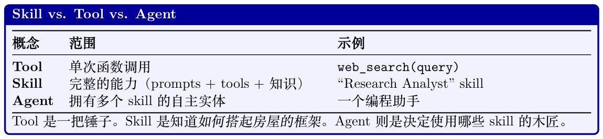

# Agent Skills

随着Agent 从单体式的prompt-加-工具系统演化为模块化架构，一个关键的设计问题浮现出来：Agent 的能力应如何被组织、发现与组合？答案越来越收敛到skill（技能）这一概念——一些离散、可复用的行为单元，可以在不重新训练的前提下被加载、组合与替换。

这一思路由Voyager [227] 推广开来：该工作展示了一个在Minecraft 中运行的LLM Agent 可以不断积累一个可执行代码skill 的库，每个skill 都经过验证并被存储以供后续复用。同样的原则也适用于生产级Agent：skill 以可组合、可版本化的形式封装领域专长，其可扩展性远超任何单个prompt 所能容纳。Skill 通常会包装MCP server（见第22 章）以获得工具访问能力，将skill 抽象与标准化工具层连接起来。

## 23.1 什么是Skill？

一个skill 是一个自包含的能力模块，赋予Agent 在某个特定领域或任务上的专长。与仅暴露单个函数的原始tool 不同，一个skill 涵盖：

- 系统prompt 增强：注入到Agent 上下文中的领域特定指令、约束与人设要素。

- Tool 绑定：该skill 所需的一个或多个tool（API、MCP server、本地命令）。

- 知识：Agent正确执行该skill 所需的参考资料、示例或few-shot 演示。

- 工作流逻辑：引导Agent 完成复杂任务的多步骤流程、决策树或条件流。

- 安全护栏：该skill 特有的安全约束、输出格式要求与校验规则。



## 23.2 Skill 架构模式

### 23.2.1 静态Skill 加载

最简单的模式：根据配置在Agent 初始化时加载skill。Agent 始终可以访问其全部skill。

```
# 伪代码——与具体框架无关的模式
agent = Agent(
model="claude -sonnet -4-20250514",
skills=["code-review", "documentation", "testing"],
# 每个skill 都会向Agent 添加prompts 、tools 与知识
)
```

优点：简单、可预测、低延迟。

缺点：未被使用的skill 会浪费上下文窗口；无法扩展到数百个skill。

### 23.2.2 动态Skill 发现

Agent 根据当前任务选择激活哪些skill。一个skill 路由器（通常是一个轻量分类器或基于embedding的匹配器）来判断相关性：

```
# 伪代码——与具体框架无关的模式
relevant_skills = skill_router.match(
user_request=message ,
available_skills=skill_registry ,
max_skills=3
)
agent.activate(relevant_skills)
```

优点：可扩展到大型skill 库；上下文效率高。

缺点：路由错误可能漏掉相关skill；引入额外延迟。

### 23.2.3 层级化Skill 组合

Skill 可以依赖于其他skill，从而构成一个有向无环图（DAG）。一个高层skill（例如“部署应用”）可能会调用一些子skill（“跑测试”、“构建Docker 镜像”、“更新DNS”）：

- Skill 显式声明其依赖

- 编排器在执行前解析依赖图

- 子skill 可被多个父skill 共享

## 23.3 案例研究：Anthropic 的Agent 设计

Anthropic 对Agent 架构的方法[341] 是关于生产环境中基于skill 的Agent 设计最清晰的阐述之一。其设计哲学强调简单优于复杂、可组合的构建块优于单体框架。（这些模式也会在第20 章从编排视角进行讨论。）

### 23.3.1 核心原则

1. 从最简单的方案起步。在尝试更简单的方案（单次LLM 调用、检索+ 生成）并确认其不足之前，不要急于使用Agent 化模式。

2. Workflow 与Agent 的区分。Anthropic 将以下两者加以区分：

- Workflows：对LLM 调用进行预先编排——确定性的控制流，在特定节点包含LLM 步骤。更可预测、更易调试。

- Agents：由LLM 动态决定下一步该做什么——工具选择、迭代次数与停止条件都由模型驱动。更灵活，但更难控制。

3. 以增强型LLM 作为原子单元。原语从来不是裸模型——它总是与其检索源、可调用工具和持久化记忆捆绑在一起的模型。这一组合单元在实践中就是“配备了skill 的模型”。

### 23.3.2 构建块模式

Anthropic 总结了五种可组合的workflow 模式，可作为skill 模板使用：

**Table 23.1: Anthropic 提出的可组合Agent 模式。**

| 模式 | 机制 顺序的LLM 调用，每一步的输出作为 | 适用场景 具有清晰分解的多步骤转换任务 |
| --- | --- | --- |
| Prompt Chaining | 下一步的输入。步骤之间设有关卡，校 验中间结果。 一个分类器或LLM 根据任务类型将输 | 需要不同领域专长的多个独立任务类 |
| Routing | 入分发给专门的处理者（skill）。 | 别 |
| Parallelization | 多个LLM 调用同时进行——可以是分 段（拆分任务），也可以是投票（同一 任务、汇总结果）。 | 相互独立的子任务；或通过共识获得置 信度 |
| Orchestrator–Workers | 一个中心LLM 将任务拆分为子任务， 分派给worker LLM，再综合结果。 | 子任务难以事先预测的复杂任务 |
| Evaluator–Optimizer | 一个LLM 生成，另一个LLM 评估；反 复迭代直至达到质量阈值。 | 具有明确质量标准的任务（代码、写作） |

### 23.3.3 增强型LLM

Augmented LLM = Model + Retrieval + Tools + Memory

这与skill 概念直接对应：每个skill 都为一个特定任务配置该模型可访问的检索源、tool 与记忆存储。Skill 边界定义了模型在某次特定调用中能看到什么、能做什么。

### 23.3.4 实际影响

```
Anthropic 的关键洞见
最有效的Agent 并不是最复杂的，而是配有好用工具的简单循环：
while not done:
action = llm.decide(context , tools)
result = execute(action)
context.append(result)
done = llm.should_stop(context)
智能来自（1）模型自身的能力、（2）工具描述的质量、（3）任务表述的清晰度——而非花哨的编
排逻辑。Skill 为（2）和（3）提供了结构。
```

#### 源自Anthropic 方法的设计建议：

- 保持Agent 循环简单：避免过度工程化控制流，让模型自己决策。

- 在工具质量上投入：详尽、无歧义的工具描述比复杂的路由逻辑更有价值。

- 使用结构化输出：强制模型以可解析的格式（JSON、函数调用）输出决策——可减少skill 执行错误。

- 内建恢复机制：Skill应优雅地处理错误——用不同参数重试、请求澄清，或升级到由人接管。

- 限制单个skill 的范围：试图无所不能的skill 什么也做不好。狭窄、定义明确的skill 比宽泛的skill 更易组合。

## 23.4 Skill 生命周期

1. 发现：系统识别有哪些可用的skill（注册表、市场、本地定义）。

2. 选择：根据用户请求匹配并加载相关skill。

3. 激活：将skill 的prompt、tool 与知识注入到Agent 的上下文中。

4. 执行：Agent利用该skill 的能力完成任务。

5. 失活：移除skill 上下文，为后续任务释放上下文窗口空间。

6. 学习：执行结果可能更新该skill 的few-shot 示例或微调路由。

## 23.5 Skill 注册表与市场

生产级skill 系统需要相应的基础设施：

- Skill 清单（manifest）：一份结构化描述（名称、能力、所需工具、输入/输出schema），用于支持自动发现与路由。

- 版本控制：Skill会不断演进；Agent 需要锁定特定版本以保证可复现性。

- 依赖解析：Skill可能需要特定的MCP server、API key 或其他skill。

- 权限模型：并非所有Agent 都应能访问所有skill（安全性、成本与能力边界考虑）。

- 市场：组织可以发布、分享与安装skill——类似于代码的包管理器。

```
Skill 清单示例
一份skill 清单声明了编排器加载并调用一个skill 所需的一切。目前尚不存在行业标准schema；
下面是一个示意性格式，它涵盖了真实实现（Anthropic MCP、OpenAI 函数规范、LangChain
工具定义）中常见的字段：
// 示意性schema ——并非任何具体SDK 的格式
{
"name": "code-review",
"description": "Review code changes for bugs, style, and security issues",
"version": "2.1.0",
"requires": {
"tools": ["file_read", "grep", "git_diff"],
"mcp_servers": ["github"],
"models": ["claude -sonnet -4-20250514"]
},
"input_schema": {
"type": "object",
"properties": {
"repo": {"type": "string"},
"pr_number": {"type": "integer"}
}
},
"prompts": ["skills/code-review/system.md"],
"knowledge": ["skills/code-review/style-guide.md"]
}
```

## 23.6 Skill vs. 微调

一个自然的问题：为什么要使用运行时的skill 注入，而不是对模型进行微调？

在实践中，两种方法是互补的：微调提供基础能力（指令跟随、工具使用格式、推理），而skill在运行时叠加提供任务特定的专长。

**Table 23.2: 用于添加能力的Skill（上下文内）与微调对比。**

| 维度 | Skill（上下文内） | 微调 |
| --- | --- | --- |
| 部署速度 | 即时 | 数小时–数天 |
| 灵活性 | 运行时可替换/组合 | 训练时固定 |
| 上下文成本 | 占用上下文窗口 | 运行时零成本 |
| 深层行为改变 | 受上下文长度限制 | 深层参数级变化 |
| 多租户 | 不同用户可用不同skill | 所有用户共用同一模型 |
| 维护 | 更新文本文件 | 在新数据上重新训练 |
