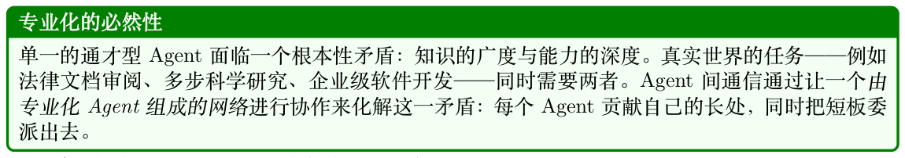
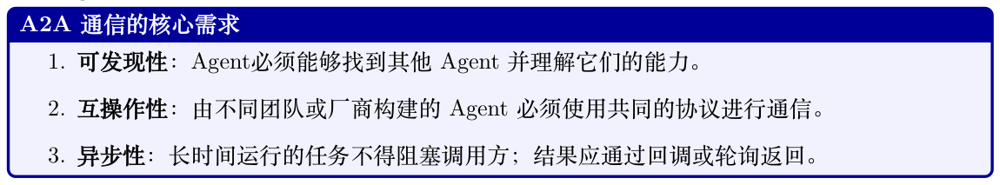
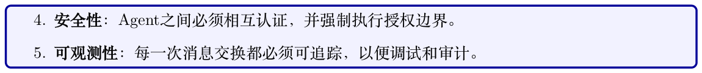
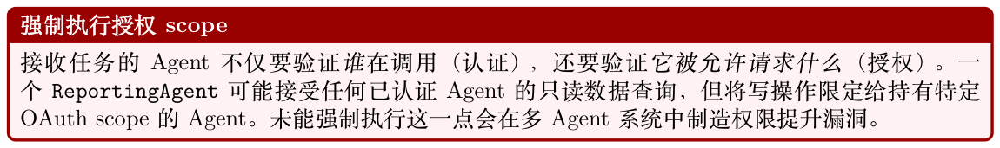
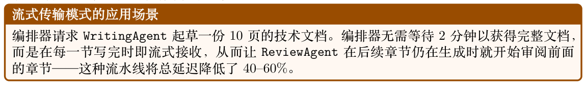
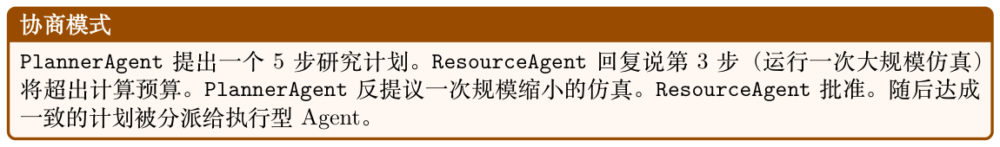
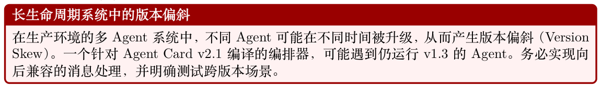
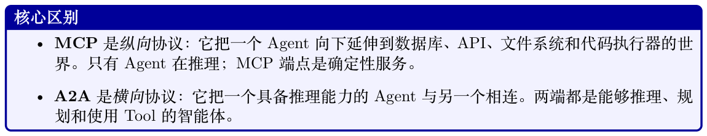
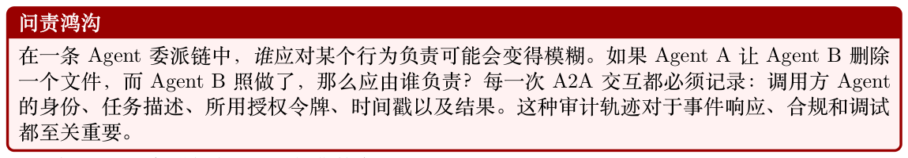

# 智能体到智能体通信（Agent-to-Agent, A2A）

A2A）

随着大语言模型从孤立的助手演化为由专业化Agent 组成的协作网络，Agent 之间如何对话这一问题已变得与单个Agent 内部如何推理同等重要。本章将介绍那些使多Agent 系统能够协调、委派并共同解决任何单一Agent 都无法独立处理的问题的协议、模式与工程实践。

## 24.1 动机：为何Agent 必须相互通信



认知负载与上下文限制。每个LLM 都在有限的上下文窗口内运行。复杂的工作流——涉及数百份文档、Tool 调用和推理步骤——很快会超出单一Agent 的内存承载力。通过将任务分解到多个Agent，每个Agent 都在可管理的上下文中工作，而编排型Agent 只需维护高层状态。

专业化与专家能力。不同的Agent 可针对特定领域进行微调、Prompt 设计或Tool 配置：例如可访问编译器和测试运行器的CodeAgent、可访问判例数据库的LegalAgent、配备统计库的DataAgent。

将子任务路由给合适的专家可同时提升质量与效率。

并行性与吞吐量。彼此独立的子任务可以同时分派给多个Agent。一个研究编排器可能并行地把文献检索扇出到五个专业化Agent，然后再综合它们的结果——大幅缩短墙钟时间。

故障隔离与韧性。当某个Agent 失败时，设计良好的多Agent 系统可以换用另一个Agent 重试、回退到更简单的方案，或者升级到人工介入——而不会让整个工作流崩溃。

委派与交接。随着上下文转移，长时间运行的任务可能需要在Agent 之间交接。最初的PlannerAgent 分解目标，将子任务交给ExecutorAgents，最后由ReviewerAgent 校验输出——每个Agent 只接收它所需要的那部分上下文。





## 24.2 Google A2A 协议

2025 年4 月，Google（在50 余家技术合作伙伴的共同贡献下）发布了智能体到智能体（A2A）协议[371]，这是一份用于AI Agent 之间互操作通信的开放规范。该协议随后被捐赠给Linux Foundation，截至2026 年支持机构已超过150 家。A2A 围绕一组核心原则进行设计，使其区别于早期的临时方案。

### 24.2.1 设计理念

A2A 规范明确提出了五条指导原则（根据官方规范[371] §1.2 改编）：

不透明执行（Opaque execution）调用方Agent 永远不会探查远程Agent 的内部——它们只通过声明的接口进行交互。目标究竟是GPT-4、Gemini 还是基于规则的系统，对协议而言无关紧要，从而真正实现异构Agent 生态。

企业级就绪（Enterprise readiness）认证（OAuth 2.0、API 密钥、JWT）、审计日志和合规要求并非事后补丁——它们从一开始就在协议层面被集成。

模态无关性（Modality agnosticism）一条消息可以同时包含文本、二进制文件和结构化JSON 负载，从而无需扩展协议即可支持处理图像、音频、代码或文档的Agent。

基于现有标准的简洁性（Simplicity via existing standards）A2A 不发明新的传输层，而是复用HTTP/HTTPS 配合JSON-RPC 2.0 消息、用于流式传输的服务器发送事件（Server-Sent Events, SSE），以及作为备选绑定的gRPC——这些都是每个基础设施团队已经在运行的技术。

异步优先的任务模型（Async-first task model）长时间运行的操作是常态而非例外。推送通知与轮询都是一等机制，因此调用方无需保持连接长达数小时。

### 24.2.2 Agent Card

A2A 可发现性的基础是Agent Card——一份托管在固定端点（/.well-known/agent.json）上的机器可读JSON 清单。它声明该Agent 能做什么、如何认证、把任务发送到何处——类似于OpenAPI 规范，但面向的是自主Agent 而非REST 端点。

```
Agent Card 结构
# 托管于https://agent.example.com/.well-known/agent.json 的Agent Card
agent_card = {
"name": "DataAnalysisAgent",
"description": "Analyzes structured datasets , produces statistical summaries , "
"generates visualizations , and answers data questions.",
"url": "https://agent.example.com/a2a",
"version": "1.2.0",
"capabilities": {
"streaming": True,
"pushNotifications": True,
"stateTransitionHistory": True
},
"authentication": {
"schemes": ["Bearer", "ApiKey"]
},
"skills": [
{
```

```
"id": "statistical -analysis",
"name": "Statistical Analysis",
"description": "Compute descriptive statistics , run hypothesis tests, "
"fit regression models on tabular data.",
"tags": ["statistics", "data", "analysis", "regression"],
"examples": [
"What is the correlation between columns A and B?",
"Run a t-test comparing these two groups.",
"Fit a linear regression predicting sales from ad spend."
],
"inputModes": ["text", "data"],
"outputModes": ["text", "data", "file"]
},
{
"id": "visualization",
"name": "Data Visualization",
"description": "Generate charts , plots, and dashboards from data.",
"tags": ["charts", "plots", "visualization", "dashboard"],
"examples": [
"Create a bar chart of monthly revenue.",
"Plot the distribution of customer ages."
],
"inputModes": ["text", "data"],
"outputModes": ["file", "text"]
}
],
"defaultInputModes": ["text"],
"defaultOutputModes": ["text"]
}
```

匹配到最合适的Agent，并据此分派——整个过程无需任何硬编码的路由逻辑。

### 24.2.3 任务生命周期

#### A2A 把所有工作都建模为Task。一个任务会沿着一个明确定义的状态机推进：

submitted

客户端已发出任务；服务器已确认接收。

working

Agent 正在主动处理。客户端可以进行轮询，或等待SSE 事件。

input-required

Agent 在继续之前需要来自用户或调用方Agent 的额外信息（例如澄清问题、缺失的凭据）。

completed

任务成功完成；结果可在响应中获取。

failed

发生了不可恢复的错误；错误消息会说明原因。

rejected

Agent 拒绝了该任务（例如超出其能力范围或未获授权）。该状态于A2A v1.0 加入。

canceled

任务被中止，可能由客户端或服务器发起。

### 24.2.4 基于Server-Sent Events 的流式传输

对于会产生增量输出的任务（例如正在撰写的长报告、正在生成的代码文件），A2A 使用服务器发送事件（Server-Sent Events, SSE）。客户端打开一个持久HTTP 连接，接收JSON 事件流：

```
SSE 事件流示例
# 每个SSE 事件携带一个TaskStatusUpdateEvent 或TaskArtifactUpdateEvent
# 下面是“撰写一份研究报告” 任务的事件流示例：
# 事件1：状态更新
data: {
"id": "task-abc123",
"status": {"state": "working"},
"final": false
}
# 事件2：部分产物（流式文本）
data: {
"id": "task-abc123",
"artifact": {
"parts": [{"type": "text", "text": "## Introduction\n\nRecent advances in..."
}],
"index": 0,
"append": false,
"lastChunk": false
},
"final": false
}
# 事件3：追加更多文本
data: {
"id": "task-abc123",
"artifact": {
"parts": [{"type": "text", "text": " reinforcement learning have shown..."}],
"index": 0,
"append": true, # 追加到已有产物
"lastChunk": false
},
"final": false
}
# 终止事件：任务完成
data: {
"id": "task-abc123",
"status": {"state": "completed"},
"final": true
}
```

### 24.2.5 长时间运行任务的推送通知

当任务可能持续数分钟乃至数小时，保持一个常开的SSE 连接并不现实。A2A 支持推送通知：客户端注册一个webhook URL，服务器会随着任务的推进通过POST 发送状态更新。

```
# 客户端在提交任务时注册推送通知端点
task_request = {
"id": "task-xyz789",
"message": {
"role": "user",
"parts": [{"type": "text", "text": "Analyze Q3 sales data and produce a report
."}]
},
"pushNotification": {
"url": "https://my-orchestrator.example.com/webhooks/a2a",
"token": "secret -hmac-token-for-verification",
"authentication": {
"schemes": ["Bearer"],
"credentials": "eyJhbGciOiJIUzI1NiJ9..."
}
```

```
}
}
# 当任务在不同状态之间转换时，
# 服务器会将TaskStatusUpdateEvent 对象POST 到该webhook URL 。
```

### 24.2.6 消息格式

A2A消息由一个role（user 或agent）加上一组带类型的parts（文本、文件或结构化数据）组成。

完整的消息模式、多模态示例以及上下文传递指南详见第24.5 节。

### 24.2.7 认证与授权

A2A 支持多种认证方案，这些方案在Agent Card 中声明，并按每次请求执行：

- Bearer Token（JWT/OAuth 2.0）：企业部署的标准方案；令牌携带的scope 限定了调用方Agent 可以请求的内容。

- API 密钥：适用于内部或可信环境的更简单方案。

- 双向TLS（Mutual TLS, mTLS）：用于高安全部署的基于证书的认证。

- OpenID Connect：联合身份机制，使跨组织的Agent 通信成为可能。



## 24.3 通信模式

多Agent 系统会根据任务的性质、延迟要求以及参与Agent 的数量，采用多种不同的通信模式。

### 24.3.1 请求-响应（Request-Response）

最简单的模式：Agent A 把任务发给Agent B，并等待完整的响应。适用于结果需要在继续之前获得的、简短且定义明确的子任务。

### 24.3.2 流式传输（Streaming）

Agent A 打开一个SSE 连接；Agent B 在产生部分结果时以流的形式发送出来。非常适合长文本生成（报告、代码）、实时协作或渐进式UI 更新。



### 24.3.3 多轮交互（Multi-Turn）

某些任务需要迭代式精化。Agent 进入input-required 状态，编排器提供澄清信息，然后任务恢复执行。这与人类协作流程相似：起草→反馈→修改。

```
# 多轮：编排器处理input-required 状态
async def run_multiturn_task(client, initial_message):
task = await client.send_task(message=initial_message)
while task.status.state not in ("completed", "failed", "canceled"):
```

```
if task.status.state == "input-required":
# Agent 需要澄清
clarification_needed = task.status.message
print(f"Agent asks: {clarification_needed}")
# 编排器生成或转发澄清回复
user_reply = await get_clarification(clarification_needed)
# 发送回复以继续任务
task = await client.send_task(
task_id=task.id,
message={"role": "user",
"parts": [{"type": "text", "text": user_reply}]}
)
else:
# 仍在执行——延迟后再轮询
await asyncio.sleep(2)
task = await client.get_task(task.id)
return task
```

### 24.3.4 广播（Broadcast）

编排器将同一条消息同时发送给多个Agent——适用于发布通告、分发共享上下文，或触发并行独立的工作流。

### 24.3.5 发布-订阅（Publish-Subscribe, Pub-Sub）

Agent 订阅事件通道（例如new-document-uploaded、model-retrained）。当事件触发时，所有订阅的Agent 都会收到通知。这种方式解耦了生产者与消费者，并支持响应式、事件驱动的架构。

### 24.3.6 协商（Negotiation）

两个Agent 互相交换提案与反提案，以便在计划、资源分配或方案上达成一致。常见于Agent 具有不同目标或约束的多Agent 规划系统中。



### 24.3.7 基于拍卖的任务分配（Auction-Based Task Allocation）

编排器宣布带需求的任务；候选Agent 提交竞标（预计完成时间、置信度、成本）；编排器把任务授予中标方。这使得在一组Agent 上进行动态的、市场化的负载均衡成为可能。

**Table 24.1: A2A 通信模式总览。**

| 模式 | 延迟 | 最佳适用场景 |
| --- | --- | --- |
| 请求-响应 | 低 | 简短、定义明确的子任务 |
| 流式传输 | 低（首Token） | 长文本生成、实时UI |
| 多轮 | 中 | 需要澄清的模糊任务 |
| 广播 | 低 | 共享上下文分发 |
| 发布-订阅 | 可变 | 事件驱动的响应式工作流 |
| 协商 | 中–高 | 资源受限的规划 |
| 拍卖 | 中 | 动态负载均衡 |

## 24.4 Agent 发现与路由

在一个Agent 能够与另一个Agent 通信之前，它必须先找到对方。Agent 发现就是定位可以处理特定任务的Agent 的过程。

### 24.4.1 Agent 注册中心

Agent 注册中心是一种目录服务，用于索引Agent Card 并提供搜索与查找API。常见的部署模型有两种：中心化注册中心（Centralized Registry）单一权威注册中心（例如企业服务目录）索引所有Agent。运维简单，但会形成单点故障，且可能无法扩展到跨组织部署。

联合注册中心（Federated Registry）由多个注册中心组成，每个对特定领域或组织具有权威性，并通过跨注册中心搜索协议互通。更具韧性和隐私保护，但需要标准化的联合协议。

### 24.4.2 基于能力的路由

编排器不会硬编码Agent 的URL，而是进行基于能力的路由：先向注册中心查询匹配所需技能的Agent，再从中选择最合适的。

```
class AgentRouter:
"""根据能力匹配将任务路由到Agent 。"""
def __init__(self, registry_url: str):
self.registry_url = registry_url
self._cache: dict[str, list[AgentCard]] = {}
async def find_agents(self, required_skill: str,
tags: list[str] | None = None) -> list[AgentCard]:
"""向注册中心查询具备所需技能的Agent 。"""
params = {"skill": required_skill}
if tags:
params["tags"] = ",".join(tags)
async with httpx.AsyncClient() as client:
resp = await client.get(f"{self.registry_url}/agents", params=params)
return [AgentCard(**card) for card in resp.json()["agents"]]
async def route(self, task_description: str) -> AgentCard:
"""在语义上将任务描述匹配到最合适的可用Agent 。"""
# 对任务描述进行嵌入
task_embedding = await embed(task_description)
# 获取所有已注册的Agent
all_agents = await self.find_agents(required_skill="*")
# 按任务与Agent 描述的余弦相似度对每个Agent 评分
scored = []
for agent in all_agents:
agent_embedding = await embed(agent.description)
score = cosine_similarity(task_embedding , agent_embedding)
scored.append((score, agent))
# 返回得分最高的Agent
scored.sort(key=lambda x: x[0], reverse=True)
return scored[0][1]
```

### 24.4.3 等价Agent 间的负载均衡

当多个Agent 提供相同能力时，路由器必须分配负载。常用策略包括：

- 轮询（Round-robin）：在所有可用Agent 之间平均分发任务。

- 最少负载（Least-loaded）：路由到活跃任务最少的Agent（需要健康/指标端点）。

- 延迟感知（Latency-aware）：路由到近期响应时间最低的Agent。

- 亲和性路由（Affinity-based）：将相关任务路由到同一个Agent，以利用已缓存的上下文。

### 24.4.4 版本管理与兼容性

Agent Card包含version 字段。编排器应指定最低版本要求，并在只有旧版本可用时进行优雅降级。推荐使用语义化版本（Semantic Versioning）[372]（MAJOR.MINOR.PATCH）：破坏性接口变更递增MAJOR，新增能力递增MINOR。



## 24.5 消息格式与Schema

### 24.5.1 结构化与非结构化消息

A2A 支持从完全非结构化（纯文本）到完全结构化（带类型的JSON Schema）的整个谱系。选择何种格式取决于参与的Agent：

**Table 24.2: 结构化与非结构化A2A 消息的权衡。**

| 消息类型 | 优点 | 缺点 |
| --- | --- | --- |
| 纯文本 | 灵活、可读性强、易于生成 | 难以可靠解析，无Schema 校验 |
| 结构化JSON | 机器可解析、可校验、带类型 | 需要事先约定Schema，灵活性较差 |
| 混合（文本+ 数据） | 人类可读的意图+ 机器可解析的负载 | 构造和解析更复杂 |

### 24.5.2 多模态消息

#### A2A 消息的结构是一个role（user 或agent）外加一组带类型的parts：

**Table 24.3: A2A 消息part 类型（线上格式使用"type": "text"|"file"|"data"）。**

| Part 类型 |  |
| --- | --- |
| 字段 | 应用场景 |
| TextPart |  |
| text: string | 自然语言指令、响应 |
| FilePart |  |
| mimeType、uri 或bytes | 文档、图像、音频、代码文件 |
| DataPart |  |
| data: object | 结构化JSON（Tool 结果、Schema） |
| 现代Agent 越来越多地处理非文本模态。A2A 的FilePart 支持任意MIME 类型，从而可以构 |  |
| 建丰富的多模态工作流： |  |

```
多模态A2A 消息：数据分析
# 一条同时包含文本指令、数据负载和文件的消息
message = {
"role": "user",
"parts": [
{
"type": "text",
"text": "Analyze the attached CSV and the schema below. "
"Identify anomalies and produce a summary report."
},
{
"type": "file",
"mimeType": "text/csv",
"uri": "https://storage.example.com/data/sales_q3.csv"
```

```
},
{
"type": "data",
"data": {
"schema": {
"columns": ["date", "region", "product", "revenue", "units"],
"types": ["date", "string", "string", "float", "int"]
},
"expectedRowCount": 15000,
"anomalyThreshold": 3.0 # z 分数阈值
}
}
]
}
多模态A2A 消息：图像分析
# 多模态消息：文本+ 图像+ 结构化数据
multimodal_message = {
"role": "user",
"parts": [
{"type": "text",
"text": "Describe what is wrong with this chart and suggest fixes."},
{"type": "file",
"mimeType": "image/png",
"bytes": base64.b64encode(chart_image_bytes).decode()},
{"type": "data",
"data": {
"chartType": "bar",
"dataSource": "Q3 Revenue by Region",
"knownIssues": ["y-axis does not start at zero",
"missing error bars"]
}}
]
}
```

### 24.5.3 上下文传递：哪些该共享，哪些应保留

多Agent 系统中一个关键的设计决策是上下文范围控制：要把多少对话历史和内部状态传递给子Agent。

上下文范围控制原则

最小化上下文（Minimal Context）只传递子Agent 完成其任务所必需的内容。可降低Token 用量、延迟以及敏感信息泄露的风险。

摘要化上下文（Summarized Context）不要传递原始对话历史，而是传递结构化摘要：目标、约束、已做出的决策以及相关事实。

私有状态（Private State）内部推理、中间草稿以及用户的个人身份信息（PII），除非确有需要，通常不应转发给子Agent。

关联ID（Correlation IDs）始终传递correlationId，以便子Agent 的行为能够在日志和审计轨迹中追溯到发起的工作流。

### 24.5.4 会话串联与关联ID

#### 在复杂工作流中，许多任务可能同时处于进行中。关联ID 用于跨Agent 串联相关任务：

```
import uuid
class WorkflowContext:
"""在多Agent 工作流中携带关联元数据。"""
```

```
def __init__(self, workflow_id: str | None = None):
self.workflow_id = workflow_id or str(uuid.uuid4())
self.span_id = str(uuid.uuid4())
self.parent_span_id: str | None = None
def child_context(self) -> "WorkflowContext":
"""为子任务创建子上下文。"""
child = WorkflowContext(workflow_id=self.workflow_id)
child.parent_span_id = self.span_id
return child
def to_metadata(self) -> dict:
return {
"x-workflow -id": self.workflow_id ,
"x-span-id": self.span_id ,
"x-parent -span-id": self.parent_span_id
}
# 使用方式：在每次A2A 任务提交时附加该元数据
ctx = WorkflowContext()
task = await client.send_task(
message=message ,
metadata=ctx.to_metadata()
)
# 子任务使用子上下文以便追踪
sub_ctx = ctx.child_context()
```

## 24.6 协调协议

除了点对点通信，多Agent 系统还能从更高层次的协调协议中受益——这些是支持集体决策与问题求解的结构化交互模式。

### 24.6.1 合同网协议（Contract Net Protocol）

合同网协议（Contract Net Protocol, CNP）[373] 是一种经典的多Agent 协调机制，可被改造用于基于LLM 的系统：

1. 宣告（Announcement）：管理者Agent 向所有潜在承包者Agent 广播任务公告，其中包含任务需求和评估标准。

2. 竞标（Bidding）：承包者Agent 根据自身能力评估任务，并提交包含预计完成时间、置信度和资源需求的竞标。

3. 授标（Award）：管理者选择中标方（对于并行子任务则可选择多个中标方），并授予合同。

4. 执行与汇报（Execution and Reporting）：承包者执行任务并将结果汇报给管理者。

```
合同网协议实现
import dataclasses
class ContractNetManager:
"""为任务分配实现合同网协议（Contract Net Protocol ）。"""
async def allocate_task(self, task: Task,
candidate_agents: list[AgentCard]) -> AgentCard:
# 阶段1：向所有候选Agent 宣告任务
announcement = {
"type": "task-announcement",
"task": dataclasses.asdict(task),
"deadline": (datetime.now(timezone.utc) + timedelta(seconds=10)).
```

```
isoformat(),
"evaluationCriteria": ["confidence", "estimatedTime", "cost"]
}
# 阶段2：收集竞标
bids = await asyncio.gather(*[
self._request_bid(agent, announcement)
for agent in candidate_agents
], return_exceptions=True)
valid_bids = [(agent, bid) for agent, bid in zip(candidate_agents , bids)
if not isinstance(bid, Exception) and bid is not None]
if not valid_bids:
raise RuntimeError(f"No agents bid on task {task.id}")
# 阶段3：授予最佳竞标方（置信度最高、用时最少）
def score_bid(agent_bid):
_, bid = agent_bid
return bid["confidence"] - 0.1 * bid["estimatedSeconds"]
winner_agent , winning_bid = max(valid_bids , key=score_bid)
# 通知中标方与落标方
await self._award_contract(winner_agent , task)
await asyncio.gather(*[
self._reject_bid(agent, task.id)
for agent, _ in valid_bids if agent != winner_agent
])
return winner_agent
async def _request_bid(self, agent: AgentCard ,
announcement: dict) -> dict | None:
"""请求某个Agent 对任务进行竞标。"""
try:
result = await self.client.send_task(
agent_url=agent.url,
message={"role": "user",
"parts": [{"type": "data", "data": announcement}]}
)
return result.artifacts[0].parts[0]["data"]
except Exception:
return None
```

### 24.6.2 黑板系统（Blackboard Systems）

黑板系统[320] 提供一个共享工作区（即“黑板”），Agent 在上面发布部分解、观察和假设。其他Agent 监视黑板，在能够提供价值时进行贡献——这是一种机会主义的问题求解方式。

黑板系统非常适合那些求解路径事先未知、不同Agent 在不同阶段做出贡献的问题——例如科学假设生成、复杂调试或多源情报分析。

### 24.6.3 共识协议（Consensus Protocols）

当多个Agent 必须就一项决策达成一致（例如执行哪个计划、结果是否正确），共识协议提供了结构化的投票机制：简单多数投票（Simple Majority Voting）每个Agent 投票；获得> 50% 选票的选项胜出。速度快，但当Agent 共享同一基础模型时，容易受到相关性错误的影响。

加权投票（Weighted Voting）按Agent 的置信度或历史准确率对选票加权。更稳健，但需要经过良好校准的置信度估计。

基于法定人数（Quorum-Based）

一项决策需要n 个Agent 中至少k 个达成一致。提供容错能力：最多可有n −k 个Agent 失败或不同意而不会阻塞流程。

德尔菲方法（Delphi Method）

Agent 先投票，看到匿名化的结果后修改投票，并反复迭代直至收敛。可减少锚定偏差，鼓励真正的深入审议。

```
async def quorum_vote(agents: list[AgentCard], question: str,
options: list[str], quorum: int) -> str | None:
"""在Agent 之间进行法定人数投票。返回获胜选项或None 。"""
votes = await asyncio.gather(*[
ask_agent_to_vote(agent, question , options)
for agent in agents
])
counts: dict[str, int] = {}
for vote in votes:
if vote in options:
counts[vote] = counts.get(vote, 0) + 1
# 返回第一个达到法定人数的选项
for option, count in sorted(counts.items(), key=lambda x: -x[1]):
if count >= quorum:
return option
return None # 未达到法定人数
```

### 24.6.4 领导者选举（Leader Election）

在动态的多Agent 系统中，可能需要在运行时选举一位领导者（编排器）——例如原编排器失败时，或当Agent 在没有预先指派协调者的情况下自组织时。经典的分布式系统算法（Bully、Ring）可被改造用于Agent 网络：Agent 间交换能力分数或优先级令牌，以选举出当前可用Agent 中能力最强的作为领导者。

## 24.7 A2A 与MCP：互补的协议

A2A 与模型上下文协议（Model Context Protocol, MCP）[334] 之间的关系常被误解。这两种协议是互补的，并非竞争关系：



维度MCP A2A

参与方Agent ↔Tool/资源Agent ↔Agent智能性仅一端（Agent）具备智能双方均具备智能状态性通常为无状态Tool 调用带生命周期的有状态任务流式传输有限（Tool 结果）一等的SSE 流式传输发现机制Tool 清单Agent Card认证模型服务端控制双向认证、OAuth 2.0典型延迟毫秒级秒到分钟级典型用例“搜索网络”、“运行SQL”“委派给专家Agent”

### 24.7.1 何时使用哪一种

- 当远程端点是一个确定性函数时使用MCP：数据库查询、API 调用、代码执行沙箱。Agent完全掌控交互过程。

- 当远程端点需要对请求进行推理时使用A2A：解释模糊指令、做出判断、使用自有Tool 或进行多轮对话。

- 在同一系统中同时使用两者：编排Agent 通过A2A 将任务委派给专家Agent，而每个专家Agent 通过MCP 访问自己的Tool。

### 24.7.2 组合架构

在生产环境的多Agent 系统中，A2A 与MCP 在不同层次上协同工作：A2A 处理Agent 之间的委派与协调（同级之间的横向通信），而MCP 处理每个Agent 到其Tool 与数据源的连接（与能力的纵向集成）。这种关注点分离是构建可扩展Agent 架构的关键。

**Figure 24.1: A2A 与MCP 组合架构。编排器通过A2A 将任务委派给专家Agent；每个Agent 则通过MCP服务器访问自己的Tool。**

- 用A2A 进行委派：当一个Agent 需要它本身不具备的能力时，会通过A2A 任务消息委派给另一个Agent。每个Agent 都是带有自身Agent Card 的自包含服务。

- 用MCP 访问Tool：每个Agent 通过MCP 服务器连接其Tool。这意味着Tool 永远不会直接暴露给其他Agent——只能通过所属Agent 的接口访问。

- 信任边界的分离：编排器信任专家Agent（通过A2A 认证进行核实）。每个专家信任其自有的MCP 服务器（本地或已认证）。不存在可传递的Tool 访问。

- 独立扩缩容：代码密集型负载可扩展CodeAgent 实例；数据型负载可扩展DataAgent。编排器始终保持轻量。

## 24.8 多Agent 系统中的安全与信任

多Agent 系统带来了独特的安全挑战。当Agent A 委派给Agent B、Agent B 又委派给Agent C时，信任链必须被精心管理。

### 24.8.1 Agent 身份验证

每个Agent 都必须具有可验证的身份。可选方案包括：

- 由可信身份提供方签发的JWT 令牌[374]，携带Agent ID、颁发者和过期时间。接收方Agent使用提供方的公钥进行验证。

- 由内部CA 颁发的mTLS 证书[375]，同时提供认证与传输加密。

- 适用于不存在单一可信权威的跨组织场景的去中心化标识符（Decentralized Identifiers, DIDs）[376]。

### 24.8.2 消息完整性与加密

- 所有A2A 通信都应通过TLS 1.3 [377] 进行，以防止窃听和中间人攻击。

- 对于敏感负载，端到端加密（例如JWE）可以确保中间基础设施（负载均衡器、代理）无法读取消息内容。

- 消息签名（JWS）提供不可否认性：接收方Agent 可以证明某条特定消息确实来自某位特定发送者。

### 24.8.3 授权scope

并非每个Agent 都应该能够要求其他任何Agent 做任何事。OAuth 2.0 授权scope [378] 定义了边界：

```
# DataAgent 的OAuth 2.0 scope 示例
SCOPES = {
"data:read": "Read data from connected databases",
"data:write": "Write or modify data in connected databases",
"data:export": "Export data to external systems",
"analysis:run": "Execute statistical analyses",
"analysis:schedule":"Schedule recurring analyses",
"admin:config": "Modify agent configuration"
}
# ReportingAgent 可能仅持有：data:read, analysis:run
# ETL 流水线Agent 可能持有：data:read, data:write, data:export
# 只有人类管理员持有：admin:config
class A2AServer:
def verify_authorization(self, token: str, required_scope: str) -> bool:
"""验证调用方Agent 是否持有所需scope 。"""
claims = jwt.decode(token, self.public_key , algorithms=["RS256"])
granted_scopes = claims.get("scope", "").split()
if required_scope not in granted_scopes:
raise PermissionError(
f"Caller lacks required scope '{required_scope}'. "
f"Granted: {granted_scopes}"
)
return True
```

### 24.8.4 审计轨迹与问责



```
@dataclass
class A2AAuditEvent:
timestamp: str # ISO 8601
workflow_id: str # 顶层工作流的关联ID
span_id: str # 当前任务的span
```

```
parent_span_id: str # 调用任务的span （用于委派链）
caller_agent_id: str # 经验证的调用方Agent 身份
callee_agent_id: str # 当前Agent 的身份
task_id: str
skill_invoked: str
authorization_scopes: list[str]
outcome: str # "completed" | "failed" | "rejected"
duration_ms: int
error_code: str | None
```

## 24.9 实现示例：多Agent 研究工作流

下面的示例演示了一个完整的、基于A2A 的多Agent 研究工作流：一个OrchestratorAgent 分解研究问题，将子任务委派给专家Agent，并综合它们的结果。

```
"""
使用A2A 协议实现的多Agent 研究工作流。
演示内容：Agent Card 、A2A 客户端/服务器、任务生命周期、
多轮交互以及Agent 间交接。
"""
import asyncio
import json
import uuid
from collections.abc import AsyncIterator
from datetime import datetime , timedelta , timezone
import httpx
from fastapi import FastAPI , HTTPException , Request
from fastapi.responses import StreamingResponse
from pydantic import BaseModel , Field
# -- 数据模型------------------------------------------------------------------
class Part(BaseModel):
type: str # "text" | "file" | "data"
text: str | None = None
data: dict | None = None
mimeType: str | None = None
uri: str | None = None
class Message(BaseModel):
role: str # "user" | "agent"
parts: list[Part]
class TaskStatus(BaseModel):
state: str # submitted | working | input-required | completed | failed
message: str | None = None
timestamp: str = Field(
default_factory=lambda: datetime.now(timezone.utc).isoformat()
)
class Artifact(BaseModel):
parts: list[Part]
index: int = 0
append: bool = False
lastChunk: bool = True
class Task(BaseModel):
id: str
status: TaskStatus
messages: list[Message] = []
artifacts: list[Artifact] = []
metadata: dict = {}
```

```
# -- A2A 客户端（HTTP/REST 绑定）---------------------------------------------
# 注意：A2A v1.0 定义了三种协议绑定：JSON-RPC 2.0 、gRPC ，
# 以及HTTP+JSON/REST 。此示例为提高可读性使用REST 绑定。
class A2AClient:
"""用于向兼容A2A 的Agent 发送任务的客户端。"""
def __init__(self, agent_url: str, auth_token: str):
self.agent_url = agent_url.rstrip("/")
self.headers = {
"Authorization": f"Bearer {auth_token}",
"Content -Type": "application/json"
}
async def get_agent_card(self) -> dict:
"""获取该Agent 的能力卡片。"""
async with httpx.AsyncClient() as client:
resp = await client.get(
f"{self.agent_url}/.well-known/agent.json",
headers=self.headers
)
resp.raise_for_status()
return resp.json()
async def send_task(self, message: Message ,
task_id: str | None = None,
metadata: dict | None = None) -> Task:
"""提交一个任务，返回初始的Task 对象。"""
payload = {
"id": task_id or str(uuid.uuid4()),
"message": message.model_dump(),
"metadata": metadata or {}
}
async with httpx.AsyncClient() as client:
resp = await client.post(
f"{self.agent_url}/tasks/send",
json=payload ,
headers=self.headers ,
timeout=30.0
)
resp.raise_for_status()
return Task(**resp.json())
async def stream_task(self, message: Message ,
metadata: dict | None = None) -> AsyncIterator[dict]:
"""提交任务并以SSE 事件流的形式接收结果。"""
payload = {
"id": str(uuid.uuid4()),
"message": message.model_dump(),
"metadata": metadata or {}
}
async with httpx.AsyncClient() as client:
async with client.stream(
"POST",
f"{self.agent_url}/tasks/sendSubscribe",
json=payload ,
headers={**self.headers , "Accept": "text/event-stream"},
timeout=300.0
) as response:
async for line in response.aiter_lines():
if line.startswith("data: "):
event_data = json.loads(line[6:])
yield event_data
if event_data.get("final"):
break
```

```
async def get_task(self, task_id: str) -> Task:
"""轮询任务状态。"""
async with httpx.AsyncClient() as client:
resp = await client.get(
f"{self.agent_url}/tasks/{task_id}",
headers=self.headers
)
resp.raise_for_status()
return Task(**resp.json())
async def wait_for_completion(self, task: Task,
poll_interval: float = 2.0) -> Task:
"""轮询直至任务到达终止状态。"""
terminal_states = {"completed", "failed", "canceled"}
while task.status.state not in terminal_states:
await asyncio.sleep(poll_interval)
task = await self.get_task(task.id)
return task
# -- A2A 服务器（FastAPI ）----------------------------------------------------
class ResearchAgent:
"""
一个专门的研究Agent ，能够检索文献并对给定主题
的研究结果进行总结。
"""
AGENT_CARD = {
"name": "ResearchAgent",
"description": "Searches academic literature and synthesizes research findings
.",
"url": "https://research -agent.example.com/a2a",
"version": "1.0.0",
"capabilities": {
"streaming": True,
"pushNotifications": False,
"stateTransitionHistory": True
},
"authentication": {"schemes": ["Bearer"]},
"skills": [{
"id": "literature -search",
"name": "Literature Search",
"description": "Search and summarize academic papers on a topic.",
"tags": ["research", "literature", "academic", "papers"],
"examples": [
"Summarize recent papers on transformer attention mechanisms.",
"What does the literature say about RLHF for code generation?"
],
"inputModes": ["text"],
"outputModes": ["text", "data"]
}]
}
def __init__(self):
self.tasks: dict[str, Task] = {}
self.app = FastAPI(title="ResearchAgent A2A Server")
self._register_routes()
def _register_routes(self):
@self.app.get("/.well-known/agent.json")
async def agent_card():
return self.AGENT_CARD
@self.app.post("/tasks/send")
async def send_task(request: Request):
```

```
body = await request.json()
task = await self._create_and_run_task(body)
return task.model_dump()
@self.app.post("/tasks/sendSubscribe")
async def send_subscribe(request: Request):
body = await request.json()
return StreamingResponse(
self._stream_task(body),
media_type="text/event-stream"
)
@self.app.get("/tasks/{task_id}")
async def get_task(task_id: str):
if task_id not in self.tasks:
raise HTTPException(status_code=404, detail="Task not found")
return self.tasks[task_id].model_dump()
async def _create_and_run_task(self, body: dict) -> Task:
task_id = body.get("id", str(uuid.uuid4()))
message = Message(**body["message"])
task = Task(
id=task_id ,
status=TaskStatus(state="submitted"),
messages=[message],
metadata=body.get("metadata", {})
)
self.tasks[task_id] = task
# 异步执行
asyncio.create_task(self._execute_task(task_id))
return task
async def _execute_task(self, task_id: str):
task = self.tasks[task_id]
task.status = TaskStatus(state="working")
try:
# 从消息中提取研究问题
question = task.messages[0].parts[0].text
# 模拟文献检索（实际生产中替换为真实搜索Tool ）
await asyncio.sleep(1) # 模拟延迟
findings = await self._search_literature(question)
# 生成产物
task.artifacts = [Artifact(parts=[
Part(type="text", text=findings["summary"]),
Part(type="data", data={"papers": findings["papers"],
"query": question})
])]
task.status = TaskStatus(state="completed")
except Exception as e:
task.status = TaskStatus(state="failed", message=str(e))
self.tasks[task_id] = task
async def _search_literature(self, question: str) -> dict:
"""占位实现：生产环境中调用真实的搜索API 。"""
return {
"summary": f"Based on a search of recent literature regarding "
f"'{question}', key findings include: ...",
"papers": [
{"title": "Attention Is All You Need", "year": 2017,
```

```
"relevance": 0.95},
{"title": "RLHF: Training Language Models to Follow Instructions",
"year": 2022, "relevance": 0.88}
]
}
async def _stream_task(self, body: dict) -> AsyncIterator[str]:
task = await self._create_and_run_task(body)
# 推送状态更新
yield f"data: {json.dumps({'id': task.id, 'status': {'state': 'submitted'}, '
final': False})}\n\n"
yield f"data: {json.dumps({'id': task.id, 'status': {'state': 'working'}, '
final': False})}\n\n"
# 等待完成
while task.status.state not in ("completed", "failed", "canceled"):
await asyncio.sleep(0.5)
task = self.tasks[task.id]
# 推送产物
if task.artifacts:
for part in task.artifacts[0].parts:
event = {
"id": task.id,
"artifact": {
"parts": [part.model_dump()],
"index": 0,
"append": False,
"lastChunk": True
},
"final": False
}
yield f"data: {json.dumps(event)}\n\n"
# 最终状态
yield f"data: {json.dumps({'id': task.id, 'status': task.status.model_dump(),
'final': True})}\n\n"
# -- 编排器：多Agent 工作流--------------------------------------------------
class ResearchOrchestrator:
"""
编排一个多Agent 研究工作流：
1. 将研究问题分解为子问题
2. 将每个子问题分派给ResearchAgent
3. 将结果综合为最终报告
"""
def __init__(self, research_agent_url: str, auth_token: str):
self.research_client = A2AClient(research_agent_url , auth_token)
self.workflow_id = str(uuid.uuid4())
async def run(self, research_question: str) -> str:
print(f"[Orchestrator] Starting workflow {self.workflow_id}")
print(f"[Orchestrator] Question: {research_question}")
# 第1 步：分解为子问题
sub_questions = self._decompose(research_question)
print(f"[Orchestrator] Decomposed into {len(sub_questions)} sub-questions")
# 第2 步：并行分派子问题
tasks = await asyncio.gather(*[
self.research_client.send_task(
message=Message(role="user", parts=[Part(type="text", text=q)]),
metadata={"workflowId": self.workflow_id , "subQuestion": i}
```

```
)
for i, q in enumerate(sub_questions)
])
# 第3 步：等待所有任务完成
completed_tasks = await asyncio.gather(*[
self.research_client.wait_for_completion(task)
for task in tasks
])
# 第4 步：检查失败情况
failed = [t for t in completed_tasks if t.status.state == "failed"]
if failed:
print(f"[Orchestrator] Warning: {len(failed)} sub-tasks failed")
# 第5 步：综合结果
findings = []
for task, question in zip(completed_tasks , sub_questions):
if task.status.state == "completed" and task.artifacts:
summary = task.artifacts[0].parts[0].text
findings.append(f"### {question}\n{summary}")
report = self._synthesize(research_question , findings)
print(f"[Orchestrator] Workflow complete. Report: {len(report)} chars")
return report
def _decompose(self, question: str) -> list[str]:
"""将复杂问题分解为聚焦的子问题。"""
# 生产环境中：使用LLM 进行分解
return [
f"What are the foundational methods for: {question}?",
f"What are the most recent advances in: {question}?",
f"What are the open challenges and limitations in: {question}?"
]
def _synthesize(self, question: str, findings: list[str]) -> str:
"""将子结论综合为一份连贯的报告。"""
# 生产环境中：使用LLM 进行综合
sections = "\n\n".join(findings)
return f"# Research Report: {question}\n\n{sections}"
# -- 入口---------------------------------------------------------------------
async def main():
orchestrator = ResearchOrchestrator(
research_agent_url="https://research -agent.example.com/a2a",
auth_token="eyJhbGciOiJSUzI1NiJ9..."
)
report = await orchestrator.run(
"Reinforcement learning from human feedback for large language models"
)
print(report)
if __name__ == "__main__":
asyncio.run(main())
```

## 24.10 小结

#### 关键要点：Agent 到Agent 通信

1. A2A 让规模化的专业化成为可能：通过将任务路由给专家Agent，多Agent 系统可同时获得深度与广度。（第25 章将深入介绍多Agent 架构。）

2. Google 的A2A 协议为可互操作的Agent 通信提供了一个面向生产的开放标准，涵盖Agent Card、任务生命周期管理、SSE 流式传输和企业级认证。

3. 通信模式从简单的请求-响应，到复杂的协商和基于拍卖的分配——可根据任务复杂度和延迟需求来选择。

4. A2A 与MCP 互补：A2A 连接Agent 与Agent；MCP 连接Agent 与Tool。大多数生产系统两者并用。

5. 安全不可妥协：Agent身份验证、授权scope 和审计轨迹在任何多Agent 部署中都不可或缺。

6. 协调协议（合同网、黑板、共识）在简单委派之外，提供了用于集体决策的结构化机制。

7. 基于关联ID 的可观测性对于调试和审计跨越多个Agent 与Tool 的复杂多Agent 工作流至关重要。

#### A2A 中的开放研究问题

- Agent 应如何处理来自层级中多个编排器的相互冲突的指令？哪些冲突解决机制最为有效？

- Agent 能否通过经验学习出更好的路由与委派策略，而不再依赖静态的能力声明？

- 如何防范Prompt 注入攻击——即恶意Agent 通过在消息中嵌入对抗性指令来操纵下游Agent？

- 上下文传递的合理隐私边界在哪里——子Agent 应该看到多少对话历史，又如何在技术上强制执行这些边界？

- 当Agent 网络扩展到成百上千个Agent 时，如何在不形成瓶颈或破坏一致性的前提下维持连贯的全局状态？
