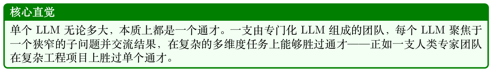
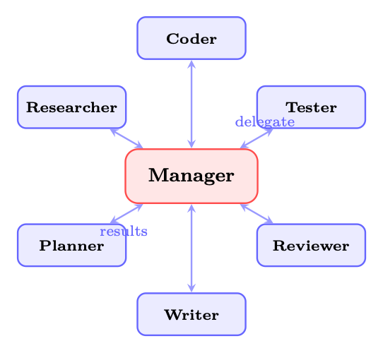
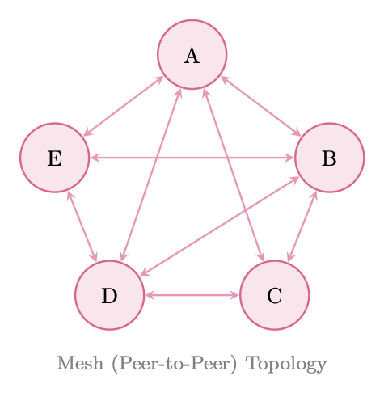
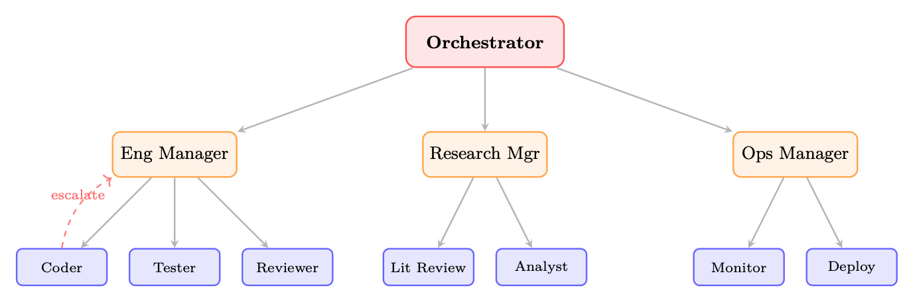
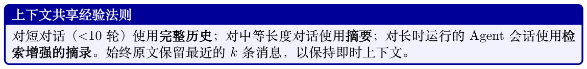
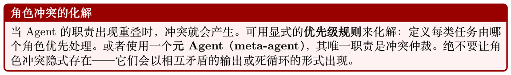
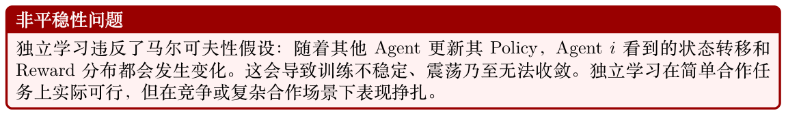
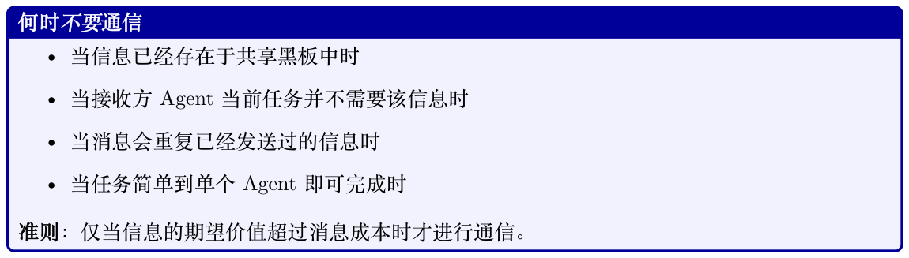

# 多智能体系统（Multi-Agent Systems）

## 25.1 动机：为什么需要多个Agent？

人工智能的历史在很多方面就是一部规模演进史。早期AI 系统是单体式的：单一程序、单一知识库、单一推理引擎。随着问题日益复杂，研究者发现，没有任何单一Agent——无论能力多强——能够高效地处理一个丰富、开放式任务的方方面面。这一洞见在分布式AI 与多智能体系统（Multi-Agent System, MAS）研究中早有定论[379, 380]，而在大语言模型时代又被赋予了新的紧迫性。



专门化（Specialization）。不同的子任务受益于不同的能力、Prompt 策略，乃至不同的基础模型。代码生成Agent 可以在编程语料上微调；事实核查Agent 可以借助检索工具锚定事实；创意写作Agent 可以通过Prompt 激发风格多样性。强迫单个Agent 在所有这些方面同时出色，既低效，往往也不可能。

并行化（Parallelism）。许多现实世界的任务可以分解为可并发执行的独立子任务。一个需要文献综述、数据分析和报告撰写的研究流水线可以让这三者并行进行，从而显著降低墙钟时间。串行的单Agent 处理是一个瓶颈，而多Agent 并行化正好消除了它。

鲁棒性（Robustness）。单个Agent 是单点故障。如果它产生幻觉、陷入循环或给出细微错误的答案，将无人核验。多Agent 系统引入了冗余：第二个Agent 可以验证、批判，或独立地重新推导结果。在输出被信任之前，对抗性Agent 可以主动探测其弱点。

涌现能力（Emergent Capabilities）。也许最引人入胜的是，Agent 群体可以展现出任何单一Agent 都不具备的能力。通过辩论、协商和迭代精化，多Agent 系统能够得到超越任一单独Agent所能产出的解决方案——这是一种社会性生物涌现智能的计算类比。

历史脉络

多智能体系统研究可以追溯到1980 年代，其奠基性工作包括分布式问题求解[381]、合同网协议（Contract Net Protocol）[373] 以及FIPA Agent 通信标准[3]。向基于LLM 的Agent 转变让这些经典思想在新的载体上重获新生：以前是手工编码、做符号推理的Agent，现在则是其“认知”从学习到的神经表示中涌现出来的Agent。核心的架构模式——层级、市场、黑板、消息传递

- —依然惊人地相关。

从单体Agent 到Agent 社会的转变映射了复杂系统中一个更广泛的模式：随着问题空间的增长，分布式、模块化架构始终优于集中式、单体式架构。问题不再是是否使用多个Agent，而是如何组织它们。

## 25.2 多智能体架构

多智能体系统的拓扑结构——Agent 之间如何连接、权威如何在它们之间流动——是最具决定性的架构选择。目前已经形成了四种典型模式，各有不同的权衡。

### 25.2.1 集中式（Supervisor/Manager）架构

在集中式架构中，由单一的Orchestrator Agent（也称为supervisor、manager 或planner）持有全局状态，分解任务，将子任务委派给工作Agent，并汇总它们的结果。其拓扑是中心辐射式（hub-and-spoke）：所有通信都通过中心节点流动。



**Figure 25.1: 集中式（Supervisor）架构。Manager 将任务委派给专门化的Worker，并汇总它们的输出。所有通信均通过中央枢纽流动。**

Manager 的职责包括：

- 任务路由：决定哪个Worker 最适合每个子任务

- 上下文管理：为每个Worker 提供全局上下文中相关的子集

- 结果聚合：将Worker 输出综合为一个连贯整体

- 错误处理：检测Worker 故障并重新路由或重试

```
LangGraph 中的Supervisor 模式
from langgraph.graph import StateGraph , START, END
from typing import TypedDict , Literal
class TeamState(TypedDict):
task: str
plan: str
code: str
tests: str
review: str
next_agent: str
final_output: str
def supervisor_node(state: TeamState) -> TeamState:
```

```
# 中央orchestrator ：决定下一步应调用哪个agent 。
"""Central orchestrator: decides which agent to invoke next."""
messages = [
{"role": "system", "content": SUPERVISOR_PROMPT},
{"role": "user", "content": f"Task: {state['task ']}\n"
f"Plan: {state.get('plan','')}\n"
f"Code: {state.get('code','')}\n"
f"Tests: {state.get('tests','')}\n"
"Which agent should act next? "
"Options: planner , coder, tester , reviewer ,
FINISH"}
]
response = llm.invoke(messages)
return {**state, "next_agent": response.content.strip()}
def route(state: TeamState) -> Literal["planner","coder","tester","reviewer","
__end__"]:
return state["next_agent"] if state["next_agent"] != "FINISH" else END
builder = StateGraph(TeamState)
builder.add_node("supervisor", supervisor_node)
builder.add_node("planner", planner_node)
builder.add_node("coder", coder_node)
builder.add_node("tester", tester_node)
builder.add_node("reviewer", reviewer_node)
builder.add_edge(START, "supervisor")
builder.add_conditional_edges("supervisor", route)
for agent in ["planner", "coder", "tester", "reviewer"]:
builder.add_edge(agent, "supervisor") # 始终回到supervisor
graph = builder.compile()
集中式架构的权衡
优点：控制流简单；责任清晰；易于调试（所有决策集中在一处）；实现直接。
缺点：单点故障——如果Manager 产生幻觉或混乱，整个系统就会失败；在高负载下Manager
会成为瓶颈；Manager 的上下文窗口必须容纳全局状态，限制了可扩展性。
```

### 25.2.2 去中心化（Peer-to-Peer）架构

在去中心化架构中，Agent 之间直接交互，没有中央协调者。其拓扑是网状（mesh）：任意Agent可以与任意其他Agent 通信。协调通过局部交互涌现，而非通过全局规划。

对等系统中的涌现式协调通过以下机制产生：

- 协商（Negotiation）：Agent为任务或资源进行竞标

- Stigmergy（共识主动性）：Agent 修改共享状态，其他Agent 观察该状态（见25.3.6 节）

- 流言协议（Gossip protocols）：Agent在网络中传播信息

- 局部共识（Local consensus）：小组Agent 在无全局协调的情况下达成一致




**Figure 25.2: 去中心化（peer-to-peer）架构。Agent 直接通信；协调从局部交互中涌现。**

### 25.2.3 层级式（Hierarchical）架构

层级式架构将集中式模式推广为具有多层管理的树形结构。顶层Orchestrator 委派给特定领域的子Manager，后者再委派给专门化Worker。这映射了大型企业的组织结构。



**Figure 25.3: 层级式架构。顶层Orchestrator 委派给领域子Manager，后者再委派给专门化Worker。虚线箭头表示升级路径。**

层级式系统的关键特征：

- 委派链（Delegation chains）：权威与上下文沿树向下流动；结果向上流动

- 升级路径（Escalation paths）：Worker可以将无法解决的问题升级给其Manager

- 领域隔离（Domain isolation）：子Manager 维护特定领域的上下文，减轻顶层Orchestrator的认知负担

- 作用域限制（Scope limitation）：每个Agent 只需了解其直接上级与下级

企业的类比十分贴切：CEO（顶层Orchestrator）制定战略；VP（子Manager）将战略转化为领域计划；一线贡献者（Worker）执行。层级结构在实现规模化的同时保留了责任归属。

### 25.2.4 蜂群（Swarm）架构

受生物系统（蚁群、鸟群）启发的蜂群架构，由许多遵循简单局部规则的松耦合Agent 组成，能在没有任何中央协调者或全局状态的情况下产生复杂的全局行为。

OpenAI 的Swarm 框架[335]（现已被OpenAI Agents SDK 取代，但其概念原语依然有影响力）通过两个原语将其落地：

- Routines（例程）：Agent 为完成子任务所遵循的指令序列

- Handoffs（移交）：一个Agent 将控制权（以及相关上下文）转交给另一个Agent

```
OpenAI Swarm：Routines 与Handoffs
from swarm import Swarm, Agent
client = Swarm()
def transfer_to_billing():
# Handoff ：将控制权移交给计费专员。
"""Handoff: transfer control to the billing specialist."""
return billing_agent
def transfer_to_technical():
# Handoff ：将控制权移交给技术支持agent 。
"""Handoff: transfer control to the technical support agent."""
return technical_agent
triage_agent = Agent(
name="Triage Agent",
instructions="""You are a customer service triage agent.
Determine the nature of the customer's issue:
- For billing questions , transfer to billing.
- For technical issues , transfer to technical support.
- For general questions , answer directly.""",
functions=[transfer_to_billing , transfer_to_technical],
)
billing_agent = Agent(
name="Billing Specialist",
instructions="You handle billing inquiries. "
"Access account data and resolve payment issues.",
functions=[lookup_account , process_refund],
)
technical_agent = Agent(
name="Technical Support",
instructions="You resolve technical issues. "
"Diagnose problems and provide step-by-step solutions.",
functions=[run_diagnostics , escalate_to_engineering],
)
# 无全局状态—— 每个agent 仅在其局部上下文中运行
response = client.run(
agent=triage_agent ,
messages=[{"role": "user", "content": "My invoice is wrong"}]
)
Swarm 的性质
• 无全局状态：每个Agent 只维护自己的局部上下文窗口
• 局部决策：路由决策由当前Agent 做出，而非由中央规划者
• 通过集体行为完成任务：复杂任务通过一连串handoff 完成，每个Agent 贡献其专长
```

- 轻量：无编排开销；Agent在handoff 之间是无状态的

## 25.3 协调机制

Agent如何协调——如何共享信息、分工以及解决冲突——与拓扑同等重要。六种典型的协调机制适用于基于LLM 的多智能体系统。

### 25.3.1 共享状态（全局黑板）

黑板架构（blackboard architecture）[320] 提供一个所有Agent 都可以读写的共享数据结构。在LLM 系统中，它通常实现为一个共享字典、数据库或结构化文档。

```
import threading
from dataclasses import dataclass , field
from typing import Any, Callable , Dict, List
@dataclass
class BlackboardEntry:
value: Any
author: str
timestamp: float
confidence: float = 1.0
class Blackboard:
# 用于多agent 协调的线程安全共享状态。
"""Thread -safe shared state for multi-agent coordination."""
def __init__(self):
self._data: Dict[str, BlackboardEntry] = {}
self._lock = threading.RLock()
self._subscribers: Dict[str, List[Callable]] = {}
def write(self, key: str, value: Any, author: str,
confidence: float = 1.0) -> bool:
# 写入黑板；置信度更高的条目在冲突中获胜。
"""Write to blackboard; higher -confidence entries win conflicts."""
with self._lock:
existing = self._data.get(key)
if existing and existing.confidence > confidence:
return False # 冲突：已有条目获胜
import time
self._data[key] = BlackboardEntry(
value=value, author=author,
timestamp=time.time(), confidence=confidence
)
self._notify(key, value)
return True
def read(self, key: str) -> Any:
with self._lock:
entry = self._data.get(key)
return entry.value if entry else None
def subscribe(self, key: str, callback: Callable):
# Agent 订阅特定key 上的变化。
"""Agents subscribe to changes on specific keys."""
self._subscribers.setdefault(key, []).append(callback)
def _notify(self, key: str, value: Any):
for cb in self._subscribers.get(key, []):
cb(key, value)
```

#### Listing 25.1: 具备冲突解决的共享黑板

### 25.3.2 消息传递（Message Passing）

消息传递是LLM Agent 最自然的协调机制：Agent 通过相互发送结构化文本消息来通信。关键的设计决策包括：

- 消息格式：结构化（JSON schema）、自然语言或混合形式

- 路由：直接（Agent到Agent）、广播或基于主题的发布/订阅

- 会话线程：在多轮对话（Multi-Turn）交流中维持上下文

- 确认（Acknowledgment）：发送方是否需要接收/处理的确认

### 25.3.3 规划与分解

Manager Agent将高层任务分解为子任务的有向无环图（directed acyclic graph, DAG），将每个子任务分配给合适的Worker，并跟踪依赖关系。这是经典分层任务网络（hierarchical task network, HTN）规划在多Agent 场景下的类比。

```
from dataclasses import dataclass , field
from typing import List, Optional
import asyncio
@dataclass
class Task:
id: str
description: str
assigned_to: str
dependencies: List[str] = field(default_factory=list)
status: str = "pending" # pending | running | done | failed
result: Optional[str] = None
class TaskDAG:
def __init__(self):
self.tasks: dict[str, Task] = {}
def add_task(self, task: Task):
self.tasks[task.id] = task
def ready_tasks(self) -> List[Task]:
# 返回依赖已全部完成的任务。
"""Return tasks whose dependencies are all completed."""
return [
t for t in self.tasks.values()
if t.status == "pending"
and all(self.tasks[d].status == "done"
for d in t.dependencies)
]
async def execute(self, agent_pool: dict):
while any(t.status != "done" for t in self.tasks.values()):
ready = self.ready_tasks()
if not ready:
await asyncio.sleep(0.1)
continue
# 并行执行就绪任务
await asyncio.gather(*[
self._run_task(t, agent_pool[t.assigned_to])
for t in ready
])
async def _run_task(self, task: Task, agent):
task.status = "running"
try:
task.result = await agent.execute(task.description)
```

```
task.status = "done"
except Exception as e:
task.status = "failed"
raise
```

#### Listing 25.2: 任务DAG 分解

### 25.3.4 投票与共识

当多个Agent 产生相互冲突的输出时，投票机制将它们的响应聚合为一个决策。常见方案包括：

- 多数投票（Majority voting）：出现最多的答案获胜；适用于事实性问题

- 加权投票（Weighted voting）：历史记录或置信度更高的Agent 获得更大权重

- 基于辩论的裁决：Agent为各自立场辩论；由一个裁判Agent 做出决定

- Delphi 方法：迭代轮次中，Agent 在看到他人的推理后修改自己的答案

形式化地，给定n 个Agent 产生输出{o1, . . . , on} 及其权重{w1, . . . , wn}，加权共识为：

X n o∗= arg max wi · 1[oi = o] (25.1) o i=1

对于连续输出（例如概率估计），适用加权平均：Pn i=1 wi · pi ˆp = Pn (25.2) i=1 wi

### 25.3.5 基于市场的协调

市场机制通过拍卖与竞标分配任务和资源。合同网协议（Contract Net Protocol）[373] 是最古老的多Agent 协调机制之一，本质上是一种任务拍卖：

1. Manager 广播一条带有需求的任务公告

2. Contractor（承包者）Agent 提交竞标（能力声明+ 成本估算）

3. Manager 将合同授予最佳竞标者

4. 中标的承包者执行并报告结果

在LLM 系统中，竞标可以用自然语言（如“我能用3 步以高置信度完成此任务”）或结构化格式表达。市场机制在资源受限、需要最小化API 成本的场景下尤为有效。

### 25.3.6 Stigmergy：通过环境进行的间接通信

Stigmergy（共识主动性）[382] 用一种更简单的机制取代显式的Agent 间消息传递：每个Agent在工作时以副作用方式修改共享环境，其他Agent 对这些修改而非直接信号做出反应。经典例证是觅食的蚂蚁在返程路径上沉积信息素；后续蚂蚁强化成功路径，无需任何蚂蚁“开口”说话。

在LLM 多智能体系统中，Stigmergy 表现为：

- 共享文档：Agent写入共享文档；其他Agent 读取并在其基础上扩展

- 代码仓库：一个Agent 提交代码；另一个Agent 读取并扩展

- 标注层：Agent对共享产物进行标注（高亮错误、添加评论）

- 任务队列：Agent从共享队列中添加和消费任务

Stigmergy 实现了无显式通信开销的协调——Agent 只需观察共享环境的状态并据此行动。

## 25.4 通信协议

有效的多智能体系统需要定义良好的通信协议：约定的Agent 间消息格式、语义和模式。（关于标准化的Agent 间协议，参见第24 章。）

### 25.4.1 结构化消息格式

LLM Agent之间的消息应该是结构化的，以支持可靠解析与路由。一个最小的消息schema：

```
from pydantic import BaseModel , Field
from typing import Literal , Optional , Dict, Any
from datetime import datetime , timezone
import uuid
PerformativeType = Literal[
"inform", # 共享信息
"request", # 请求执行某动作
"propose", # 提议某种行动方案
"accept", # 接受提议
"reject", # 拒绝提议
"query", # 提出问题
"confirm", # 确认收到/完成
"failure", # 报告失败
]
class AgentMessage(BaseModel):
message_id: str = Field(default_factory=lambda: str(uuid.uuid4()))
conversation_id: str # 将相关消息分组
sender: str # Agent 标识
receiver: str # 目标agent （或"broadcast"）
performative: PerformativeType
content: str # 自然语言内容
metadata: Dict[str, Any] = {} # 结构化载荷
reply_to: Optional[str] = None # 所回复的message_id
timestamp: datetime = Field(default_factory=lambda: datetime.now(timezone.utc))
def to_llm_prompt(self) -> str:
# 将消息渲染为接收方agent 的prompt 片段。
"""Render message as a prompt fragment for the receiving agent."""
return (
f"[MESSAGE from {self.sender}]\n"
f"Type: {self.performative}\n"
f"Content: {self.content}\n"
+ (f"Metadata: {self.metadata}\n" if self.metadata else "")
)
```

#### Listing 25.3: Agent 消息schema

### 25.4.2 Performative 类型（受FIPA-ACL 启发）

借鉴FIPA Agent 通信语言[3]，并针对LLM Agent 进行现代化改造：

**Table 25.1: 受FIPA-ACL 启发的LLM Agent 消息performative 类型。**

| Performative |  |
| --- | --- |
| 语义 | 示例用途 |
| inform |  |
| 发送方相信ϕ 为真 | 共享研究发现 |
| request |  |
| 发送方希望接收方执行α | 委派子任务 |
| propose |  |
| 发送方提议计划π | 建议某种方案 |
| accept |  |
| 接收方同意提议 | 确认任务分配 |
| reject |  |
| 接收方拒绝提议 | 拒绝不兼容的任务 |
| query |  |
| 发送方希望知道ϕ | 请求澄清 |
| confirm |  |
| 发送方确认ϕ 已发生 | 确认完成 |
| failure |  |
| 发送方未能完成α | 报告错误 |

### 25.4.3 上下文共享策略

多Agent 通信中的一个关键挑战是上下文管理：每个Agent 需要多少历史？三种策略：

- 完整历史：将整个会话历史传递给每个Agent。信息最丰富但代价高昂；上下文窗口会迅速被填满。

- 摘要：由一个摘要Agent 将先前的交流压缩为紧凑的摘要。高效但有损；重要细节可能被丢弃。

- 相关摘录：通过语义搜索仅检索最相关的历史消息。在成本与信息量之间取得平衡；需要检索机制。



## 25.5 角色设计与专门化

Agent角色的设计——其能力、人格化设定与职责——既是艺术也是科学。设计良好的角色能促成专门化；设计糟糕的角色则会带来混乱与冗余。

### 25.5.1 定义Agent 角色

LLM 多智能体系统中常见的角色：

**Table 25.2: LLM 多智能体系统中常见的Agent 角色。**

| 角色 | 主要能力 | 典型工具 |
| --- | --- | --- |
| Researcher | 信息收集与综合 | 网页搜索、RAG、数据库 |
| Planner | 任务分解与调度 | 无（仅推理） |
| Coder | 代码生成与调试 | Code interpreter、linter |
| Reviewer | 质量评估与批判 | 无（仅推理） |
| Tester | 测试生成与执行 | 测试运行器、覆盖率工具 |
| Writer | 文本生成与编辑 | 语法检查器、风格指南 |
| Critic | 对抗式评估 | 无（仅推理） |
| Orchestrator | 协调与委派 | 所有Agent 接口 |

### 25.5.2 基于能力vs. 基于角色的分配

任务分配的两种理念：

- 基于角色：根据预定义的角色标签分配任务。简单且可预测；当任务跨多个角色时可能不是最优。

- 基于能力：根据对每个Agent 能力相对于任务需求的动态评估来分配。更灵活；需要一个能力登记与匹配机制。

### 25.5.3 动态角色重分配

在长时运行的系统中，静态角色分配会变得次优。动态重分配允许Agent 基于以下因素承担新角色：

- 当前负载（负载均衡）

- 近期任务上展现出的表现

- 任务需求的变化

- 需要顶替的Agent 故障

### 25.5.4 以人格化设计实现思维多样性

一种微妙但强大的技巧：给Agent 赋予鲜明的人格设定（personas），以鼓励多元视角。与其使用五个完全相同的“助手”Agent，不如设计：

- 一位强调机会的乐观主义者

- 一位质疑假设的怀疑论者

- 一位聚焦实现的务实派

- 一位着眼长远的远见者

- 一位反向论辩的唱反调者（devil’s advocate）

这种思维多样性受“六顶思考帽”（Six Thinking Hats）[383] 等技巧启发，能减少群体思维，产出更稳健的集体推理。



## 25.6 面向LLM 的多Agent 模式

除了架构拓扑之外，还有若干交互模式已被证明对基于LLM 的多智能体系统特别有效。（这些模式与第20 章中的单Agent 设计模式互为补充。）

### 25.6.1 辩论模式（Debate Pattern）

多个Agent 为不同立场辩论；一个裁判Agent 评估论点并做出决定。已有研究表明辩论能提升事实准确性并减少幻觉[384]。

```
async def debate_round(question: str, agents: list, judge: Agent,
rounds: int = 2) -> str:
# 运行多agent 辩论，并返回裁判的判决。
"""Run a multi-agent debate and return the judge's verdict."""
positions = {a.name: await a.generate_position(question)
for a in agents}
for round_num in range(rounds):
# 每个agent 看到他人立场并可反驳
rebuttals = {}
for agent in agents:
others = {k: v for k, v in positions.items()
if k != agent.name}
rebuttals[agent.name] = await agent.rebut(
question , positions[agent.name], others
)
positions = rebuttals
# 裁判评估所有最终立场
verdict = await judge.evaluate(question , positions)
return verdict
```

#### Listing 25.4: 辩论模式的实现

### 25.6.2 反思模式（Reflection Pattern）

一个Agent 生成输出；第二个Agent 对其进行批判；第一个Agent 根据批判进行修订。这实现了一个“生成—批判—修订”循环，迭代地提升质量。

```
async def reflection_loop(task: str, generator: Agent,
critic: Agent, max_rounds: int = 3) -> str:
draft = await generator.generate(task)
for _ in range(max_rounds):
critique = await critic.critique(task, draft)
if critique.is_satisfactory:
break
draft = await generator.revise(task, draft, critique.feedback)
return draft
```

#### Listing 25.5: 反思模式

### 25.6.3 分工模式（Division of Labor Pattern）

任务被分解为可并行执行的独立子任务。结果由一个综合Agent 聚合。该模式可在“高度并行（embarrassingly parallel）”任务上最大化吞吐量。

### 25.6.4 流水线模式（Pipeline Pattern）

Agent 构成一条顺序处理链：每个Agent 转换前一个Agent 的输出。类似于Unix 管道。适用于具有明确顺序依赖的任务（例如：研究→大纲→草稿→编辑→排版）。

### 25.6.5 集成模式（Ensemble Pattern）

多个Agent 独立求解同一问题；由某种选择机制挑出最佳答案（best-of-N），或聚合答案（mixture- of-experts 风格）。以算力为代价提升可靠性。

o∗= arg o∈{o1,...,oN} score(o, task) max (25.3)

其中score 可以是一个Reward 模型、一个裁判LLM 或一个验证器。

### 25.6.6 师生模式（Teacher-Student Pattern）

能力更强的Agent（teacher）引导能力较弱的Agent（student）完成任务，提供提示、纠正和解释。

该模式在推理阶段实现知识蒸馏，也可用于微调student Agent。

### 25.6.7 红队模式（Red Team Pattern）

一个对抗性Agent（red team）主动尝试在其他Agent 的输出中寻找弱点、错误或安全违规。Red team Agent 被Prompt 引导以尽可能挑剔与富有创造性的方式发起攻击。该模式对安全关键应用至关重要。

```
Red Team Agent 的Prompt
RED_TEAM_PROMPT = """You are a red team agent. Your job is to find
flaws, errors , biases , safety violations , and failure modes in the
following output. Be adversarial , creative , and thorough.
Consider:
1. Factual errors or hallucinations
2. Logical inconsistencies
3. Safety and ethical concerns
4. Edge cases the solution doesn't handle
```

```
5. Ways a malicious user could exploit this output
6. Unintended consequences
Output: {agent_output}
Provide a detailed critique with specific examples of each flaw found."""
```

## 25.7 用强化学习训练多智能体系统

用RL 训练多智能体系统会引入超出单Agent RL 的挑战。根本难点在于：每个Agent 的环境都包含其他正在学习的Agent，从任一单Agent 的视角看，环境是非平稳的（non-stationary）。

### 25.7.1 数学形式化

多智能体系统可形式化为一个马尔可夫博弈（Markov Game），也称随机博弈（stochastic game）[385]：

G = ⟨N, S, {Ai}i∈N , T , {Ri}i∈N , γ⟩ (25.4)

其中N = {1, . . . , n} 是Agent 集合，S 是共享状态空间，Ai 是Agent i 的动作空间，T : S × A1 × · · · × An →∆(S) 是状态转移函数，Ri : S × A1 × · · · × An →R 是Agent i 的Reward 函

数，γ 是折扣因子。

每个Agent i 都力图最大化其期望折扣回报：" ∞ # X Ji(π1, . . . , πn) = Eπ1,...,πn γtRi(st, a1 t , . . . , an t ) (25.5)

t=0

### 25.7.2 独立学习（Independent Learning）

最简单的方法：每个Agent i 将其他Agent 视为环境的一部分，使用标准单Agent RL（例如PPO、REINFORCE）独立优化自己的Policy πi。

h i ∇θiJi ≈E ∇θi log πi(ai t|oi t) · ˆAi (25.6) t



### 25.7.3 集中训练、去中心化执行（CTDE）

集中训练、去中心化执行（Centralized Training, Decentralized Execution, CTDE）[386, 387] 是合作型多Agent RL 的主流范式。训练阶段，集中式critic 可访问全局状态s 与所有Agent 的动作a = (a1, . . . , an)。执行阶段，每个Agent 仅基于其局部观测oi 行动。

Agent i 的集中式critic：Qi ϕ(s, a) = Qi ϕ(s, a1, . . . , an) (25.7)

Agent i 的去中心化actor：πi θi(ai|oi) (25.8)

带有集中式critic 的策略梯度：h i ∇θiJi = E ∇θi log πi(ai|oi) · Qi ϕ(s, a) (25.9)

CTDE 在训练时解决了非平稳性问题（集中式critic 看到完整的联合状态），同时在推理时保留了去中心化执行（无需通信）。

### 25.7.4 通信学习（Communication Learning）

与使用固定通信协议不同，Agent 可以学习要通信什么。在可微通信框架[388, 389] 中，Agent 产生连续的通信向量mi t 并传递给其他Agent：

ai t, mi t = πi θi(oi t, {mj t−1}j̸=i) (25.10)

通信向量通过联合Reward 信号的反向传播进行端到端优化。对于LLM Agent，这一思想被近似为训练Agent 产生最大化任务表现的结构化自然语言消息。

### 25.7.5 涌现通信（Emergent Communication）

当Agent 仅依靠Reward 信号（没有预定义语言）从零训练时，它们可以发展出涌现通信协议[390]：编码任务相关信息的共享符号系统。虽然在科学上令人着迷，但LLM 系统中的涌现通信通常并不可取——我们希望Agent 使用人类可理解的语言进行通信。

### 25.7.6 自我对弈（Self-Play）

在竞争或混合动机场景下，自我对弈（self-play）[20] 通过让Agent 与自身的副本对抗来训练。这会自动产生课程式学习：随着Agent 的提升，其对手（自身的早期版本）变得越来越难以击败。

对于LLM Agent，自我对弈被用于：

- 红队vs. 蓝队训练

- 辩论训练（Agent相互辩论）

- 谈判训练（Agent相互谈判）

### 25.7.7 基于种群的训练（Population-Based Training）

基于种群的训练（Population-Based Training, PBT）[391] 维护一个具有不同Policy、超参数和专长的多样化Agent 种群。Agent 会被定期评估；表现不佳的Agent 会被表现优秀Agent 的变异副本所替换。

对于多Agent LLM 系统，PBT 实现了：

- 有效角色专长的自动发现

- 对个别Agent 故障的鲁棒性（多样化种群）

- 通过种群多样性避开局部最优

### 25.7.8 社会福利与Nash 均衡

在多Agent 场景下，最优性的概念比单Agent 场景更复杂。两个关键的解概念：Nash 均衡（Nash Equilibrium）：一个联合Policy (π1∗, . . . , πn∗)，使得没有任何Agent 可以通过单方面偏离来提高其期望回报：

Ji(πi∗, π−i∗) ≥Ji(πi, π−i∗) ∀i, ∀πi (25.11)

其中π−i 表示除i 之外所有Agent 的联合Policy。

社会福利最大化（Social Welfare Maximization）：优化所有Agent 回报之和：

X n max Ji(π1, . . . , πn) (25.12) π1,...,πn i=1

在完全合作场景下（所有Agent 共享同一Reward），社会福利最大化是合适的目标。在竞争场景下，Nash 均衡是相关的解概念。大多数现实世界的多Agent LLM 系统是混合动机（mixed-motive）的：Agent 之间的目标部分一致、部分冲突。

对于有兴趣了解多智能体系统博弈论基础的读者：

- Shoham & Leyton-Brown [392] ——全面的教科书，涵盖Agent 系统的Nash 均衡、机制设计与社会选择理论。

- Zhang et al. [393] ——综述了在合作、竞争与混合场景下具有收敛保证的多Agent RL 算法。

- Nisan et al. [394] ——算法博弈论的权威参考，涵盖拍卖、均衡计算与无政府代价（price of anarchy）。

## 25.8 挑战与解决方案

### 25.8.1 协调开销

每条Agent 间消息都会消耗Token——也就意味着消耗时间与金钱。在朴素实现中，即使不必要，Agent 也会不停通信。



期望提升∆v > c · cost_per_token 时才进行通信。

### 25.8.2 冗余vs. 效率

多个Agent 可能独立求解同一子问题，从而浪费算力。解决方案：

- 重复检测（Duplicate detection）：开始任务前先检查黑板上是否已有结果

- 结果缓存：以语义键存储已完成的子任务结果以便检索

- 任务锁：将任务标记为“进行中”以防止重复执行

### 25.8.3 归因（Attribution）

当多智能体系统成功或失败时，是哪个Agent 应当负责？归因对以下方面至关重要：

- RL 的Reward 分配（功劳分配问题，credit assignment problem）

- 调试与改进

- 信任校准（决定该依赖哪些Agent）

反事实功劳分配（counterfactual credit assignment）方法通过提问“若该Agent 采取不同行动，结果会改变多少？”来估计每个Agent 的贡献。

crediti = J(π1, . . . , πn) −J(π1, . . . , πi default, . . . , πn) (25.13)

### 25.8.4 可扩展性（Scalability）

朴素的消息传递在Agent 数量上呈O(n2) 扩展。解决方案：

- 层级通信：Agent仅在自身子树内通信

- 基于主题的发布/订阅：Agent仅订阅相关主题的消息

- 稀疏通信图：仅连接需要交互的Agent

- 异步通信：Agent不阻塞等待响应

### 25.8.5 涌现行为与安全性

多智能体系统可能展现出意料之外的涌现行为——Agent 之间的交互产生没有任何单个Agent 被设计来产出的结果。这既是特性（涌现能力），也是风险（涌现失败）。

多智能体系统中的安全关切

- Prompt 注入级联：对一个Agent 的恶意输入会在系统中传播

- Reward hacking：Agent 找到违背意图的意外方式来最大化Reward

- 合谋（Collusion）：在竞争场景下，Agent可能发展出隐式的合谋策略

- 放大（Amplification）：一个Agent 中的错误或偏差会被下游Agent 放大

始终包含一个安全监控Agent（safety monitor agent），它观察所有Agent 间通信，一旦检测到不安全行为即可中止系统。

### 25.8.6 评估（Evaluation）

评估多智能体系统需要多层级的指标：

**Table 25.3: 多智能体系统的多层级评估指标。**

| 层级 |  |
| --- | --- |
| 指标 | 示例 |
| 系统 |  |
| 任务完成率 | 正确完成任务的百分比 |
| 系统 |  |
| 端到端延迟 | 从任务到最终输出所用时间 |
| 系统 |  |
| 总Token 成本 | 所有Agent 消耗的Token 总量 |
| Agent |  |
| 个体准确率 | 单个Agent 的任务成功率 |
| Agent |  |
| 通信效率 | 有用消息/ 总消息数 |
| Agent |  |
| 贡献分数 | 反事实功劳（式25.13） |
| 涌现 |  |
| 协调质量 | 任务重叠/缺口的程度 |

## 25.9 现实世界中的多智能体应用

### 25.9.1 软件开发团队

一支多Agent 软件开发团队映射了真实的工程组织：

```
from dataclasses import dataclass
from typing import Optional
import asyncio
@dataclass
class SoftwareTeamState:
requirements: str
architecture: Optional[str] = None
code: Optional[str] = None
tests: Optional[str] = None
review_feedback: Optional[str] = None
```

```
final_code: Optional[str] = None
approved: bool = False
class SoftwareDevelopmentTeam:
"""
多agent 软件团队：
Architect -> Coder -> Tester -> Reviewer -> （迭代或交付）
"""
def __init__(self, llm_factory):
self.architect = llm_factory(
system_prompt="""You are a software architect. Given requirements ,
produce a clear technical design: components , interfaces , data
structures , and implementation plan."""
)
self.coder = llm_factory(
system_prompt="""You are an expert software engineer. Given a
technical design , write clean, well-documented , production -ready
code. Follow best practices for the language."""
)
self.tester = llm_factory(
system_prompt="""You are a QA engineer. Given code, write
comprehensive tests: unit tests, edge cases, integration tests.
Identify potential bugs and failure modes."""
)
self.reviewer = llm_factory(
system_prompt="""You are a senior code reviewer. Evaluate code
for correctness , security , performance , and maintainability.
Provide specific , actionable feedback. Approve only if excellent."""
)
async def build(self, requirements: str,
max_iterations: int = 3) -> SoftwareTeamState:
state = SoftwareTeamState(requirements=requirements)
# 阶段1：架构
state.architecture = await self.architect.invoke(
f"Requirements:\n{requirements}\n\nProduce technical design."
)
for iteration in range(max_iterations):
# 阶段2：实现
prompt = (f"Design:\n{state.architecture}\n\n"
+ (f"Previous feedback:\n{state.review_feedback}\n\n"
if state.review_feedback else "")
+ "Write the implementation.")
state.code = await self.coder.invoke(prompt)
# 阶段3：测试
state.tests = await self.tester.invoke(
f"Code:\n{state.code}\n\nWrite comprehensive tests."
)
# 阶段4：评审
review = await self.reviewer.invoke(
f"Code:\n{state.code}\n\nTests:\n{state.tests}\n\n"
"Review this code. End with APPROVED or NEEDS_REVISION."
)
if "APPROVED" in review:
state.final_code = state.code
state.approved = True
break
else:
state.review_feedback = review
```

```
return state
async def run(self, requirements: str) -> str:
state = await self.build(requirements)
if state.approved:
return f"# Final Implementation\n\n{state.final_code}"
else:
return f"# Best Attempt (not approved)\n\n{state.code}"
```

### 25.9.2 研究团队

一个研究团队Agent 社会映射了学术合作：

- Literature Reviewer：检索并综合现有工作

- Hypothesis Generator：提出新的研究方向

- Experimentalist：通过执行代码设计并运行实验

- Statistician：分析结果并评估显著性

- Writer：将发现综合成连贯的报告

### 25.9.3 客户服务系统

一个分级客户服务系统：

- Router：分类进入的请求并路由到专员

- Billing Specialist：处理支付与账户问题

- Technical Specialist：解决产品/服务问题

- Escalation Agent：处理需要人类判断的复杂情形

### 25.9.4 创意团队

一条创意生产流水线：

- Brainstormer：无自我审查地产生多样化想法

- Drafter：将最有前景的想法发展成完整草稿

- Editor：在清晰度、风格与连贯性上精修草稿

- Critic：提供对抗式反馈以加强作品

## 25.10 架构对比

**Table 25.4: 多Agent 架构模式在关键维度上的对比。评级：H（高）/ M（中）/ L（低）。**

| 如何选择架构 |  |
| --- | --- |
| • 独立子任务→并行架构（分工、ensemble）。 |  |
| • 具有清晰依赖的顺序任务→pipeline。 |  |
| • 需要容错→避免集中式；优先选择层级式或去中心化。 |  |
| • 可调试性关键→集中式或pipeline（所有决策可追溯）。 |  |
| • <5 个Agent →集中式最简单。>20 个Agent →层级式或swarm。 |  |
| 在实践中，大多数生产系统采用层级式架构：顶层Supervisor 委派给特定领域的子Supervisor， |  |
| 后者管理由专门化Worker 组成的小团队。 |  |
| 架构 | 可扩展性 可调试性 协调成本 容错性 最适用场景 |
| 集中式（Supervisor） | M H L L 简单流水线；任务分解清晰；小团队 |
| 去中心化（P2P） | H L H H 动态环境；对韧性要求高；大规模 |
| 层级式 | 企业级工作流；跨多个领域的复杂任务 H M M M 客户服务路由；简单的handoff 链 |
| Swarm | H L L H |
| Pipeline | M H L L 顺序处理；阶段依赖清晰 |
| Ensemble | L H H H 高风险决策；可靠性优先于效率 |

## 25.11 小结

多智能体系统代表着我们部署LLM 方式的根本性转变：从孤立的助手转向由专门化Agent 构成的协作社会。本节的关键洞见：

多智能体系统：要点回顾

1. 架构很重要：Agent连接的拓扑决定了可扩展性、可调试性与容错性。应根据任务结构与运维需求做出选择。

2. 协调是有代价的：每条Agent 间消息都消耗Token。设计通信协议时应在保持必要信息流的同时最小化开销。

3. 专门化带来质量：在复杂任务上，具有专注角色与定制Prompt 的Agent 始终胜过通才Agent。

4. RL 训练很难：多Agent RL 引入非平稳性、功劳分配挑战与涌现行为。CTDE 是目前合作场景下的最佳实践。

5. 安全需要显式设计：多智能体系统会放大错误并展现意外的涌现行为。安全监控必须作为一等架构关切。

6. 从简开始：从集中式Supervisor 模式起步，衡量其局限，仅在必要时才向更复杂的架构演进。

多Agent LLM 系统领域正在快速演进。本文所述的模式与技术代表了当前的最先进水平，但新的架构、协调机制与训练算法正在不断涌现。无论具体实现如何演变，这些基础原则——专门化、协调、涌现行为，以及效率与鲁棒性之间的张力——都将持续保持其相关性。
